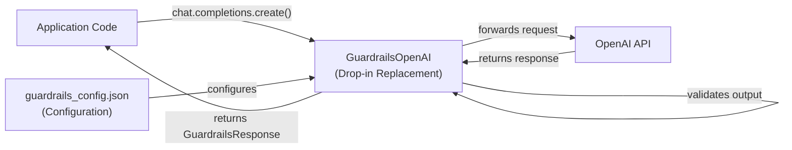
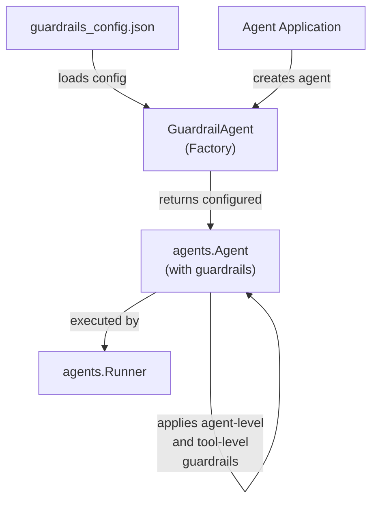
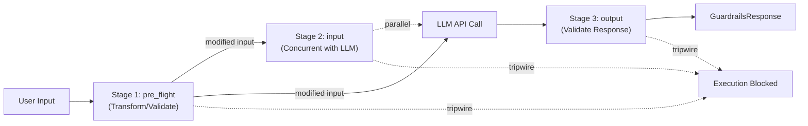
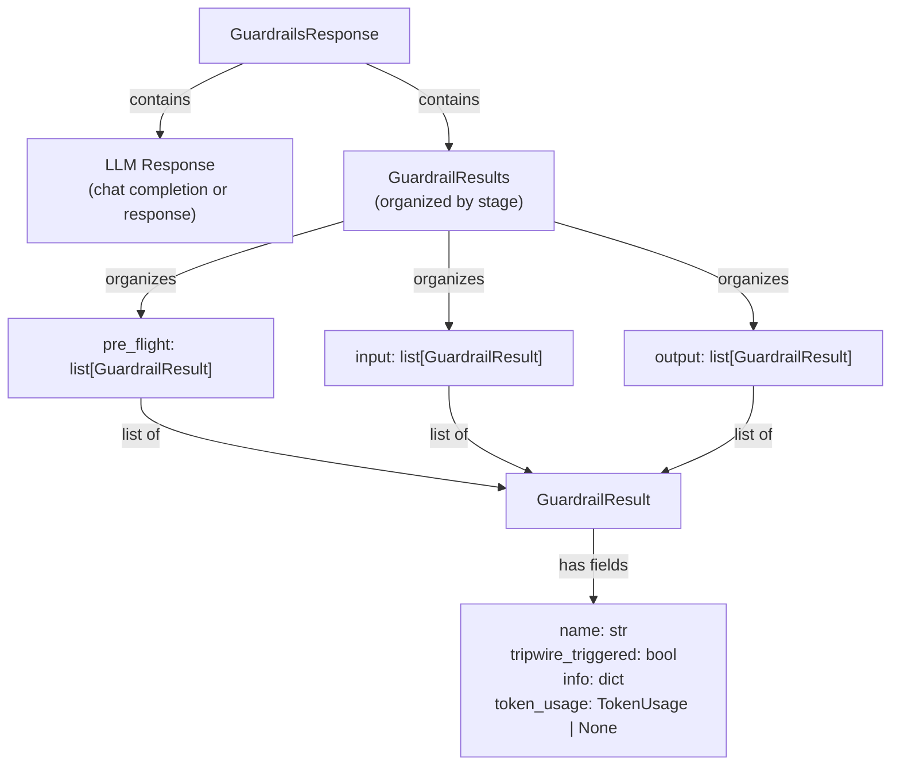
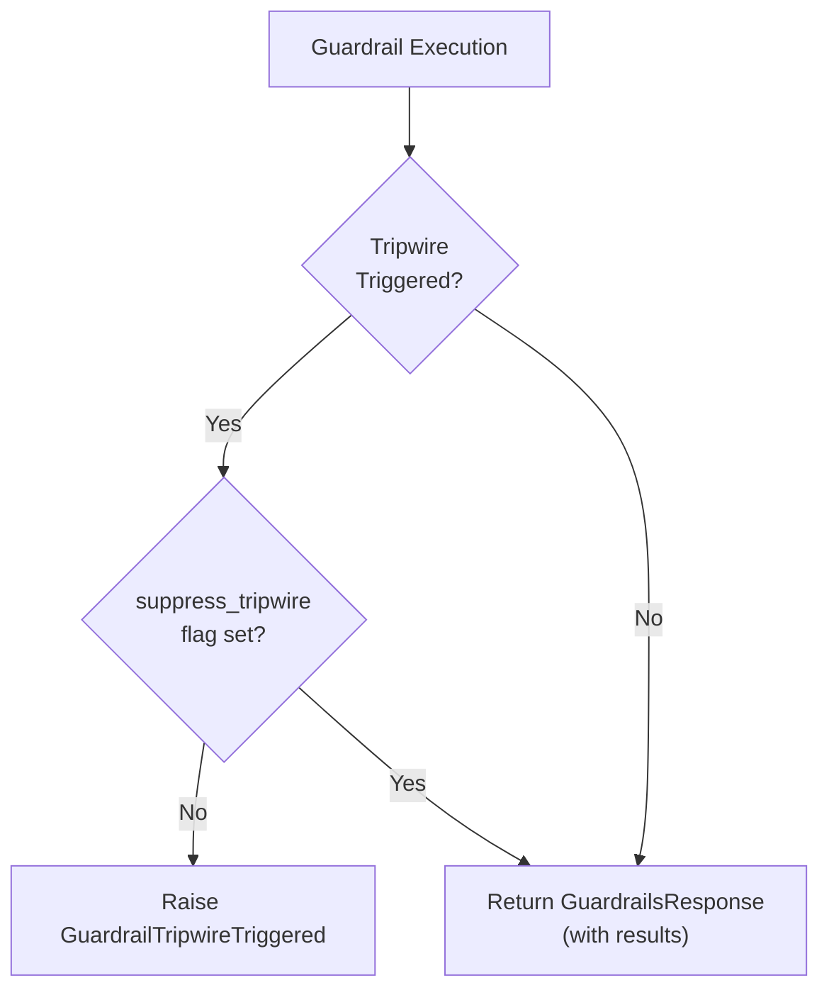

<!-- source: DeepWiki mcp.deepwiki.com · repo openai/openai-guardrails-python · page 1.1 What is OpenAI Guardrails · fetched 2026-10-26 -->

# What is OpenAI Guardrails

<details>
<summary>Relevant source files</summary>

The following files were used as context for generating this wiki page:

- [README.md](README.md)
- [docs/assets/images/guardrails-python-config-screenshot-100pct-q70.webp](docs/assets/images/guardrails-python-config-screenshot-100pct-q70.webp)
- [pyproject.toml](pyproject.toml)
- [src/guardrails/__init__.py](src/guardrails/__init__.py)

</details>


This document introduces the OpenAI Guardrails Python package, explaining its purpose, core value proposition, and primary integration patterns. For detailed architecture information, see [System Architecture](#1.2). For installation and configuration instructions, see [Installation and Setup](#1.3).

## Purpose and Scope

OpenAI Guardrails is a Python package that adds configurable safety and compliance validation to LLM applications. It provides drop-in replacement clients for the OpenAI Python SDK that automatically apply input and output guardrails to API calls. The package is distributed via PyPI as `openai-guardrails` and requires Python 3.11 or higher.

**Sources:** [pyproject.toml:1-16](), [README.md:1-6]()

## Core Value Proposition

OpenAI Guardrails functions as a **safety layer** that wraps OpenAI API interactions, enabling developers to:

- **Validate inputs** before they reach the LLM (e.g., detect prompt injection, jailbreak attempts, PII)
- **Validate outputs** after the LLM responds (e.g., detect hallucinations, NSFW content, off-topic responses)
- **Transform inputs** in pre-flight stages (e.g., mask PII before sending to LLM)
- **Configure guardrails declaratively** via JSON configuration files generated from a web portal
- **Apply guardrails without code changes** by replacing `OpenAI` with `GuardrailsOpenAI`

The package is designed to minimize integration effort while providing comprehensive safety coverage across multiple stages of LLM interactions.

**Sources:** [README.md:1-6](), [README.md:37-64]()

## Integration Patterns

### Conceptual Architecture



**Sources:** [README.md:37-64](), Diagram 1 from high-level architecture

### Drop-in Client Replacement

The primary integration pattern replaces the standard `OpenAI` client with `GuardrailsOpenAI`:

| Standard OpenAI Client | Guardrails Client |
|------------------------|-------------------|
| `from openai import OpenAI` | `from guardrails import GuardrailsOpenAI` |
| `client = OpenAI()` | `client = GuardrailsOpenAI(config=Path("config.json"))` |
| Returns `ChatCompletion` | Returns `GuardrailsResponse` with results |
| No validation | Automatic input/output validation |

The guardrails client exposes the same API surface as the standard OpenAI client, including:
- `client.chat.completions.create()` - Chat completions with guardrails
- `client.responses.create()` - Responses API with guardrails
- `client.responses.parse()` - Structured outputs with guardrails

**Sources:** [README.md:37-64](), [src/guardrails/__init__.py:16-21]()

### Agents SDK Integration

For applications using the OpenAI Agents SDK, guardrails integrate via the `GuardrailAgent` factory:



This pattern applies guardrails at two levels:
- **Agent-level**: Validates agent inputs and outputs
- **Tool-level**: Validates individual tool call inputs and outputs

**Sources:** [README.md:66-96](), [src/guardrails/__init__.py:15]()

## Key Code Entities

### Public API Surface

The package exposes the following primary interfaces from [src/guardrails/__init__.py:45-68]():

```mermaid
graph TB
    subgraph "Client Wrappers"
        GOA["GuardrailsOpenAI<br/>(sync client)"]
        GAOA["GuardrailsAsyncOpenAI<br/>(async client)"]
        GAZU["GuardrailsAzureOpenAI<br/>(Azure sync)"]
        GAAZU["GuardrailsAsyncAzureOpenAI<br/>(Azure async)"]
    end
    
    subgraph "Agent Integration"
        GAgent["GuardrailAgent<br/>(factory pattern)"]
    end
    
    subgraph "Result Types"
        GResult["GuardrailResult<br/>(single check result)"]
        GResults["GuardrailResults<br/>(organized by stage)"]
        GResponse["GuardrailsResponse<br/>(wraps LLM response)"]
    end
    
    subgraph "Exceptions"
        GTripwire["GuardrailTripwireTriggered<br/>(blocking error)"]
    end
    
    subgraph "Runtime Functions"
        RunGR["run_guardrails<br/>(execute checks)"]
        InstGR["instantiate_guardrails<br/>(load from config)"]
        LoadCB["load_config_bundle<br/>(parse config)"]
    end
    
    subgraph "Registry"
        Registry["default_spec_registry<br/>(built-in checks)"]
    end
    
    GOA -.uses.-> RunGR
    GAOA -.uses.-> RunGR
    GAgent -.uses.-> InstGR
    RunGR -.queries.-> Registry
    RunGR -.returns.-> GResults
    GOA -.returns.-> GResponse
    GResponse -.contains.-> GResults
    RunGR -.may raise.-> GTripwire
    InstGR -.uses.-> LoadCB
```

**Sources:** [src/guardrails/__init__.py:45-68]()

### Configuration-Driven Architecture

Guardrails are configured via JSON files rather than programmatic API calls:

| Component | Purpose | Code Reference |
|-----------|---------|----------------|
| `guardrails_config.json` | Defines which guardrails to apply in which stages | Generated from portal |
| `ConfigSource` | Type alias for config input (Path, dict, or str) | [src/guardrails/__init__.py:59]() |
| `load_config_bundle` | Parses JSON config into internal structures | [src/guardrails/__init__.py:63]() |
| `default_spec_registry` | Registry mapping guardrail names to implementations | [src/guardrails/__init__.py:65]() |
| `GuardrailSpecMetadata` | Metadata describing guardrail capabilities | [src/guardrails/__init__.py:61]() |

Users typically generate configuration files from the web portal at `guardrails.openai.com`, which produces JSON files specifying:
- Which guardrails to enable
- Configuration parameters for each guardrail
- Pipeline stage assignments (pre_flight, input, output)

**Sources:** [README.md:5-6](), [src/guardrails/__init__.py:32-43]()

## Execution Model

### Three-Stage Pipeline

Guardrails execute in a three-stage pipeline that processes requests before and after LLM calls:



Each stage serves a distinct purpose:

| Stage | Purpose | Example Guardrails | Execution Pattern |
|-------|---------|-------------------|-------------------|
| **pre_flight** | Input transformation before validation | PII masking, URL filtering | Sequential, may modify input |
| **input** | Input validation | Prompt injection, jailbreak, moderation | Concurrent with LLM call |
| **output** | Output validation | Hallucination detection, NSFW text | Sequential after LLM response |

If any guardrail triggers a tripwire (violation threshold exceeded), a `GuardrailTripwireTriggered` exception is raised unless suppressed with `suppress_tripwire=True`.

**Sources:** Diagram 2 from high-level architecture, [README.md:48-64]()

### Result Aggregation

All guardrail execution results are aggregated into structured types:



Users can inspect `response.guardrail_results` to examine which guardrails executed, whether they triggered, and detailed information about each check.

**Sources:** [src/guardrails/__init__.py:16-21](), [src/guardrails/__init__.py:48-49]()

## Built-in Guardrails

The package includes nine built-in guardrails categorized by execution engine:

### API-Based Guardrails

These guardrails call external APIs for specialized validation:

| Guardrail | Purpose | External Service |
|-----------|---------|------------------|
| **Moderation** | Content moderation across 13 categories | OpenAI Moderation API |
| **URL Filter** | Domain allowlist/blocklist validation | None (local logic) |
| **Contains PII** | Personally Identifiable Information detection | Presidio framework |

### LLM-Based Guardrails

These guardrails use language models for nuanced analysis:

| Guardrail | Purpose | Multi-turn Aware |
|-----------|---------|------------------|
| **Jailbreak** | Detects jailbreak attempts across 7 techniques | Yes |
| **NSFW Text** | Detects workplace-inappropriate content | No |
| **Hallucination Detection** | Validates responses against vector stores | No |
| **Prompt Injection** | Detects tool call manipulation attempts | Yes |
| **Off Topic Prompts** | Ensures topical alignment with business scope | Yes |
| **User-defined LLM** | Custom moderation with user-provided prompts | Configurable |

All LLM-based guardrails share common infrastructure from the `llm_base` module and support conversation-aware analysis when applicable.

**Sources:** [README.md:183-195](), Diagram 4 from high-level architecture

## Error Handling

Guardrails can block execution by raising `GuardrailTripwireTriggered` exceptions:



This allows applications to:
- **Block unsafe requests** by catching exceptions (default behavior)
- **Log violations gracefully** by setting `suppress_tripwire=True` and inspecting results
- **Implement custom policies** by examining `guardrail_results.tripwire_triggered`

**Sources:** [README.md:48-64](), [src/guardrails/__init__.py:30]()

## Evaluation Framework

The package includes an evaluation framework for testing guardrail performance:

| Component | Purpose | Code Reference |
|-----------|---------|----------------|
| `guardrails-evals` CLI | Command-line evaluation tool | [pyproject.toml:80]() |
| `GuardrailEval` class | Programmatic evaluation API | [README.md:133-147]() |
| JSONL datasets | Labeled test data with expected triggers | [README.md:117-131]() |
| Benchmark mode | Multi-model comparison with ROC curves | [README.md:109-115]() |

This enables developers to systematically test guardrails against labeled datasets and measure performance metrics like precision, recall, ROC AUC, and latency.

**Sources:** [README.md:97-147](), [pyproject.toml:78-80]()

## Summary

OpenAI Guardrails provides a **configuration-driven safety layer** for LLM applications with three primary characteristics:

1. **Drop-in Integration**: Replace `OpenAI` with `GuardrailsOpenAI` with minimal code changes
2. **Multi-Stage Validation**: Apply guardrails in pre_flight, input, and output stages
3. **Declarative Configuration**: Define guardrails via JSON files generated from web portal

The package exposes a focused public API through `GuardrailsOpenAI`, `GuardrailsAsyncOpenAI`, `GuardrailAgent`, and related types, enabling developers to add comprehensive safety coverage to LLM applications without extensive refactoring.

For implementation details, see [System Architecture](#1.2). For usage instructions, see [Getting Started](#2).

**Sources:** [README.md:1-206](), [src/guardrails/__init__.py:1-77](), [pyproject.toml:1-130]()

---

