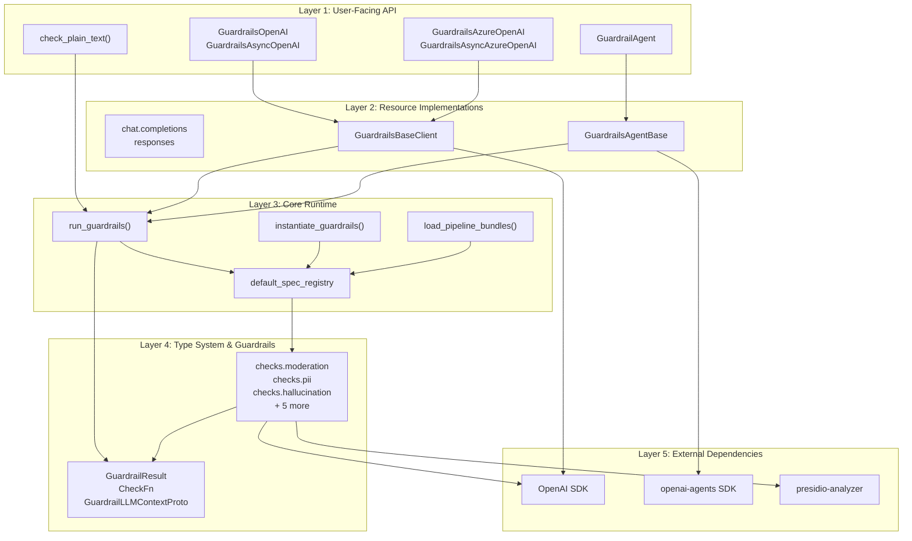
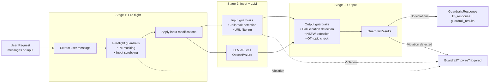
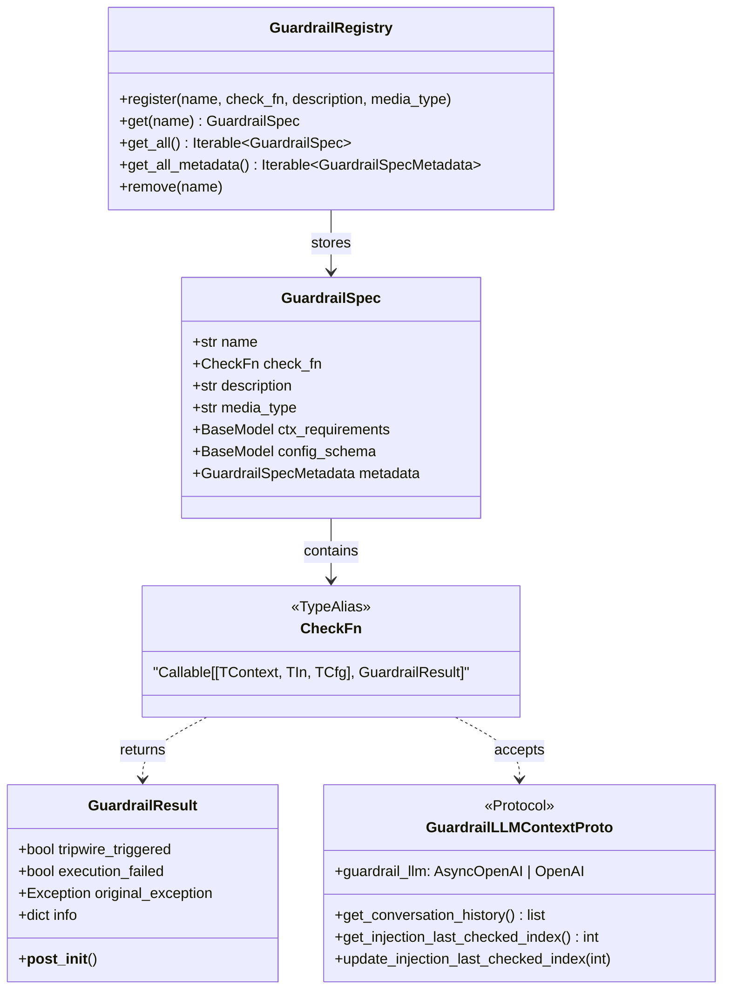
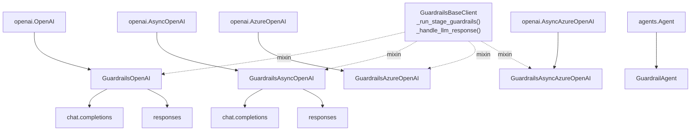
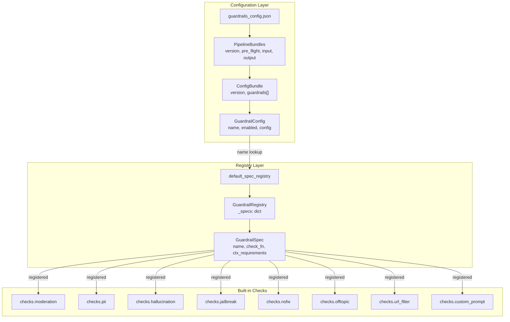
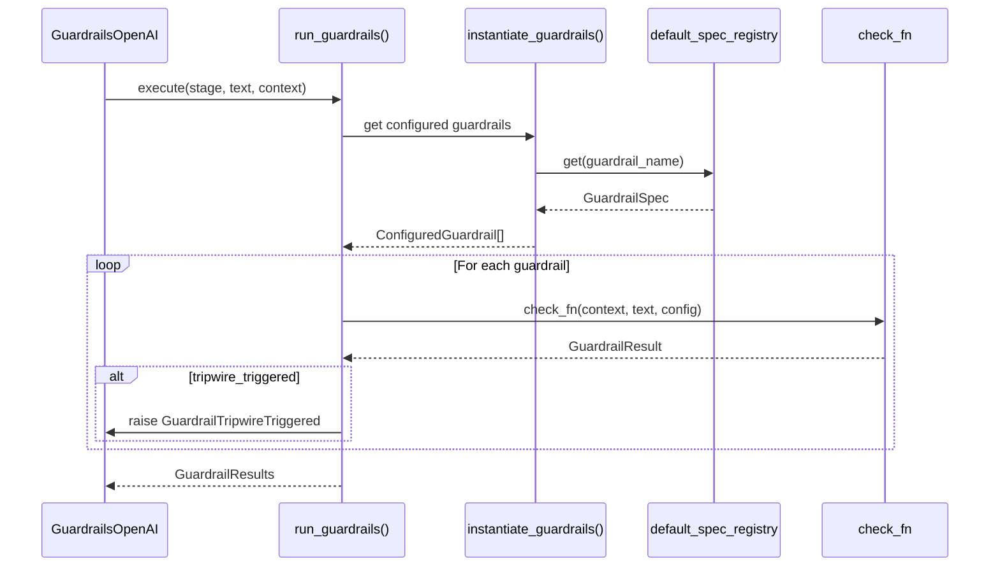
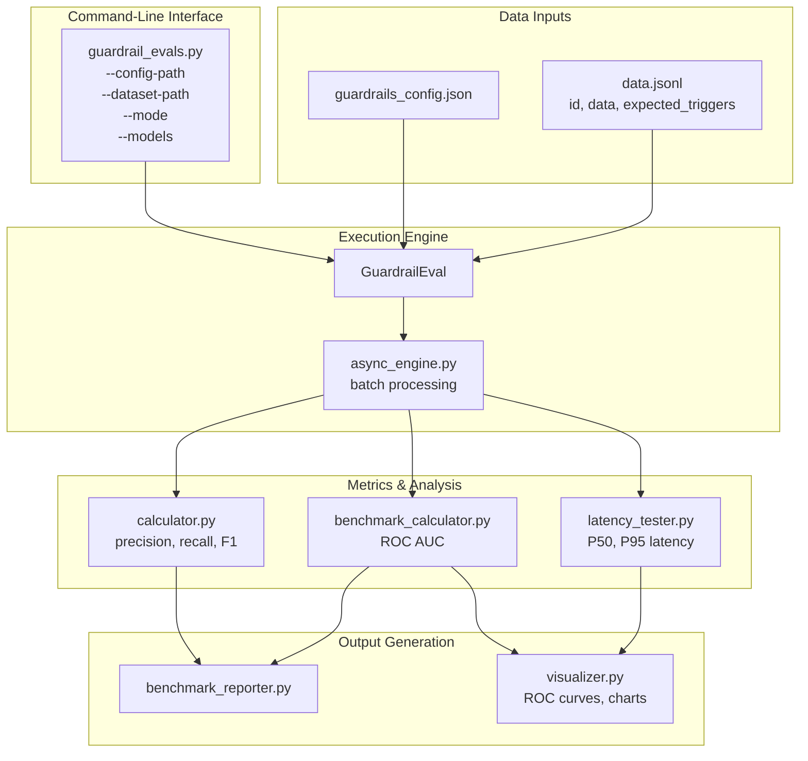

<!-- source: DeepWiki mcp.deepwiki.com · repo openai/openai-guardrails-python · page 1.2 System Architecture · fetched 2026-10-26 -->

# System Architecture

<details>
<summary>Relevant source files</summary>

The following files were used as context for generating this wiki page:

- [examples/basic/agents_sdk.py](examples/basic/agents_sdk.py)
- [pyproject.toml](pyproject.toml)
- [src/guardrails/__init__.py](src/guardrails/__init__.py)
- [src/guardrails/_streaming.py](src/guardrails/_streaming.py)
- [src/guardrails/agents.py](src/guardrails/agents.py)
- [src/guardrails/resources/chat/chat.py](src/guardrails/resources/chat/chat.py)
- [src/guardrails/resources/responses/responses.py](src/guardrails/resources/responses/responses.py)
- [tests/unit/test_agents.py](tests/unit/test_agents.py)
- [tests/unit/test_context.py](tests/unit/test_context.py)

</details>


## Purpose and Scope

This document describes the high-level architecture of the OpenAI Guardrails Python framework. It covers the layered design, core execution pipeline, type system, client integration patterns, and major subsystems. The architecture enables drop-in replacement of OpenAI clients with guardrail-enhanced variants while maintaining API compatibility.

For installation instructions, see [Installation and Setup](#1.3). For detailed pipeline execution behavior, see [Three-Stage Pipeline Architecture](#3.1). For guardrail implementation details, see [Built-in Guardrails](#6).

---

## Architectural Layers

The system is organized into five primary layers, from user-facing APIs down to external dependencies:



**Sources:** [README.md:1-204](), [src/guardrails/__init__.py:1-76](), [pyproject.toml:1-111]()

---

## Three-Stage Pipeline Architecture

The core architectural pattern is a **three-stage validation pipeline** that processes user requests through sequential guardrail checkpoints:



### Pipeline Stages

| Stage | Execution Timing | Purpose | Typical Guardrails |
|-------|-----------------|---------|-------------------|
| **pre_flight** | Before LLM call | Modify input, sanitize data | PII masking |
| **input** | Concurrent with LLM call | Validate input safety | Jailbreak detection, URL filter, Moderation |
| **output** | After LLM response | Validate output quality | Hallucination detection, NSFW, Off-topic |

**Concurrency optimization**: Input guardrails execute in parallel with the LLM API call using `ThreadPoolExecutor` (sync) or `asyncio.gather()` (async) to minimize added latency. Pre-flight and output stages execute sequentially.

**Sources:** [README.md:34-92](), Diagram 2 from high-level diagrams

---

## Type System and Core Contracts

The type system defines contracts for guardrail functions and their execution context:



### Core Type Definitions

**`GuardrailResult`** [src/guardrails/types.py:60-90]()
- Immutable dataclass representing guardrail check outcome
- `tripwire_triggered`: Boolean indicating policy violation
- `execution_failed`: Set when check encounters technical failure
- `info`: Dictionary for diagnostic metadata

**`CheckFn`** [src/guardrails/types.py:96]()
- Type alias: `Callable[[TContext, TIn, TCfg], GuardrailResult | Awaitable[GuardrailResult]]`
- Supports both synchronous and asynchronous implementations
- Generic over context, input, and configuration types

**`GuardrailLLMContextProto`** [src/guardrails/types.py:30-58]()
- Protocol defining required context attributes
- Provides access to `guardrail_llm` (OpenAI client)
- Enables conversation history access for stateful guardrails

**Sources:** [src/guardrails/types.py:1-109](), [tests/unit/test_registry.py:25-48]()

---

## Client Integration Layer

The client integration layer provides drop-in replacements for OpenAI SDK clients. These wrappers inherit from OpenAI base classes and intercept API calls to inject guardrail validation.

### Client Class Hierarchy



### Public API Surface

The package exposes four OpenAI client variants:

| Client Class | Base Class | Purpose |
|--------------|------------|---------|
| `GuardrailsOpenAI` | `openai.OpenAI` | Synchronous standard OpenAI API |
| `GuardrailsAsyncOpenAI` | `openai.AsyncOpenAI` | Asynchronous standard OpenAI API |
| `GuardrailsAzureOpenAI` | `openai.AzureOpenAI` | Synchronous Azure OpenAI |
| `GuardrailsAsyncAzureOpenAI` | `openai.AsyncAzureOpenAI` | Asynchronous Azure OpenAI |

All clients accept a `config` parameter (path or dict) specifying pipeline guardrails.

**`GuardrailAgent`** [src/guardrails/__init__.py:15]()
- Drop-in replacement for `agents.Agent` from OpenAI Agents SDK
- Supports tool-level and agent-level guardrails
- Raises `InputGuardrailTripwireTriggered` / `OutputGuardrailTripwireTriggered`

**Sources:** [src/guardrails/__init__.py:14-27](), [README.md:34-92]()

---

## Registry and Configuration System

The registry pattern enables dynamic guardrail lookup and instantiation from declarative configuration files.



### Registry Components

**`GuardrailRegistry`** [src/guardrails/__init__.py:31]()
- Singleton pattern via `default_spec_registry`
- Methods: `register()`, `get()`, `get_all()`, `remove()`
- Stores `GuardrailSpec` instances by name
- Validates media types and prevents duplicate registration

**`GuardrailSpec`** [tests/unit/test_registry.py:122-124]()
- Encapsulates guardrail metadata and implementation
- Contains `check_fn`, `ctx_requirements`, `config_schema`
- Generated via introspection of type hints

### Configuration Loading

**`load_pipeline_bundles()`** [src/guardrails/__init__.py:39]()
- Loads `guardrails_config.json` into `PipelineBundles` structure
- Returns three `ConfigBundle` instances (pre_flight, input, output)
- Validates JSON schema and guardrail name references

**`load_config_bundle()`** [src/guardrails/__init__.py:38]()
- Loads single-stage configuration for standalone usage

**Sources:** [src/guardrails/__init__.py:31-41](), [tests/unit/test_registry.py:89-131]()

---

## Runtime Execution Engine

The runtime engine instantiates and executes guardrails based on loaded configuration:



### Runtime Functions

**`run_guardrails()`** [src/guardrails/__init__.py:40]()
- Core execution orchestrator
- Accepts `ConfiguredGuardrail[]`, context, input, stage
- Executes guardrails sequentially
- Returns `GuardrailResults` or raises `GuardrailTripwireTriggered`

**`instantiate_guardrails()`** [src/guardrails/__init__.py:40]()
- Factory function for creating `ConfiguredGuardrail` instances
- Resolves guardrail names via registry lookup
- Validates configuration against guardrail schema
- Injects context requirements

**`check_plain_text()`** [src/guardrails/__init__.py:36]()
- Utility for standalone text validation
- Bypasses client integration layer
- Useful for testing and simple use cases

**`ConfiguredGuardrail`** [src/guardrails/__init__.py:34]()
- Wrapper combining `GuardrailSpec` with configuration
- Executable object with bound context and config

**Sources:** [src/guardrails/__init__.py:32-41](), [src/guardrails/types.py:60-109]()

---

## Built-in Guardrails Module

The `checks` submodule contains eight built-in guardrail implementations:

| Guardrail | File | Purpose | Stage |
|-----------|------|---------|-------|
| **Moderation** | `checks.moderation` | OpenAI moderation API integration | input |
| **URL Filter** | `checks.url_filter` | Domain allowlist/blocklist enforcement | input |
| **Contains PII** | `checks.pii` | PII detection via Presidio | pre_flight |
| **Hallucination Detection** | `checks.hallucination` | Vector store verification | output |
| **Jailbreak** | `checks.jailbreak` | Prompt injection detection | input |
| **NSFW Text** | `checks.nsfw` | Workplace-inappropriate content | output |
| **Off Topic Prompts** | `checks.offtopic` | Business scope validation | input/output |
| **Custom Prompt Check** | `checks.custom_prompt` | LLM-based custom rules | any |

All guardrails conform to the `CheckFn` type signature and return `GuardrailResult`.

**Sources:** [README.md:181-193](), [src/guardrails/__init__.py:14]()

---

## Evaluation Infrastructure

The evaluation subsystem provides comprehensive testing and benchmarking capabilities:



### Evaluation Modes

**Evaluation Mode**
- Basic metrics: precision, recall, F1 score
- Single configuration testing
- Output: `eval_results_*.jsonl`, `eval_metrics.json`

**Benchmark Mode**
- Multi-model comparison
- ROC AUC and precision@recall metrics
- Latency analysis (P50, P95 time-to-content)
- Output: ROC curves, performance charts, summary tables

**Dataset Format** [README.md:117-128]()
```json
{
  "id": "sample_1",
  "data": "Text or conversation",
  "expected_triggers": {
    "Moderation": true,
    "NSFW Text": false
  }
}
```

**Sources:** [README.md:95-145](), [pyproject.toml:38-44]()

---

## Package Distribution and Dependencies

### Package Structure

```
openai-guardrails/
├── src/guardrails/          # Main package
│   ├── __init__.py          # Public API surface
│   ├── types.py             # Type definitions
│   ├── registry.py          # Guardrail registry
│   ├── runtime.py           # Execution engine
│   ├── client.py            # OpenAI client wrappers
│   ├── agents.py            # Agent integration
│   ├── checks/              # Built-in guardrails
│   └── evals/               # Evaluation framework
├── tests/                   # Test suite
├── examples/                # Usage examples
└── docs/                    # Documentation
```

### Dependencies

**Core Dependencies** [pyproject.toml:9-15]()
- `openai>=1.75.0` - OpenAI Python SDK
- `pydantic>=2.11.3` - Configuration validation
- `openai-agents>=0.3.3` - Agents SDK integration
- `presidio-analyzer>=2.2.358` - PII detection

**Optional Extras**
- `[examples]` - Rich console, Pillow for demo scripts
- `[benchmark]` - NumPy, scikit-learn, matplotlib for evaluation

### CLI Entrypoint

[pyproject.toml:76-77]()
```toml
[project.scripts]
guardrails = "guardrails.cli:main"
```

### PyPI Distribution

- Package name: `openai-guardrails`
- Installation: `pip install openai-guardrails`
- Published via GitHub Actions on release

**Sources:** [pyproject.toml:1-111](), [README.md:7-31]()

---

## Summary

The OpenAI Guardrails architecture is built on five key principles:

1. **Drop-in Replacement**: Client wrappers inherit from OpenAI SDK classes for seamless integration
2. **Three-Stage Pipeline**: Pre-flight, input, and output stages provide comprehensive validation
3. **Type-Safe Contracts**: Protocol-based design enables extensibility while maintaining type safety
4. **Registry Pattern**: Dynamic guardrail lookup from declarative configuration
5. **Comprehensive Testing**: Built-in evaluation framework for data-driven optimization

This architecture enables organizations to add safety guardrails to existing LLM applications with minimal code changes while maintaining full control over validation policies and error handling behavior.

---

