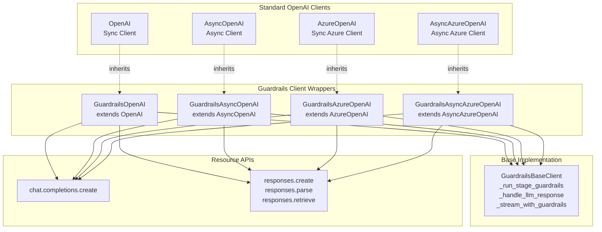
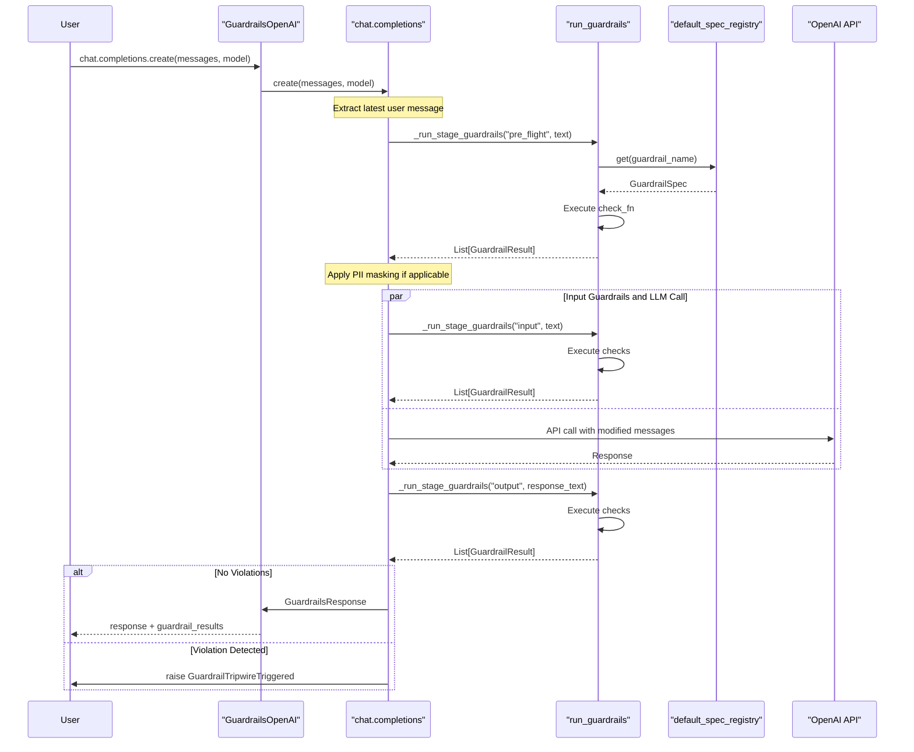
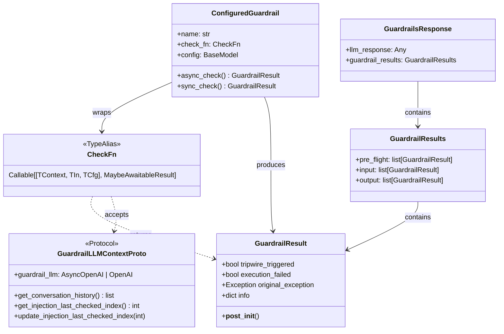
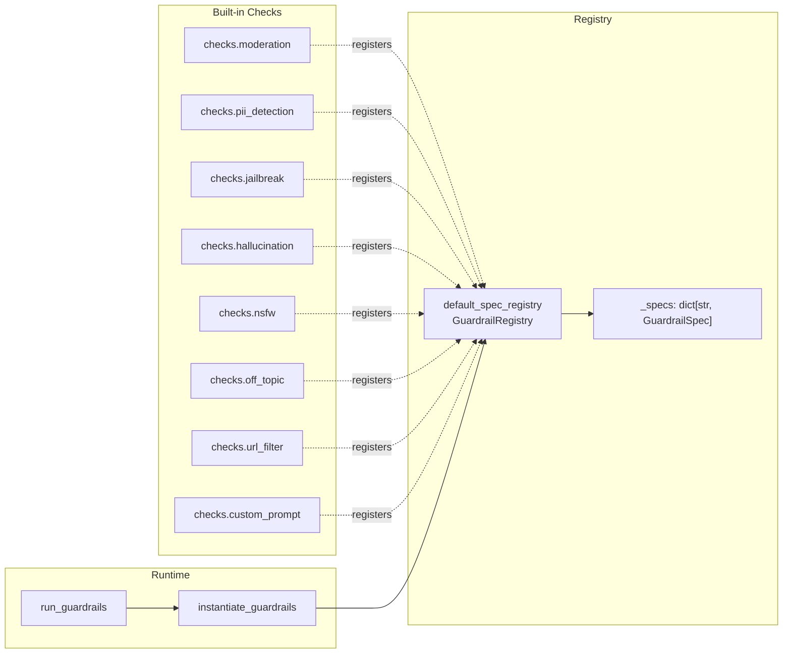
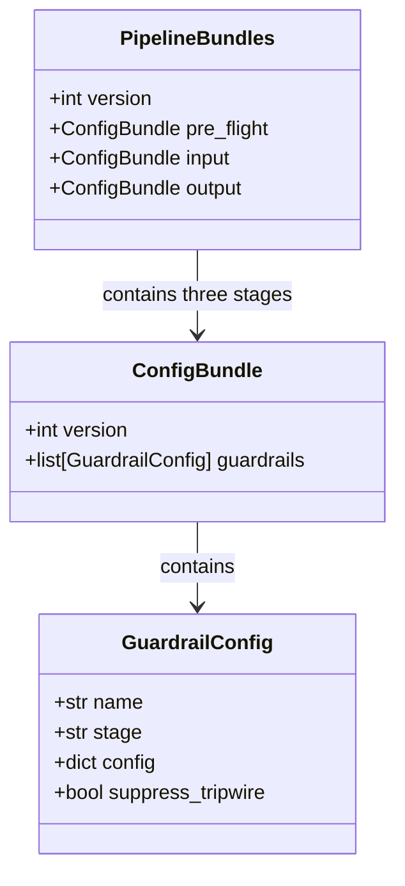
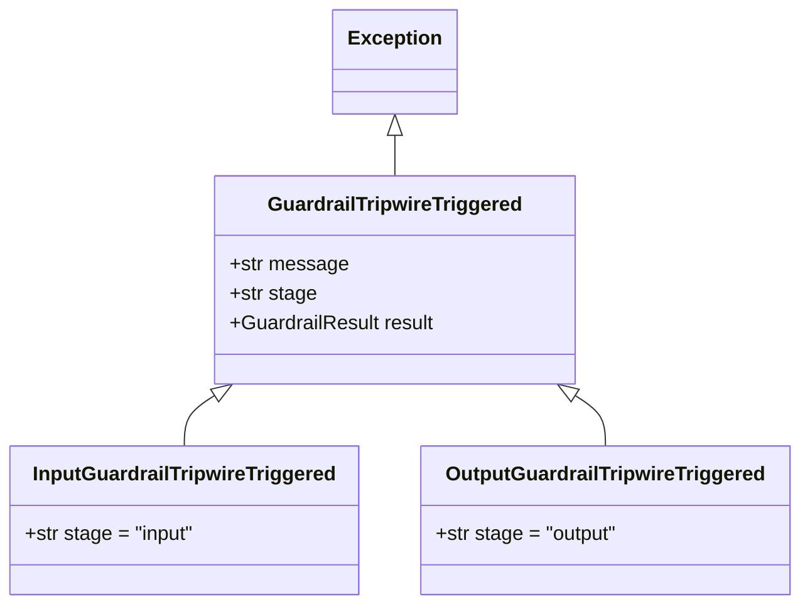
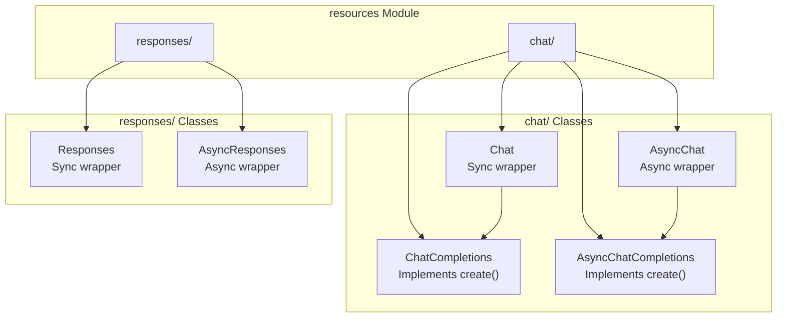

<!-- source: DeepWiki mcp.deepwiki.com · repo openai/openai-guardrails-python · page 10 API Reference · fetched 2026-10-26 -->

# API Reference

<details>
<summary>Relevant source files</summary>

The following files were used as context for generating this wiki page:

- [pyproject.toml](pyproject.toml)
- [src/guardrails/__init__.py](src/guardrails/__init__.py)

</details>


This page provides a comprehensive reference for the public API surface of the `openai-guardrails` package. It documents all classes, functions, types, and modules exported from the top-level `guardrails` package.

For detailed documentation of specific API categories:
- Public API exports and module structure: [Public API Surface](#10.1)
- Runtime execution functions: [Runtime Utilities](#10.2)
- Type definitions and protocols: [Type Definitions](#10.3)
- Configuration data structures: [Configuration Schema](#10.4)
- Exception types: [Exception Types](#10.5)

For usage patterns and examples:
- Client integration patterns: [Client Integration](#4)
- Agent SDK integration: [Agent Integration](#5)
- Built-in guardrail implementations: [Built-in Guardrails](#6)

---

## Package Structure

The `guardrails` package is organized into several functional layers, with a carefully designed public API surface that exposes only the essential interfaces for users.

```mermaid
graph TB
    subgraph "guardrails Package"
        Init["__init__.py<br/>Public API Surface"]
        
        subgraph "Client Layer"
            Client["client.py<br/>GuardrailsOpenAI<br/>GuardrailsAsyncOpenAI<br/>GuardrailsAzureOpenAI<br/>GuardrailsAsyncAzureOpenAI"]
            BaseClient["_base_client.py<br/>GuardrailsBaseClient"]
            Agents["agents.py<br/>GuardrailAgent"]
        end
        
        subgraph "Runtime Layer"
            Runtime["runtime.py<br/>run_guardrails<br/>instantiate_guardrails<br/>check_plain_text<br/>load_config_bundle<br/>load_pipeline_bundles"]
        end
        
        subgraph "Type System"
            Types["types.py<br/>GuardrailResult<br/>CheckFn<br/>GuardrailLLMContextProto"]
            Spec["spec.py<br/>GuardrailSpec<br/>GuardrailSpecMetadata"]
        end
        
        subgraph "Registry & Checks"
            Registry["registry.py<br/>GuardrailRegistry<br/>default_spec_registry"]
            Checks["checks/<br/>Built-in Guardrails"]
        end
        
        subgraph "Resources"
            Resources["resources/<br/>chat/<br/>responses/"]
            Chat["chat.py<br/>Chat<br/>ChatCompletions"]
            Responses["responses.py<br/>Responses"]
        end
        
        subgraph "Configuration & Exceptions"
            Exceptions["exceptions.py<br/>GuardrailTripwireTriggered"]
            Config["config.py<br/>ConfigBundle<br/>PipelineBundles"]
        end
    end
    
    Init --> Client
    Init --> Agents
    Init --> Runtime
    Init --> Types
    Init --> Registry
    Init --> Checks
    Init --> Resources
    Init --> Exceptions
    Init --> Spec
    
    Client --> BaseClient
    BaseClient --> Runtime
    BaseClient --> Registry
    Resources --> Chat
    Resources --> Responses
    Chat --> BaseClient
    Responses --> BaseClient
    Agents --> BaseClient
    Runtime --> Registry
    Runtime --> Config
```

**Sources:** [src/guardrails/__init__.py:1-76]()

---

## API Categories

The public API is organized into six major categories:

| Category | Exports | Purpose |
|----------|---------|---------|
| **Client APIs** | `GuardrailsOpenAI`, `GuardrailsAsyncOpenAI`, `GuardrailsAzureOpenAI`, `GuardrailsAsyncAzureOpenAI` | Drop-in replacements for OpenAI client classes with guardrail integration |
| **Agent Integration** | `GuardrailAgent` | Drop-in replacement for OpenAI Agents SDK `Agent` class |
| **Runtime Utilities** | `run_guardrails`, `instantiate_guardrails`, `check_plain_text`, `load_config_bundle`, `load_pipeline_bundles` | Functions for direct guardrail execution and configuration loading |
| **Type System** | `GuardrailResult`, `GuardrailResults`, `GuardrailsResponse`, `ConfiguredGuardrail`, `JsonString`, `ConfigSource` | Core data types and protocols |
| **Registry & Metadata** | `default_spec_registry`, `GuardrailSpecMetadata` | Guardrail registration and discovery |
| **Built-in Checks** | `checks` (submodule) | Access to built-in guardrail implementations |
| **Exceptions** | `GuardrailTripwireTriggered` | Exception raised when guardrails detect violations |
| **Resources** | `resources` (submodule) | Direct access to resource class implementations |

**Sources:** [src/guardrails/__init__.py:45-67]()

---

## Public Exports

The following table lists all symbols exported from `guardrails.__init__.py`:

| Symbol | Type | Description |
|--------|------|-------------|
| `GuardrailsOpenAI` | Class | Synchronous OpenAI client with guardrails |
| `GuardrailsAsyncOpenAI` | Class | Asynchronous OpenAI client with guardrails |
| `GuardrailsAzureOpenAI` | Class | Synchronous Azure OpenAI client with guardrails |
| `GuardrailsAsyncAzureOpenAI` | Class | Asynchronous Azure OpenAI client with guardrails |
| `GuardrailAgent` | Class | Agent class with guardrails for OpenAI Agents SDK |
| `GuardrailsResponse` | Class | Response wrapper containing LLM output and guardrail results |
| `GuardrailResults` | Class | Collection of guardrail results organized by pipeline stage |
| `GuardrailResult` | Dataclass | Result from a single guardrail check |
| `GuardrailTripwireTriggered` | Exception | Exception raised when guardrail detects violation |
| `ConfiguredGuardrail` | Class | Configured, executable guardrail instance |
| `GuardrailSpecMetadata` | Dataclass | Metadata describing a guardrail specification |
| `run_guardrails` | Function | Execute a list of guardrails against input |
| `instantiate_guardrails` | Function | Factory function to create guardrail instances |
| `check_plain_text` | Function | Validate plain text against guardrails |
| `load_config_bundle` | Function | Load guardrail configuration from file or dict |
| `load_pipeline_bundles` | Function | Load three-stage pipeline configuration |
| `ConfigSource` | TypeAlias | Union type for configuration sources |
| `JsonString` | TypeAlias | String type for JSON configuration |
| `default_spec_registry` | Object | Global registry of built-in guardrails |
| `checks` | Module | Submodule containing built-in guardrail implementations |
| `resources` | Module | Submodule containing resource class implementations |
| `__version__` | String | Package version from metadata |

**Sources:** [src/guardrails/__init__.py:1-76]()

---

## Client API Surface

The client APIs provide drop-in replacements for OpenAI's standard client classes. All four client variants inherit from a common base implementation and expose the same guardrail integration points.



### Client Classes

All four client classes share the same constructor signature, accepting:
- Standard OpenAI client initialization parameters
- `config_path` (str | Path | None): Path to `guardrails_config.json`
- `config_bundles` (PipelineBundles | None): Pre-loaded configuration object
- `suppress_tripwire` (bool): Global fail-safe mode override

**Sources:** [src/guardrails/__init__.py:16-27](), [src/guardrails/client.py]()

### Resource Methods

Each client exposes two resource namespaces:

**chat.completions**
- `create(messages, model, stream, suppress_tripwire, **kwargs)`: Create chat completion with guardrails

**responses**
- `create(input, model, stream, tools, suppress_tripwire, **kwargs)`: Create response with guardrails
- `parse(input, model, text_format, suppress_tripwire, **kwargs)`: Parse structured response with guardrails
- `retrieve(response_id, suppress_tripwire, **kwargs)`: Retrieve response with output validation

**Sources:** [src/guardrails/resources/chat/chat.py:64-115](), [src/guardrails/resources/responses/responses.py:24-145]()

---

## Runtime Execution Flow

The following diagram illustrates how API calls flow through the guardrails system:



**Sources:** [src/guardrails/resources/chat/chat.py:64-115](), [src/guardrails/_base_client.py]()

---

## Type System Architecture

The type system defines the core interfaces for implementing and executing guardrails:



### Core Types

**GuardrailResult**
- Immutable dataclass representing the outcome of a guardrail check
- Fields: `tripwire_triggered`, `execution_failed`, `original_exception`, `info`
- Validation ensures consistency between `execution_failed` and `original_exception`

**CheckFn**
- Type alias: `Callable[[TContext, TIn, TCfg], MaybeAwaitableResult]`
- Defines the signature for all guardrail functions
- May return `GuardrailResult` or `Awaitable[GuardrailResult]`

**GuardrailLLMContextProto**
- Protocol defining the context interface for guardrails that need LLM access
- Required attribute: `guardrail_llm` (OpenAI client instance)
- Optional methods: `get_conversation_history()`, `get_injection_last_checked_index()`, `update_injection_last_checked_index()`

**Sources:** [src/guardrails/types.py:1-109]()

---

## Registry System

The registry system manages guardrail registration and discovery:



### Registry API

**default_spec_registry**
- Global singleton instance of `GuardrailRegistry`
- Pre-populated with all built-in guardrails
- Accessible via `guardrails.default_spec_registry`

**GuardrailRegistry Methods**
- `register(name, check_fn, description, media_type, metadata)`: Register a guardrail
- `get(name)`: Retrieve a `GuardrailSpec` by name
- `get_all()`: Iterate over all registered specs
- `get_all_metadata()`: Iterate over all metadata objects
- `remove(name)`: Unregister a guardrail

**Sources:** [src/guardrails/__init__.py:31-32](), [src/guardrails/registry.py](), [tests/unit/test_registry.py:89-131]()

---

## Runtime Utilities

The runtime utilities provide functions for direct guardrail execution without using the client wrappers:

| Function | Signature | Purpose |
|----------|-----------|---------|
| `run_guardrails` | `(guardrails, text, context, suppress_tripwire) -> list[GuardrailResult]` | Execute a list of guardrails against input text |
| `instantiate_guardrails` | `(config_list, registry) -> list[ConfiguredGuardrail]` | Create guardrail instances from configuration |
| `check_plain_text` | `(text, config_path, stage) -> list[GuardrailResult]` | Simple text validation utility |
| `load_config_bundle` | `(source) -> ConfigBundle` | Load configuration from file or dict |
| `load_pipeline_bundles` | `(source) -> PipelineBundles` | Load three-stage pipeline configuration |

**Type Aliases**
- `ConfigSource = str | Path | dict | ConfigBundle`
- `JsonString = str` (JSON-encoded configuration string)

**Sources:** [src/guardrails/__init__.py:32-41](), [src/guardrails/runtime.py]()

---

## Configuration Data Structures

The configuration system uses strongly-typed Pydantic models:



These structures map directly to the `guardrails_config.json` schema. See [Configuration Schema](#10.4) for detailed field documentation.

**Sources:** [src/guardrails/config.py]()

---

## Exception Hierarchy

The guardrails system defines a single exception type for policy violations:



**GuardrailTripwireTriggered**
- Base exception raised when a guardrail detects a violation
- Available attributes: `message`, `stage`, `result`
- Raised by default unless `suppress_tripwire=True`

**Specialized Variants**
- `InputGuardrailTripwireTriggered`: Raised by agent input guardrails
- `OutputGuardrailTripwireTriggered`: Raised by agent output guardrails

See [Exception Types](#10.5) for detailed documentation.

**Sources:** [src/guardrails/__init__.py:30](), [src/guardrails/exceptions.py]()

---

## Built-in Checks Module

The `checks` submodule provides access to all built-in guardrail implementations:

| Check | Module | Purpose |
|-------|--------|---------|
| Moderation | `checks.moderation` | OpenAI Moderation API integration |
| PII Detection | `checks.pii_detection` | Detect and mask personally identifiable information |
| Jailbreak Detection | `checks.jailbreak` | Detect jailbreak attempts using LLM classification |
| Hallucination Detection | `checks.hallucination` | Verify outputs against source documents using vector search |
| NSFW Detection | `checks.nsfw` | Detect NSFW text content |
| Off-Topic Detection | `checks.off_topic` | Detect off-topic prompts |
| URL Filter | `checks.url_filter` | Block or validate URLs in input |
| Custom Prompt | `checks.custom_prompt` | User-defined LLM-based validation |

Each check is automatically registered with `default_spec_registry` on import. See [Built-in Guardrails](#6) for detailed documentation of each check's configuration and behavior.

**Sources:** [src/guardrails/__init__.py:14](), [src/guardrails/checks/]()

---

## Resources Module

The `resources` submodule contains the implementation classes for API resources:



These classes are internal implementation details but are exposed via the `resources` module for advanced use cases. Typical users should use the client APIs instead.

**Sources:** [src/guardrails/__init__.py:29](), [src/guardrails/resources/]()

---

## Version Information

The package version is available as `guardrails.__version__`, automatically populated from package metadata at import time.

```python
import guardrails

print(guardrails.__version__)  # e.g., "0.1.0"
```

**Sources:** [src/guardrails/__init__.py:69](), [pyproject.toml:1-3]()

---

## Import Optimization

The `guardrails` package uses lazy loading for optional dependencies to minimize import overhead. Azure OpenAI clients are only available if the Azure extras are installed:

```python
from guardrails import GuardrailsAzureOpenAI, GuardrailsAsyncAzureOpenAI

# If Azure is not available, these will be None
if GuardrailsAzureOpenAI is None:
    raise ImportError("Azure OpenAI support requires azure extras")
```

**Sources:** [src/guardrails/__init__.py:23-27]()

---

## Logging

The package configures a `NullHandler` to prevent interfering with application logging:

```python
import logging

# Get module-specific logger
logger = logging.getLogger("guardrails.runtime")

# Configure as needed
logger.setLevel(logging.DEBUG)
logger.addHandler(logging.StreamHandler())
```

**Sources:** [src/guardrails/__init__.py:71-75]()

---

