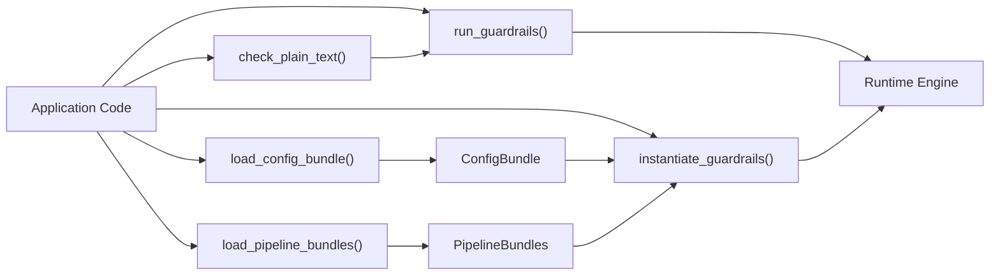
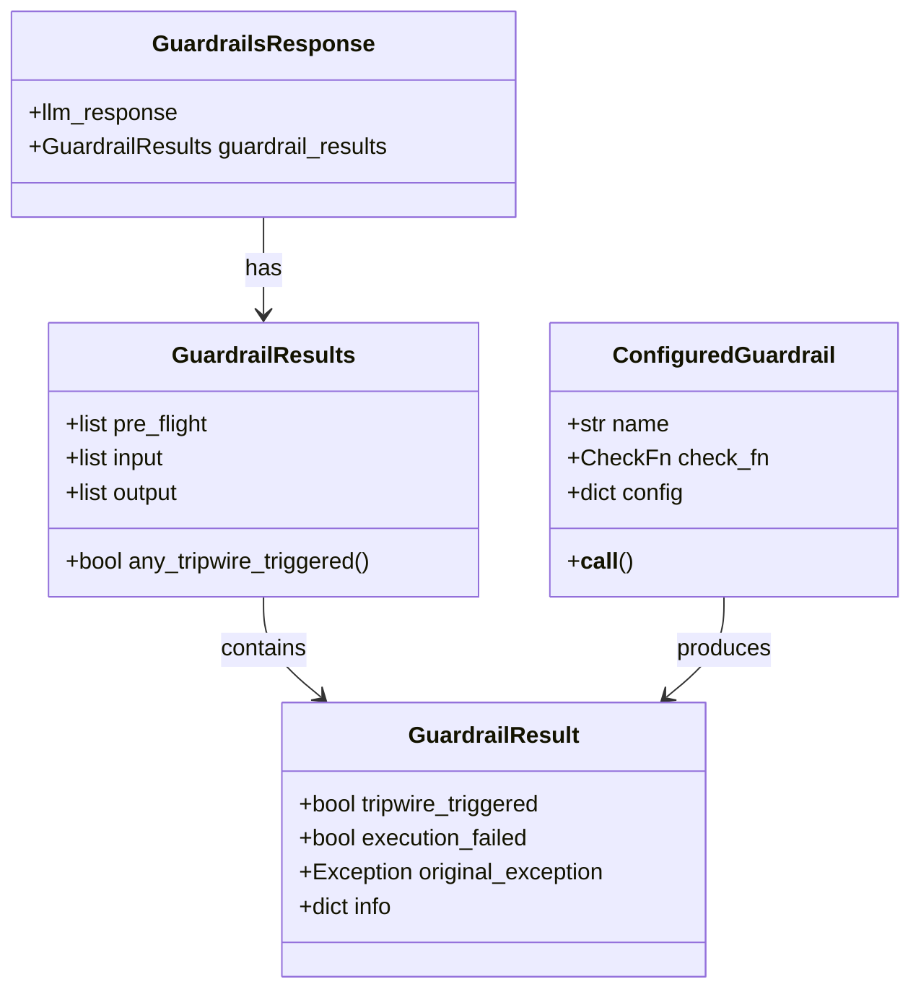
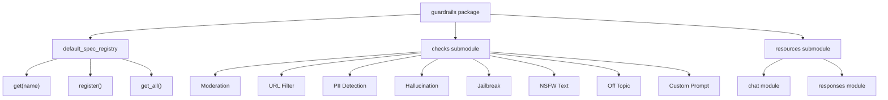

<!-- source: DeepWiki mcp.deepwiki.com · repo openai/openai-guardrails-python · page 10.1 Public API Surface · fetched 2026-10-26 -->

# Public API Surface

<details>
<summary>Relevant source files</summary>

The following files were used as context for generating this wiki page:

- [pyproject.toml](pyproject.toml)
- [src/guardrails/__init__.py](src/guardrails/__init__.py)

</details>


This document catalogs all public exports from the `guardrails` package, as defined in [src/guardrails/__init__.py](). It serves as a reference for developers integrating the guardrails framework into their applications. For detailed usage patterns of individual components, see [Getting Started](#2), [Client Integration](#4), and [Agent Integration](#5).

## Overview

The `guardrails` package exposes its public API through a single entry point at [src/guardrails/__init__.py:1-76](). The module uses lazy imports to minimize import overhead and groups exports into six major categories:

1. **Client Classes** - Drop-in replacements for OpenAI clients
2. **Agent Integration** - Guardrails for the Agents SDK
3. **Runtime Utilities** - Functions for executing guardrails
4. **Type Definitions** - Core data structures
5. **Registry and Submodules** - Guardrail registry and built-in checks
6. **Configuration Types** - Configuration helpers

**Sources**: [src/guardrails/__init__.py:1-76]()

## Module Export Structure

The following diagram maps all public exports from the `guardrails` package to their source locations:

```mermaid
graph TB
    subgraph "guardrails.__init__"
        Init["guardrails package"]
    end
    
    subgraph "Client Classes"
        Init --> GOA["GuardrailsOpenAI"]
        Init --> GAOA["GuardrailsAsyncOpenAI"]
        Init --> GAzOA["GuardrailsAzureOpenAI"]
        Init --> GAAzOA["GuardrailsAsyncAzureOpenAI"]
        
        GOA -.source.-> ClientMod["guardrails.client"]
        GAOA -.source.-> ClientMod
        GAzOA -.source.-> ClientMod
        GAAzOA -.source.-> ClientMod
    end
    
    subgraph "Agent Integration"
        Init --> GAgent["GuardrailAgent"]
        GAgent -.source.-> AgentMod["guardrails.agents"]
    end
    
    subgraph "Runtime Utilities"
        Init --> RunGR["run_guardrails"]
        Init --> InstGR["instantiate_guardrails"]
        Init --> CheckText["check_plain_text"]
        Init --> LoadCfg["load_config_bundle"]
        Init --> LoadPipe["load_pipeline_bundles"]
        
        RunGR -.source.-> RuntimeMod["guardrails.runtime"]
        InstGR -.source.-> RuntimeMod
        CheckText -.source.-> RuntimeMod
        LoadCfg -.source.-> RuntimeMod
        LoadPipe -.source.-> RuntimeMod
    end
    
    subgraph "Type Definitions"
        Init --> GResult["GuardrailResult"]
        Init --> GResults["GuardrailResults"]
        Init --> GResp["GuardrailsResponse"]
        Init --> ConfigGR["ConfiguredGuardrail"]
        
        GResult -.source.-> TypesMod["guardrails.types"]
        GResults -.source.-> ClientMod
        GResp -.source.-> ClientMod
        ConfigGR -.source.-> RuntimeMod
    end
    
    subgraph "Exceptions"
        Init --> GTrip["GuardrailTripwireTriggered"]
        GTrip -.source.-> ExcMod["guardrails.exceptions"]
    end
    
    subgraph "Registry and Submodules"
        Init --> Registry["default_spec_registry"]
        Init --> Checks["checks submodule"]
        Init --> Resources["resources submodule"]
        
        Registry -.source.-> RegMod["guardrails.registry"]
        Checks -.source.-> ChecksMod["guardrails.checks"]
        Resources -.source.-> ResMod["guardrails.resources"]
    end
    
    subgraph "Configuration Types"
        Init --> JsonStr["JsonString"]
        Init --> ConfigSrc["ConfigSource"]
        Init --> SpecMeta["GuardrailSpecMetadata"]
        
        JsonStr -.source.-> RuntimeMod
        ConfigSrc -.source.-> RuntimeMod
        SpecMeta -.source.-> SpecMod["guardrails.spec"]
    end
```



**Sources**: [src/guardrails/__init__.py:14-67]()

## Client Classes

The package exports four client classes that serve as drop-in replacements for OpenAI's client libraries:

| Class | Description | Source Module | Async |
|-------|-------------|---------------|-------|
| `GuardrailsOpenAI` | Standard OpenAI client with guardrails | `guardrails.client` | No |
| `GuardrailsAsyncOpenAI` | Async OpenAI client with guardrails | `guardrails.client` | Yes |
| `GuardrailsAzureOpenAI` | Azure OpenAI client with guardrails | `guardrails.client` | No |
| `GuardrailsAsyncAzureOpenAI` | Async Azure OpenAI client with guardrails | `guardrails.client` | Yes |

All four classes are exported from [src/guardrails/__init__.py:16-27](). Azure variants are optional and gracefully degrade to `None` if Azure dependencies are unavailable.

### Import Pattern

```python
from guardrails import GuardrailsOpenAI, GuardrailsAsyncOpenAI
```

For detailed usage, see [GuardrailsOpenAI Client](#4.1) and [Azure OpenAI Integration](#4.2).

**Sources**: [src/guardrails/__init__.py:16-27](), [README.md:39-62]()

## Agent Integration

The `GuardrailAgent` class provides integration with the OpenAI Agents SDK:

| Export | Type | Description | Source |
|--------|------|-------------|--------|
| `GuardrailAgent` | Class | Drop-in replacement for `Agent` class | `guardrails.agents` |

This export is defined at [src/guardrails/__init__.py:15]() and appears in the `__all__` list at [src/guardrails/__init__.py:47]().

### Import Pattern

```python
from guardrails import GuardrailAgent
```

For detailed usage with the Agents SDK, see [Agent Integration](#5).

**Sources**: [src/guardrails/__init__.py:15](), [README.md:66-91]()

## Runtime Utilities

Five functions provide direct access to the guardrails runtime engine:



### Function Reference

| Function | Purpose | Returns |
|----------|---------|---------|
| `run_guardrails()` | Execute guardrails on input data | `list[GuardrailResult]` |
| `instantiate_guardrails()` | Create guardrail instances from config | `list[ConfiguredGuardrail]` |
| `check_plain_text()` | Validate plain text against guardrails | `list[GuardrailResult]` |
| `load_config_bundle()` | Load guardrail configuration from JSON | `ConfigBundle` |
| `load_pipeline_bundles()` | Load three-stage pipeline config | `PipelineBundles` |

All runtime utilities are exported from [src/guardrails/__init__.py:32-41](). For detailed documentation of each function, see [Runtime Utilities](#10.2).

**Sources**: [src/guardrails/__init__.py:32-41](), [src/guardrails/__init__.py:56-64]()

## Type Definitions

The package exports four core type definitions for working with guardrail results:



### Type Reference

| Type | Source Module | Purpose | Line Reference |
|------|---------------|---------|----------------|
| `GuardrailResult` | `guardrails.types` | Individual check result | [src/guardrails/__init__.py:43]() |
| `GuardrailResults` | `guardrails.client` | Organized results by stage | [src/guardrails/__init__.py:17]() |
| `GuardrailsResponse` | `guardrails.client` | LLM response + guardrail results | [src/guardrails/__init__.py:20]() |
| `ConfiguredGuardrail` | `guardrails.runtime` | Configured, executable guardrail | [src/guardrails/__init__.py:34]() |

For complete type specifications, see [Type Definitions](#10.3).

**Sources**: [src/guardrails/__init__.py:17-20](), [src/guardrails/__init__.py:34](), [src/guardrails/__init__.py:43]()

## Configuration Types

Three type aliases support configuration loading and type safety:

| Type | Source | Purpose | Export Line |
|------|--------|---------|-------------|
| `JsonString` | `guardrails.runtime` | Type alias for JSON string data | [src/guardrails/__init__.py:35]() |
| `ConfigSource` | `guardrails.runtime` | Union type for config inputs | [src/guardrails/__init__.py:33]() |
| `GuardrailSpecMetadata` | `guardrails.spec` | Metadata for guardrail specifications | [src/guardrails/__init__.py:42]() |

These types are primarily used internally but are exposed for advanced use cases. See [Configuration Schema](#10.4) for details.

**Sources**: [src/guardrails/__init__.py:33-35](), [src/guardrails/__init__.py:42]()

## Exceptions

The package exports one primary exception type:

| Exception | Purpose | Source Module | Export Line |
|-----------|---------|---------------|-------------|
| `GuardrailTripwireTriggered` | Raised when guardrail violations occur | `guardrails.exceptions` | [src/guardrails/__init__.py:30]() |

### Import Pattern

```python
from guardrails import GuardrailTripwireTriggered

try:
    response = client.chat.completions.create(...)
except GuardrailTripwireTriggered as e:
    print(f"Guardrail triggered: {e}")
```

For all exception types including variants like `InputGuardrailTripwireTriggered` and `OutputGuardrailTripwireTriggered`, see [Exception Types](#10.5).

**Sources**: [src/guardrails/__init__.py:30](), [README.md:60-61]()

## Registry and Submodules

The package exposes the guardrail registry and two submodules for accessing built-in checks and resource classes:



### Registry Export

| Export | Type | Description | Line Reference |
|--------|------|-------------|----------------|
| `default_spec_registry` | `GuardrailRegistry` | Global registry instance | [src/guardrails/__init__.py:31]() |

### Submodule Exports

| Submodule | Purpose | Line Reference |
|-----------|---------|----------------|
| `checks` | Built-in guardrail implementations | [src/guardrails/__init__.py:14]() |
| `resources` | Resource classes for Chat and Responses APIs | [src/guardrails/__init__.py:29]() |

### Import Patterns

```python
# Access registry
from guardrails import default_spec_registry

# Access built-in checks
from guardrails import checks

# Access resource classes
from guardrails import resources
```

For guardrail registry details, see [Guardrail Registry](#3.4). For built-in checks, see [Built-in Guardrails](#6).

**Sources**: [src/guardrails/__init__.py:14](), [src/guardrails/__init__.py:29](), [src/guardrails/__init__.py:31]()

## Package Metadata

The package exposes a version string following the `importlib.metadata` pattern:

```python
from guardrails import __version__

print(__version__)  # e.g., "0.1.0"
```

The version is retrieved dynamically from package metadata at [src/guardrails/__init__.py:69]() using `metadata.version("openai-guardrails")`.

**Sources**: [src/guardrails/__init__.py:69](), [pyproject.toml:3]()

## Complete Export List

The `__all__` list at [src/guardrails/__init__.py:45-67]() defines the complete public API surface:

| Category | Exports |
|----------|---------|
| Client Classes | `GuardrailsOpenAI`, `GuardrailsAsyncOpenAI`, `GuardrailsAzureOpenAI`, `GuardrailsAsyncAzureOpenAI` |
| Agent Integration | `GuardrailAgent` |
| Runtime Utilities | `run_guardrails`, `instantiate_guardrails`, `check_plain_text`, `load_config_bundle`, `load_pipeline_bundles` |
| Type Definitions | `GuardrailResult`, `GuardrailResults`, `GuardrailsResponse`, `ConfiguredGuardrail` |
| Configuration Types | `JsonString`, `ConfigSource`, `GuardrailSpecMetadata` |
| Exceptions | `GuardrailTripwireTriggered` |
| Registry | `default_spec_registry` |
| Submodules | `checks`, `resources` |

This comprehensive API surface enables all documented usage patterns from simple text validation to complex multi-stage pipelines with Azure deployments and agent integrations.

**Sources**: [src/guardrails/__init__.py:45-67]()

## Import Optimization

The package uses lazy imports to minimize initial import cost. The main entry point at [src/guardrails/__init__.py:1-9]() documents this design:

> "Modules within :mod:`guardrails` are imported lazily to keep the import surface small when only a few utilities are needed."

This means importing `from guardrails import GuardrailsOpenAI` does not load the entire `checks` module or evaluation framework, reducing startup time for simple use cases.

A `NullHandler` is installed on the package logger at [src/guardrails/__init__.py:75]() to prevent the library from configuring global logging for host applications.

**Sources**: [src/guardrails/__init__.py:1-9](), [src/guardrails/__init__.py:71-75]()

---

