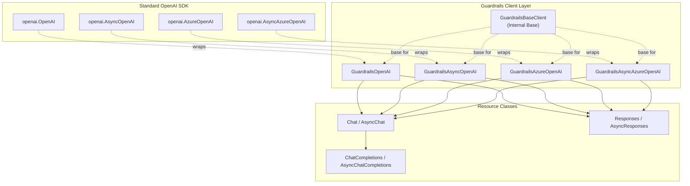
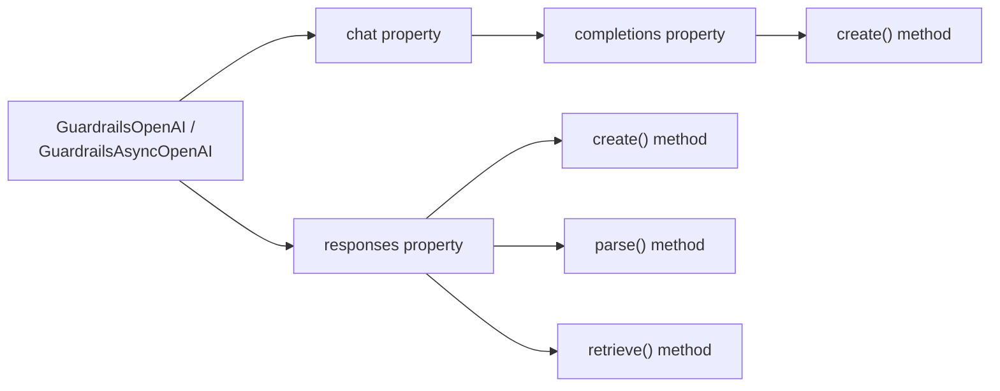
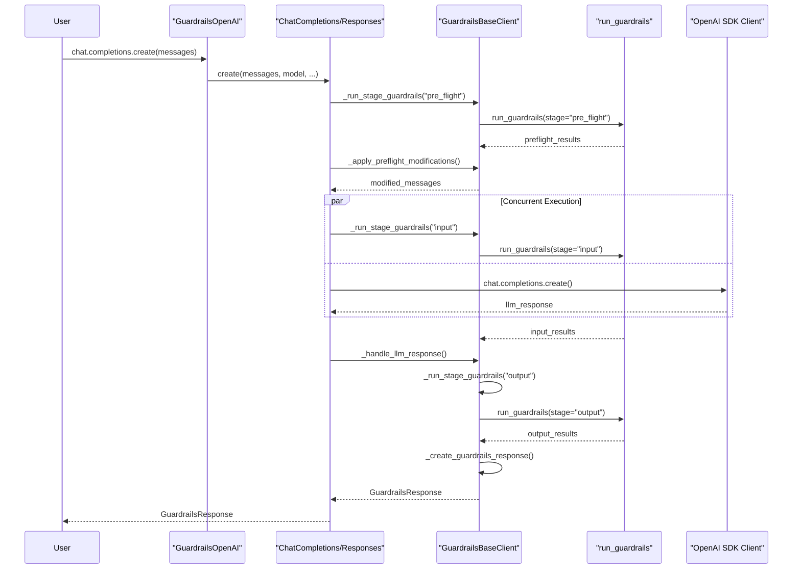
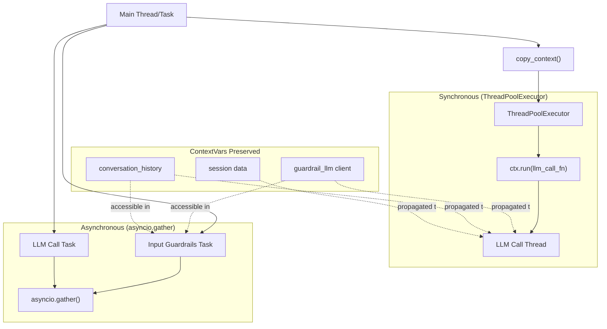

<!-- source: DeepWiki mcp.deepwiki.com · repo openai/openai-guardrails-python · page 10.2 Client Classes · fetched 2026-10-26 -->

# Client Classes

<details>
<summary>Relevant source files</summary>

The following files were used as context for generating this wiki page:

- [pyproject.toml](pyproject.toml)
- [src/guardrails/__init__.py](src/guardrails/__init__.py)
- [src/guardrails/resources/chat/chat.py](src/guardrails/resources/chat/chat.py)
- [src/guardrails/resources/responses/responses.py](src/guardrails/resources/responses/responses.py)
- [tests/unit/test_context.py](tests/unit/test_context.py)

</details>


This page documents the client classes that serve as the primary entry points for using OpenAI Guardrails. These classes provide drop-in replacements for the standard OpenAI SDK clients, wrapping API calls with configurable guardrail checks.

For information about the Agent SDK integration, see [GuardrailAgent Overview](#5.1). For details on the underlying runtime execution, see [Runtime Execution Model](#3.5). For configuration loading, see [Configuration Files](#2.2).

---

## Overview

The client classes expose OpenAI's chat completions and responses APIs with integrated guardrail validation. They maintain API compatibility with the standard OpenAI SDK while adding guardrail execution at three pipeline stages: `pre_flight`, `input`, and `output`.

**Core Client Classes:**
- `GuardrailsOpenAI` - Synchronous OpenAI client
- `GuardrailsAsyncOpenAI` - Asynchronous OpenAI client
- `GuardrailsAzureOpenAI` - Synchronous Azure OpenAI client
- `GuardrailsAsyncAzureOpenAI` - Asynchronous Azure OpenAI client

All four variants share the same resource structure and method signatures, differing only in their async/sync nature and the underlying OpenAI client they wrap.

**Sources:** [src/guardrails/__init__.py:16-27]()

---

## Client Class Hierarchy



The client hierarchy follows a layered structure where each guardrails client wraps the corresponding OpenAI SDK client. `GuardrailsBaseClient` provides shared implementation for guardrail execution, response handling, and conversation management. Resource classes (`Chat`, `Responses`) are instantiated by the client and delegate to the underlying OpenAI client after applying guardrails.

**Sources:** [src/guardrails/__init__.py:16-27](), [src/guardrails/resources/chat/chat.py:14-54](), [src/guardrails/resources/responses/responses.py:16-26]()

---

## GuardrailsOpenAI and GuardrailsAsyncOpenAI

### GuardrailsOpenAI

The synchronous OpenAI client with integrated guardrails. Drop-in replacement for `openai.OpenAI`.

**Class Definition:**
```
class GuardrailsOpenAI(OpenAI):
    """OpenAI client with guardrails support (synchronous)."""
```

**Initialization Parameters:**
| Parameter | Type | Description |
|-----------|------|-------------|
| `config_path` | `str \| None` | Path to `guardrails_config.json` file |
| `config_json` | `str \| dict \| None` | JSON string or dict with guardrail configuration |
| `previous_response_cache` | Object | Optional response cache for conversation history |
| `**kwargs` | Any | Standard OpenAI client parameters (api_key, base_url, etc.) |

**Resource Access:**
- `client.chat.completions.create()` - Chat completions with guardrails
- `client.responses.create()` - Responses API with guardrails
- `client.responses.parse()` - Structured outputs with guardrails
- `client.responses.retrieve()` - Response retrieval with output validation

**Sources:** [src/guardrails/__init__.py:16-21]()

### GuardrailsAsyncOpenAI

The asynchronous OpenAI client with integrated guardrails. Drop-in replacement for `openai.AsyncOpenAI`.

**Class Definition:**
```
class GuardrailsAsyncOpenAI(AsyncOpenAI):
    """OpenAI client with guardrails support (asynchronous)."""
```

**Initialization Parameters:**
Same as `GuardrailsOpenAI`.

**Resource Access:**
- `await client.chat.completions.create()` - Async chat completions
- `await client.responses.create()` - Async responses API
- `await client.responses.parse()` - Async structured outputs
- `await client.responses.retrieve()` - Async response retrieval

All methods return coroutines that must be awaited. Concurrent execution uses `asyncio.gather()` for parallel guardrail and LLM calls.

**Sources:** [src/guardrails/__init__.py:16-21](), [src/guardrails/resources/chat/chat.py:129-194](), [src/guardrails/resources/responses/responses.py:184-352]()

---

## Azure OpenAI Variants

### GuardrailsAzureOpenAI

Synchronous Azure OpenAI client with guardrails. Drop-in replacement for `openai.AzureOpenAI`.

**Class Definition:**
```
class GuardrailsAzureOpenAI(AzureOpenAI):
    """Azure OpenAI client with guardrails support (synchronous)."""
```

**Initialization Parameters:**
| Parameter | Type | Description |
|-----------|------|-------------|
| `config_path` | `str \| None` | Path to `guardrails_config.json` file |
| `config_json` | `str \| dict \| None` | JSON string or dict with guardrail configuration |
| `previous_response_cache` | Object | Optional response cache for conversation history |
| `azure_endpoint` | `str` | Azure endpoint URL |
| `api_version` | `str` | Azure API version |
| `api_key` | `str \| None` | Azure API key |
| `azure_ad_token` | `str \| None` | Azure AD token for authentication |
| `**kwargs` | Any | Additional Azure OpenAI parameters |

Azure clients omit the `safety_identifier` parameter when making API calls, as this is OpenAI-specific.

**Sources:** [src/guardrails/__init__.py:23-27]()

### GuardrailsAsyncAzureOpenAI

Asynchronous Azure OpenAI client with guardrails. Drop-in replacement for `openai.AsyncAzureOpenAI`.

**Class Definition:**
```
class GuardrailsAsyncAzureOpenAI(AsyncAzureOpenAI):
    """Azure OpenAI client with guardrails support (asynchronous)."""
```

**Initialization Parameters:**
Same as `GuardrailsAzureOpenAI`.

**Azure-Specific Behavior:**
- Does not include `safety_identifier` in API requests ([src/guardrails/resources/chat/chat.py:95-96]())
- Supports all Azure-specific authentication methods
- Compatible with Azure-deployed models

**Sources:** [src/guardrails/__init__.py:23-27](), [src/guardrails/resources/chat/chat.py:172-173](), [src/guardrails/resources/responses/responses.py:77-78]()

---

## Resource Structure



### Chat Resource

The `chat` property provides access to chat completions API.

**Synchronous Access Pattern:**
```python
client = GuardrailsOpenAI(config_path="guardrails_config.json")
response = client.chat.completions.create(
    model="gpt-4o",
    messages=[{"role": "user", "content": "Hello"}]
)
```

**Asynchronous Access Pattern:**
```python
client = GuardrailsAsyncOpenAI(config_path="guardrails_config.json")
response = await client.chat.completions.create(
    model="gpt-4o",
    messages=[{"role": "user", "content": "Hello"}]
)
```

**Classes Involved:**
- `Chat` / `AsyncChat` - Container resource ([src/guardrails/resources/chat/chat.py:14-54]())
- `ChatCompletions` / `AsyncChatCompletions` - Completions interface ([src/guardrails/resources/chat/chat.py:56-194]())

**Sources:** [src/guardrails/resources/chat/chat.py:14-194]()

### Responses Resource

The `responses` property provides access to the Responses API for structured outputs and response retrieval.

**Available Methods:**

| Method | Sync/Async | Description |
|--------|-----------|-------------|
| `create()` | Both | Generate response with guardrails |
| `parse()` | Both | Generate structured output with guardrails |
| `retrieve()` | Both | Retrieve existing response with output validation |

**Classes Involved:**
- `Responses` / `AsyncResponses` - Response resource ([src/guardrails/resources/responses/responses.py:16-352]())

**Sources:** [src/guardrails/resources/chat/chat.py:1-195](), [src/guardrails/resources/responses/responses.py:1-353]()

---

## Guardrail Integration Flow



The flow demonstrates the three-stage pipeline architecture:

1. **Pre-flight Stage**: Runs synchronously before the LLM call. May modify input (PII masking, etc.).
2. **Input Stage**: Runs concurrently with the LLM API call to minimize latency.
3. **Output Stage**: Validates the LLM response after it's received.

For streaming responses, output guardrails run after the stream completes and all chunks are accumulated.

**Sources:** [src/guardrails/resources/chat/chat.py:67-126](), [src/guardrails/resources/responses/responses.py:27-108]()

---

## Initialization and Configuration

### Basic Initialization

**From Configuration File:**
```python
from guardrails import GuardrailsOpenAI

client = GuardrailsOpenAI(
    api_key="your-api-key",
    config_path="guardrails_config.json"
)
```

**From Configuration JSON:**
```python
config = {
    "pre_flight_guardrails": [
        {"guardrail_name": "contains_pii", "action": "modify"}
    ],
    "input_guardrails": [
        {"guardrail_name": "prompt_injection"}
    ],
    "output_guardrails": [
        {"guardrail_name": "hallucination_detection"}
    ]
}

client = GuardrailsOpenAI(
    api_key="your-api-key",
    config_json=config
)
```

### Configuration Loading

The client loads guardrails configuration during initialization through `GuardrailsBaseClient`:

1. Parses `config_path` or `config_json` parameter
2. Loads guardrail bundles for each stage via `load_pipeline_bundles()`
3. Instantiates guardrails via `instantiate_guardrails()`
4. Stores configured guardrails for runtime execution

**Configuration Source Priority:**
- If both `config_path` and `config_json` provided, `config_json` takes precedence
- If neither provided, client operates without guardrails (pass-through mode)

**Sources:** [src/guardrails/__init__.py:16-27]()

### Azure-Specific Initialization

```python
from guardrails import GuardrailsAzureOpenAI

client = GuardrailsAzureOpenAI(
    api_key="your-azure-key",
    azure_endpoint="https://your-resource.openai.azure.com/",
    api_version="2024-02-15-preview",
    config_path="guardrails_config.json"
)
```

Azure clients require `azure_endpoint` and `api_version` parameters in addition to standard OpenAI parameters.

**Sources:** [src/guardrails/__init__.py:23-27]()

---

## Method Signatures

### ChatCompletions.create()

**Synchronous Signature:**
```python
def create(
    self,
    messages: list[dict[str, str]],
    model: str,
    stream: bool = False,
    suppress_tripwire: bool = False,
    **kwargs
) -> GuardrailsResponse | Iterator[GuardrailsResponse]
```

**Asynchronous Signature:**
```python
async def create(
    self,
    messages: list[dict[str, str]],
    model: str,
    stream: bool = False,
    suppress_tripwire: bool = False,
    **kwargs
) -> GuardrailsResponse | AsyncIterator[GuardrailsResponse]
```

**Parameters:**
| Parameter | Type | Default | Description |
|-----------|------|---------|-------------|
| `messages` | `list[dict[str, str]]` | Required | Chat messages in OpenAI format |
| `model` | `str` | Required | Model identifier (e.g., "gpt-4o") |
| `stream` | `bool` | `False` | Enable streaming responses |
| `suppress_tripwire` | `bool` | `False` | Suppress tripwire exceptions (see [Error Handling](#2.3)) |
| `**kwargs` | Any | - | Additional OpenAI parameters (temperature, max_tokens, etc.) |

**Returns:**
- Non-streaming: `GuardrailsResponse` with `response` and `guardrail_results` attributes
- Streaming: Iterator/AsyncIterator of response chunks

**Sources:** [src/guardrails/resources/chat/chat.py:67-126](), [src/guardrails/resources/chat/chat.py:140-194]()

### Responses.create()

**Synchronous Signature:**
```python
def create(
    self,
    input: str | list[dict[str, str]],
    model: str,
    stream: bool = False,
    tools: list[dict] | None = None,
    suppress_tripwire: bool = False,
    **kwargs
) -> GuardrailsResponse | Iterator[GuardrailsResponse]
```

**Asynchronous Signature:**
```python
async def create(
    self,
    input: str | list[dict[str, str]],
    model: str,
    stream: bool = False,
    tools: list[dict] | None = None,
    suppress_tripwire: bool = False,
    **kwargs
) -> GuardrailsResponse | AsyncIterator[GuardrailsResponse]
```

**Parameters:**
| Parameter | Type | Default | Description |
|-----------|------|---------|-------------|
| `input` | `str \| list[dict[str, str]]` | Required | Input text or conversation messages |
| `model` | `str` | Required | Model identifier |
| `stream` | `bool` | `False` | Enable streaming |
| `tools` | `list[dict] \| None` | `None` | Tool definitions for function calling |
| `suppress_tripwire` | `bool` | `False` | Suppress tripwire exceptions |
| `**kwargs` | Any | - | Additional parameters, including `previous_response_id` |

**Conversation History:**
The `previous_response_id` parameter in `**kwargs` enables conversation continuity by loading prior history from the response cache.

**Sources:** [src/guardrails/resources/responses/responses.py:27-108](), [src/guardrails/resources/responses/responses.py:195-269]()

### Responses.parse()

**Synchronous Signature:**
```python
def parse(
    self,
    input: list[dict[str, str]],
    model: str,
    text_format: type[BaseModel],
    suppress_tripwire: bool = False,
    **kwargs
) -> GuardrailsResponse
```

**Asynchronous Signature:**
```python
async def parse(
    self,
    input: list[dict[str, str]],
    model: str,
    text_format: type[BaseModel],
    stream: bool = False,
    suppress_tripwire: bool = False,
    **kwargs
) -> GuardrailsResponse | AsyncIterator[GuardrailsResponse]
```

**Parameters:**
| Parameter | Type | Default | Description |
|-----------|------|---------|-------------|
| `input` | `list[dict[str, str]]` | Required | Conversation messages |
| `model` | `str` | Required | Model identifier |
| `text_format` | `type[BaseModel]` | Required | Pydantic model for structured output schema |
| `stream` | `bool` | `False` | Enable streaming (async only) |
| `suppress_tripwire` | `bool` | `False` | Suppress tripwire exceptions |
| `**kwargs` | Any | - | Additional parameters |

**Returns:**
Structured output parsed into the specified Pydantic model, wrapped in `GuardrailsResponse`.

**Sources:** [src/guardrails/resources/responses/responses.py:110-164](), [src/guardrails/resources/responses/responses.py:271-335]()

### Responses.retrieve()

**Synchronous Signature:**
```python
def retrieve(
    self,
    response_id: str,
    suppress_tripwire: bool = False,
    **kwargs
) -> GuardrailsResponse
```

**Asynchronous Signature:**
```python
async def retrieve(
    self,
    response_id: str,
    suppress_tripwire: bool = False,
    **kwargs
) -> GuardrailsResponse
```

**Parameters:**
| Parameter | Type | Default | Description |
|-----------|------|---------|-------------|
| `response_id` | `str` | Required | ID of the response to retrieve |
| `suppress_tripwire` | `bool` | `False` | Suppress tripwire exceptions |
| `**kwargs` | Any | - | Additional parameters |

**Behavior:**
Retrieves an existing response from OpenAI and runs output guardrails on the content. Pre-flight and input guardrails are not applicable since the response already exists.

**Sources:** [src/guardrails/resources/responses/responses.py:166-181](), [src/guardrails/resources/responses/responses.py:337-352]()

---

## Context Propagation in Concurrent Execution



**Synchronous Context Propagation:**

The synchronous clients use `ThreadPoolExecutor` with `copy_context()` to propagate `ContextVars` to the LLM call thread:

```python
ctx = copy_context()
llm_future = executor.submit(ctx.run, llm_call_fn)
```

This ensures that conversation-aware guardrails can access the same context as the LLM call, even when running concurrently in separate threads.

**Asynchronous Context Propagation:**

The asynchronous clients use `asyncio.gather()` which automatically propagates `ContextVars` to concurrent tasks:

```python
input_results, llm_response = await asyncio.gather(input_check, llm_call)
```

No explicit context copying is needed as `asyncio` handles context propagation natively.

**Sources:** [src/guardrails/resources/chat/chat.py:98-100](), [src/guardrails/resources/chat/chat.py:175-177](), [tests/unit/test_context.py:42-114]()

---

## Response Handling

### GuardrailsResponse Object

All client methods return a `GuardrailsResponse` object that wraps the OpenAI response with guardrail results:

```python
response = client.chat.completions.create(
    model="gpt-4o",
    messages=[{"role": "user", "content": "Hello"}]
)

# Access OpenAI response
print(response.response.choices[0].message.content)

# Access guardrail results
print(response.guardrail_results.pre_flight)
print(response.guardrail_results.input)
print(response.guardrail_results.output)
```

**Structure:**
- `response` - Original OpenAI response object
- `guardrail_results` - `GuardrailResults` containing results from all stages

For detailed information on `GuardrailResults` and `GuardrailResult` types, see [Type Definitions](#10.4).

### Streaming Responses

When `stream=True`, the client returns an iterator/async iterator that yields chunks:

**Synchronous Streaming:**
```python
stream = client.chat.completions.create(
    model="gpt-4o",
    messages=[{"role": "user", "content": "Hello"}],
    stream=True
)

for chunk in stream:
    if chunk.response.choices[0].delta.content:
        print(chunk.response.choices[0].delta.content, end="")
```

**Asynchronous Streaming:**
```python
stream = await client.chat.completions.create(
    model="gpt-4o",
    messages=[{"role": "user", "content": "Hello"}],
    stream=True
)

async for chunk in stream:
    if chunk.response.choices[0].delta.content:
        print(chunk.response.choices[0].delta.content, end="")
```

**Output Guardrails in Streaming Mode:**
Output guardrails run after the entire stream completes. The final chunk includes complete `guardrail_results` with output validation.

For more details on streaming behavior, see [Streaming and Blocking Modes](#4.5).

**Sources:** [src/guardrails/resources/chat/chat.py:111-118](), [src/guardrails/resources/chat/chat.py:179-186]()

---

## Safety Identifier

The client automatically includes a `safety_identifier` parameter in API requests to OpenAI (but not Azure):

**Automatic Inclusion Logic:**
```python
if supports_safety_identifier(self._resource_client):
    llm_kwargs["safety_identifier"] = SAFETY_IDENTIFIER
```

This identifier helps OpenAI track requests made through the guardrails SDK for support and analytics purposes. It is omitted for:
- Azure OpenAI deployments
- Local/custom model endpoints
- Any client that doesn't support the parameter

**Sources:** [src/guardrails/resources/chat/chat.py:95-96](), [src/guardrails/resources/responses/responses.py:77-78](), [src/guardrails/resources/responses/responses.py:247-248]()

---

## Conversation History Management

Clients support conversation continuity through the `previous_response_id` parameter:

```python
# First turn
response1 = client.responses.create(
    input="What is Python?",
    model="gpt-4o"
)

# Second turn - includes conversation history
response2 = client.responses.create(
    input="Tell me more",
    model="gpt-4o",
    previous_response_id=response1.response.id
)
```

**History Loading:**
1. Client calls `_load_conversation_history_from_previous_response(previous_response_id)`
2. Prior history retrieved from `previous_response_cache`
3. Current turn appended to create full `normalized_conversation`
4. Full conversation provided to guardrails for context-aware validation

For detailed conversation history mechanics, see [Conversation History Management](#4.6).

**Sources:** [src/guardrails/resources/responses/responses.py:40-48](), [src/guardrails/resources/responses/responses.py:206-213]()

---

## Summary Table

| Class | Base | Async | Azure | Resources |
|-------|------|-------|-------|-----------|
| `GuardrailsOpenAI` | `openai.OpenAI` | No | No | `chat`, `responses` |
| `GuardrailsAsyncOpenAI` | `openai.AsyncOpenAI` | Yes | No | `chat`, `responses` |
| `GuardrailsAzureOpenAI` | `openai.AzureOpenAI` | No | Yes | `chat`, `responses` |
| `GuardrailsAsyncAzureOpenAI` | `openai.AsyncAzureOpenAI` | Yes | Yes | `chat`, `responses` |

**Common Features Across All Clients:**
- Three-stage guardrail pipeline (pre_flight, input, output)
- Concurrent execution of input guardrails and LLM calls
- Streaming and non-streaming support
- Conversation history tracking
- Tripwire exception handling via `suppress_tripwire`
- Drop-in replacement for standard OpenAI clients

**Sources:** [src/guardrails/__init__.py:16-27](), [src/guardrails/resources/chat/chat.py:1-195](), [src/guardrails/resources/responses/responses.py:1-353]()

---

