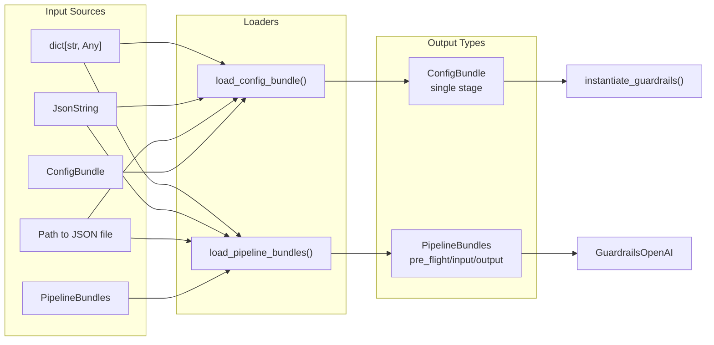
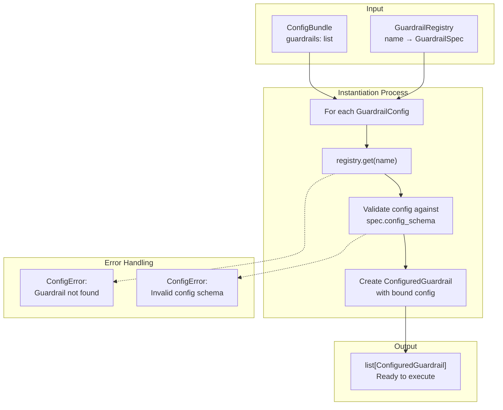
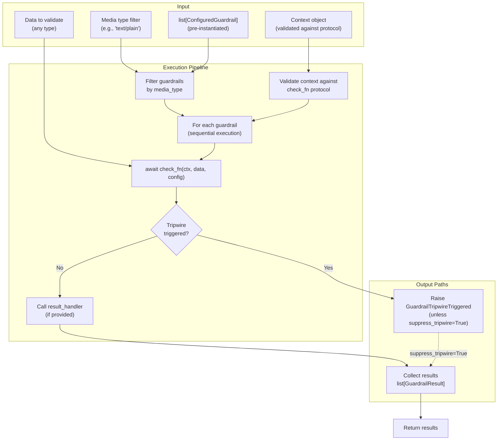
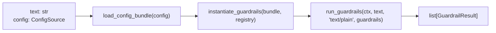
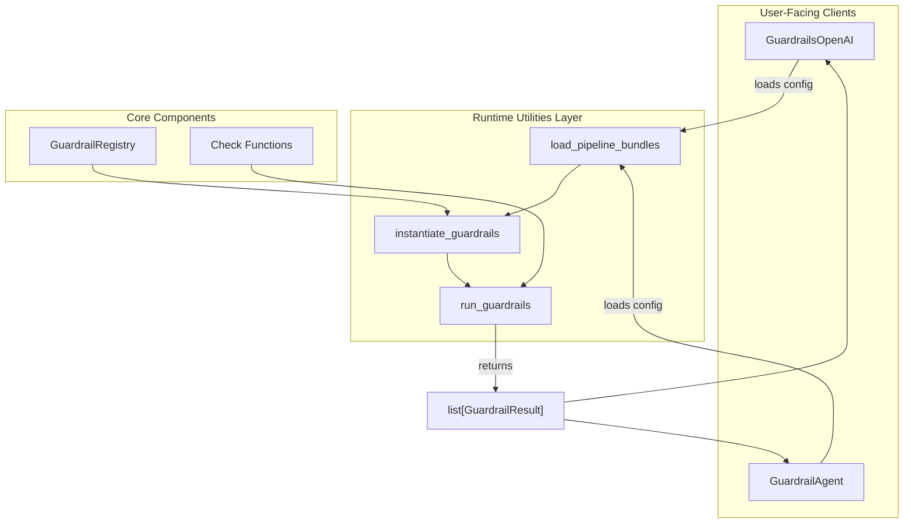

<!-- source: DeepWiki mcp.deepwiki.com · repo openai/openai-guardrails-python · page 10.3 Runtime Utilities · fetched 2026-10-26 -->

# Runtime Utilities

<details>
<summary>Relevant source files</summary>

The following files were used as context for generating this wiki page:

- [pyproject.toml](pyproject.toml)
- [src/guardrails/__init__.py](src/guardrails/__init__.py)

</details>


## Purpose and Scope

This page documents the runtime utilities exposed by the `guardrails.runtime` module. These utilities provide the core execution engine for running guardrails, loading configuration from various sources, and instantiating guardrail check functions. 

The runtime utilities bridge the gap between declarative configuration (covered in [Configuration Files](#2.2)) and the actual execution of guardrail checks. For information about the type system used by these utilities, see [Type System and Protocols](#3.2). For details about how guardrails are registered, see [Guardrail Registry](#3.4).

The runtime module provides five main functions and three supporting types that enable direct programmatic use of guardrails without requiring the full client wrappers:

- **Configuration Loading**: `load_config_bundle`, `load_pipeline_bundles`
- **Guardrail Instantiation**: `instantiate_guardrails`
- **Core Execution**: `run_guardrails`
- **Convenience Functions**: `check_plain_text`

**Sources**: [src/guardrails/__init__.py:32-41]()

---

## Public API Surface

The runtime utilities are exposed through the main `guardrails` package:

```python
from guardrails import (
    run_guardrails,              # Core execution engine
    instantiate_guardrails,      # Factory function
    check_plain_text,            # Simple text validation
    load_config_bundle,          # Single-stage config loader
    load_pipeline_bundles,       # Multi-stage config loader
    ConfigSource,                # Type alias for config input
    ConfiguredGuardrail,         # Executable guardrail instance
    JsonString,                  # Type alias for JSON strings
)
```

**Sources**: [src/guardrails/__init__.py:32-41](), [src/guardrails/__init__.py:45-67]()

---

## Configuration Loading

### Overview

Configuration loaders convert various input formats into validated configuration objects (`ConfigBundle` or `PipelineBundles`). These functions accept flexible input types through the `ConfigSource` type alias.



**Diagram**: Configuration loading pipeline showing flexible input sources and output types

**Sources**: [tests/unit/test_runtime.py:116-184]()

---

### load_config_bundle

**Function Signature**: `load_config_bundle(source: ConfigSource) -> ConfigBundle`

Loads a single-stage guardrail configuration from various sources. The function performs validation using Pydantic models and raises `ConfigError` if the input structure is invalid.

**Accepted Input Formats**:

| Input Type | Description | Example |
|------------|-------------|---------|
| `dict[str, Any]` | Python dictionary | `{"version": 1, "guardrails": [...]}` |
| `str` (JSON) | JSON string | `'{"version": 1, "guardrails": []}'` |
| `Path` | File path to JSON | `Path("config.json")` |
| `ConfigBundle` | Already loaded object | Returned as-is |

**Return Value**: A `ConfigBundle` object with validated `version` and `guardrails` fields.

**Example Usage**:

```python
from guardrails import load_config_bundle

# From dictionary
bundle = load_config_bundle({
    "version": 1,
    "guardrails": [
        {"name": "pii_detection", "config": {...}}
    ]
})

# From file path
from pathlib import Path
bundle = load_config_bundle(Path("config/guardrails.json"))
```

**Error Handling**:

- Raises `ValidationError` (Pydantic) if the structure doesn't match the `ConfigBundle` schema
- Raises `ConfigError` if the input type is unsupported or JSON parsing fails

**Sources**: [tests/unit/test_runtime.py:116-134](), [src/guardrails/__init__.py:38]()

---

### load_pipeline_bundles

**Function Signature**: `load_pipeline_bundles(source: ConfigSource) -> PipelineBundles`

Loads a multi-stage pipeline configuration supporting pre-flight, input, and output stages. This is the primary configuration format used by `GuardrailsOpenAI`, `GuardrailsAzureOpenAI`, and `GuardrailAgent` clients.

**Configuration Structure**:

```python
{
    "version": 1,
    "pre_flight": {  # Optional: runs first, can modify input
        "version": 1,
        "guardrails": [...]
    },
    "input": {  # Optional: runs concurrent with LLM call
        "version": 1,
        "guardrails": [...]
    },
    "output": {  # Optional: validates LLM response
        "version": 1,
        "guardrails": [...]
    }
}
```

**Stage Semantics**:

| Stage | Execution Timing | Can Modify Input | Typical Use Cases |
|-------|------------------|------------------|-------------------|
| `pre_flight` | Before LLM call | Yes | PII masking, input sanitization |
| `input` | Concurrent with LLM | No | Jailbreak detection, URL filtering |
| `output` | After LLM response | No | Hallucination detection, NSFW filtering |

**Validation Rules**:

- At least one stage must be defined (raises `ValueError` otherwise)
- Each stage is an optional `ConfigBundle`
- The `stages()` method returns only non-None stages

**Example Usage**:

```python
from guardrails import load_pipeline_bundles

bundles = load_pipeline_bundles({
    "version": 1,
    "pre_flight": {
        "version": 1,
        "guardrails": [{"name": "pii_detection", "config": {...}}]
    },
    "output": {
        "version": 1,
        "guardrails": [{"name": "hallucination_detection", "config": {...}}]
    }
})

# Iterate over defined stages
for stage_name, bundle in bundles.stages():
    print(f"Stage {stage_name} has {len(bundle.guardrails)} guardrails")
```

**Sources**: [tests/unit/test_runtime.py:136-184](), [src/guardrails/__init__.py:39]()

---

### ConfigSource Type

**Type Definition**: `ConfigSource = Union[str, dict[str, Any], Path, ConfigBundle, PipelineBundles]`

A type alias representing all accepted input formats for configuration loaders. This flexible type enables users to provide configuration in whatever format is most convenient for their use case.

**Sources**: [src/guardrails/__init__.py:33]()

---

## Guardrail Instantiation

### instantiate_guardrails

**Function Signature**: `instantiate_guardrails(bundle: ConfigBundle, registry: GuardrailRegistry) -> list[ConfiguredGuardrail]`

Converts a `ConfigBundle` into a list of executable `ConfiguredGuardrail` instances by looking up check functions in the registry and validating their configurations.



**Diagram**: Guardrail instantiation process from configuration to executable instances

**Instantiation Steps**:

1. **Lookup**: For each `GuardrailConfig` in the bundle, retrieve the corresponding `GuardrailSpec` from the registry by name
2. **Validation**: Parse and validate the configuration dictionary against the guardrail's Pydantic `config_schema`
3. **Binding**: Create a `ConfiguredGuardrail` instance with the check function and validated configuration bound together

**Error Handling**:

| Error Type | Cause | Exception |
|------------|-------|-----------|
| Guardrail not found | Name not in registry | `ConfigError` |
| Invalid config | Schema validation failure | `ConfigError` (wraps `ValidationError`) |

**Example Usage**:

```python
from guardrails import instantiate_guardrails, load_config_bundle, default_spec_registry

bundle = load_config_bundle({
    "version": 1,
    "guardrails": [
        {
            "name": "pii_detection",
            "config": {
                "anonymize": True,
                "entities": ["PERSON", "EMAIL"]
            }
        }
    ]
})

guardrails = instantiate_guardrails(bundle, default_spec_registry)
# guardrails[0] is now executable with validated config
```

**Sources**: [tests/unit/test_runtime.py:186-206](), [src/guardrails/__init__.py:37]()

---

### ConfiguredGuardrail Type

**Type Definition**: A dataclass representing an executable guardrail instance with validated configuration.

**Structure**:

```python
@dataclass
class ConfiguredGuardrail:
    name: str                    # Guardrail identifier
    check_fn: CheckFn           # Callable that performs the check
    config: BaseModel           # Validated Pydantic config instance
    description: str            # Human-readable description
    media_type: str             # Supported media type (e.g., "text/plain")
```

The `ConfiguredGuardrail` object is the result of instantiation and represents a guardrail ready to execute. It contains the check function bound to its validated configuration, eliminating the need for runtime config parsing.

**Sources**: [src/guardrails/__init__.py:34]()

---

## Core Execution Engine

### run_guardrails

**Function Signature**: 
```python
async def run_guardrails(
    ctx: Any,
    data: Any,
    media_type: str,
    guardrails: list[ConfiguredGuardrail],
    suppress_tripwire: bool = False,
    result_handler: Optional[Callable[[GuardrailResult], Awaitable[None]]] = None,
) -> list[GuardrailResult]
```

The core execution engine that runs a list of instantiated guardrails against input data. This function performs context validation, executes check functions in sequence, handles tripwire exceptions, and optionally streams results through a handler.



**Diagram**: Runtime execution flow showing validation, sequential execution, and error handling

**Parameters**:

| Parameter | Type | Description |
|-----------|------|-------------|
| `ctx` | `Any` | Context object passed to check functions (must satisfy their protocol) |
| `data` | `Any` | Input data to validate (type depends on guardrail) |
| `media_type` | `str` | Media type for filtering (only matching guardrails execute) |
| `guardrails` | `list[ConfiguredGuardrail]` | Pre-instantiated guardrails to run |
| `suppress_tripwire` | `bool` | If `True`, return results without raising on violations (default: `False`) |
| `result_handler` | `Optional[...]` | Async callback invoked for each result (for streaming) |

**Execution Behavior**:

1. **Media Type Filtering**: Only guardrails matching the specified `media_type` are executed
2. **Context Validation**: For each guardrail, validates that `ctx` satisfies the check function's protocol requirements (raises `ContextValidationError` on failure)
3. **Sequential Execution**: Guardrails execute in order, each awaiting the previous
4. **Result Streaming**: If `result_handler` is provided, it's called for each result as it becomes available
5. **Tripwire Handling**: By default, raises `GuardrailTripwireTriggered` on first violation; with `suppress_tripwire=True`, collects all results

**Error Handling**:

| Error Type | Cause | Behavior |
|------------|-------|----------|
| `ContextValidationError` | Context doesn't match protocol | Always raised immediately |
| `GuardrailTripwireTriggered` | Guardrail detected violation | Raised unless `suppress_tripwire=True` |
| `Exception` (other) | Check function error | Wrapped in `GuardrailResult` with `execution_failed=True` |

**Example Usage**:

```python
from guardrails import run_guardrails, instantiate_guardrails, load_config_bundle
from dataclasses import dataclass

@dataclass
class RequestContext:
    user_id: str
    guardrail_llm: AsyncOpenAI

ctx = RequestContext(user_id="user123", guardrail_llm=client)
bundle = load_config_bundle({"version": 1, "guardrails": [...]})
guardrails = instantiate_guardrails(bundle, registry)

# Run with default behavior (raises on violation)
try:
    results = await run_guardrails(
        ctx=ctx,
        data="Check this text",
        media_type="text/plain",
        guardrails=guardrails,
    )
except GuardrailTripwireTriggered as e:
    print(f"Violation detected: {e}")

# Run with suppression (collect all results)
results = await run_guardrails(
    ctx=ctx,
    data="Check this text",
    media_type="text/plain",
    guardrails=guardrails,
    suppress_tripwire=True,
)
for result in results:
    if result.tripwire_triggered:
        print(f"Violation: {result.info}")
```

**Sources**: [tests/unit/test_runtime.py:208-290](), [src/guardrails/__init__.py:40]()

---

### Context Validation

The runtime engine validates that the provided context object satisfies the protocol requirements of each check function before execution. This validation occurs at runtime using Python's `inspect` module to extract type hints.

**Validation Process**:

1. Extract the context parameter's type annotation from the check function signature
2. If it's a `Protocol`, verify that `ctx` has all required attributes
3. If it's a concrete type, verify that `ctx` is an instance of that type
4. If validation fails, raise `ContextValidationError` with details about the mismatch

**Example**:

```python
from typing import Protocol
from openai import AsyncOpenAI

class GuardrailLLMContextProto(Protocol):
    guardrail_llm: AsyncOpenAI
    
def check(ctx: GuardrailLLMContextProto, data: str, config: Config) -> GuardrailResult:
    # ctx.guardrail_llm is guaranteed to exist
    ...

# This context is valid:
class ValidContext:
    def __init__(self):
        self.guardrail_llm = AsyncOpenAI()

# This context is invalid (missing guardrail_llm):
class InvalidContext:
    pass

await run_guardrails(ctx=InvalidContext(), ...)  # Raises ContextValidationError
```

**Sources**: [tests/unit/test_runtime.py:270-290]()

---

## Convenience Functions

### check_plain_text

**Function Signature**: 
```python
async def check_plain_text(
    text: str,
    config: ConfigSource,
    registry: GuardrailRegistry = default_spec_registry,
    ctx: Optional[Any] = None,
    suppress_tripwire: bool = False,
) -> list[GuardrailResult]
```

A high-level convenience function that combines configuration loading, guardrail instantiation, and execution into a single call for text validation. This is the simplest way to validate text without using the full client wrappers.

**Functionality**:



**Diagram**: `check_plain_text` function flow combining all runtime utilities

**Parameters**:

| Parameter | Type | Description |
|-----------|------|-------------|
| `text` | `str` | Plain text to validate |
| `config` | `ConfigSource` | Configuration (dict, JSON, Path, or ConfigBundle) |
| `registry` | `GuardrailRegistry` | Registry to use (defaults to `default_spec_registry`) |
| `ctx` | `Optional[Any]` | Context object (defaults to empty object if not provided) |
| `suppress_tripwire` | `bool` | Whether to suppress exceptions on violations |

**Example Usage**:

```python
from guardrails import check_plain_text
from pathlib import Path

# Simple usage with file path
results = await check_plain_text(
    text="Hello, check this message",
    config=Path("config/guardrails.json"),
)

# With inline configuration
results = await check_plain_text(
    text="Another message",
    config={
        "version": 1,
        "guardrails": [
            {"name": "jailbreak_detection", "config": {...}}
        ]
    },
    suppress_tripwire=True,
)

for result in results:
    print(f"Guardrail triggered: {result.tripwire_triggered}")
```

**Default Context Behavior**:

If `ctx=None`, the function creates a minimal fallback context object. Guardrails that don't require specific context attributes (e.g., simple pattern matching checks) will work with this default. Guardrails requiring specific context (e.g., those needing `guardrail_llm`) will raise `ContextValidationError`.

**Sources**: [tests/unit/test_runtime.py:293-327](), [src/guardrails/__init__.py:36]()

---

## Type Definitions

### JsonString

**Type Definition**: `JsonString = str`

A type alias indicating that a string contains JSON data. This is used in function signatures to clarify that the string should be valid JSON that will be parsed into a configuration object.

**Usage Example**:

```python
json_config: JsonString = '{"version": 1, "guardrails": []}'
bundle = load_config_bundle(json_config)
```

**Sources**: [src/guardrails/__init__.py:35]()

---

## Integration with Client Wrappers

The runtime utilities form the foundation of the higher-level client wrappers (`GuardrailsOpenAI`, `GuardrailsAzureOpenAI`, `GuardrailAgent`). Understanding the runtime layer is essential for:

- **Custom Integration**: Implementing guardrails in non-OpenAI systems
- **Testing**: Writing unit tests for individual guardrails
- **Debugging**: Understanding the execution flow when issues occur
- **Advanced Use Cases**: Building custom guardrail pipelines



**Diagram**: Runtime utilities as the foundation for client wrappers

The client wrappers use the runtime layer as follows:

1. **Configuration Loading**: Clients call `load_pipeline_bundles` to load multi-stage configurations
2. **Instantiation**: For each stage, clients call `instantiate_guardrails` to create executable guardrails
3. **Execution**: At each pipeline stage (pre-flight, input, output), clients call `run_guardrails` with appropriate context and data

For details on how the clients orchestrate these calls, see [GuardrailsOpenAI Client](#4.1) and [Agent Integration](#5).

**Sources**: [src/guardrails/__init__.py:16-41]()

---

## Error Handling Summary

| Exception Type | Raised By | Cause | Recovery Strategy |
|----------------|-----------|-------|-------------------|
| `ValidationError` | `load_config_bundle`, `load_pipeline_bundles` | Invalid config schema | Fix configuration structure |
| `ConfigError` | `load_config_bundle`, `instantiate_guardrails` | Missing guardrail or invalid config | Check guardrail name and config schema |
| `ContextValidationError` | `run_guardrails` | Context doesn't match protocol | Provide correct context attributes |
| `GuardrailTripwireTriggered` | `run_guardrails`, `check_plain_text` | Guardrail detected violation | Handle as security/safety event |

For comprehensive exception documentation, see [Exception Types](#10.5).

**Sources**: [tests/unit/test_runtime.py:122-206](), [tests/unit/test_runtime.py:270-290]()

---

