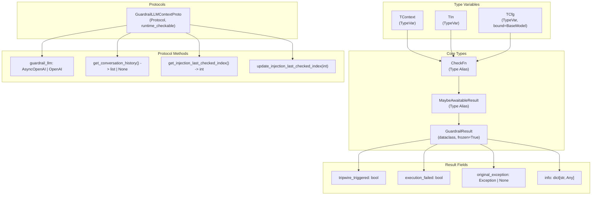
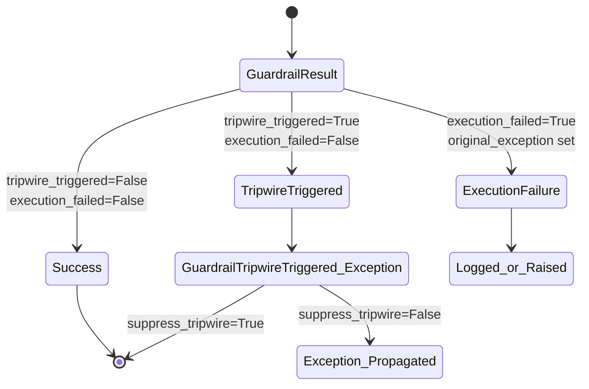
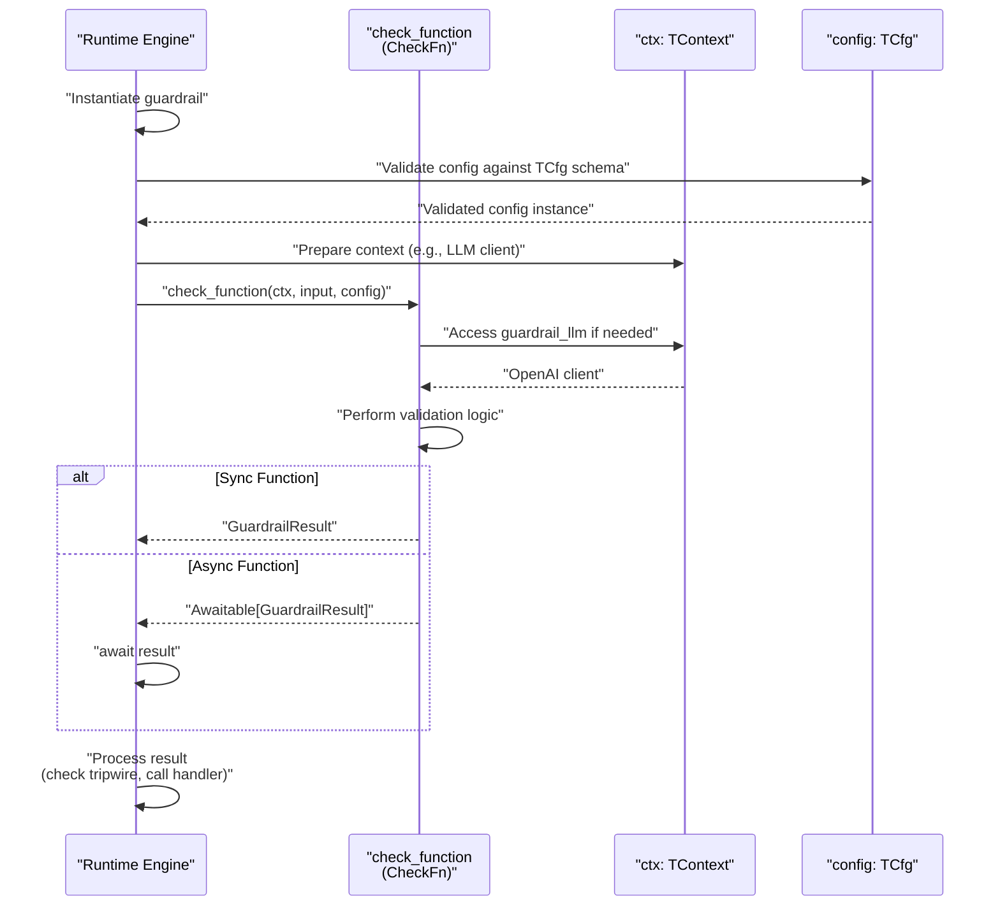
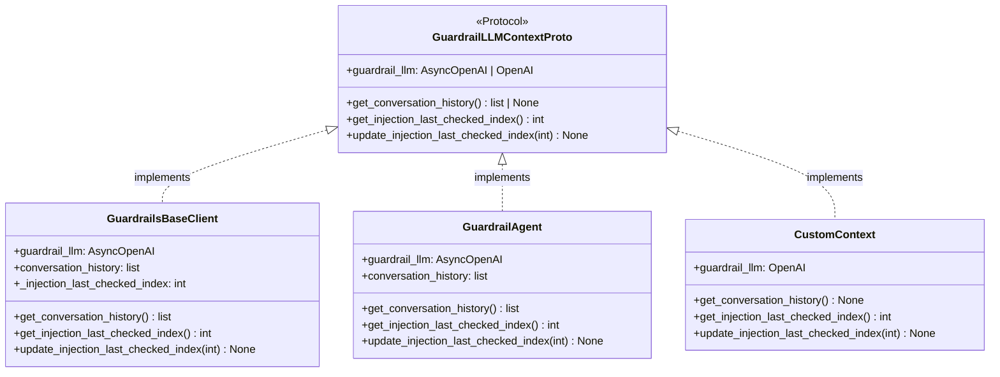
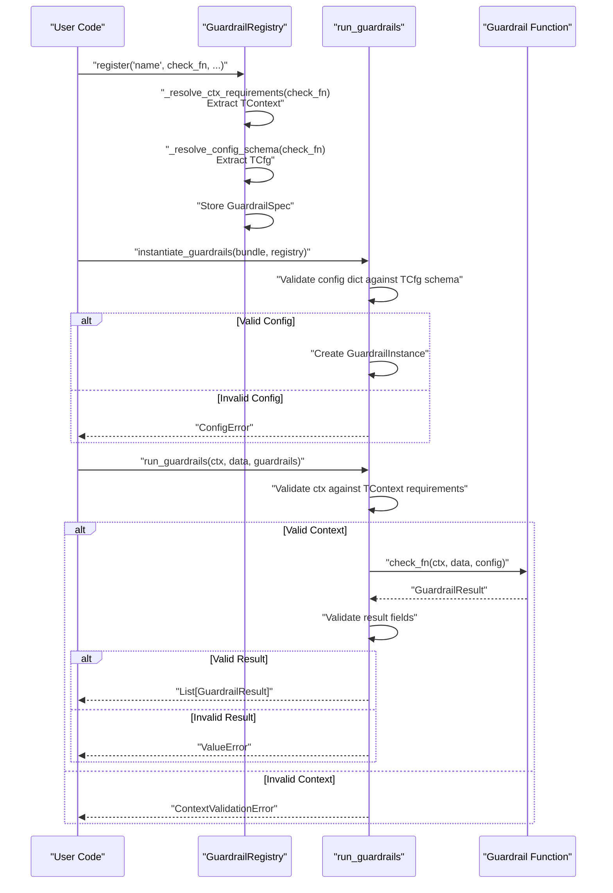

<!-- source: DeepWiki mcp.deepwiki.com · repo openai/openai-guardrails-python · page 10.4 Type Definitions · fetched 2026-10-26 -->

# Type Definitions

<details>
<summary>Relevant source files</summary>

The following files were used as context for generating this wiki page:

- [pyproject.toml](pyproject.toml)
- [src/guardrails/__init__.py](src/guardrails/__init__.py)
- [src/guardrails/checks/text/llm_base.py](src/guardrails/checks/text/llm_base.py)

</details>


This page documents the core type definitions, protocols, and type aliases defined in [src/guardrails/types.py](). These types form the foundation of the guardrails system, defining how guardrail functions are structured, what they return, and how they access runtime context.

For conceptual explanations of the type system, see [Type System and Protocols](#3.2). For configuration-related types like `ConfigBundle` and `PipelineBundles`, see [Configuration Schema](#10.4). For exception types, see [Exception Types](#10.5).

---

## Overview of Core Types

The guardrails type system consists of four primary components:

| Type | Purpose | Location |
|------|---------|----------|
| `GuardrailResult` | Dataclass representing the outcome of a guardrail check | [src/guardrails/types.py:60-90]() |
| `CheckFn` | Type alias defining guardrail function signatures | [src/guardrails/types.py:92-108]() |
| `GuardrailLLMContextProto` | Protocol for context objects providing LLM client access | [src/guardrails/types.py:30-58]() |
| Type Variables | Generic type parameters (`TContext`, `TIn`, `TCfg`) | [src/guardrails/types.py:92-94]() |

**Type System Architecture**



Sources: [src/guardrails/types.py:1-109]()

---

## GuardrailResult

`GuardrailResult` is a frozen dataclass that encapsulates the outcome of a guardrail check. All guardrail functions must return this type (or an awaitable resolving to it).

### Structure

```python
@dataclass(frozen=True, slots=True)
class GuardrailResult:
    tripwire_triggered: bool
    execution_failed: bool = False
    original_exception: Exception | None = None
    info: dict[str, Any] = field(default_factory=dict)
```

| Field | Type | Required | Description |
|-------|------|----------|-------------|
| `tripwire_triggered` | `bool` | Yes | `True` if the guardrail identified a critical failure that should halt execution |
| `execution_failed` | `bool` | No | `True` if the guardrail itself failed to execute properly (defaults to `False`) |
| `original_exception` | `Exception \| None` | No | The original exception if `execution_failed=True` (defaults to `None`) |
| `info` | `dict[str, Any]` | No | Additional structured metadata about the check result (defaults to empty dict) |

### Characteristics

**Immutability**: The dataclass is frozen, preventing modification after construction [src/guardrails/types.py:60](). Attempting to mutate fields raises `FrozenInstanceError` [tests/unit/test_types.py:40-46]().

**Validation**: The `__post_init__` method enforces consistency - if `execution_failed=True`, then `original_exception` must be provided [src/guardrails/types.py:83-89]():

```python
def __post_init__(self) -> None:
    if self.execution_failed and self.original_exception is None:
        raise ValueError(
            "When execution_failed=True, original_exception must be provided"
        )
```

**Info Field**: The `info` dictionary may contain additional metadata like:
- `checked_text`: The processed/validated text when applicable
- Error details, matched patterns, or diagnostic messages
- Model-specific information (e.g., confidence scores)

Each instance gets a unique `info` dict via `default_factory` [tests/unit/test_types.py:49-58]().

**GuardrailResult State Diagram**



Sources: [src/guardrails/types.py:60-90](), [tests/unit/test_types.py:40-58]()

---

## CheckFn Type Alias

`CheckFn` is a generic type alias defining the signature for all guardrail functions. It uses three type variables to provide type safety while maintaining flexibility.

### Definition

```python
TContext = TypeVar("TContext")
TIn = TypeVar("TIn")
TCfg = TypeVar("TCfg", bound=BaseModel)
MaybeAwaitableResult = GuardrailResult | Awaitable[GuardrailResult]
CheckFn = Callable[[TContext, TIn, TCfg], MaybeAwaitableResult]
```

[src/guardrails/types.py:92-108]()

### Type Parameters

| Parameter | Description | Constraint |
|-----------|-------------|------------|
| `TContext` | Context type providing runtime resources (often implements `GuardrailLLMContextProto`) | None |
| `TIn` | Input data type to validate (e.g., `str`, `dict`, custom types) | None |
| `TCfg` | Configuration type for the guardrail | Must be a Pydantic `BaseModel` |

### Function Signature

A function conforming to `CheckFn` has this signature:

```python
def check_function(
    ctx: TContext,
    value: TIn,
    config: TCfg
) -> GuardrailResult | Awaitable[GuardrailResult]:
    ...
```

**CheckFn Execution Flow**



### Usage Example

The following example shows a length-checking guardrail conforming to `CheckFn` [tests/unit/test_runtime.py:78-81]():

```python
from pydantic import BaseModel
from guardrails.types import GuardrailResult, CheckFn

class LenCfg(BaseModel):
    threshold: int

class CtxProto(Protocol):
    user: str

def len_check(ctx: CtxProto, data: str, config: LenCfg) -> GuardrailResult:
    return GuardrailResult(tripwire_triggered=len(data) > config.threshold)

# Type-safe assignment
fn: CheckFn[CtxProto, str, LenCfg] = len_check
```

Sources: [src/guardrails/types.py:92-108](), [tests/unit/test_types.py:61-76](), [tests/unit/test_runtime.py:66-88]()

---

## GuardrailLLMContextProto

`GuardrailLLMContextProto` is a runtime-checkable Protocol defining the interface for context objects that provide access to OpenAI clients and conversation history. Classes implementing this protocol can be used as the `TContext` parameter in guardrail functions.

### Protocol Definition

```python
@runtime_checkable
class GuardrailLLMContextProto(Protocol):
    guardrail_llm: AsyncOpenAI | OpenAI | AsyncAzureOpenAI | AzureOpenAI
    
    def get_conversation_history(self) -> list | None: ...
    def get_injection_last_checked_index(self) -> int: ...
    def update_injection_last_checked_index(self, new_index: int) -> None: ...
```

[src/guardrails/types.py:30-58]()

### Protocol Members

**Attribute: `guardrail_llm`**

The OpenAI client instance used by guardrails for making LLM calls. Supports both standard and Azure clients, sync and async variants.

**Method: `get_conversation_history()`**

Returns the full conversation history if available, `None` otherwise. Used by conversation-aware guardrails like prompt injection detection [src/guardrails/types.py:46-48]().

Default implementation:
```python
def get_conversation_history(self) -> list | None:
    return getattr(self, "conversation_history", None)
```

**Method: `get_injection_last_checked_index()`**

Returns the last checked index for incremental prompt injection detection. Allows guardrails to check only new messages rather than re-checking the entire history [src/guardrails/types.py:50-52]().

Default implementation:
```python
def get_injection_last_checked_index(self) -> int:
    return getattr(self, "injection_last_checked_index", 0)
```

**Method: `update_injection_last_checked_index(new_index)`**

Updates the last checked index after processing messages [src/guardrails/types.py:54-57]().

Default implementation:
```python
def update_injection_last_checked_index(self, new_index: int) -> None:
    if hasattr(self, "_client"):
        self._client._injection_last_checked_index = new_index
```

### Protocol Implementation Pattern

**GuardrailLLMContextProto Implementation**



### Usage in Guardrail Functions

Guardrails access the LLM client through the context [tests/unit/test_types.py:79-95]():

```python
from guardrails.types import GuardrailLLMContextProto, GuardrailResult
from pydantic import BaseModel

class MyCfg(BaseModel):
    prompt: str

async def my_guardrail(
    ctx: GuardrailLLMContextProto,
    text: str,
    config: MyCfg
) -> GuardrailResult:
    # Access LLM client
    response = await ctx.guardrail_llm.chat.completions.create(
        model="gpt-4o-mini",
        messages=[{"role": "user", "content": config.prompt}]
    )
    
    # Access conversation history if available
    history = ctx.get_conversation_history()
    if history:
        # Process history...
        pass
    
    return GuardrailResult(tripwire_triggered=False)
```

Sources: [src/guardrails/types.py:30-58](), [tests/unit/test_types.py:79-95]()

---

## Type Variables and Aliases

The type system uses several generic type variables to provide flexibility while maintaining type safety.

### Type Variables

**TContext**

Generic type variable for context objects [src/guardrails/types.py:92]().

- Unconstrained - can be any type
- Typically implements `GuardrailLLMContextProto` for LLM access
- May be a simple dataclass, Protocol, or custom class
- Examples: `CtxProto`, `GuardrailsBaseClient`, `GuardrailAgent`

**TIn**

Generic type variable for input data [src/guardrails/types.py:93]().

- Unconstrained - can be any type
- Common types: `str`, `dict`, `list`, custom domain objects
- Guardrails validate this input data
- Examples: plain text strings, parsed messages, structured data

**TCfg**

Generic type variable for configuration, bounded to Pydantic `BaseModel` [src/guardrails/types.py:94]().

- Must be a Pydantic `BaseModel` subclass
- Provides schema validation for guardrail configuration
- Loaded from `guardrails_config.json` and validated at instantiation time
- Examples: `LenCfg`, `ModerationConfig`, `PIIDetectionConfig`

### Type Aliases

**MaybeAwaitableResult**

Type alias supporting both synchronous and asynchronous guardrails [src/guardrails/types.py:95]():

```python
MaybeAwaitableResult = GuardrailResult | Awaitable[GuardrailResult]
```

Allows guardrail functions to be either:
- Synchronous: returns `GuardrailResult` directly
- Asynchronous: returns `Awaitable[GuardrailResult]` (typically from `async def`)

The runtime engine handles both cases transparently [src/guardrails/runtime.py]().

**Type Variable Relationships**

```mermaid
graph TB
    subgraph "CheckFn Type Signature"
        CheckFnDef["CheckFn[TContext, TIn, TCfg]"]
    end
    
    subgraph "TContext Examples"
        TC1["GuardrailLLMContextProto"]
        TC2["GuardrailsBaseClient"]
        TC3["Custom dataclass"]
        TC4["Protocol with 'user' field"]
    end
    
    subgraph "TIn Examples"
        TI1["str (plain text)"]
        TI2["dict (messages)"]
        TI3["list (conversation)"]
        TI4["Custom domain object"]
    end
    
    subgraph "TCfg Examples"
        TCF1["BaseModel subclass"]
        TCF2["ModerationConfig"]
        TCF3["PIIDetectionConfig"]
        TCF4["No config = _NoConfig"]
    end
    
    subgraph "Return Type"
        RT1["GuardrailResult (sync)"]
        RT2["Awaitable[GuardrailResult] (async)"]
        MaybeAwaitable["MaybeAwaitableResult"]
    end
    
    CheckFnDef --> TC1
    CheckFnDef --> TC2
    CheckFnDef --> TC3
    CheckFnDef --> TC4
    
    CheckFnDef --> TI1
    CheckFnDef --> TI2
    CheckFnDef --> TI3
    CheckFnDef --> TI4
    
    CheckFnDef --> TCF1
    CheckFnDef --> TCF2
    CheckFnDef --> TCF3
    CheckFnDef --> TCF4
    
    CheckFnDef --> MaybeAwaitable
    MaybeAwaitable --> RT1
    MaybeAwaitable --> RT2
```



Sources: [src/guardrails/types.py:92-96]()

---

## Type Resolution in the Registry System

The guardrail registry system uses these type definitions to perform automatic type resolution and validation. When registering a guardrail, the registry introspects the `CheckFn` signature to extract type requirements.

### Context Type Resolution

The registry resolves context requirements via `_resolve_ctx_requirements()` [src/guardrails/registry.py]():

- **Protocol annotations**: Creates a Pydantic model with matching fields [tests/unit/test_registry.py:25-48]()
- **BaseModel annotations**: Returns the model unchanged [tests/unit/test_registry.py:50-64]()

Example:
```python
class CtxProto(Protocol):
    foo: int

def check(ctx: CtxProto, value: str, config: int) -> GuardrailResult:
    ...

# Registry creates: class CtxProtoModel(BaseModel): foo: int
```

### Configuration Schema Resolution

The registry resolves configuration schema via `_resolve_config_schema()` [src/guardrails/registry.py]():

- **BaseModel subclass**: Returns the config model [tests/unit/test_registry.py:74-78]()
- **None type**: Returns `_NoConfig` sentinel [tests/unit/test_registry.py:81-83]()

Example:
```python
class Cfg(BaseModel):
    threshold: int

def with_cfg(ctx: object, value: str, config: Cfg) -> GuardrailResult:
    ...

# Registry extracts: Cfg

def without_cfg(ctx: object, value: str, config: None) -> GuardrailResult:
    ...

# Registry extracts: _NoConfig
```

Sources: [tests/unit/test_registry.py:25-86]()

---

## Type Safety and Runtime Validation

The type system provides both compile-time and runtime safety:

### Compile-Time Safety

When using type checkers like `mypy`, the generic type parameters ensure:
- Context objects have required attributes
- Input data matches expected types
- Configuration objects are valid Pydantic models
- Return types are consistent

### Runtime Safety

At runtime, the system validates:
- `GuardrailResult` field consistency via `__post_init__` [src/guardrails/types.py:83-89]()
- Configuration data against Pydantic schemas [tests/unit/test_runtime.py:197-205]()
- Context objects against Protocol requirements [tests/unit/test_runtime.py:270-289]()

**Type Validation Flow**



Sources: [src/guardrails/types.py:83-89](), [tests/unit/test_runtime.py:197-289]()

---

## Summary Table

| Type | Kind | Purpose | Key Features |
|------|------|---------|--------------|
| `GuardrailResult` | Dataclass | Return value from guardrail checks | Frozen, validated, contains tripwire/error info |
| `CheckFn` | Type Alias | Function signature for guardrails | Generic over context, input, config types |
| `GuardrailLLMContextProto` | Protocol | Interface for context objects | Provides LLM client access and conversation history |
| `TContext` | TypeVar | Generic context parameter | Unconstrained, often implements `GuardrailLLMContextProto` |
| `TIn` | TypeVar | Generic input parameter | Unconstrained, typically `str` or structured data |
| `TCfg` | TypeVar | Generic config parameter | Bounded to `BaseModel` for schema validation |
| `MaybeAwaitableResult` | Type Alias | Return type allowing sync/async | Union of `GuardrailResult` and `Awaitable[GuardrailResult]` |

Sources: [src/guardrails/types.py:1-109]()

---

