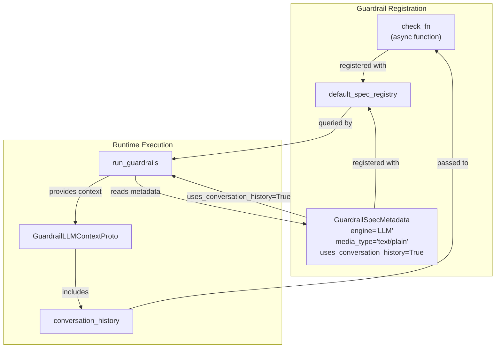
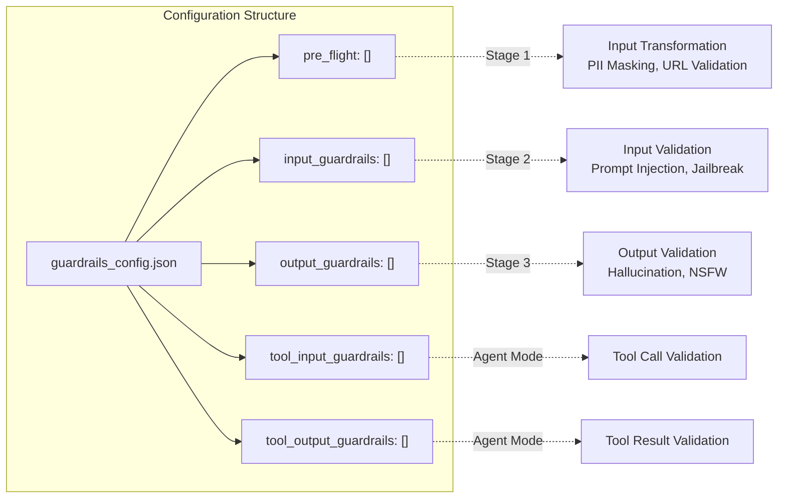
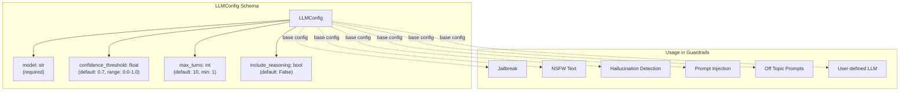
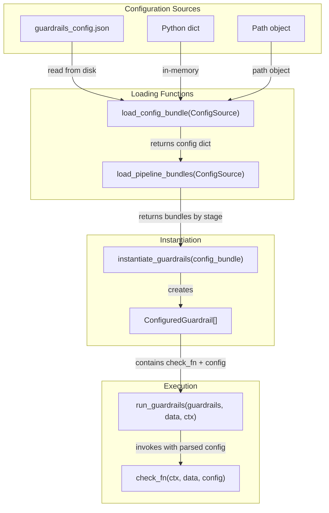
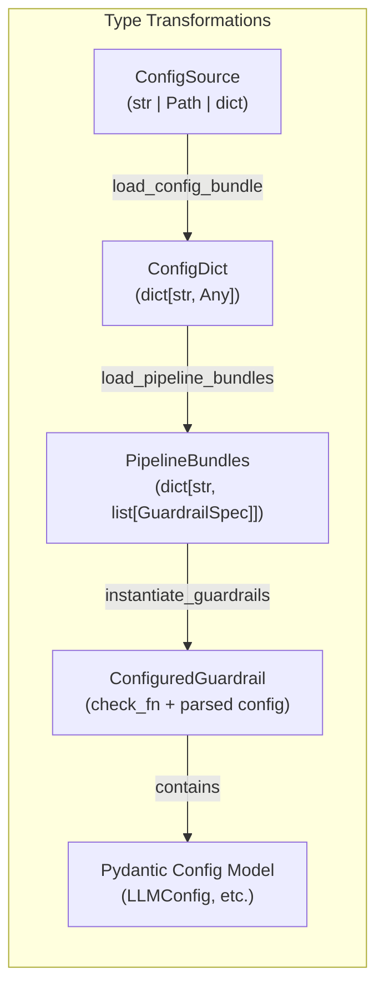

<!-- source: DeepWiki mcp.deepwiki.com · repo openai/openai-guardrails-python · page 10.5 Configuration Schema · fetched 2026-10-26 -->

# Configuration Schema

<details>
<summary>Relevant source files</summary>

The following files were used as context for generating this wiki page:

- [pyproject.toml](pyproject.toml)
- [src/guardrails/__init__.py](src/guardrails/__init__.py)
- [src/guardrails/checks/text/llm_base.py](src/guardrails/checks/text/llm_base.py)

</details>


## Purpose and Scope

This page documents the configuration schema types and structures used throughout the OpenAI Guardrails framework. It covers `ConfigSource`, `GuardrailSpecMetadata`, pipeline configuration structure, and guardrail-specific configuration schemas like `LLMConfig`.

For information about loading and using these configurations at runtime, see [Runtime Utilities](#10.3). For the client-level integration of configurations, see [Client Classes](#10.2). For an overview of configuration file generation and structure, see [Configuration Files](#2.2).

---

## ConfigSource

`ConfigSource` is a type alias that represents the various sources from which guardrail configurations can be loaded. It supports multiple input formats to enable flexible configuration management.

**Type Definition:**
```
ConfigSource = str | Path | dict[str, Any]
```

The `ConfigSource` type accepts:
- **String paths**: File path to a `guardrails_config.json` file
- **Path objects**: `pathlib.Path` instances pointing to configuration files
- **Dictionary objects**: In-memory configuration dictionaries with the same structure as the JSON format

This flexibility allows configurations to be loaded from disk during development, embedded as constants in application code, or generated dynamically at runtime.

**Sources:** [src/guardrails/__init__.py:33](), [src/guardrails/runtime (inferred)]()

---

## GuardrailSpecMetadata

`GuardrailSpecMetadata` describes the execution characteristics and requirements of a guardrail. This metadata is registered alongside each guardrail check function in the `default_spec_registry` and is used by the runtime to determine how to execute the guardrail.

### Metadata Fields

| Field | Type | Description |
|-------|------|-------------|
| `engine` | `str` | Execution engine type: `"API"` for external API calls, `"LLM"` for language model-based checks |
| `media_type` | `str` | Content type the guardrail operates on (e.g., `"text/plain"`) |
| `uses_conversation_history` | `bool` | Whether the guardrail requires multi-turn conversation context |

### Metadata Usage Diagram



**Metadata-Based Execution Logic:**

1. **Engine Type**: Determines resource requirements
   - `"API"`: May call external services (OpenAI Moderation API, Presidio)
   - `"LLM"`: Requires access to `guardrail_llm` client from context

2. **Conversation Awareness**: Controls context propagation
   - `True`: Guardrail receives full `GuardrailLLMContextProto` with conversation history
   - `False`: Guardrail receives extracted text only

3. **Media Type**: Indicates expected input format
   - `"text/plain"`: Standard text content
   - Future extension point for image, audio, etc.

**Example Registration:**

The registration pattern is visible in the LLM guardrail factory:

[src/guardrails/checks/text/llm_base.py:588-594]()

**Sources:** [src/guardrails/__init__.py:42](), [src/guardrails/checks/text/llm_base.py:593](), [src/guardrails/spec (inferred)]()

---

## Pipeline Configuration Structure

Guardrail pipelines are defined in JSON configuration files, typically named `guardrails_config.json`. The configuration specifies which guardrails to run at each stage of the execution pipeline.

### Pipeline Stages



### Configuration File Schema

A complete configuration file has the following structure:

```json
{
  "pre_flight": [
    {
      "name": "Contains PII",
      "config": {
        "entities": ["PERSON", "EMAIL_ADDRESS"],
        "action": "mask"
      }
    }
  ],
  "input_guardrails": [
    {
      "name": "Prompt Injection",
      "config": {
        "model": "gpt-4o-mini",
        "confidence_threshold": 0.7
      }
    }
  ],
  "output_guardrails": [
    {
      "name": "NSFW Text",
      "config": {
        "model": "gpt-4o-mini",
        "confidence_threshold": 0.8
      }
    }
  ],
  "tool_input_guardrails": [],
  "tool_output_guardrails": []
}
```

### Stage Execution Semantics

| Stage | Execution Timing | Modifies Input | Runs Concurrently with LLM |
|-------|-----------------|----------------|---------------------------|
| `pre_flight` | Before input validation | Yes | No |
| `input_guardrails` | Before/during LLM call | No | Yes |
| `output_guardrails` | After LLM response | No | No |
| `tool_input_guardrails` | Before each tool call (agents) | No | N/A |
| `tool_output_guardrails` | After each tool result (agents) | No | N/A |

**Key Characteristics:**

- **Pre-flight**: Executes sequentially, can transform input (e.g., PII masking)
- **Input Guardrails**: Execute concurrently with LLM call to minimize latency
- **Output Guardrails**: Execute after receiving LLM response
- **Tool-Level**: Only used in agent mode, separate from agent-level guardrails

**Sources:** [src/guardrails/runtime (inferred)](), High-level diagrams (Diagram 2, 3)

---

## Guardrail-Specific Configuration Schemas

Each guardrail check function accepts a configuration object that controls its behavior. Configuration schemas are Pydantic models that validate parameters and provide type safety.

### LLMConfig Schema

`LLMConfig` is the base configuration schema for all LLM-based guardrails. It provides common parameters for model selection, confidence thresholds, and conversation handling.



#### Field Definitions

**model** (required)
- Type: `str`
- Description: OpenAI model identifier to use for guardrail analysis
- Examples: `"gpt-4o-mini"`, `"gpt-4o"`, `"gpt-4-turbo"`

**confidence_threshold** (optional)
- Type: `float`
- Default: `0.7`
- Range: `0.0` to `1.0`
- Description: Minimum confidence score required to trigger the guardrail tripwire. The LLM returns a confidence value, and if it exceeds this threshold, `tripwire_triggered` is set to `True`.

**max_turns** (optional)
- Type: `int`
- Default: `10`
- Minimum: `1`
- Description: Maximum number of conversation turns to include in analysis. Set to `1` for single-turn behavior. Higher values enable multi-turn context analysis for conversation-aware guardrails.

**include_reasoning** (optional)
- Type: `bool`
- Default: `False`
- Description: Whether to include reasoning/explanation in the guardrail output. When enabled, uses `LLMReasoningOutput` schema which includes a `reason` field. Disabled by default to save tokens in production.

#### Configuration Model Details

[src/guardrails/checks/text/llm_base.py:82-120]()

The `LLMConfig` class uses Pydantic's `ConfigDict(extra="forbid")` to prevent accidental typos in configuration keys. Field validation ensures `confidence_threshold` is within `[0.0, 1.0]` and `max_turns` is at least `1`.

**Sources:** [src/guardrails/checks/text/llm_base.py:82-120]()

---

### Extended LLM Configuration Schemas

Some guardrails extend `LLMConfig` with additional fields specific to their functionality.

#### Example: Extended Config Pattern

```python
class HallucinationConfig(LLMConfig):
    knowledge_source: str = Field(
        ...,
        description="Vector store ID or file search tool configuration"
    )
```

Guardrails may extend `LLMConfig` by:
1. Inheriting from `LLMConfig` or using `config_model` parameter in `create_llm_check_fn`
2. Adding domain-specific fields (e.g., `knowledge_source`, `allowed_topics`)
3. Maintaining compatibility with base LLM execution infrastructure

**Sources:** [src/guardrails/checks (inferred)](), [src/guardrails/checks/text/llm_base.py:491]()

---

## Configuration Loading and Instantiation

Configuration objects flow from JSON files through the runtime system to guardrail check functions.



### Loading Process

1. **Source Parsing**: `load_config_bundle` accepts a `ConfigSource` (file path, Path object, or dict) and returns a normalized configuration dictionary.

2. **Pipeline Extraction**: `load_pipeline_bundles` separates the configuration into stage-specific bundles (pre_flight, input_guardrails, etc.).

3. **Guardrail Instantiation**: `instantiate_guardrails` creates `ConfiguredGuardrail` objects by:
   - Looking up check functions by name in `default_spec_registry`
   - Parsing the `config` dict using the check function's expected config schema
   - Validating configuration using Pydantic

4. **Runtime Execution**: `run_guardrails` invokes each check function with its validated configuration object.

### Configuration Type Flow



The type transformations ensure:
- **Early Validation**: Configuration errors are caught during instantiation, not execution
- **Type Safety**: Pydantic models provide runtime type checking
- **Immutability**: `ConfiguredGuardrail` objects are created once and reused

**Sources:** [src/guardrails/__init__.py:33-41](), [src/guardrails/runtime (inferred)]()

---

## Configuration Schema Validation

All configuration schemas use Pydantic for validation, providing:

- **Field Validation**: Type checking, range constraints (e.g., `confidence_threshold` in [0.0, 1.0])
- **Required vs Optional**: Clear distinction between required fields (e.g., `model`) and optional fields with defaults
- **Extra Field Prevention**: `ConfigDict(extra="forbid")` catches typos and invalid keys
- **JSON Serialization**: Seamless conversion between JSON config files and Python objects

### Validation Error Handling

Configuration validation errors occur during the instantiation phase:

```python
# Invalid confidence_threshold
{
  "name": "Jailbreak",
  "config": {
    "model": "gpt-4o-mini",
    "confidence_threshold": 1.5  # ERROR: > 1.0
  }
}
# Raises: pydantic.ValidationError
```

Validation failures prevent the creation of `ConfiguredGuardrail` objects, ensuring that only valid configurations reach the runtime execution phase.

**Sources:** [src/guardrails/checks/text/llm_base.py:119]()

---

