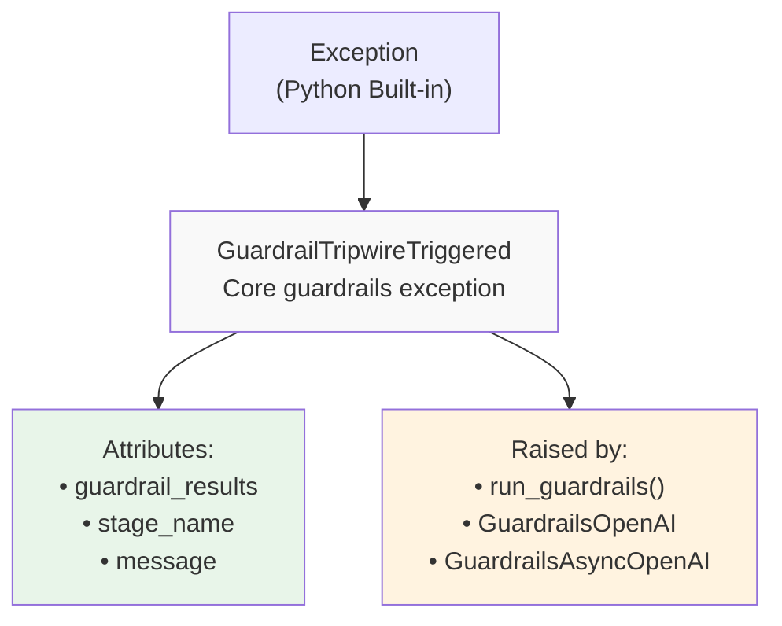
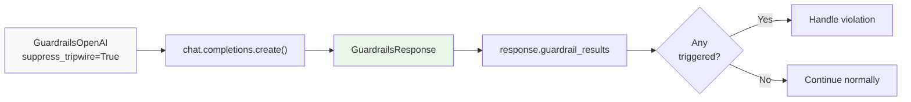
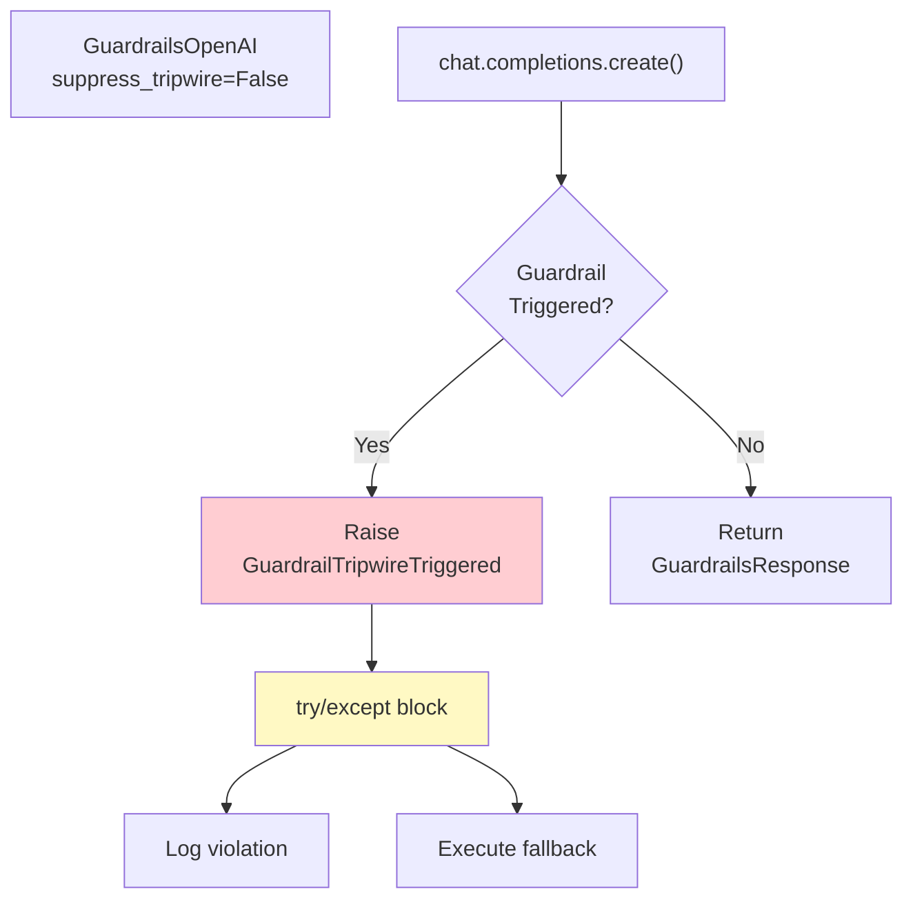
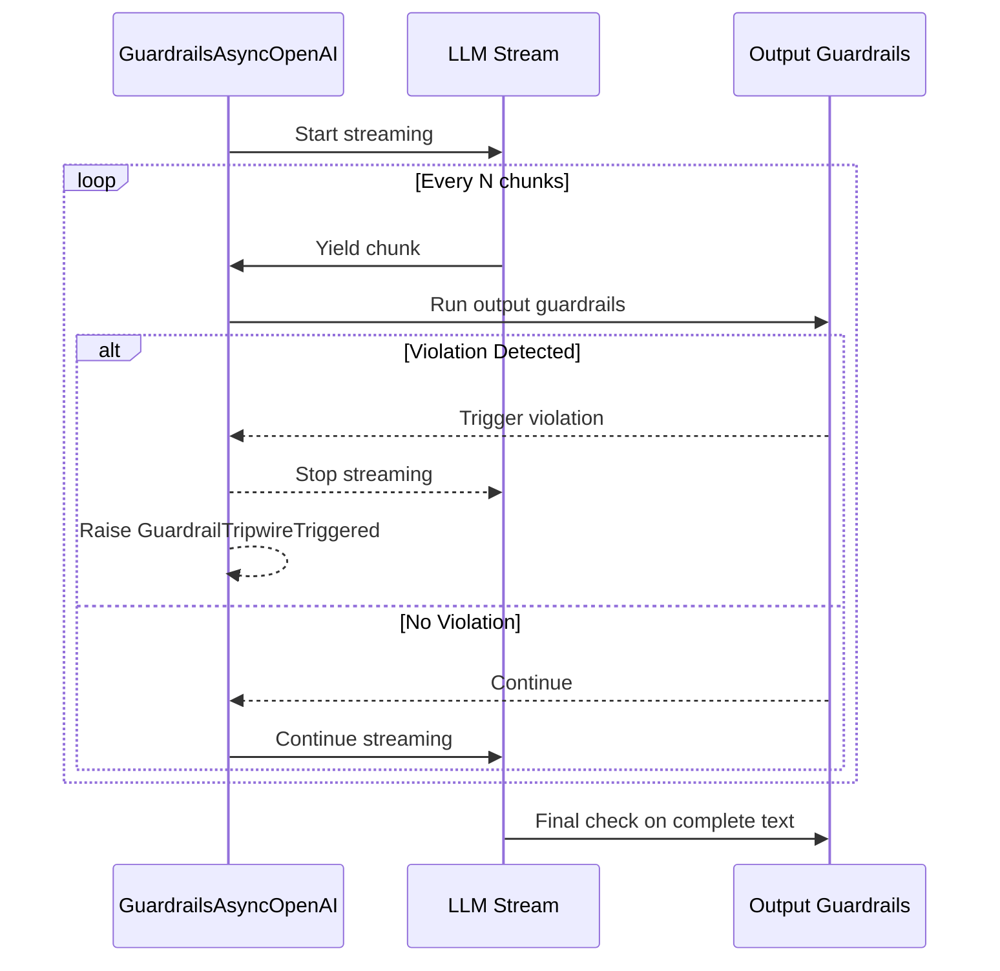
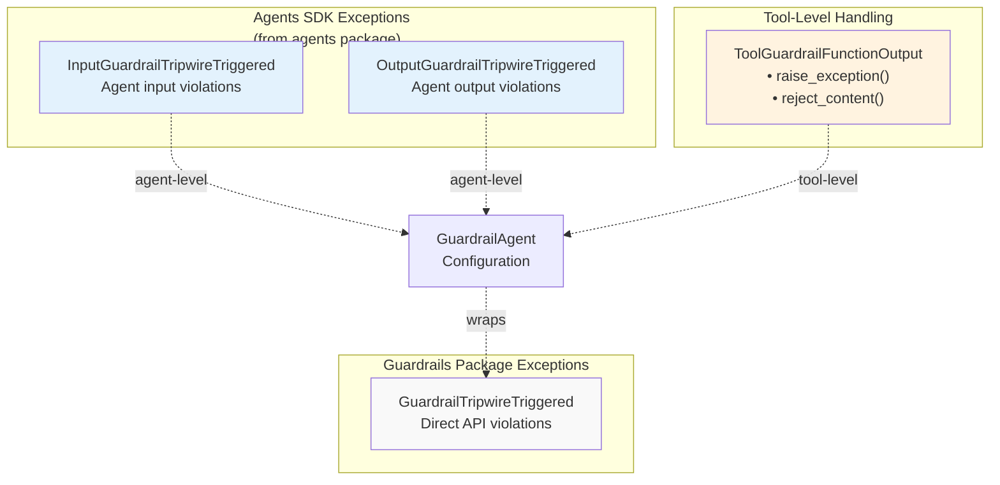
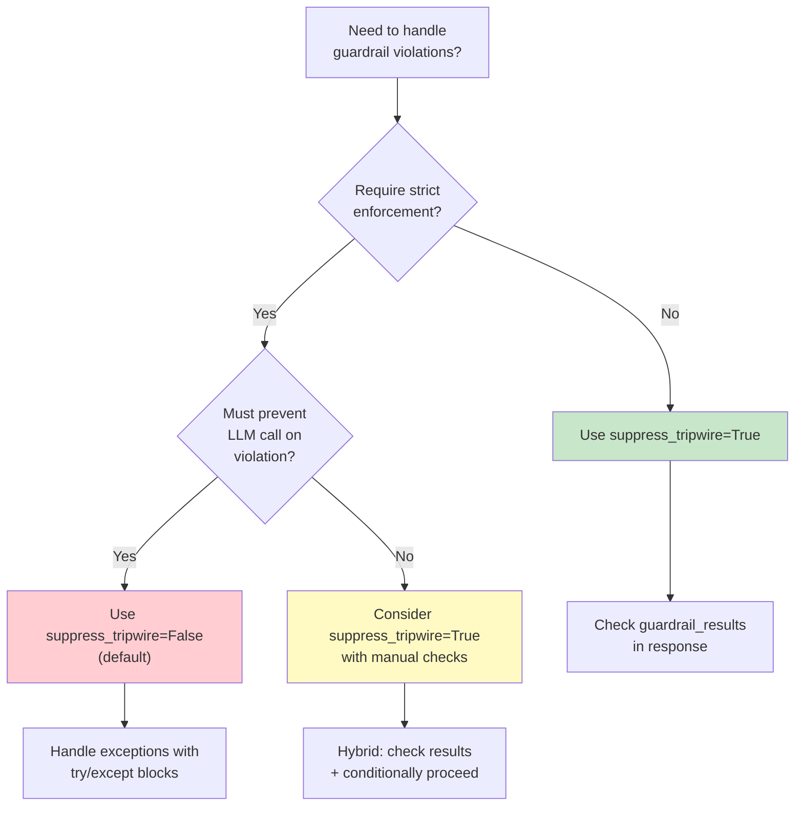
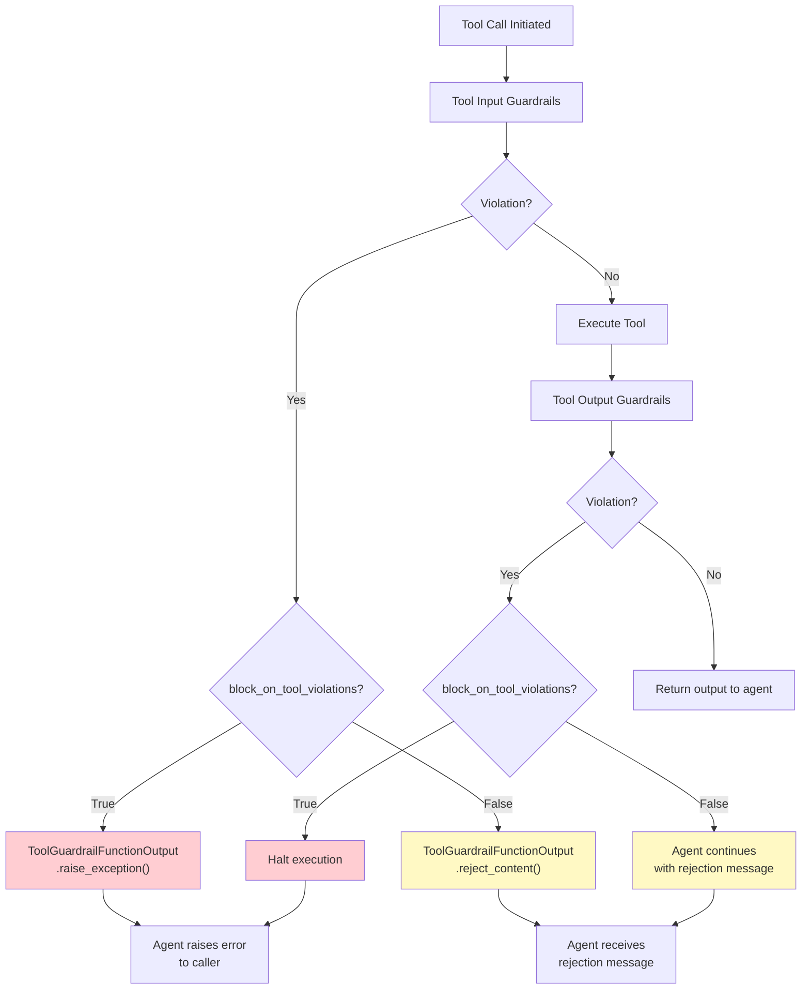
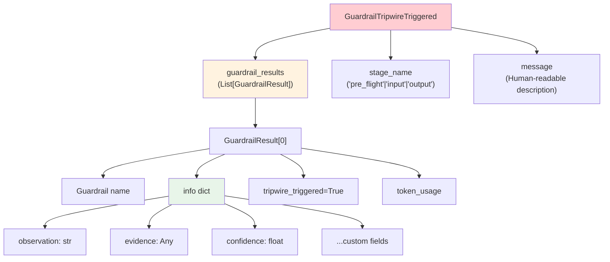

<!-- source: DeepWiki mcp.deepwiki.com · repo openai/openai-guardrails-python · page 10.6 Exception Types · fetched 2026-10-26 -->

# Exception Types

<details>
<summary>Relevant source files</summary>

The following files were used as context for generating this wiki page:

- [examples/basic/agents_sdk.py](examples/basic/agents_sdk.py)
- [pyproject.toml](pyproject.toml)
- [src/guardrails/__init__.py](src/guardrails/__init__.py)
- [src/guardrails/_streaming.py](src/guardrails/_streaming.py)
- [src/guardrails/agents.py](src/guardrails/agents.py)
- [tests/unit/test_agents.py](tests/unit/test_agents.py)

</details>


This page documents the exception types raised by the OpenAI Guardrails framework when guardrail violations occur. These exceptions provide structured information about which guardrail triggered, what data was flagged, and metadata about the violation.

For information about configuring tripwire behavior, see [Error Handling and Tripwires](#2.3). For details on agent-level exception handling, see [Agent Exception Handling](#5.4).

---

## Overview

The guardrails framework uses a structured exception system to signal policy violations during execution. The core exception type is `GuardrailTripwireTriggered`, which is raised when any guardrail detects a violation and the execution is configured to halt (i.e., when `suppress_tripwire=False`, which is the default behavior).

**Key Concepts:**

| Concept | Description |
|---------|-------------|
| **Tripwire** | A boolean flag indicating whether a guardrail detected a violation |
| **Suppression** | Using `suppress_tripwire=True` to receive results without exceptions |
| **Exception Hierarchy** | Guardrails package vs Agents SDK exception types |
| **Stage Context** | Which pipeline stage triggered the exception (pre_flight, input, output) |

Sources: [src/guardrails/__init__.py:30](), [src/guardrails/_streaming.py:14]()

---

## GuardrailTripwireTriggered

The primary exception type raised when a guardrail violation occurs. This exception is exported from the main `guardrails` package and is the standard mechanism for halting execution when policy violations are detected.

### Exception Structure



**Diagram: GuardrailTripwireTriggered Exception Structure**

Sources: [src/guardrails/__init__.py:30](), [src/guardrails/_streaming.py:14]()

### When Raised

The exception is raised in the following scenarios:

1. **During Client Operations** - When using `GuardrailsOpenAI` or `GuardrailsAsyncOpenAI` clients with `suppress_tripwire=False` (default)
2. **During Runtime Execution** - When calling `run_guardrails()` directly without suppression
3. **During Streaming** - Periodically during stream processing when violations are detected

### Exception Attributes

While the exact implementation is in `src/guardrails/exceptions.py` (not provided in the files), the exception carries:

- **`guardrail_results`**: List of `GuardrailResult` objects indicating which guardrails triggered
- **`stage_name`**: Pipeline stage where violation occurred ("pre_flight", "input", or "output")  
- **`message`**: Human-readable description of the violation

Sources: [src/guardrails/_streaming.py:61-64](), [src/guardrails/_streaming.py:117-120]()

---

## Exception Handling Patterns

### Pattern 1: Suppress and Inspect Results

The most common pattern is to suppress exceptions and inspect results programmatically:



**Diagram: Suppression Pattern - No Exceptions Raised**

**Implementation:**

```python
# Client configured with suppress_tripwire=True
client = GuardrailsOpenAI(suppress_tripwire=True)
response = client.chat.completions.create(...)

# Check results without exceptions
for stage, results in response.guardrail_results.items():
    for result in results:
        if result.tripwire_triggered:
            # Handle violation programmatically
            print(f"Violation in {stage}: {result.info}")
```

Sources: [src/guardrails/_streaming.py:31](), [src/guardrails/_streaming.py:59]()

### Pattern 2: Exception-Based Control Flow

Using exceptions for strict enforcement:



**Diagram: Exception-Based Pattern - Strict Enforcement**

**Implementation:**

```python
# Client configured with strict mode (default)
client = GuardrailsOpenAI(suppress_tripwire=False)

try:
    response = client.chat.completions.create(...)
    # Process response normally
except GuardrailTripwireTriggered as e:
    # Handle violation with exception
    print(f"Guardrail triggered: {e.message}")
    print(f"Stage: {e.stage_name}")
    print(f"Results: {e.guardrail_results}")
```

Sources: [src/guardrails/_streaming.py:61-64](), [src/guardrails/_streaming.py:117-120]()

### Pattern 3: Streaming with Periodic Checks

During streaming, exceptions can be raised mid-stream:



**Diagram: Streaming Exception Flow**

Sources: [src/guardrails/_streaming.py:49-64](), [src/guardrails/_streaming.py:104-120]()

---

## Agents SDK Exception Integration

When using `GuardrailAgent` with the OpenAI Agents SDK, different exception types are used that are native to the agents framework. These are distinct from the guardrails package exceptions.

### Agent Exception Types



**Diagram: Exception Types by Integration Pattern**

Sources: [examples/basic/agents_sdk.py:7-8](), [examples/basic/agents_sdk.py:79-88](), [src/guardrails/agents.py:229-235]()

### Agent Exception Handling Example

```python
from agents import (
    InputGuardrailTripwireTriggered,
    OutputGuardrailTripwireTriggered,
    Runner,
)
from guardrails import GuardrailAgent

agent = GuardrailAgent(
    config="guardrails_config.json",
    name="Support Agent",
)

try:
    result = await Runner.run(agent, user_input)
except InputGuardrailTripwireTriggered as exc:
    # Agent-level input guardrail triggered
    print(f"Input blocked: {exc.guardrail_result.guardrail.name}")
    print(f"Details: {exc.guardrail_result.output.output_info}")
except OutputGuardrailTripwireTriggered as exc:
    # Agent-level output guardrail triggered
    print(f"Output blocked: {exc.guardrail_result.guardrail.name}")
    print(f"Details: {exc.guardrail_result.output.output_info}")
```

Sources: [examples/basic/agents_sdk.py:79-88]()

---

## Exception vs Return Value Strategies

The framework supports two distinct strategies for handling violations, configured via the `suppress_tripwire` parameter:

### Comparison Table

| Aspect | `suppress_tripwire=False` (Default) | `suppress_tripwire=True` |
|--------|-------------------------------------|--------------------------|
| **Behavior** | Raises `GuardrailTripwireTriggered` | Returns results in response object |
| **Control Flow** | Exception-based, execution halts | Programmatic checks, execution continues |
| **Use Case** | Strict enforcement, hard stops | Logging, metrics, soft warnings |
| **LLM Call** | Prevented when input guardrails trigger | Always executed regardless |
| **Response Access** | Not available when exception raised | Always available with results attached |
| **Code Complexity** | Requires try/except blocks | Simpler linear flow |

### Strategy Selection Decision Tree



**Diagram: Exception Strategy Decision Tree**

Sources: [src/guardrails/_streaming.py:31](), [src/guardrails/_streaming.py:59](), [src/guardrails/_streaming.py:91]()

---

## Error Propagation in Tool Guardrails

When using `GuardrailAgent` with tool-level guardrails, additional configuration options control how violations are handled:

### Tool Guardrail Exception Flow



**Diagram: Tool-Level Exception Handling with Configuration Options**

Sources: [src/guardrails/agents.py:278-284](), [src/guardrails/agents.py:337-342](), [src/guardrails/agents.py:609-610](), [src/guardrails/agents.py:631-632]()

### Configuration Parameters

**`raise_guardrail_errors`** (GuardrailAgent parameter):
- `False` (default): Guardrail execution errors are logged and treated as safe
- `True`: Guardrail execution errors raise exceptions and halt

**`block_on_tool_violations`** (GuardrailAgent parameter):
- `False` (default): Tool violations use `reject_content()` - agent continues with rejection message
- `True`: Tool violations use `raise_exception()` - execution halts completely

```python
# Strict mode: both execution errors and violations halt
agent = GuardrailAgent(
    config="guardrails_config.json",
    name="Strict Agent",
    raise_guardrail_errors=True,
    block_on_tool_violations=True,
)

# Permissive mode: log and continue
agent = GuardrailAgent(
    config="guardrails_config.json",
    name="Permissive Agent",
    raise_guardrail_errors=False,
    block_on_tool_violations=False,
)
```

Sources: [src/guardrails/agents.py:608-610](), [src/guardrails/agents.py:629-634](), [tests/unit/test_agents.py:289-292](), [tests/unit/test_agents.py:316-319]()

---

## Exception Inspection and Metadata

When exceptions are raised, they carry structured metadata that can be inspected for logging, debugging, and remediation:

### Available Metadata



**Diagram: Exception Metadata Structure**

### Inspection Example

```python
from guardrails import GuardrailTripwireTriggered

try:
    response = client.chat.completions.create(...)
except GuardrailTripwireTriggered as exc:
    # Stage information
    print(f"Pipeline stage: {exc.stage_name}")
    
    # Iterate through all triggered guardrails
    for result in exc.guardrail_results:
        if result.tripwire_triggered:
            print(f"\nGuardrail: {result.info.get('guardrail_name', 'Unknown')}")
            print(f"Observation: {result.info.get('observation', 'N/A')}")
            print(f"Evidence: {result.info.get('evidence', 'N/A')}")
            
            # Token usage (if LLM-based guardrail)
            if result.token_usage:
                print(f"Tokens used: {result.token_usage.total_tokens}")
```

Sources: [src/guardrails/agents.py:278](), [src/guardrails/agents.py:337]()

---

## Testing and Stubbing

In test environments, guardrail exceptions can be stubbed or mocked for unit testing:

### Test Pattern Example

```python
import pytest
from guardrails import GuardrailTripwireTriggered
from guardrails.runtime import run_guardrails

@pytest.mark.asyncio
async def test_violation_handling(monkeypatch):
    """Test exception handling when guardrail triggers."""
    
    # Mock run_guardrails to raise exception
    async def mock_run_guardrails(**kwargs):
        raise GuardrailTripwireTriggered(
            guardrail_results=[],
            stage_name="input",
            message="Test violation"
        )
    
    monkeypatch.setattr("guardrails.runtime.run_guardrails", mock_run_guardrails)
    
    # Test exception handling
    with pytest.raises(GuardrailTripwireTriggered) as exc_info:
        await run_guardrails(...)
    
    assert exc_info.value.stage_name == "input"
```

Sources: [tests/unit/test_agents.py:273-283](), [tests/unit/test_agents.py:328-351]()

---

## Summary

### Key Takeaways

1. **`GuardrailTripwireTriggered`** is the primary exception type for guardrail violations
2. **`suppress_tripwire`** parameter controls exception vs return value strategy
3. **Agents SDK** uses separate exception types (`InputGuardrailTripwireTriggered`, `OutputGuardrailTripwireTriggered`)
4. **Tool-level guardrails** have additional configuration via `block_on_tool_violations`
5. **Streaming** can raise exceptions mid-stream during periodic checks
6. **Exception metadata** provides structured information for logging and debugging

### Exception Type Reference

| Exception Type | Package | Use Case |
|----------------|---------|----------|
| `GuardrailTripwireTriggered` | `guardrails` | Direct API usage (GuardrailsOpenAI, run_guardrails) |
| `InputGuardrailTripwireTriggered` | `agents` | Agent-level input violations |
| `OutputGuardrailTripwireTriggered` | `agents` | Agent-level output violations |
| `ToolGuardrailFunctionOutput.raise_exception()` | `agents` | Tool-level violations (strict mode) |

Sources: [src/guardrails/__init__.py:30](), [examples/basic/agents_sdk.py:7-8](), [src/guardrails/agents.py:229-235]()