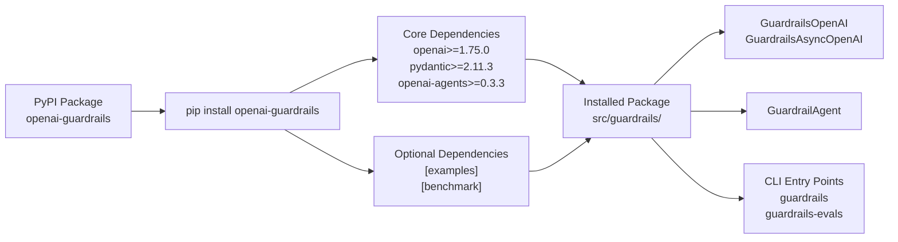
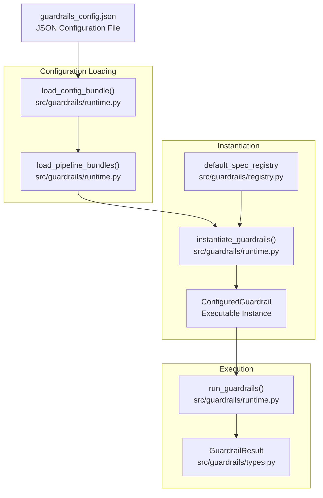
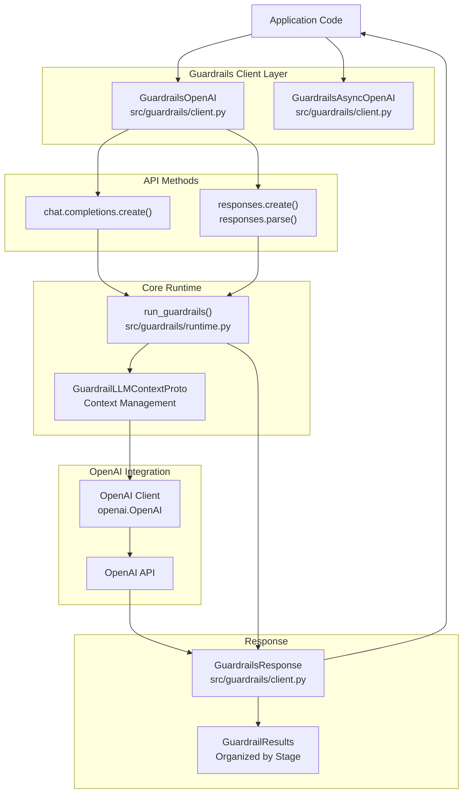
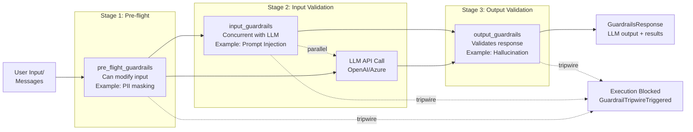
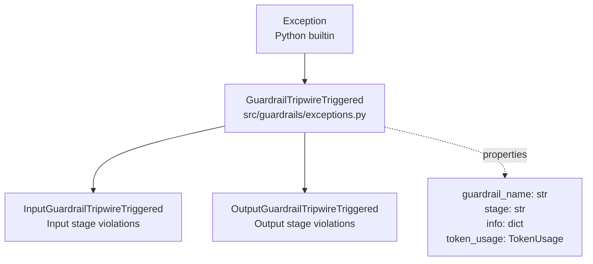

<!-- source: DeepWiki mcp.deepwiki.com · repo openai/openai-guardrails-python · page 2 Getting Started · fetched 2026-10-26 -->

# Getting Started

<details>
<summary>Relevant source files</summary>

The following files were used as context for generating this wiki page:

- [README.md](README.md)
- [docs/assets/images/guardrails-python-config-screenshot-100pct-q70.webp](docs/assets/images/guardrails-python-config-screenshot-100pct-q70.webp)
- [pyproject.toml](pyproject.toml)
- [src/guardrails/__init__.py](src/guardrails/__init__.py)

</details>


This page covers the essential steps to install, configure, and begin using OpenAI Guardrails in your Python applications. You will learn how to set up the package, generate configuration files, and write your first guardrail-protected API calls.

For advanced integration patterns including Azure OpenAI and structured outputs, see [Client Integration](#4). For agent-based workflows, see [Agent Integration](#5). For evaluation and testing, see [Evaluation and Benchmarking](#7).

---

## Installation

OpenAI Guardrails requires Python 3.11 or higher. Install the package using pip:

```bash
pip install openai-guardrails
```

### Core Dependencies

The package automatically installs the following dependencies:

| Dependency | Version | Purpose |
|------------|---------|---------|
| `openai` | ≥1.75.0 | OpenAI Python client |
| `pydantic` | ≥2.11.3 | Data validation and configuration schemas |
| `openai-agents` | ≥0.3.3 | Agents SDK integration support |
| `presidio-analyzer` | ≥2.2.360 | PII detection capabilities |

### Development Installation

For local development with editable installation:

```bash
git clone https://github.com/openai/openai-guardrails-python.git
cd openai-guardrails-python
pip install -e .
```

To run examples, install optional dependencies:

```bash
pip install -e ".[examples]"
```

**Installation Flow**



**Sources:** [pyproject.toml:1-16](), [pyproject.toml:78-80](), [README.md:9-33]()

---

## Configuration Setup

OpenAI Guardrails uses a JSON configuration file that defines which guardrails to run and how they should behave. The easiest way to generate this configuration is through the web-based configuration portal.

### Generating Configuration

1. Visit [guardrails.openai.com](https://guardrails.openai.com)
2. Select the guardrails you want to enable
3. Configure guardrail parameters (thresholds, categories, etc.)
4. Choose pipeline stages (pre-flight, input, output, tool-level)
5. Download the generated `guardrails_config.json` file

### Configuration File Structure

The configuration file contains pipeline bundles that define guardrails for different stages:

```
guardrails_config.json
├── pre_flight_guardrails[]    # Runs before LLM call, can modify input
├── input_guardrails[]         # Validates input, runs concurrently with LLM
├── output_guardrails[]        # Validates LLM response
├── tool_input_guardrails[]    # For agent tools (before tool execution)
└── tool_output_guardrails[]   # For agent tools (after tool execution)
```

Each guardrail entry specifies:
- `name`: Guardrail identifier (e.g., "Moderation", "Jailbreak")
- `config`: Guardrail-specific parameters
- `tripwire`: Whether to block execution if triggered
- `enabled`: Whether the guardrail is active

**Configuration to Runtime Mapping**



**Sources:** [README.md:5-8](), [src/guardrails/__init__.py:32-41](), [README.md:19]()

---

## First Steps with GuardrailsOpenAI

The `GuardrailsOpenAI` class is a drop-in replacement for the standard OpenAI client. It wraps API calls with configured guardrail checks while maintaining full compatibility with the OpenAI API.

### Basic Usage Pattern

```python
from pathlib import Path
from guardrails import GuardrailsOpenAI, GuardrailTripwireTriggered

# Initialize with configuration file
client = GuardrailsOpenAI(config=Path("guardrails_config.json"))

# Use exactly like OpenAI client
try:
    response = client.chat.completions.create(
        model="gpt-4o",
        messages=[{"role": "user", "content": "Hello, how are you?"}],
    )
    print(response.choices[0].message.content)
except GuardrailTripwireTriggered as e:
    print(f"Guardrail blocked the request: {e}")
```

### Client Initialization Options

The client accepts the same parameters as the standard OpenAI client, plus configuration:

| Parameter | Type | Purpose |
|-----------|------|---------|
| `config` | `Path \| str \| dict` | Path to config file or dict containing configuration |
| `api_key` | `str` | OpenAI API key (or use `OPENAI_API_KEY` env var) |
| All standard OpenAI parameters | Various | Passed through to base client |

### Available Client Classes

```python
from guardrails import (
    GuardrailsOpenAI,              # Synchronous OpenAI client
    GuardrailsAsyncOpenAI,          # Asynchronous OpenAI client
    GuardrailsAzureOpenAI,          # Synchronous Azure OpenAI client
    GuardrailsAsyncAzureOpenAI,     # Asynchronous Azure OpenAI client
)
```

**Client Integration Architecture**



**Sources:** [README.md:36-64](), [src/guardrails/__init__.py:16-21](), [src/guardrails/__init__.py:51-52]()

---

## Understanding Guardrail Execution

When you make an API call through a guardrails client, the system executes guardrails in three sequential stages while maintaining the standard OpenAI response structure.

### Three-Stage Execution Model

**Execution Pipeline Flow**



### Stage Characteristics

| Stage | Timing | Can Modify Input | Typical Use Cases |
|-------|--------|------------------|-------------------|
| **pre_flight** | Before LLM call | ✅ Yes | PII masking, URL filtering, input transformation |
| **input** | Concurrent with LLM | ❌ No | Prompt injection, jailbreak detection, moderation |
| **output** | After LLM response | ❌ No | Hallucination detection, NSFW content, off-topic |

### Response Structure

The `GuardrailsResponse` wraps the standard OpenAI response with additional guardrail metadata:

```python
response = client.chat.completions.create(...)

# Standard OpenAI response fields
response.choices[0].message.content  # LLM output
response.model                       # Model used
response.usage                       # Token usage

# Guardrail results
response.guardrail_results.pre_flight  # List[GuardrailResult]
response.guardrail_results.input       # List[GuardrailResult]
response.guardrail_results.output      # List[GuardrailResult]

# Individual result structure
result = response.guardrail_results.input[0]
result.name                    # "Jailbreak"
result.tripwire_triggered      # True/False
result.info                    # Dict with details
result.token_usage            # Token counts
```

**Sources:** [src/guardrails/__init__.py:17-21](), [src/guardrails/__init__.py:47-49]()

---

## Error Handling

Guardrails can either block execution (tripwire mode) or allow it to proceed while logging violations. Understanding these modes is crucial for production deployments.

### GuardrailTripwireTriggered Exception

When a guardrail with `tripwire=true` detects a violation, it raises `GuardrailTripwireTriggered`:

```python
from guardrails import GuardrailsOpenAI, GuardrailTripwireTriggered

client = GuardrailsOpenAI(config="guardrails_config.json")

try:
    response = client.chat.completions.create(
        model="gpt-4o",
        messages=[{"role": "user", "content": "Potentially harmful content"}],
    )
except GuardrailTripwireTriggered as e:
    # Access exception details
    print(f"Guardrail: {e.guardrail_name}")
    print(f"Stage: {e.stage}")  # "pre_flight", "input", or "output"
    print(f"Info: {e.info}")    # Additional context
    
    # Handle the violation
    # - Log to security monitoring
    # - Return safe error message to user
    # - Trigger alerting
```

### Suppressing Tripwires

For non-blocking operation, use `suppress_tripwire=True`. Violations are recorded but don't raise exceptions:

```python
response = client.chat.completions.create(
    model="gpt-4o",
    messages=[{"role": "user", "content": "Some content"}],
    suppress_tripwire=True,  # Don't raise exceptions
)

# Check results manually
for result in response.guardrail_results.input:
    if result.tripwire_triggered:
        print(f"Warning: {result.name} triggered")
        # Log violation but continue
```

### Exception Hierarchy



### Error Handling Strategies

| Strategy | Use Case | Implementation |
|----------|----------|----------------|
| **Strict blocking** | Production safety-critical systems | Default behavior with tripwire=true |
| **Logging only** | Development, monitoring | suppress_tripwire=True, log violations |
| **Graceful degradation** | User-facing apps | Catch exception, return safe fallback |
| **Selective blocking** | Mixed criticality | Configure tripwire per guardrail |

**Example: Graceful Degradation**

```python
def safe_chat_completion(client, messages):
    try:
        return client.chat.completions.create(
            model="gpt-4o",
            messages=messages,
        )
    except GuardrailTripwireTriggered as e:
        # Log for security monitoring
        logging.warning(f"Guardrail triggered: {e.guardrail_name}", extra=e.info)
        
        # Return safe response
        return create_safe_fallback_response(
            "I'm unable to process that request. Please rephrase."
        )
```

**Sources:** [src/guardrails/__init__.py:30](), [README.md:44-64]()

---

## Next Steps

Now that you have the basics working, explore more advanced features:

- **[Quickstart Guide](#2.1)** - Detailed step-by-step tutorial with complete examples
- **[Configuration Files](#2.2)** - Deep dive into configuration structure and options
- **[Error Handling and Tripwires](#2.3)** - Advanced error handling patterns
- **[Client Integration](#4)** - Streaming, Azure OpenAI, structured outputs
- **[Agent Integration](#5)** - Using guardrails with OpenAI Agents SDK
- **[Built-in Guardrails](#6)** - Documentation for all available guardrails
- **[Examples](#9)** - Practical code examples for common scenarios

For programmatic configuration and runtime usage without the client wrapper, see [Runtime Utilities](#10.3).

**Sources:** [README.md:1-196](), [src/guardrails/__init__.py:1-77]()

---

