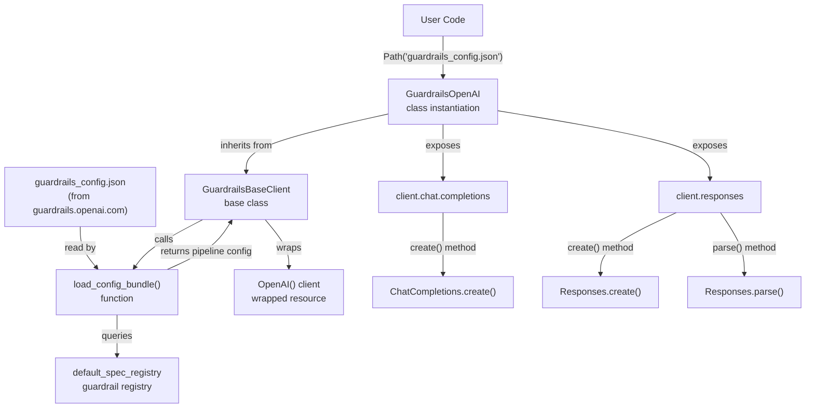
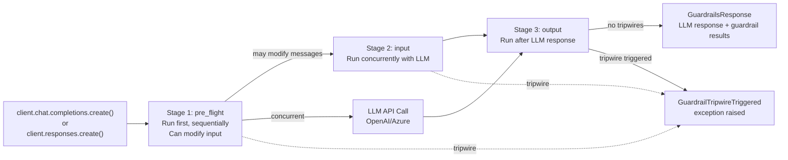
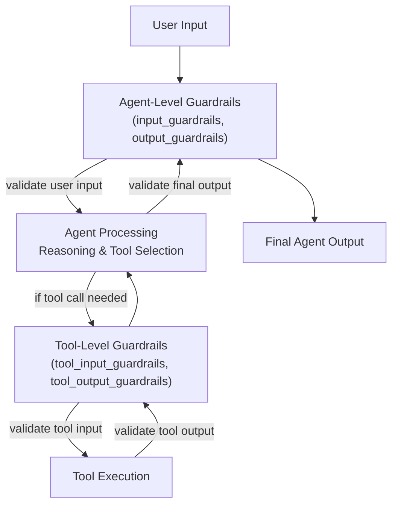

<!-- source: DeepWiki mcp.deepwiki.com · repo openai/openai-guardrails-python · page 2.1 Quickstart Guide · fetched 2026-10-26 -->

# Quickstart Guide

<details>
<summary>Relevant source files</summary>

The following files were used as context for generating this wiki page:

- [README.md](README.md)
- [docs/assets/images/guardrails-python-config-screenshot-100pct-q70.webp](docs/assets/images/guardrails-python-config-screenshot-100pct-q70.webp)
- [src/guardrails/resources/chat/chat.py](src/guardrails/resources/chat/chat.py)
- [src/guardrails/resources/responses/responses.py](src/guardrails/resources/responses/responses.py)
- [tests/unit/test_context.py](tests/unit/test_context.py)

</details>


This page provides minimal working examples to get you started with OpenAI Guardrails. It demonstrates the two primary integration patterns: drop-in client replacement and agent integration. For detailed configuration options, see [Configuration Files](#2.2). For error handling strategies, see [Error Handling and Tripwires](#2.3). For installation instructions, see [Installation and Setup](#1.3).

---

## Prerequisites

Before starting, ensure you have:

1. Installed the package via `pip install openai-guardrails`
2. Generated a `guardrails_config.json` file from [guardrails.openai.com](https://guardrails.openai.com)
3. Set your OpenAI API key in environment variables

Sources: [README.md:9-15]()

---

## Drop-in Client Replacement

The `GuardrailsOpenAI` class provides a direct replacement for the standard `OpenAI` client, automatically applying configured guardrails to all API calls.

### Basic Chat Completion Example

```python
from pathlib import Path
from guardrails import GuardrailsOpenAI, GuardrailTripwireTriggered

# Create client with guardrails configuration
client = GuardrailsOpenAI(config=Path("guardrails_config.json"))

try:
    # Use standard Chat Completions API
    response = client.chat.completions.create(
        model="gpt-4o",
        messages=[{"role": "user", "content": "Hello world"}],
    )
    print(response.choices[0].message.content)
    
except GuardrailTripwireTriggered as e:
    print(f"Guardrail triggered: {e}")
```

### Responses API Example

```python
# Works with Responses API as well
try:
    resp = client.responses.create(
        model="gpt-4o",
        input="What are the main features of your premium plan?",
    )
    print(resp.output_text)
    
except GuardrailTripwireTriggered as e:
    print(f"Guardrail triggered: {e}")
```

Sources: [README.md:39-64](), [src/guardrails/resources/chat/chat.py:67-127](), [src/guardrails/resources/responses/responses.py:27-109]()

### Client Instantiation Flow



**Client Instantiation Flow**: The `GuardrailsOpenAI` client wraps the standard OpenAI client and loads guardrail configurations at initialization. The configuration specifies which guardrails run at each pipeline stage.

Sources: [README.md:42-46](), [src/guardrails/_base_client.py]()

---

## Execution Flow with Guardrails

When you call `client.chat.completions.create()` or `client.responses.create()`, guardrails execute in three stages:



**Three-Stage Pipeline**: Guardrails execute at three points in the request lifecycle. Pre-flight guardrails run first and can modify the input (e.g., PII masking). Input guardrails run concurrently with the LLM call to minimize latency. Output guardrails validate the LLM response. Any stage can trigger a `GuardrailTripwireTriggered` exception.

Sources: [src/guardrails/resources/chat/chat.py:67-127](), [src/guardrails/resources/responses/responses.py:27-109](), [README.md:48-64]()

### Stage Configuration

The `guardrails_config.json` file specifies which guardrails run at each stage:

| Stage | Purpose | Examples | Can Modify Input |
|-------|---------|----------|------------------|
| `pre_flight` | Input transformation before validation | PII masking, URL filtering | Yes |
| `input` | User input validation (concurrent with LLM) | Prompt injection, Jailbreak, Moderation | No |
| `output` | LLM output validation | Hallucination detection, NSFW text | No |

Sources: [src/guardrails/resources/chat/chat.py:76-81](), [src/guardrails/resources/responses/responses.py:56-62]()

---

## Agent Integration with GuardrailAgent

The `GuardrailAgent` function creates an OpenAI Agents SDK agent with guardrails pre-configured:

```python
import asyncio
from pathlib import Path
from agents import InputGuardrailTripwireTriggered, OutputGuardrailTripwireTriggered, Runner
from agents.run import RunConfig
from guardrails import GuardrailAgent

# Create agent with guardrails automatically configured
agent = GuardrailAgent(
    config=Path("guardrails_config.json"),
    name="Customer support agent",
    instructions="You are a customer support agent. You help customers with their questions.",
)

async def main():
    try:
        result = await Runner.run(
            agent, 
            "Hello, can you help me?", 
            run_config=RunConfig(tracing_disabled=True)
        )
        print(result.final_output)
    except (InputGuardrailTripwireTriggered, OutputGuardrailTripwireTriggered):
        print("🛑 Guardrail triggered!")

if __name__ == "__main__":
    asyncio.run(main())
```

Sources: [README.md:70-93]()

### Agent Guardrail Stages

For agents, guardrails can be configured at two levels:



**Agent vs Tool Guardrails**: Agent-level guardrails (`input_guardrails`, `output_guardrails`) validate user inputs and final agent outputs. Tool-level guardrails (`tool_input_guardrails`, `tool_output_guardrails`) validate each tool invocation. This allows fine-grained control over what the agent can access and return.

Sources: [README.md:70-93]()

---

## Understanding GuardrailsResponse

When no tripwire is triggered, the client returns a `GuardrailsResponse` object that wraps the standard OpenAI response with additional guardrail metadata:

```python
# Standard response attributes (unchanged)
response.choices[0].message.content
response.usage.total_tokens

# Additional guardrail information
response.guardrail_results  # GuardrailResults object
response.guardrail_results.pre_flight  # List[GuardrailResult]
response.guardrail_results.input       # List[GuardrailResult]
response.guardrail_results.output      # List[GuardrailResult]

# Check if any guardrails triggered (but didn't raise exception)
for result in response.guardrail_results.output:
    print(f"{result.guardrail_name}: {result.tripwire_triggered}")
```

### GuardrailResult Structure

Each `GuardrailResult` contains:

| Field | Type | Description |
|-------|------|-------------|
| `guardrail_name` | `str` | Name of the guardrail (e.g., "Moderation", "Jailbreak") |
| `tripwire_triggered` | `bool` | Whether this guardrail detected a violation |
| `info` | `dict` | Guardrail-specific details (e.g., categories, evidence) |
| `token_usage` | `TokenUsage \| None` | LLM tokens consumed (for LLM-based checks) |

Sources: [README.md:48-64]()

---

## Suppressing Tripwire Exceptions

By default, guardrail violations raise `GuardrailTripwireTriggered` exceptions. To handle violations gracefully without exceptions, use `suppress_tripwire=True`:

```python
# Suppress exceptions, check results manually
response = client.chat.completions.create(
    model="gpt-4o",
    messages=[{"role": "user", "content": "potentially problematic input"}],
    suppress_tripwire=True,  # Don't raise exceptions
)

# Check for violations in response
if response.guardrail_results.input:
    for result in response.guardrail_results.input:
        if result.tripwire_triggered:
            print(f"Warning: {result.guardrail_name} detected an issue")
            print(f"Details: {result.info}")

# LLM response is still available
print(response.choices[0].message.content)
```

Sources: [src/guardrails/resources/chat/chat.py:67](), [src/guardrails/resources/responses/responses.py:27-35](), [README.md:48-64]()

---

## Key Classes and Methods Reference

This table maps user-facing concepts to actual code entities:

| Concept | Class/Function | File Location | Purpose |
|---------|---------------|---------------|---------|
| Client wrapper | `GuardrailsOpenAI` | [src/guardrails/__init__.py]() | Drop-in OpenAI client replacement |
| Async client | `GuardrailsAsyncOpenAI` | [src/guardrails/__init__.py]() | Async version of client wrapper |
| Agent factory | `GuardrailAgent()` | [src/guardrails/agent.py]() | Creates agents SDK agent with guardrails |
| Chat API | `ChatCompletions.create()` | [src/guardrails/resources/chat/chat.py:67]() | Chat completions with guardrails |
| Responses API | `Responses.create()` | [src/guardrails/resources/responses/responses.py:27]() | Responses API with guardrails |
| Structured output | `Responses.parse()` | [src/guardrails/resources/responses/responses.py:110]() | Structured outputs with guardrails |
| Tripwire exception | `GuardrailTripwireTriggered` | [src/guardrails/exceptions.py]() | Raised when guardrail triggers |
| Response wrapper | `GuardrailsResponse` | [src/guardrails/types.py]() | Response with guardrail results |
| Config loader | `load_config_bundle()` | [src/guardrails/config.py]() | Loads guardrails_config.json |

Sources: [README.md](), [src/guardrails/__init__.py](), [src/guardrails/resources/chat/chat.py](), [src/guardrails/resources/responses/responses.py]()

---

## Next Steps

Now that you have a working guardrails setup:

1. **Configure guardrails**: Learn about the configuration file structure in [Configuration Files](#2.2)
2. **Explore built-in guardrails**: See available checks in [Built-in Guardrails](#6)
3. **Handle errors**: Learn exception handling strategies in [Error Handling and Tripwires](#2.3)
4. **Understand the pipeline**: Read about the three-stage architecture in [Three-Stage Pipeline Architecture](#3.1)
5. **Run evaluations**: Test your guardrails using [Evaluation Framework](#7)

Sources: [README.md:149-197]()

---

