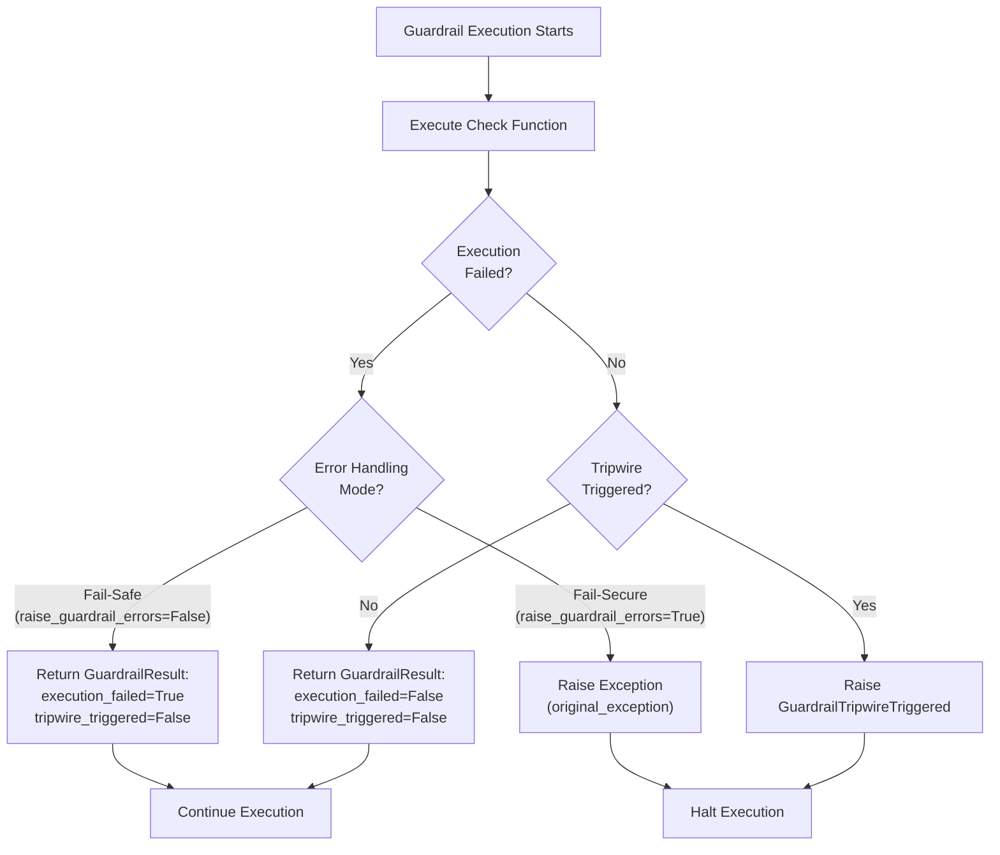
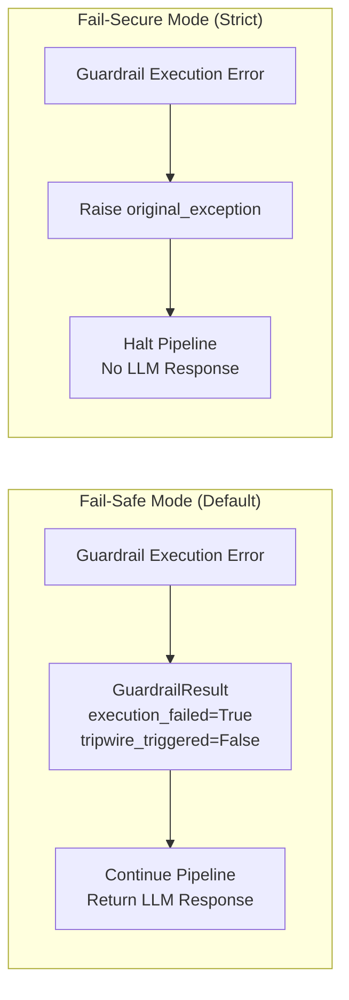
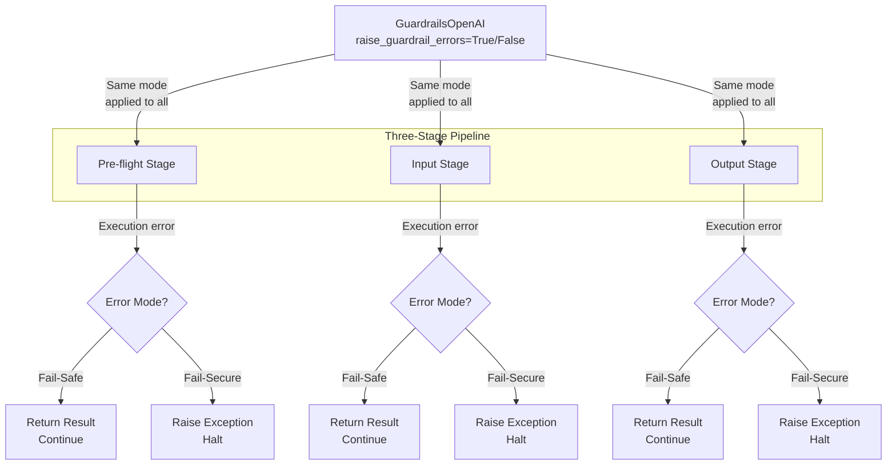

<!-- source: DeepWiki mcp.deepwiki.com · repo openai/openai-guardrails-python · page 2.3 Error Handling and Tripwires · fetched 2026-10-26 -->

# Error Handling Modes

<details>
<summary>Relevant source files</summary>

The following files were used as context for generating this wiki page:

- [README.md](README.md)
- [docs/assets/images/guardrails-python-config-screenshot-100pct-q70.webp](docs/assets/images/guardrails-python-config-screenshot-100pct-q70.webp)
- [examples/basic/agents_sdk.py](examples/basic/agents_sdk.py)
- [src/guardrails/_streaming.py](src/guardrails/_streaming.py)
- [src/guardrails/agents.py](src/guardrails/agents.py)
- [src/guardrails/resources/chat/chat.py](src/guardrails/resources/chat/chat.py)
- [src/guardrails/resources/responses/responses.py](src/guardrails/resources/responses/responses.py)
- [tests/unit/test_agents.py](tests/unit/test_agents.py)
- [tests/unit/test_context.py](tests/unit/test_context.py)

</details>


## Purpose and Scope

This page explains how the guardrails framework handles **guardrail execution failures** - situations where a guardrail check itself fails to run properly (e.g., invalid model configuration, API errors, network timeouts). The framework provides two error handling modes: **fail-safe** (default) and **fail-secure**.

This page specifically covers execution failures, not safety violations. For information about handling safety violations when guardrails successfully detect policy breaches, see [Quickstart Guide](#2.1).

**Sources:** [docs/quickstart.md:84-109]()

---

## Overview: Execution Failures vs Tripwire Violations

The guardrails framework distinguishes between two types of failures:

| Failure Type | Description | `GuardrailResult` State | Example Causes |
|--------------|-------------|------------------------|----------------|
| **Execution Failure** | Guardrail code fails to execute | `execution_failed=True`<br/>`tripwire_triggered=False` | Invalid model name, API timeout, missing configuration, network error |
| **Tripwire Violation** | Guardrail successfully detects policy breach | `tripwire_triggered=True`<br/>`execution_failed=False` | PII detected, jailbreak attempt, NSFW content |

Error handling modes **only affect execution failures**. Tripwire violations always raise `GuardrailTripwireTriggered` exceptions regardless of the error handling mode.



**Diagram: Error Handling Decision Flow**

**Sources:** [src/guardrails/types.py:60-90](), [docs/quickstart.md:84-109]()

---

## Fail-Safe Mode (Default Behavior)

In fail-safe mode, the framework continues execution even when guardrails fail to execute. This mode prioritizes **availability** over strict enforcement.

### Behavior

When a guardrail encounters an execution error in fail-safe mode:

1. The guardrail returns `GuardrailResult` with `execution_failed=True` and `tripwire_triggered=False`
2. The `original_exception` field contains the actual exception that occurred
3. The pipeline continues executing remaining guardrails
4. The LLM call proceeds normally
5. The user receives the LLM response along with guardrail results showing execution failures

### Configuration

Fail-safe mode is enabled by default. You can explicitly set it using:

```python
from guardrails import GuardrailsOpenAI

# Default behavior - fail-safe mode
client = GuardrailsOpenAI(
    config="guardrails_config.json"
)

# Explicitly enable fail-safe mode
client = GuardrailsOpenAI(
    config="guardrails_config.json",
    raise_guardrail_errors=False  # Default value
)
```

### Use Cases

Fail-safe mode is appropriate when:

- **High availability is critical**: Service must remain operational even if guardrails malfunction
- **Development/testing**: Allows testing main application flow without blocking on guardrail configuration issues
- **Graceful degradation**: Prefer reduced safety over complete service interruption
- **Monitoring is in place**: You have logging/monitoring to detect and alert on execution failures

### Example Response

In fail-safe mode, execution failures are returned as part of the response:

```python
from guardrails import GuardrailsOpenAI

client = GuardrailsOpenAI(config="config.json")
response = await client.responses.create(
    model="gpt-5",
    input="Hello world"
)

# Check for execution failures
for result in response.guardrail_results.input:
    if result.execution_failed:
        print(f"Guardrail failed: {result.info}")
        print(f"Exception: {result.original_exception}")
```

**Sources:** [docs/quickstart.md:88-95](), [README.md:40-62]()

---

## Fail-Secure Mode (Strict Enforcement)

In fail-secure mode, the framework raises exceptions immediately when guardrails fail to execute. This mode prioritizes **security** over availability.

### Behavior

When a guardrail encounters an execution error in fail-secure mode:

1. The framework immediately raises the `original_exception` that caused the failure
2. Pipeline execution halts immediately
3. The LLM call is prevented (if failure occurs before/during input stage)
4. No response is returned to the user
5. The application must handle the exception

### Configuration

Enable fail-secure mode using the `raise_guardrail_errors` parameter:

```python
from guardrails import GuardrailsAsyncOpenAI

# Enable fail-secure mode
client = GuardrailsAsyncOpenAI(
    config="guardrails_config.json",
    raise_guardrail_errors=True  # Strict mode
)
```

All client classes support this parameter:
- `GuardrailsOpenAI`
- `GuardrailsAsyncOpenAI`
- `GuardrailsAzureOpenAI`
- `GuardrailsAsyncAzureOpenAI`

### Use Cases

Fail-secure mode is appropriate when:

- **Safety is paramount**: Any guardrail failure represents unacceptable risk
- **Compliance requirements**: Regulatory requirements mandate validated security controls
- **Zero false negatives**: Cannot risk allowing unsafe content due to guardrail malfunction
- **Production readiness**: Guardrails are thoroughly tested and misconfigurations should halt deployment

### Exception Handling

Applications must handle exceptions in fail-secure mode:

```python
from guardrails import GuardrailsAsyncOpenAI

client = GuardrailsAsyncOpenAI(
    config="config.json",
    raise_guardrail_errors=True
)

try:
    response = await client.responses.create(
        model="gpt-5",
        input="Hello world"
    )
except Exception as e:
    # Handle guardrail execution failures
    print(f"Guardrail execution failed: {e}")
    # Implement appropriate error handling:
    # - Log error
    # - Return error to user
    # - Trigger alerts
    # - Fall back to alternative path
```

**Sources:** [docs/quickstart.md:97-107](), [README.md:40-62]()

---

## Mode Comparison



**Diagram: Mode Comparison**

### Decision Matrix

| Criterion | Fail-Safe | Fail-Secure |
|-----------|-----------|-------------|
| **Priority** | Availability | Security |
| **On Execution Error** | Continue | Halt |
| **LLM Call** | Proceeds | Blocked |
| **User Impact** | Receives response with warnings | Receives error |
| **Risk** | Unvalidated content may pass | Service unavailable |
| **Best For** | Development, high-availability services | Production, compliance-critical systems |
| **Configuration** | `raise_guardrail_errors=False` (default) | `raise_guardrail_errors=True` |

**Sources:** [docs/quickstart.md:84-109]()

---

## Technical Implementation

### GuardrailResult Structure

The `GuardrailResult` dataclass encodes execution state:

```python
@dataclass(frozen=True, slots=True)
class GuardrailResult:
    tripwire_triggered: bool
    execution_failed: bool = False
    original_exception: Exception | None = None
    info: dict[str, Any] = field(default_factory=dict)
```

Key fields for error handling:
- **`execution_failed`**: `True` when guardrail code fails to execute
- **`original_exception`**: The actual exception raised during execution
- **`tripwire_triggered`**: `False` for execution failures (safety not validated)
- **`info`**: Dictionary containing error details and diagnostic information

**Sources:** [src/guardrails/types.py:60-90]()

### Result Validation

The `GuardrailResult` class enforces consistency in `__post_init__`:

```python
def __post_init__(self) -> None:
    """Validate required fields and consistency."""
    if self.execution_failed and self.original_exception is None:
        raise ValueError(
            "When execution_failed=True, original_exception must be provided"
        )
```

This ensures execution failures always include exception context for debugging.

**Sources:** [src/guardrails/types.py:83-90]()

---

## Configuration Across Pipeline Stages

The `raise_guardrail_errors` parameter applies uniformly across all three pipeline stages:



**Diagram: Error Mode Applied Across Pipeline Stages**

All guardrails in all stages (pre-flight, input, output) respect the same error handling configuration. There is no per-stage or per-guardrail override.

**Sources:** [docs/quickstart.md:42-50](), [docs/quickstart.md:84-109]()

---

## Common Execution Failure Scenarios

### Invalid Model Configuration

```python
# Configuration specifies non-existent model
{
    "name": "Jailbreak",
    "config": {
        "model": "gpt-nonexistent",  # Invalid model
        "confidence_threshold": 0.5
    }
}
```

**Fail-Safe**: Returns `execution_failed=True`, pipeline continues  
**Fail-Secure**: Raises model validation exception, halts execution

### API Timeout or Network Error

```python
# Guardrail calls OpenAI API which times out
{
    "name": "NSFW Text",
    "config": {
        "model": "gpt-5-mini",
        "timeout": 1  # Very short timeout
    }
}
```

**Fail-Safe**: Returns `execution_failed=True` with timeout exception  
**Fail-Secure**: Raises timeout exception, halts execution

### Missing Required Configuration

```python
# Configuration missing required fields
{
    "name": "Contains PII",
    "config": {}  # Missing required "entities" field
}
```

**Fail-Safe**: Returns `execution_failed=True` with validation error  
**Fail-Secure**: Raises configuration validation exception

### Dependency Unavailable

```python
# Presidio library not installed for PII detection
{
    "name": "Contains PII",
    "config": {
        "entities": ["EMAIL_ADDRESS"]
    }
}
```

**Fail-Safe**: Returns `execution_failed=True` with import error  
**Fail-Secure**: Raises import exception

**Sources:** [docs/quickstart.md:84-109]()

---

## Best Practices

### Development vs Production

```python
# Development: Use fail-safe mode for flexibility
dev_client = GuardrailsOpenAI(
    config="dev_config.json",
    raise_guardrail_errors=False  # Permissive
)

# Production: Use fail-secure mode for safety
prod_client = GuardrailsOpenAI(
    config="prod_config.json",
    raise_guardrail_errors=True  # Strict
)
```

### Monitoring in Fail-Safe Mode

When using fail-safe mode, implement monitoring to detect execution failures:

```python
from guardrails import GuardrailsOpenAI

client = GuardrailsOpenAI(config="config.json", raise_guardrail_errors=False)
response = await client.responses.create(model="gpt-5", input="Hello")

# Monitor execution failures
for stage_name, results in [
    ("pre_flight", response.guardrail_results.pre_flight),
    ("input", response.guardrail_results.input),
    ("output", response.guardrail_results.output)
]:
    for result in results:
        if result.execution_failed:
            # Log to monitoring system
            logger.error(
                "Guardrail execution failed",
                extra={
                    "stage": stage_name,
                    "exception": str(result.original_exception),
                    "info": result.info
                }
            )
```

### Testing Error Handling

Test both execution failures and tripwire violations:

```python
import pytest
from guardrails import GuardrailsOpenAI, GuardrailTripwireTriggered

def test_fail_safe_mode():
    """Test that execution errors don't halt pipeline."""
    client = GuardrailsOpenAI(
        config="config_with_invalid_model.json",
        raise_guardrail_errors=False
    )
    
    response = await client.responses.create(model="gpt-5", input="test")
    
    # Should receive response despite execution failure
    assert response.llm_response is not None
    
    # Should have execution_failed=True in results
    assert any(r.execution_failed for r in response.guardrail_results.input)

def test_fail_secure_mode():
    """Test that execution errors raise exceptions."""
    client = GuardrailsOpenAI(
        config="config_with_invalid_model.json",
        raise_guardrail_errors=True
    )
    
    # Should raise exception, not return response
    with pytest.raises(Exception):
        await client.responses.create(model="gpt-5", input="test")
```

**Sources:** [docs/quickstart.md:84-109]()

---

## Related Pages

- [Quickstart Guide](#2.1) - Basic usage and exception handling
- [Three-Stage Pipeline Architecture](#3.1) - How guardrails execute across stages
- [Runtime Execution](#3.5) - Detailed execution flow and error propagation
- [Exception Types](#10.5) - Complete exception hierarchy including `GuardrailTripwireTriggered`

---

