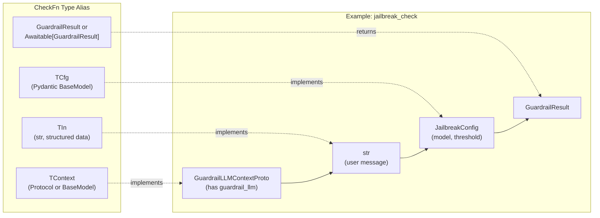
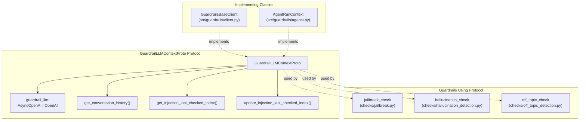
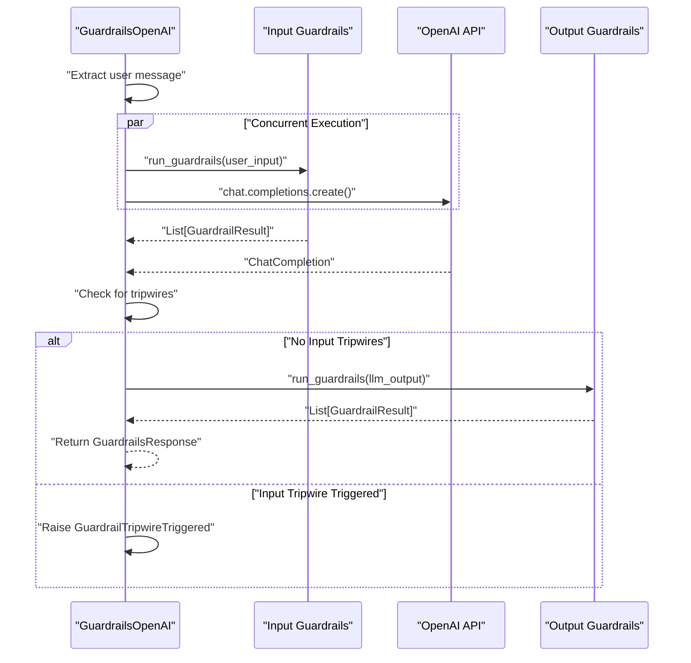
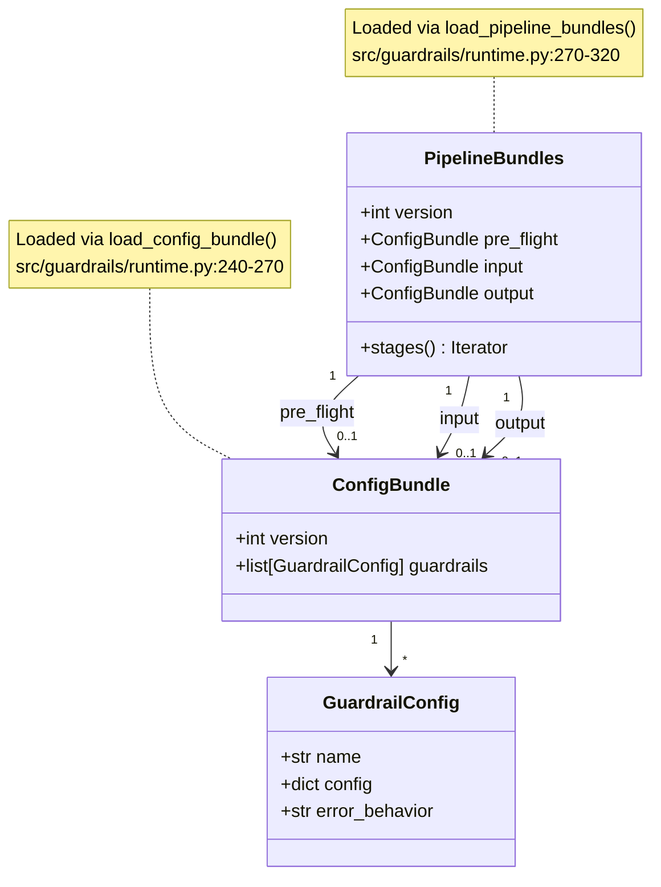
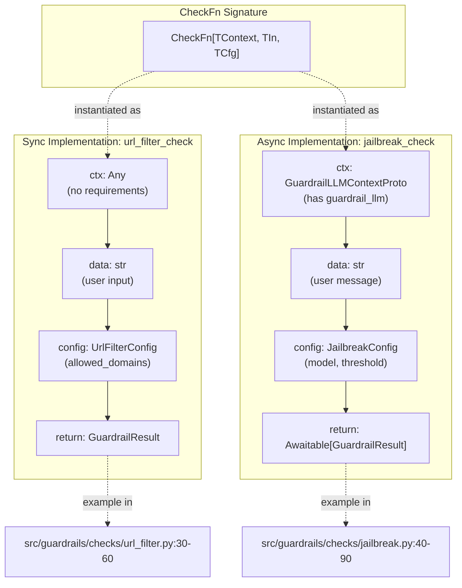
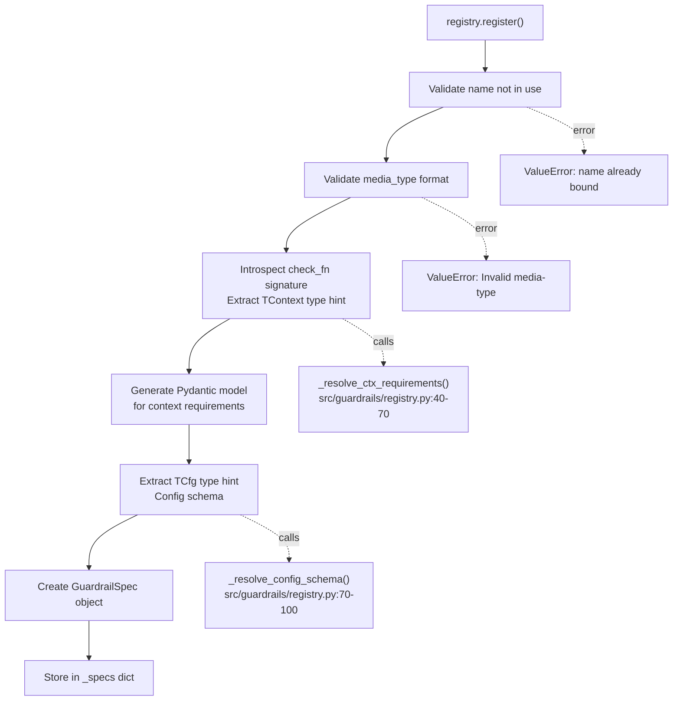
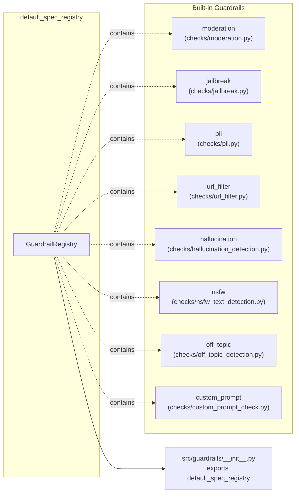
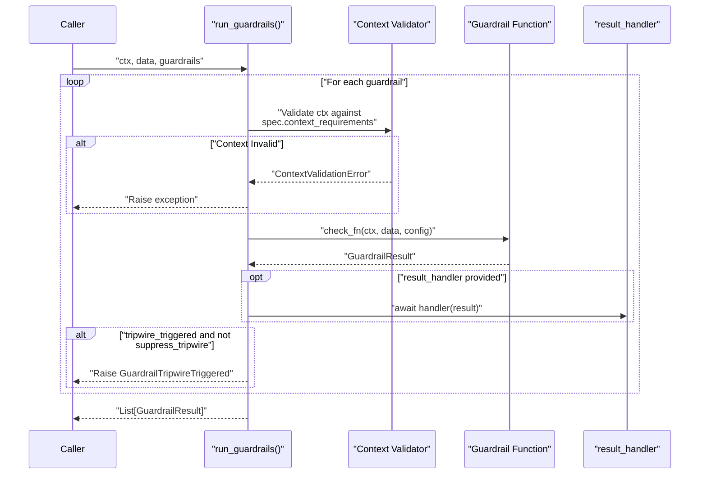

<!-- source: DeepWiki mcp.deepwiki.com · repo openai/openai-guardrails-python · page 3 Core Concepts · fetched 2026-10-26 -->

# Core Concepts

<details>
<summary>Relevant source files</summary>

The following files were used as context for generating this wiki page:

- [pyproject.toml](pyproject.toml)
- [src/guardrails/__init__.py](src/guardrails/__init__.py)

</details>


This page documents the fundamental building blocks of the OpenAI Guardrails framework: the type system, pipeline architecture, guardrail function patterns, registry mechanism, and runtime execution model. These concepts underpin all guardrail implementations and client integrations.

For practical usage examples and getting started, see [Quickstart Guide](#2.1). For details on specific client implementations, see [Client Integration](#4). For information on writing custom guardrails, see [Custom Prompt Checks](#6.5).

---

## The Type System

The guardrails framework defines a strict type system built on Pydantic models and Python protocols. All guardrail functions conform to a consistent signature, enabling uniform instantiation, execution, and result handling.

### GuardrailResult

The `GuardrailResult` dataclass represents the outcome of any guardrail check. It is a frozen, immutable type that encapsulates pass/fail status, execution metadata, and diagnostic information.

**Structure:**

| Field | Type | Description |
|-------|------|-------------|
| `tripwire_triggered` | `bool` | Whether the guardrail detected a critical violation |
| `execution_failed` | `bool` | Whether the guardrail itself failed to execute (default: `False`) |
| `original_exception` | `Exception \| None` | The exception raised during execution, if `execution_failed=True` |
| `info` | `dict[str, Any]` | Arbitrary metadata about the check (default: `{}`) |

The `info` dictionary may contain implementation-specific data such as confidence scores, matched patterns, or the processed text. Many built-in guardrails populate `info["checked_text"]` with the validated content.

**Invariants:**
- The dataclass is frozen (`frozen=True`) to prevent mutation after creation
- If `execution_failed=True`, then `original_exception` must be provided
- Each instance has a unique `info` dict (no shared mutable state)

```mermaid
classDiagram
    class GuardrailResult {
        <<dataclass frozen>>
        +bool tripwire_triggered
        +bool execution_failed
        +Exception original_exception
        +dict info
        +__post_init__()
    }
    
    class ValidResult {
        tripwire_triggered = False
        execution_failed = False
        info = {"checked_text": "..."}
    }
    
    class TrippedResult {
        tripwire_triggered = True
        execution_failed = False
        info = {"reason": "..."}
    }
    
    class FailedResult {
        tripwire_triggered = False
        execution_failed = True
        original_exception = Exception(...)
    }
    
    GuardrailResult <|-- ValidResult
    GuardrailResult <|-- TrippedResult
    GuardrailResult <|-- FailedResult
    
    note for GuardrailResult "Defined in src/guardrails/types.py:60-90"
```

**Sources:** [src/guardrails/types.py:60-90](), [tests/unit/test_types.py:40-59]()

### CheckFn Type Alias

The `CheckFn` type alias defines the signature for all guardrail functions. It is parameterized over three type variables:

```python
CheckFn = Callable[[TContext, TIn, TCfg], MaybeAwaitableResult]
```

Where:
- `TContext`: Context object providing resources (e.g., LLM client, conversation history)
- `TIn`: Input data to validate (typically `str` or structured data)
- `TCfg`: Configuration object (Pydantic `BaseModel` subclass)
- `MaybeAwaitableResult`: Either `GuardrailResult` or `Awaitable[GuardrailResult]`

This uniform signature enables:
1. **Type-safe registration** - The registry can introspect function signatures to validate context requirements
2. **Consistent instantiation** - All guardrails accept config dicts and bind them to typed config objects
3. **Async/sync flexibility** - Functions may return results directly or as coroutines



**Sources:** [src/guardrails/types.py:92-108](), [tests/unit/test_types.py:61-77]()

### GuardrailLLMContextProto

The `GuardrailLLMContextProto` is a runtime-checkable protocol defining the contract for context objects that provide LLM access. Guardrails requiring LLM-based validation (e.g., jailbreak detection, hallucination checks) can declare this protocol as their context type.

**Required Attribute:**
- `guardrail_llm`: An instance of `AsyncOpenAI`, `OpenAI`, `AsyncAzureOpenAI`, or `AzureOpenAI`

**Optional Methods:**
- `get_conversation_history() -> list | None`: Returns full conversation history for stateful guardrails
- `get_injection_last_checked_index() -> int`: Retrieves the last message index checked for prompt injection (enables incremental validation)
- `update_injection_last_checked_index(new_index: int)`: Updates the last checked index

This protocol enables guardrails to:
1. Access the same LLM client used by the application
2. Implement conversation-aware checks (e.g., multi-turn prompt injection)
3. Maintain state across multiple invocations (incremental validation)



**Sources:** [src/guardrails/types.py:30-58](), [tests/unit/test_types.py:79-96]()

---

## Three-Stage Pipeline Architecture

Guardrails execute in three distinct stages: **pre-flight**, **input**, and **output**. Each stage has specific timing characteristics and modification capabilities.

### Pipeline Stages

| Stage | Timing | LLM Call | Can Modify Input | Typical Use Cases |
|-------|--------|----------|------------------|-------------------|
| **Pre-flight** | Before input validation | Not yet made | Yes | PII masking, content moderation |
| **Input** | Concurrent with LLM call | In progress | No | Jailbreak detection, URL filtering |
| **Output** | After LLM response | Completed | No | Hallucination detection, NSFW checking |

### Pre-flight Stage

Pre-flight guardrails execute **before** the LLM API call and can **modify the input**. This stage is ideal for sanitization and normalization tasks.

**Key Characteristics:**
- Runs sequentially, in declaration order
- Can mutate the input via `info["checked_text"]`
- Mutations propagate to subsequent stages
- Blocking: must complete before LLM call begins

**Example Use Case:** PII masking removes sensitive data before sending to the LLM:

```
Original: "My SSN is 123-45-6789"
After PII Masking: "My SSN is [REDACTED]"
```

The modified text is sent to the LLM, preventing data leakage.

**Sources:** [src/guardrails/client.py:200-240](), [src/guardrails/resources/responses.py:180-220]()

### Input Stage

Input guardrails execute **concurrently with the LLM API call** to minimize latency. They validate the original user input but cannot modify it.

**Key Characteristics:**
- Runs in parallel with LLM call via `ThreadPoolExecutor` (sync) or `asyncio.gather()` (async)
- Read-only: cannot modify input
- Results collected before returning LLM response
- Optimal for validation checks that don't require LLM output

**Concurrency Implementation:**



**Sources:** [src/guardrails/client.py:240-280](), [src/guardrails/resources/chat.py:100-180]()

### Output Stage

Output guardrails execute **after** the LLM response is received, validating the generated content before returning it to the application.

**Key Characteristics:**
- Runs sequentially after LLM call completes
- Has access to both input and output
- Cannot modify response (read-only validation)
- Final checkpoint before returning to user

**Example Use Case:** Hallucination detection compares LLM output against source documents:

```
LLM Output: "The company was founded in 2025"
Source Documents: "Founded in 2020"
Result: Tripwire triggered (factual inconsistency)
```

**Sources:** [src/guardrails/client.py:280-320](), [src/guardrails/resources/responses.py:220-260]()

### Pipeline Configuration

The three stages are configured via `PipelineBundles`, a Pydantic model grouping stage-specific `ConfigBundle` objects:



**Sources:** [src/guardrails/runtime.py:50-120](), [tests/unit/test_runtime.py:136-184]()

---

## Guardrail Functions

Guardrail functions are the core abstraction: pure functions accepting context, input, and config, returning a `GuardrailResult`. All built-in guardrails follow this pattern.

### Function Signature

A guardrail function must match the `CheckFn` type alias:

```python
def guardrail_check(
    ctx: ContextType,      # Provides resources (LLM client, etc.)
    data: InputType,        # Data to validate
    config: ConfigType      # Pydantic config model
) -> GuardrailResult | Awaitable[GuardrailResult]:
    ...
```

**Parameters:**

1. **Context (`ctx`)**: May be a Protocol (e.g., `GuardrailLLMContextProto`) or Pydantic `BaseModel`. The registry introspects this type to determine required fields.
2. **Input (`data`)**: Typically `str` for text-based checks. May be structured types for specialized guardrails.
3. **Config (`config`)**: Pydantic model defining tunable parameters (e.g., `threshold`, `model`).

**Return Value:**
- Sync functions return `GuardrailResult` directly
- Async functions return `Awaitable[GuardrailResult]`

### Example Implementations

The following diagram maps the abstract `CheckFn` signature to concrete implementations in the codebase:



**Sync Example (URL Filter):**

The URL filter check is synchronous, requiring no external API calls:

- **Context:** `Any` (no requirements)
- **Input:** `str` (text containing potential URLs)
- **Config:** `UrlFilterConfig(allowed_domains: list[str])`
- **Logic:** Uses regex to extract URLs, compares domains against allowlist
- **Return:** `GuardrailResult(tripwire_triggered=<found_disallowed_url>)`

**Async Example (Jailbreak Detection):**

Jailbreak detection requires an LLM API call:

- **Context:** `GuardrailLLMContextProto` (provides `guardrail_llm`)
- **Input:** `str` (user message)
- **Config:** `JailbreakConfig(model: str, confidence_threshold: float)`
- **Logic:** Calls `ctx.guardrail_llm.chat.completions.create()` with detection prompt
- **Return:** `Awaitable[GuardrailResult]` (async function)

**Sources:** [src/guardrails/checks/url_filter.py:30-80](), [src/guardrails/checks/jailbreak.py:40-120]()

### Context Validation

The runtime validates that the provided context object satisfies the guardrail's context requirements. This validation occurs during instantiation.

**Protocol-based Requirements:**

If a guardrail declares a `Protocol` context type, the registry generates a Pydantic model with matching fields:

```python
class CtxProto(Protocol):
    user: str
    api_key: str

def check(ctx: CtxProto, data: str, config: Config) -> GuardrailResult:
    ...
```

The registry creates:

```python
class GeneratedCtxModel(BaseModel):
    user: str
    api_key: str
```

At runtime, the provided context is validated against this model. Missing fields trigger `ContextValidationError`.

**BaseModel Requirements:**

If a guardrail declares a `BaseModel` context type directly, that model is used for validation without transformation.

**Sources:** [src/guardrails/registry.py:40-90](), [tests/unit/test_registry.py:25-48]()

---

## The Guardrail Registry

The `GuardrailRegistry` class provides a central catalog of available guardrail implementations. It stores metadata about each guardrail, including its check function, context requirements, configuration schema, and media type.

### Registration

Guardrails are registered by calling `register()` with required metadata:

```python
registry.register(
    name="my_guardrail",               # Unique identifier
    check_fn=my_check_function,         # CheckFn implementation
    description="What this checks",     # Human-readable description
    media_type="text/plain",            # Input media type
    metadata=GuardrailSpecMetadata()    # Optional metadata
)
```

**Registration Process:**



**Sources:** [src/guardrails/registry.py:150-210](), [tests/unit/test_registry.py:89-131]()

### Lookup and Retrieval

The registry provides methods for retrieving guardrail specifications:

| Method | Signature | Purpose |
|--------|-----------|---------|
| `get(name)` | `str -> GuardrailSpec` | Retrieve a single spec by name (raises `KeyError` if not found) |
| `get_all()` | `() -> Iterable[GuardrailSpec]` | Iterate over all registered specs |
| `get_all_metadata()` | `() -> Iterable[GuardrailSpecMetadata]` | Iterate over metadata only (lighter weight) |
| `remove(name)` | `str -> None` | Unregister a guardrail |

**GuardrailSpec Structure:**

Each registered guardrail is stored as a `GuardrailSpec` object:

```python
@dataclass
class GuardrailSpec:
    name: str                          # Unique identifier
    check_fn: CheckFn                  # Function implementation
    description: str                   # Human-readable description
    media_type: str                    # Supported input type
    context_requirements: BaseModel    # Generated context model
    config_schema: BaseModel           # Configuration schema
    metadata: GuardrailSpecMetadata    # Additional metadata
```

**Sources:** [src/guardrails/registry.py:100-150](), [src/guardrails/spec.py:1-50]()

### Default Registry

The framework provides a singleton `default_spec_registry` pre-populated with all built-in guardrails:



Applications can use the default registry or create custom registries for isolated testing or extension.

**Sources:** [src/guardrails/registry.py:210-250](), [src/guardrails/__init__.py:30-66]()

---

## Runtime Execution

The runtime system instantiates and executes guardrails based on configuration bundles. This process involves resolving guardrail names, validating config, binding context, and handling results.

### Instantiation

The `instantiate_guardrails()` function converts a `ConfigBundle` into a list of `ConfiguredGuardrail` objects:

```python
guardrails = instantiate_guardrails(
    bundle=config_bundle,        # ConfigBundle with list of GuardrailConfig
    registry=default_spec_registry  # Registry to resolve names
)
```

**Process:**

1. For each `GuardrailConfig` in `bundle.guardrails`:
   - Resolve `name` to `GuardrailSpec` via `registry.get(name)`
   - Validate `config` dict against `spec.config_schema`
   - Create `ConfiguredGuardrail` binding spec + validated config

2. If validation fails, raise `ConfigError` with details

**ConfiguredGuardrail Structure:**

```python
@dataclass
class ConfiguredGuardrail:
    spec: GuardrailSpec        # Metadata and check function
    config: BaseModel          # Validated configuration
    error_behavior: str        # "raise" or "log"
```

**Sources:** [src/guardrails/runtime.py:120-180](), [tests/unit/test_runtime.py:186-206]()

### Execution

The `run_guardrails()` function executes a list of configured guardrails against input data:

```python
results = await run_guardrails(
    ctx=context_object,          # Context providing resources
    data=input_data,             # Data to validate
    media_type="text/plain",     # Media type of data
    guardrails=guardrails,       # List[ConfiguredGuardrail]
    suppress_tripwire=False,     # Whether to raise on tripwire
    result_handler=None          # Optional callback for each result
)
```

**Execution Flow:**



**Key Behaviors:**

- **Context Validation**: Before execution, `ctx` is validated against each guardrail's context requirements. Missing fields raise `ContextValidationError`.
- **Async/Sync Handling**: The function detects whether `check_fn` returns a coroutine and awaits if necessary.
- **Tripwire Handling**: If `tripwire_triggered=True` and `suppress_tripwire=False`, raises `GuardrailTripwireTriggered` immediately.
- **Result Handler**: If provided, called with each result (useful for logging or metrics).

**Sources:** [src/guardrails/runtime.py:180-240](), [tests/unit/test_runtime.py:208-290]()

### Convenience Functions

The framework provides higher-level utilities for common use cases:

**check_plain_text()**

Validates plain text input against a configuration file:

```python
results = await check_plain_text(
    text="Hello world",
    config_path="guardrails_config.json",  # Path to ConfigBundle JSON
    registry=default_spec_registry,
    ctx=None  # Optional context; defaults to empty object
)
```

This function:
1. Loads config from disk via `load_config_bundle()`
2. Instantiates guardrails
3. Creates default context if `ctx=None`
4. Executes guardrails with `suppress_tripwire=True`

Ideal for quick validation scripts or testing.

**Sources:** [src/guardrails/runtime.py:320-380](), [tests/unit/test_runtime.py:293-328]()

### Configuration Loading

Configuration is loaded from JSON files or dictionaries:

**load_config_bundle()**

Loads a single-stage configuration:

```python
bundle = load_config_bundle({
    "version": 1,
    "guardrails": [
        {"name": "jailbreak", "config": {"model": "gpt-4o-mini"}}
    ]
})
```

**load_pipeline_bundles()**

Loads a three-stage pipeline configuration:

```python
pipeline = load_pipeline_bundles({
    "version": 1,
    "pre_flight": {"version": 1, "guardrails": [...]},
    "input": {"version": 1, "guardrails": [...]},
    "output": {"version": 1, "guardrails": [...]}
})
```

At least one stage must be defined. Missing stages are `None`.

**Configuration Schema:**

| Type | Required Fields | Optional Fields |
|------|----------------|-----------------|
| `ConfigBundle` | `version`, `guardrails` | - |
| `GuardrailConfig` | `name`, `config` | `error_behavior` |
| `PipelineBundles` | `version`, at least one stage | `pre_flight`, `input`, `output` |

**Sources:** [src/guardrails/runtime.py:30-120](), [tests/unit/test_runtime.py:116-184]()

---

## Summary

The core concepts covered in this page form the foundation of the guardrails framework:

1. **Type System**: `GuardrailResult`, `CheckFn`, and `GuardrailLLMContextProto` provide strong typing and consistent interfaces.
2. **Three-Stage Pipeline**: Pre-flight, input, and output stages enable flexible validation with minimal latency.
3. **Guardrail Functions**: Pure functions conforming to `CheckFn` signature, supporting both sync and async execution.
4. **Registry**: Central catalog managing guardrail metadata, context requirements, and configuration schemas.
5. **Runtime Execution**: `run_guardrails()` and `instantiate_guardrails()` handle validation, execution, and result aggregation.

These patterns are used consistently across all client integrations ([Client Integration](#4)), agent wrappers ([Agent Integration](#5)), and built-in guardrails ([Built-in Guardrails](#6)).

---

