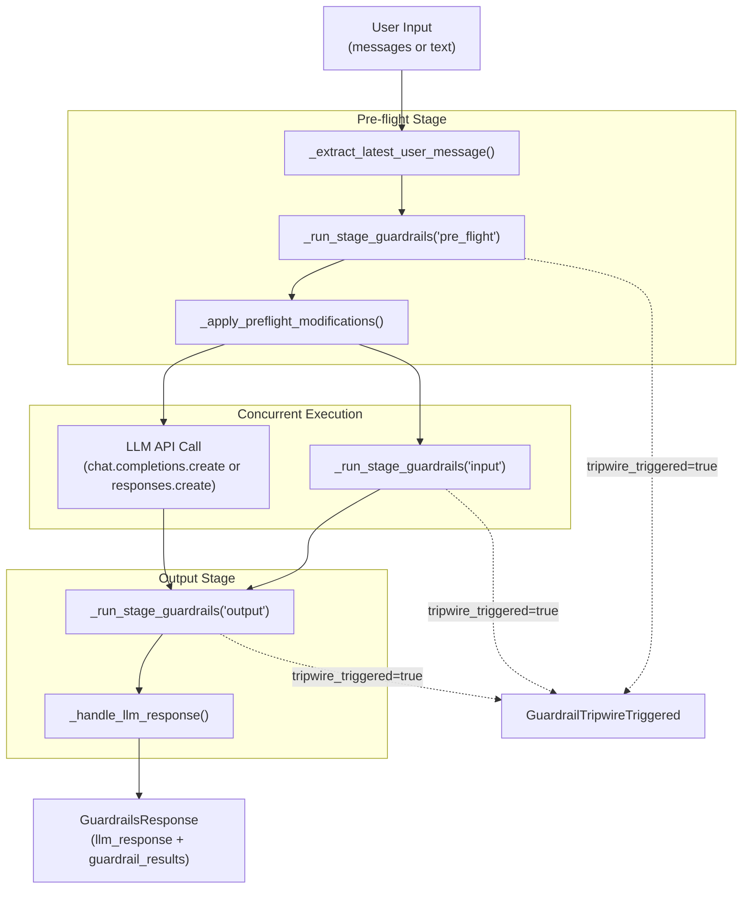
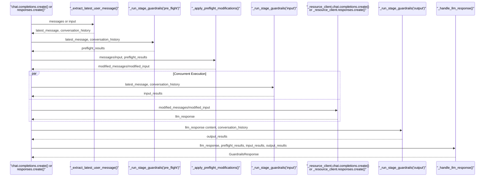
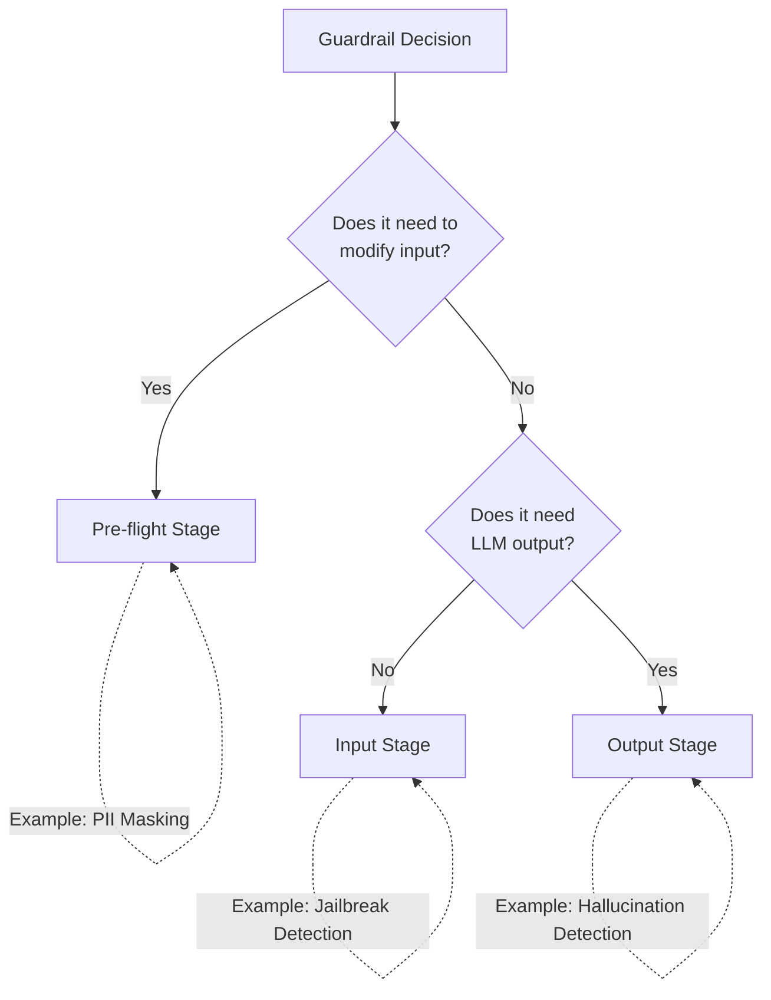
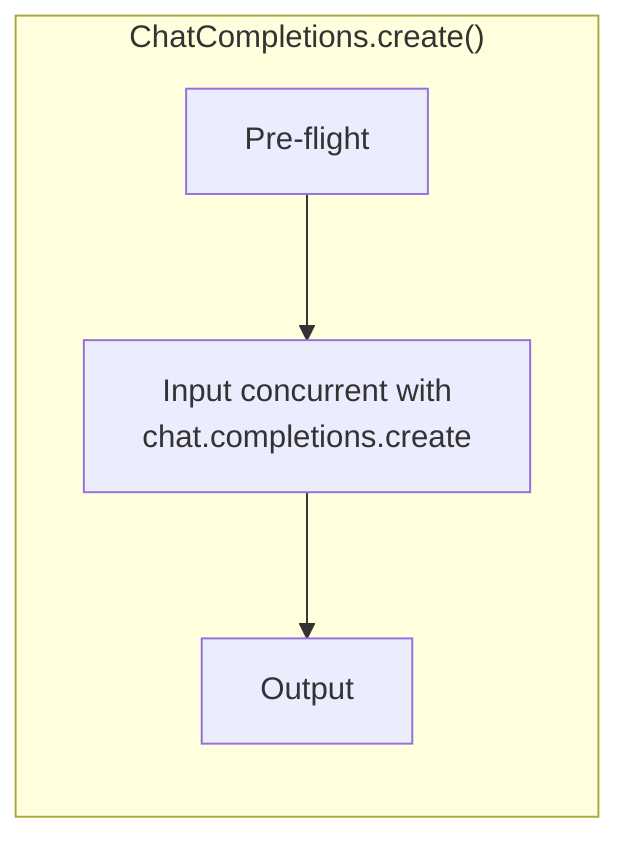
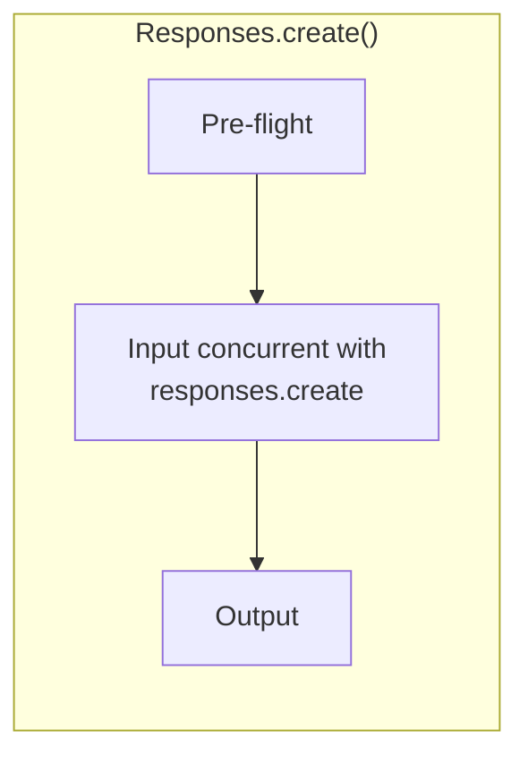
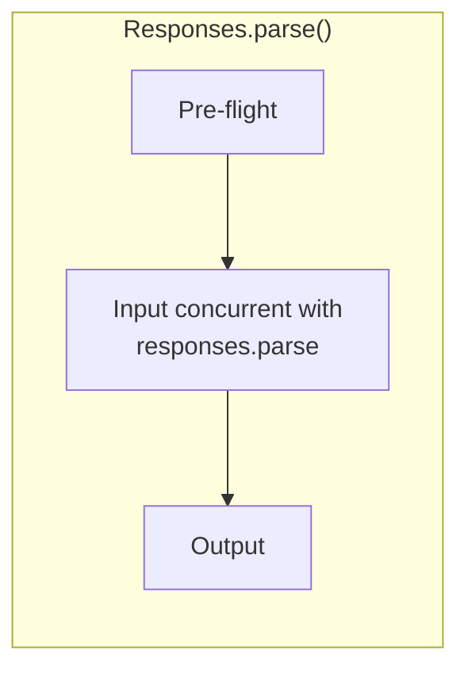
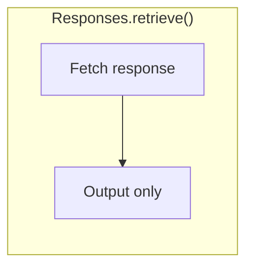
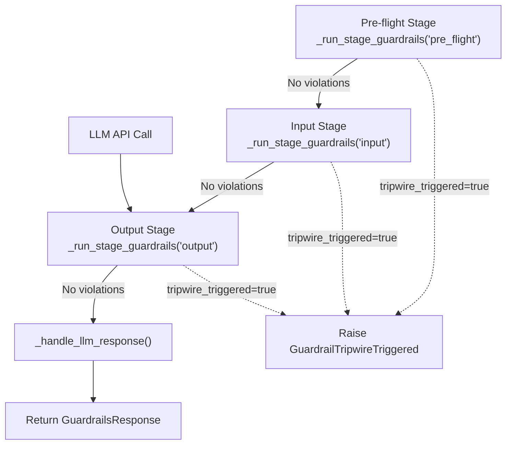
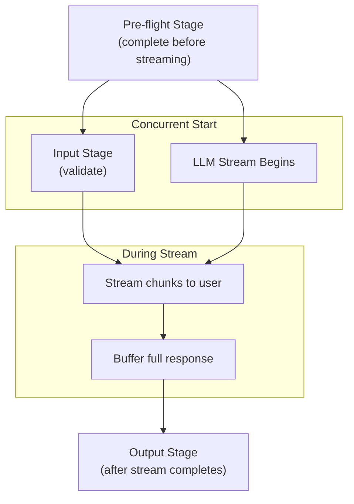

<!-- source: DeepWiki mcp.deepwiki.com · repo openai/openai-guardrails-python · page 3.1 Three-Stage Pipeline Architecture · fetched 2026-10-26 -->

# Three-Stage Pipeline Architecture

<details>
<summary>Relevant source files</summary>

The following files were used as context for generating this wiki page:

- [examples/basic/agents_sdk.py](examples/basic/agents_sdk.py)
- [src/guardrails/_streaming.py](src/guardrails/_streaming.py)
- [src/guardrails/agents.py](src/guardrails/agents.py)
- [src/guardrails/resources/chat/chat.py](src/guardrails/resources/chat/chat.py)
- [src/guardrails/resources/responses/responses.py](src/guardrails/resources/responses/responses.py)
- [tests/unit/test_agents.py](tests/unit/test_agents.py)
- [tests/unit/test_context.py](tests/unit/test_context.py)

</details>


## Purpose and Scope

This page details the three-stage pipeline architecture that forms the execution model for all guardrail validation in the OpenAI Guardrails framework. The pipeline consists of **pre-flight**, **input**, and **output** stages, each serving distinct purposes in the validation lifecycle.

For information about the type system used by guardrails (e.g., `GuardrailResult`, `CheckFn`), see [Type System and Protocols](#3.2). For details on how guardrails are executed at runtime, see [Runtime Execution](#3.5). For client-specific implementations, see [Chat Completions API](#4.3) and [Responses API](#4.4).

**Sources:** [README.md:33-114](), [docs/quickstart.md:42-50]()

## Overview of the Three Stages

The pipeline architecture divides guardrail execution into three distinct stages, each with specific responsibilities and execution characteristics:

| Stage | Purpose | Execution Timing | Can Modify Input | Examples |
|-------|---------|------------------|------------------|----------|
| **Pre-flight** | Validate and transform input before LLM processing | Sequential (blocks before LLM call) | Yes | PII masking, Content moderation |
| **Input** | Validate input for threats and policy violations | Concurrent with LLM call | No | Jailbreak detection, URL filtering, Prompt injection |
| **Output** | Validate LLM-generated content | Sequential (after LLM response) | No | Hallucination detection, NSFW detection, Off-topic checking |

The key architectural decision is that **input stage guardrails run concurrently with the LLM API call** to minimize latency overhead, while pre-flight and output stages execute sequentially.

**Sources:** [docs/quickstart.md:42-50](), [README.md:33-114]()

## Pipeline Execution Flow

### High-Level Execution Sequence



**Sources:** [src/guardrails/resources/chat/chat.py:64-115](), [src/guardrails/resources/responses/responses.py:24-87]()

### Code-Level Execution Flow

The following diagram maps the execution flow to actual code entities:



**Sources:** [src/guardrails/resources/chat/chat.py:64-115](), [src/guardrails/resources/responses/responses.py:24-87]()

## Pre-flight Stage

### Purpose and Characteristics

The pre-flight stage is the **only stage that can modify the input** before it reaches the LLM. It executes **sequentially before the LLM call**, blocking until all pre-flight guardrails complete.

**Key characteristics:**
- Executes synchronously before LLM call
- Can transform input (e.g., mask PII, remove content)
- Results include `modified_text` field for transformations
- Typically used for data sanitization and content moderation

### Implementation Details

Pre-flight guardrails are configured in the `pre_flight` section of the pipeline configuration:

```json
{
  "version": 1,
  "pre_flight": {
    "version": 1,
    "guardrails": [
      {"name": "Contains PII", "config": {"scrub_pii": true}},
      {"name": "Moderation", "config": {}}
    ]
  }
}
```

The pre-flight execution flow:

1. **Extract latest message:** [src/guardrails/resources/chat/chat.py:69]()
   ```python
   latest_message, _ = self._client._extract_latest_user_message(messages)
   ```

2. **Run pre-flight guardrails:** [src/guardrails/resources/chat/chat.py:72-77]()
   ```python
   preflight_results = self._client._run_stage_guardrails(
       "pre_flight",
       latest_message,
       conversation_history=messages,
       suppress_tripwire=suppress_tripwire,
   )
   ```

3. **Apply modifications:** [src/guardrails/resources/chat/chat.py:80]()
   ```python
   modified_messages = self._client._apply_preflight_modifications(messages, preflight_results)
   ```

### Typical Pre-flight Guardrails

- **PII Detection with Masking** (`scrub_pii=true`): Replaces detected PII with placeholders
- **Moderation**: Blocks inappropriate content before processing
- **Custom transformations**: Any guardrail that needs to modify input

**Sources:** [src/guardrails/resources/chat/chat.py:69-80](), [src/guardrails/resources/responses/responses.py:38-52]()

## Input Stage

### Purpose and Characteristics

The input stage validates user input for security threats and policy violations. Its defining characteristic is **concurrent execution with the LLM API call** to minimize latency impact.

**Key characteristics:**
- Executes **in parallel** with the LLM API call
- Cannot modify input (validation only)
- Uses `ThreadPoolExecutor` (sync) or `asyncio.gather()` (async) for concurrency
- Optimized for low-latency threat detection

### Concurrency Implementation

#### Synchronous (ThreadPoolExecutor)

[src/guardrails/resources/chat/chat.py:83-97]()

```python
# Run input guardrails and LLM call concurrently using a thread for the LLM
with ThreadPoolExecutor(max_workers=1) as executor:
    llm_future = executor.submit(
        self._client._resource_client.chat.completions.create,
        messages=modified_messages,
        model=model,
        stream=stream,
        **kwargs,
    )
    input_results = self._client._run_stage_guardrails(
        "input",
        latest_message,
        conversation_history=messages,
        suppress_tripwire=suppress_tripwire,
    )
    llm_response = llm_future.result()
```

The LLM call runs in a separate thread while input guardrails execute on the main thread. Both complete before proceeding to the output stage.

#### Asynchronous (asyncio.gather)

[src/guardrails/resources/chat/chat.py:146-159]()

```python
# Run input guardrails and LLM call concurrently
input_check = self._client._run_stage_guardrails(
    "input",
    latest_message,
    conversation_history=messages,
    suppress_tripwire=suppress_tripwire,
)
llm_call = self._client._resource_client.chat.completions.create(
    messages=modified_messages,
    model=model,
    stream=stream,
    **kwargs,
)

input_results, llm_response = await asyncio.gather(input_check, llm_call)
```

Both coroutines execute concurrently using `asyncio.gather()`, which waits for both to complete.

### Concurrency Visualization

```mermaid
gantt
    title Input Stage Concurrency Pattern
    dateFormat X
    axisFormat %s
    
    section Sequential (Without Concurrency)
    Input Guardrails: 0, 100
    LLM API Call: 100, 300
    
    section Concurrent (With Concurrency)
    Input Guardrails: 0, 100
    LLM API Call: 0, 300
    
    section Time Saved
    Overlap: 0, 100
```



In this example, input guardrails take 100ms and the LLM call takes 300ms. Without concurrency, total time is 400ms. With concurrency, total time is 300ms (max of the two), saving 100ms.

### Typical Input Guardrails

- **Jailbreak Detection**: Identifies prompt injection attempts
- **URL Filter**: Validates URLs against allowlist/blocklist
- **Prompt Injection Detection**: Detects conversation history manipulation (for agents)
- **Custom validation**: Any guardrail that validates but doesn't modify input

**Sources:** [src/guardrails/resources/chat/chat.py:83-97](), [src/guardrails/resources/chat/chat.py:146-159](), [src/guardrails/resources/responses/responses.py:54-70](), [src/guardrails/resources/responses/responses.py:186-200]()

## Output Stage

### Purpose and Characteristics

The output stage validates the LLM-generated content after the model has completed its response. It executes **sequentially after receiving the LLM response**.

**Key characteristics:**
- Executes after LLM response is received
- Validates LLM-generated content
- Cannot modify LLM output
- May access conversation history for context-aware validation

### Implementation Details

Output guardrails are configured in the `output` section:

```json
{
  "version": 1,
  "output": {
    "version": 1,
    "guardrails": [
      {"name": "Hallucination Detection", "config": {"vector_store_id": "vs_abc123"}},
      {"name": "NSFW Text", "config": {}},
      {"name": "Off Topic Prompts", "config": {"business_description": "customer support"}}
    ]
  }
}
```

The output execution occurs in `_handle_llm_response()`:

[src/guardrails/resources/chat/chat.py:108-114]()

```python
return self._client._handle_llm_response(
    llm_response,
    preflight_results,
    input_results,
    conversation_history=messages,
    suppress_tripwire=suppress_tripwire,
)
```

### Typical Output Guardrails

- **Hallucination Detection**: Validates facts against knowledge base (vector store)
- **NSFW Text Detection**: Identifies workplace-inappropriate content in outputs
- **Off-Topic Detection**: Ensures responses stay within business scope
- **PII Detection**: Checks for leaked PII in model responses
- **Custom validation**: Any guardrail that needs to validate LLM output

**Sources:** [src/guardrails/resources/chat/chat.py:108-114](), [src/guardrails/resources/responses/responses.py:80-87]()

## Stage Configuration

### Pipeline Configuration Structure

Pipeline configurations are defined using `PipelineBundles` which contain three optional `ConfigBundle` objects:

```json
{
  "version": 1,
  "pre_flight": {
    "version": 1,
    "guardrails": [
      {"name": "Contains PII", "config": {"scrub_pii": true, "entities": ["EMAIL_ADDRESS"]}}
    ]
  },
  "input": {
    "version": 1,
    "guardrails": [
      {"name": "Jailbreak", "config": {"model": "gpt-5-mini"}},
      {"name": "URL Filter", "config": {"allowed_domains": ["example.com"]}}
    ]
  },
  "output": {
    "version": 1,
    "guardrails": [
      {"name": "Hallucination Detection", "config": {"vector_store_id": "vs_123"}},
      {"name": "NSFW Text", "config": {}}
    ]
  }
}
```

### Stage Selection Guidelines

Use this decision matrix to determine which stage is appropriate for a guardrail:



**Stage placement rules:**
1. **Pre-flight required**: Guardrails that modify input (e.g., PII scrubbing with `scrub_pii=true`)
2. **Output required**: Guardrails that validate LLM-generated content (e.g., hallucination detection, NSFW text)
3. **Input preferred**: Validation-only guardrails that don't need LLM output (benefits from concurrency)
4. **Flexible**: Some guardrails like PII detection (without scrubbing) or Moderation can run in multiple stages

**Sources:** [docs/quickstart.md:42-50]()

## Execution Across Different APIs

The three-stage pipeline is consistently implemented across all client APIs:

### Chat Completions API



**Implementation:** [src/guardrails/resources/chat/chat.py:64-115]()

### Responses API



**Implementation:** [src/guardrails/resources/responses/responses.py:24-87]()

### Responses.parse() (Structured Outputs)



**Implementation:** [src/guardrails/resources/responses/responses.py:89-127]()

### Responses.retrieve()

The `retrieve()` method has a simplified pipeline since the LLM response already exists:



**Implementation:** [src/guardrails/resources/responses/responses.py:129-144]()

**Sources:** [src/guardrails/resources/chat/chat.py:64-115](), [src/guardrails/resources/responses/responses.py:24-144]()

## Tripwire Handling Across Stages

Each stage can trigger a `GuardrailTripwireTriggered` exception, immediately halting execution:

### Tripwire Propagation Flow



### Stage-Specific Tripwire Behavior

**Pre-flight tripwires:**
- LLM call is **never made**
- Input guardrails are **not executed**
- Exception raised immediately after pre-flight completion

**Input tripwires:**
- LLM call **may still complete** (due to concurrency)
- LLM response is **discarded**
- Exception raised after both input and LLM complete
- Output guardrails are **not executed**

**Output tripwires:**
- LLM response is available but **not returned to user**
- Exception includes full LLM response in context

### Suppress Tripwire Mode

All stages support `suppress_tripwire=False` parameter to disable exception raising:

[src/guardrails/resources/chat/chat.py:64]()

```python
def create(self, messages: list[dict[str, str]], model: str, stream: bool = False, suppress_tripwire: bool = False, **kwargs):
```

When `suppress_tripwire=True`:
- No `GuardrailTripwireTriggered` exceptions are raised
- Violations are recorded in `guardrail_results` but don't halt execution
- All stages execute regardless of violations
- Useful for fail-safe mode where availability is prioritized

For more details on exception handling modes, see [Error Handling Modes](#2.3).

**Sources:** [src/guardrails/resources/chat/chat.py:64-115](), [src/guardrails/resources/responses/responses.py:24-87]()

## Streaming Support

The three-stage pipeline architecture adapts for streaming responses:

### Streaming Execution Pattern



**Key differences in streaming mode:**
- Pre-flight and input stages execute **before streaming begins**
- Output stage executes **after the stream completes**
- Chunks are yielded to user while buffering full response
- See [Streaming vs Blocking Validation](#4.5) for more details

**Sources:** [src/guardrails/resources/chat/chat.py:100-106](), [src/guardrails/resources/responses/responses.py:73-79]()

## Performance Characteristics

### Stage Latency Impact

| Stage | Latency Impact | Reason |
|-------|---------------|--------|
| Pre-flight | **Additive** (sequential) | Blocks before LLM call; adds ~50-500ms depending on guardrails |
| Input | **Minimal** (concurrent) | Runs parallel to LLM call; only adds latency if slower than LLM |
| Output | **Additive** (sequential) | Runs after LLM; adds ~50-1000ms depending on guardrails |

### Optimization Strategies

1. **Minimize pre-flight guardrails:** Only include guardrails that must modify input
2. **Maximize input stage usage:** Place validation-only guardrails in input stage
3. **Use faster models for checks:** Configure guardrails to use `gpt-5-mini` instead of `gpt-5` where appropriate
4. **Enable streaming:** Reduces perceived latency for output guardrails

For performance benchmarks by guardrail type, see [Performance Benchmarks](#6.7).

**Sources:** [src/guardrails/resources/chat/chat.py:83-97](), [src/guardrails/resources/chat/chat.py:146-159]()

## Summary

The three-stage pipeline architecture provides a systematic approach to guardrail execution:

- **Pre-flight:** Sequential execution for input transformation (e.g., PII masking)
- **Input:** Concurrent validation that runs parallel to LLM calls for minimal latency
- **Output:** Sequential validation of LLM-generated content

This architecture is consistently implemented across `chat.completions.create()`, `responses.create()`, `responses.parse()`, and `responses.retrieve()` APIs, using `ThreadPoolExecutor` for synchronous clients and `asyncio.gather()` for asynchronous clients.

The concurrency design in the input stage is the key architectural innovation, enabling comprehensive input validation with minimal performance overhead.

**Sources:** [src/guardrails/resources/chat/chat.py:64-176](), [src/guardrails/resources/responses/responses.py:1-284](), [README.md:33-114](), [docs/quickstart.md:42-50]()

---

