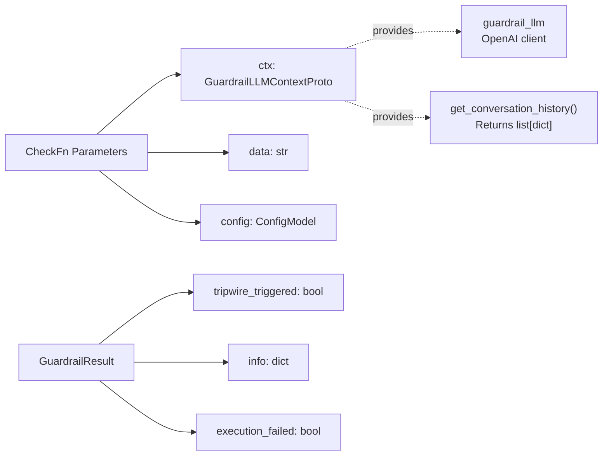
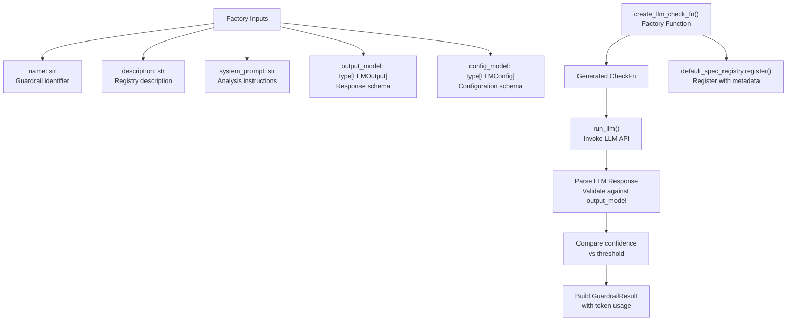
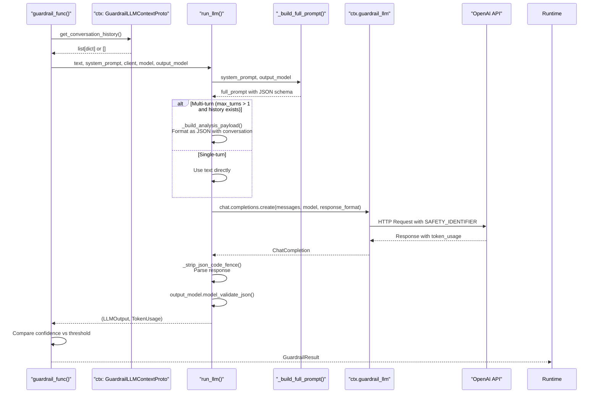
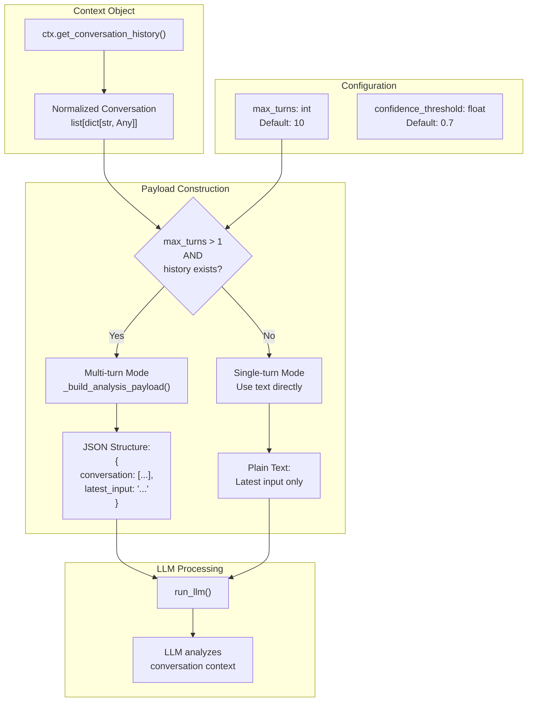
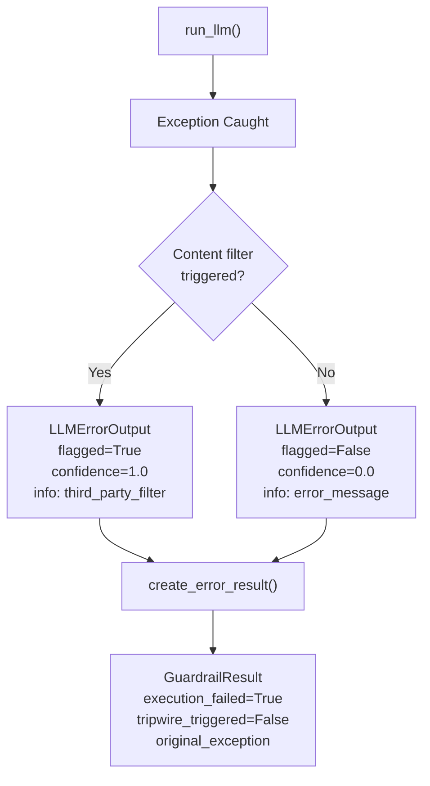

<!-- source: DeepWiki mcp.deepwiki.com · repo openai/openai-guardrails-python · page 3.2 Guardrail Functions and Check Types · fetched 2026-10-26 -->

# Guardrail Functions and Check Types

<details>
<summary>Relevant source files</summary>

The following files were used as context for generating this wiki page:

- [src/guardrails/checks/text/llm_base.py](src/guardrails/checks/text/llm_base.py)
- [src/guardrails/checks/text/moderation.py](src/guardrails/checks/text/moderation.py)
- [tests/conftest.py](tests/conftest.py)
- [tests/unit/checks/test_moderation.py](tests/unit/checks/test_moderation.py)
- [tests/unit/checks/test_secret_keys.py](tests/unit/checks/test_secret_keys.py)

</details>


This page documents the core guardrail function interface (`CheckFn`), the two primary check types (API-based and LLM-based), and how conversation-aware guardrails access multi-turn context. For information about how guardrails are executed in the runtime pipeline, see [Runtime Execution Model](#3.5). For details on specific built-in guardrails, see [Built-in Guardrails](#6).

---

## Overview

Every guardrail in the system is implemented as an asynchronous function that conforms to the `CheckFn` protocol. These functions accept three parameters: a context object, data to analyze, and configuration. They return a `GuardrailResult` indicating whether the tripwire was triggered.

Guardrails are categorized by their **engine type**, which determines how they perform analysis:

| Engine Type | Description | Examples |
|------------|-------------|----------|
| `API` | Uses external HTTP APIs for specialized analysis | Moderation, URL Filter, Contains PII |
| `LLM` | Uses language models for nuanced content analysis | Jailbreak, NSFW Text, Hallucination Detection, Prompt Injection |

Guardrails may also be **conversation-aware**, meaning they can analyze multi-turn conversations rather than just isolated text inputs.

**Sources:** [src/guardrails/checks/text/llm_base.py:48-56](), [src/guardrails/spec.py]()

---

## CheckFn Protocol

### Function Signature



All guardrail functions follow this signature pattern:

```python
async def guardrail_name(
    ctx: GuardrailLLMContextProto,
    data: str,
    config: ConfigModel,
) -> GuardrailResult
```

**Parameters:**

- **`ctx`**: Context object providing access to the OpenAI client (`ctx.guardrail_llm`) and conversation history (`ctx.get_conversation_history()`)
- **`data`**: Text content to analyze (user input, LLM output, or tool parameters)
- **`config`**: Configuration object validated against the guardrail's config schema

**Return Value:**

A `GuardrailResult` with these fields:
- `tripwire_triggered`: Boolean indicating if the guardrail detected a violation
- `info`: Dictionary containing analysis details, guardrail name, and token usage
- `execution_failed`: Boolean indicating if the check encountered an error
- `original_exception`: Optional exception object if execution failed

**Sources:** [src/guardrails/checks/text/llm_base.py:521-534](), [src/guardrails/types.py]()

---

## API-Based Guardrails

### Architecture

API-based guardrails (`engine="API"`) delegate analysis to external HTTP endpoints. They handle authentication, error handling, and fallback logic when the primary client lacks the required endpoint.

```mermaid
graph TB
    CheckFn["moderation()<br/>API-Based CheckFn"]
    
    CtxClient["ctx.guardrail_llm<br/>Context OpenAI Client"]
    FallbackClient["_get_moderation_client()<br/>Cached AsyncOpenAI"]
    
    API["External API Endpoint<br/>moderations.create()"]
    
    Result["GuardrailResult<br/>flagged_categories<br/>category_details"]
    
    CheckFn -->|"1. Try context client"| CtxClient
    CtxClient -->|"2. Call endpoint"| API
    CtxClient -."|404 NotFoundError"| FallbackClient
    FallbackClient -->|"3. Call endpoint"| API
    
    API -->|"Response"| Parse["Parse categories<br/>Check against config"]
    Parse -->|"Build result"| Result
```

### Implementation Example: Moderation

The `moderation` guardrail demonstrates API-based implementation patterns:

1. **Client Selection**: Attempts to use `ctx.guardrail_llm` first, falling back to a cached OpenAI client if the moderation endpoint is unavailable (e.g., Azure, third-party providers)
2. **Async/Sync Handling**: Detects whether the client is synchronous or asynchronous and invokes appropriately
3. **Error Handling**: Catches `NotFoundError` to trigger fallback logic
4. **Configuration-Based Filtering**: Only flags categories specified in the config

**Sources:** [src/guardrails/checks/text/moderation.py:166-243](), [tests/unit/checks/test_moderation.py:62-91](), [tests/unit/checks/test_moderation.py:93-136]()

### Key Characteristics

| Feature | Description |
|---------|-------------|
| **Client Fallback** | Uses `ctx.guardrail_llm` if available, falls back to environment-configured client |
| **Sync/Async Support** | Handles both `OpenAI` and `AsyncOpenAI` clients via `asyncio.to_thread` |
| **Error Resilience** | Catches provider-specific errors (e.g., `NotFoundError` for missing endpoints) |
| **No Conversation Context** | Typically analyzes single text inputs without multi-turn awareness |

**Sources:** [src/guardrails/checks/text/moderation.py:186-210]()

---

## LLM-Based Guardrails

### Factory Pattern Architecture

LLM-based guardrails (`engine="LLM"`) are created using the `create_llm_check_fn` factory function, which encapsulates common patterns for LLM-based analysis.



### Core Components

**Configuration Schema (`LLMConfig`):**

The base configuration schema for all LLM-based guardrails includes:

| Field | Type | Description | Default |
|-------|------|-------------|---------|
| `model` | `str` | LLM model identifier (e.g., `"gpt-4o"`) | Required |
| `confidence_threshold` | `float` | Minimum confidence to trigger (0.0-1.0) | `0.7` |
| `max_turns` | `int` | Maximum conversation turns to include | `10` |
| `include_reasoning` | `bool` | Include explanation in output | `False` |

**Output Schema (`LLMOutput`):**

All LLM-based guardrails return structured output with:

| Field | Type | Description |
|-------|------|-------------|
| `flagged` | `bool` | Whether content violates the guardrail |
| `confidence` | `float` | LLM's confidence in the decision (0.0-1.0) |
| `reason` | `str` | Explanation (only if `include_reasoning=True`) |

**Sources:** [src/guardrails/checks/text/llm_base.py:82-120](), [src/guardrails/checks/text/llm_base.py:125-157]()

### LLM Invocation Flow



**Sources:** [src/guardrails/checks/text/llm_base.py:371-483](), [src/guardrails/checks/text/llm_base.py:521-584]()

### Prompt Construction

The factory automatically constructs prompts with specific structure:

1. **System Instructions**: The provided `system_prompt` explaining analysis criteria
2. **Response Schema**: JSON field descriptions derived from `output_model`
3. **Confidence Calibration**: Instructions to use full 0.0-1.0 range for confidence scores
4. **User Content**: Either plain text or JSON payload with conversation history

**Sources:** [src/guardrails/checks/text/llm_base.py:237-273]()

---

## Conversation-Aware Guardrails

### Multi-Turn Analysis

Guardrails marked with `uses_conversation_history=True` in their metadata can analyze conversations across multiple turns. This enables detection of attacks that unfold over multiple exchanges.



### Conversation History Format

The `get_conversation_history()` method returns a normalized format:

```python
[
    {
        "role": "user",
        "content": "First user message"
    },
    {
        "role": "assistant", 
        "content": "First assistant response"
    },
    {
        "role": "user",
        "content": "Follow-up question"
    }
]
```

When `max_turns > 1`, the most recent N turns are included in the analysis payload sent to the LLM.

**Sources:** [src/guardrails/checks/text/llm_base.py:347-368](), [src/guardrails/checks/text/llm_base.py:416-426]()

### Single-Turn vs Multi-Turn Behavior

| Aspect | Single-Turn (`max_turns=1`) | Multi-Turn (`max_turns>1`) |
|--------|----------------------------|---------------------------|
| **Configuration** | Set `max_turns=1` in config | Set `max_turns=10` (or desired count) |
| **Payload Format** | Plain text: `text.strip()` | JSON with conversation array |
| **Context Used** | Current input only | Last N turns from history |
| **Use Cases** | Stateless validation (e.g., NSFW) | Attack detection across turns (e.g., Jailbreak) |

**Sources:** [src/guardrails/checks/text/llm_base.py:542-564]()

---

## Configuration and Output Schemas

### Configuration Schema Requirements

Every guardrail must define a Pydantic configuration model that:

1. Inherits from `BaseModel` (or `LLMConfig` for LLM-based guardrails)
2. Uses `Field()` with `description` for documentation
3. Sets `model_config = ConfigDict(extra="forbid")` to prevent unknown fields
4. Validates ranges using constraints (e.g., `ge=0.0, le=1.0`)

**Example from Moderation:**

```python
class ModerationCfg(BaseModel):
    categories: list[Category] = Field(
        default_factory=lambda: list(Category),
        description="Moderation categories to check. Defaults to all categories if not specified.",
    )
    model_config = ConfigDict(extra="forbid")
```

**Example from LLM-based guardrails:**

```python
class LLMConfig(BaseModel):
    model: str = Field(..., description="LLM model to use for checking the text")
    confidence_threshold: float = Field(0.7, ge=0.0, le=1.0)
    max_turns: int = Field(10, ge=1)
    include_reasoning: bool = Field(False)
    model_config = ConfigDict(extra="forbid")
```

**Sources:** [src/guardrails/checks/text/moderation.py:86-119](), [src/guardrails/checks/text/llm_base.py:82-120]()

### Output Schema Patterns

**API-Based Output:**

API-based guardrails return free-form dictionaries in the `info` field:

```python
GuardrailResult(
    tripwire_triggered=True,
    info={
        "guardrail_name": "Moderation",
        "flagged_categories": ["hate", "violence"],
        "category_details": {"hate": True, "violence": True, ...}
    }
)
```

**LLM-Based Output:**

LLM-based guardrails use structured Pydantic models validated by the LLM:

```python
class LLMOutput(BaseModel):
    flagged: bool
    confidence: float = Field(ge=0.0, le=1.0)

class LLMReasoningOutput(LLMOutput):
    reason: str  # Only when include_reasoning=True
```

The factory converts this to a `GuardrailResult`:

```python
GuardrailResult(
    tripwire_triggered=(flagged and confidence >= threshold),
    info={
        "guardrail_name": "Jailbreak",
        "flagged": True,
        "confidence": 0.85,
        "threshold": 0.7,
        "token_usage": {"prompt_tokens": 150, ...}
    }
)
```

**Sources:** [src/guardrails/checks/text/moderation.py:234-242](), [src/guardrails/checks/text/llm_base.py:574-584]()

---

## Error Handling

### LLM Execution Failures

When LLM calls fail, the `run_llm` function returns `LLMErrorOutput` with error information. The factory converts this to a `GuardrailResult` with `execution_failed=True`:



**Content Filter Handling:**

Azure OpenAI content filters may block requests. The system detects this and returns flagged results:

```python
if "content_filter" in str(exc):
    return (
        LLMErrorOutput(
            flagged=True,
            confidence=1.0,
            info={"third_party_filter": True, "error_message": str(exc)}
        ),
        TokenUsage(...)
    )
```

**Sources:** [src/guardrails/checks/text/llm_base.py:456-482](), [src/guardrails/checks/text/llm_base.py:172-210]()

### API Endpoint Fallback

API-based guardrails implement fallback patterns when endpoints are unavailable:

1. **Initial Attempt**: Try `ctx.guardrail_llm` if provided
2. **NotFoundError Detection**: Catch 404 responses from Azure or third-party providers
3. **Fallback Client**: Use cached OpenAI client with environment credentials

**Sources:** [tests/unit/checks/test_moderation.py:93-136](), [tests/unit/checks/test_moderation.py:172-222]()

---

## Registration and Metadata

### Registry Integration

All guardrails register with `default_spec_registry` during module import:

```python
default_spec_registry.register(
    name="Moderation",
    check_fn=moderation,
    description="Flags text containing disallowed content categories.",
    media_type="text/plain",
    metadata=GuardrailSpecMetadata(engine="API"),
)
```

For LLM-based guardrails, the factory handles registration automatically:

```python
default_spec_registry.register(
    name=name,
    check_fn=guardrail_func,
    description=description,
    media_type="text/plain",
    metadata=GuardrailSpecMetadata(
        engine="LLM", 
        uses_conversation_history=True
    ),
)
```

**Sources:** [src/guardrails/checks/text/moderation.py:245-251](), [src/guardrails/checks/text/llm_base.py:588-594]()

### Metadata Fields

The `GuardrailSpecMetadata` class captures guardrail characteristics:

| Field | Type | Values | Purpose |
|-------|------|--------|---------|
| `engine` | `str` | `"API"` or `"LLM"` | Determines execution pattern |
| `uses_conversation_history` | `bool` | `True` or `False` | Indicates multi-turn capability |
| `media_type` | `str` | `"text/plain"` | Input data format (future: images, audio) |

This metadata enables the runtime to:
- Route guardrails to appropriate execution engines
- Provide conversation context only to conversation-aware guardrails
- Display capabilities in configuration interfaces

**Sources:** [src/guardrails/spec.py](), [src/guardrails/checks/text/llm_base.py:593]()

---

## Summary Table: Guardrail Check Types

| Aspect | API-Based | LLM-Based |
|--------|-----------|-----------|
| **Engine Type** | `engine="API"` | `engine="LLM"` |
| **Implementation** | Direct function | Factory-generated via `create_llm_check_fn` |
| **Analysis Method** | External HTTP API | OpenAI LLM with structured prompts |
| **Configuration** | Custom Pydantic model | Extends `LLMConfig` base |
| **Output Format** | Free-form dict in `info` | Structured `LLMOutput` model |
| **Conversation Awareness** | Typically no | Yes, via `max_turns` parameter |
| **Token Usage** | Not tracked | Included in result `info` |
| **Error Handling** | Custom per guardrail | Standardized `LLMErrorOutput` |
| **Examples** | Moderation, URL Filter, Contains PII | Jailbreak, NSFW Text, Hallucination Detection |

**Sources:** [src/guardrails/checks/text/llm_base.py:1-597](), [src/guardrails/checks/text/moderation.py:1-252]()

---

