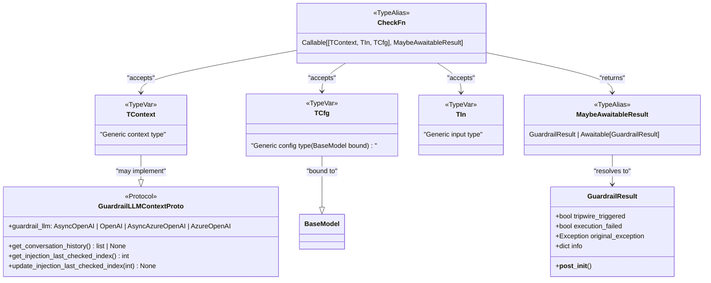
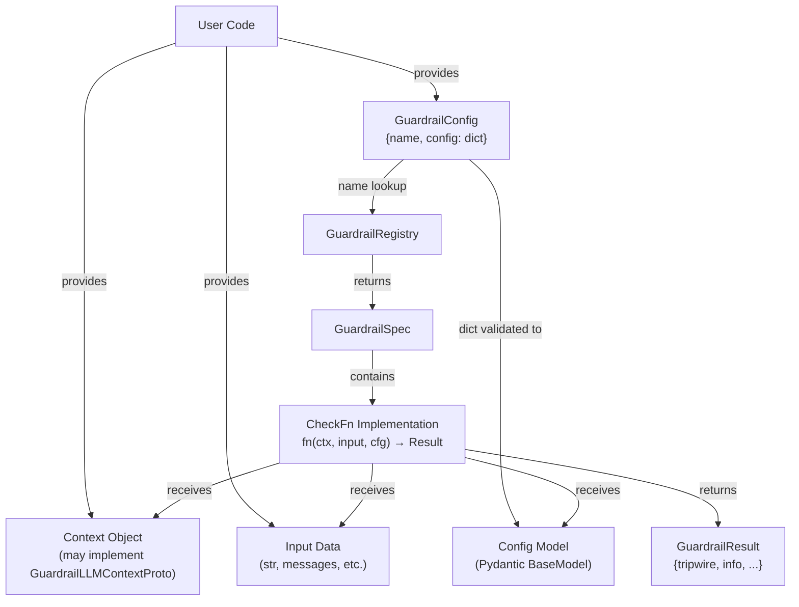
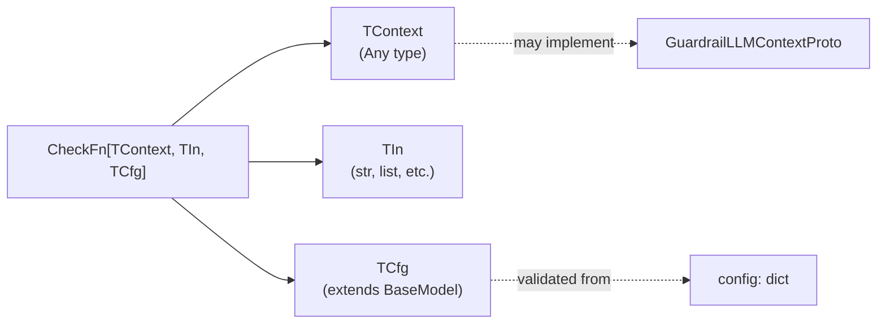
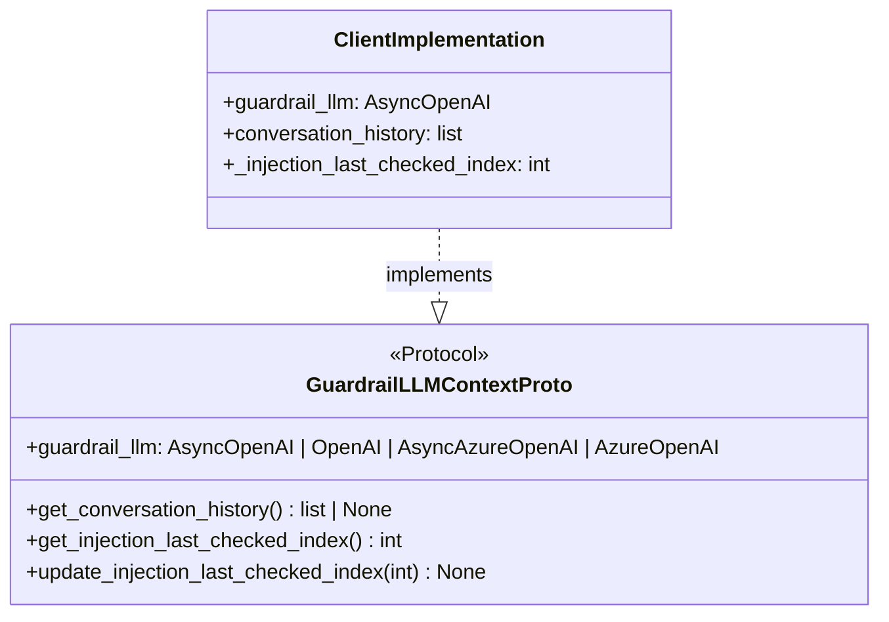
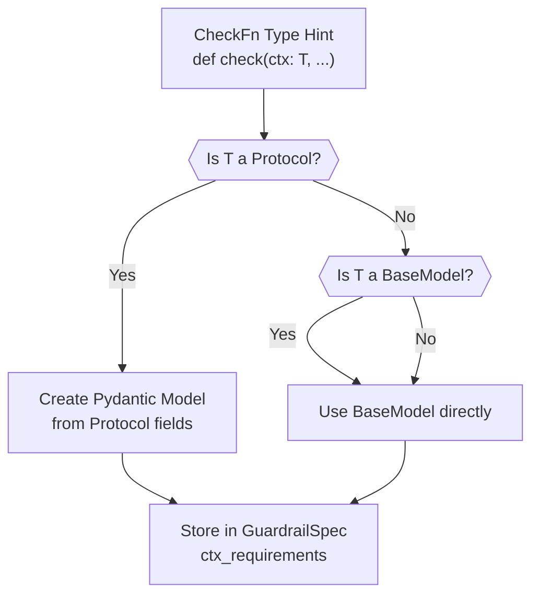
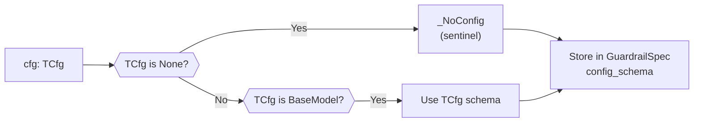
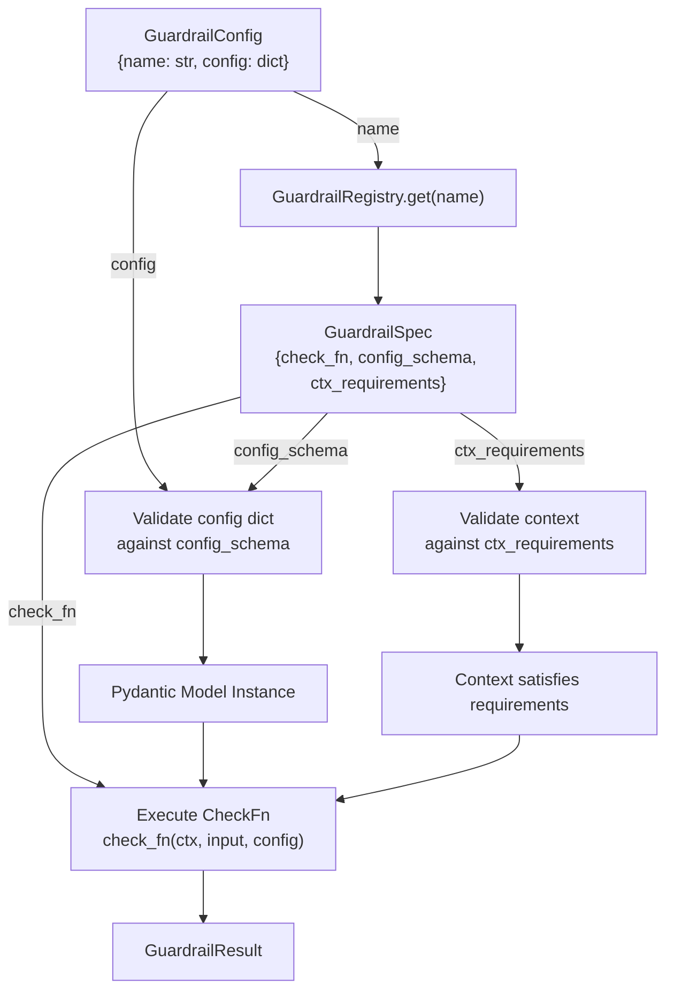
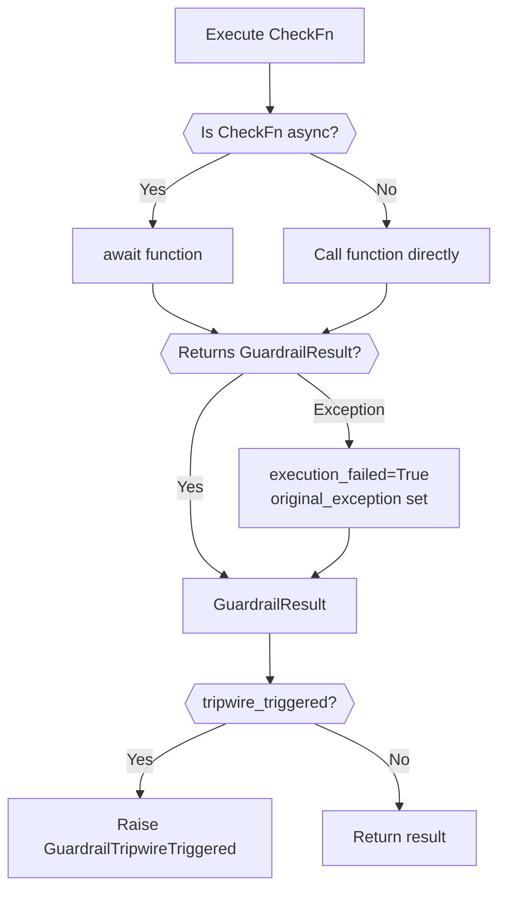

<!-- source: DeepWiki mcp.deepwiki.com · repo openai/openai-guardrails-python · page 3.3 Type System and Context Propagation · fetched 2026-10-26 -->

# Type System and Protocols

<details>
<summary>Relevant source files</summary>

The following files were used as context for generating this wiki page:

- [pyproject.toml](pyproject.toml)
- [src/guardrails/__init__.py](src/guardrails/__init__.py)
- [src/guardrails/resources/chat/chat.py](src/guardrails/resources/chat/chat.py)
- [src/guardrails/resources/responses/responses.py](src/guardrails/resources/responses/responses.py)
- [tests/unit/test_context.py](tests/unit/test_context.py)

</details>


This document describes the type system and protocol architecture that forms the foundation of the OpenAI Guardrails framework. It covers the core types used to define guardrail functions, their return values, context requirements, and configuration schemas.

For information about writing guardrail implementations, see [Guardrail Functions](#3.3). For the registry system that manages guardrail specifications, see [Guardrail Registry](#3.4). For a complete API reference of all type definitions, see [Type Definitions](#10.3).

## Overview

The type system is designed around three key abstractions:

1. **`GuardrailResult`** - A frozen dataclass representing the outcome of a guardrail check
2. **`CheckFn`** - A type alias defining the signature of guardrail functions
3. **`GuardrailLLMContextProto`** - A protocol specifying context requirements for guardrails that need LLM access

These types provide strong typing while maintaining flexibility for both synchronous and asynchronous execution, custom context requirements, and arbitrary configuration schemas.

**Sources:** [src/guardrails/types.py:1-109]()

## Core Type Architecture

The following diagram shows the relationships between the primary types in the system:



**Type Flow in Guardrail Execution**

This diagram shows how types flow through the guardrail execution pipeline:



**Sources:** [src/guardrails/types.py:60-109](), [src/guardrails/runtime.py]()

## GuardrailResult

`GuardrailResult` is a frozen, slotted dataclass that encapsulates the outcome of a guardrail check. It is defined at [src/guardrails/types.py:60-90]().

### Structure

| Field | Type | Description |
|-------|------|-------------|
| `tripwire_triggered` | `bool` | `True` if the guardrail identified a violation that should halt execution |
| `execution_failed` | `bool` | `True` if the guardrail itself failed to execute properly (default: `False`) |
| `original_exception` | `Exception \| None` | The exception that caused execution failure, if any |
| `info` | `dict[str, Any]` | Additional structured metadata about the check result |

### Design Properties

**Immutability:** The dataclass uses `frozen=True`, making all instances immutable after creation. Attempting to modify fields raises `FrozenInstanceError`.

```python
result = GuardrailResult(tripwire_triggered=True)
result.tripwire_triggered = False  # Raises FrozenInstanceError
```

**Validation:** The `__post_init__` method enforces consistency: if `execution_failed=True`, then `original_exception` must be provided.

**Default Info Dict:** Each instance gets a unique empty dict for `info` via `field(default_factory=dict)`, preventing shared mutable state between instances.

### Info Field Conventions

The `info` field is a flexible dictionary for guardrail-specific metadata. Common patterns include:

- `checked_text`: The processed/validated text (e.g., after PII masking)
- `confidence`: Confidence score from the detection model
- `matched_patterns`: Specific patterns that triggered detection
- `error_details`: Additional error information when `execution_failed=True`

**Sources:** [src/guardrails/types.py:60-90](), [tests/unit/test_types.py:40-59]()

## CheckFn Type Alias

`CheckFn` is the core type alias defining the signature of guardrail functions. It is defined at [src/guardrails/types.py:92-108]().

### Signature

```python
CheckFn = Callable[[TContext, TIn, TCfg], MaybeAwaitableResult]
```

Where:
- `TContext`: Generic type variable for context objects
- `TIn`: Generic type variable for input data
- `TCfg`: Generic type variable for configuration (bound to `BaseModel`)
- `MaybeAwaitableResult`: Union of `GuardrailResult | Awaitable[GuardrailResult]`

### Type Parameters



### Synchronous vs Asynchronous

The `MaybeAwaitableResult` type alias allows guardrail functions to be either synchronous or asynchronous:

```python
# Synchronous guardrail
def sync_check(ctx: Context, data: str, cfg: Config) -> GuardrailResult:
    return GuardrailResult(tripwire_triggered=False)

# Asynchronous guardrail
async def async_check(ctx: Context, data: str, cfg: Config) -> GuardrailResult:
    await some_async_operation()
    return GuardrailResult(tripwire_triggered=False)
```

The runtime automatically detects whether a function is async using `asyncio.iscoroutinefunction()` and handles execution accordingly.

**Sources:** [src/guardrails/types.py:92-108](), [tests/unit/test_types.py:61-77]()

## GuardrailLLMContextProto

`GuardrailLLMContextProto` is a runtime-checkable protocol that defines the interface for context objects that provide OpenAI client access. It is defined at [src/guardrails/types.py:30-58]().

### Protocol Interface



### Required Attribute

**`guardrail_llm`**: An OpenAI client instance. Supported types:
- `AsyncOpenAI` - Async OpenAI client
- `OpenAI` - Sync OpenAI client  
- `AsyncAzureOpenAI` - Async Azure OpenAI client
- `AzureOpenAI` - Sync Azure OpenAI client

### Optional Protocol Methods

**`get_conversation_history() -> list | None`**

Returns the full conversation history for conversation-aware guardrails (e.g., prompt injection detection). Returns `None` if no history is available. Default implementation uses `getattr(self, "conversation_history", None)`.

**`get_injection_last_checked_index() -> int`**

Returns the last checked message index for incremental prompt injection detection. Default implementation uses `getattr(self, "injection_last_checked_index", 0)`.

**`update_injection_last_checked_index(new_index: int) -> None`**

Updates the last checked index for incremental checking. Default implementation updates `self._client._injection_last_checked_index` if `_client` exists.

### Usage Pattern

Guardrails that need LLM access declare their context parameter with this protocol:

```python
def llm_based_check(
    ctx: GuardrailLLMContextProto,
    data: str,
    cfg: Config
) -> GuardrailResult:
    # Access the LLM client
    client = ctx.guardrail_llm
    
    # Optionally access conversation history
    history = ctx.get_conversation_history()
    
    # Perform LLM-based validation
    ...
```

The protocol is runtime-checkable (`@runtime_checkable`), allowing `isinstance()` checks at runtime.

**Sources:** [src/guardrails/types.py:30-58](), [tests/unit/test_types.py:79-96]()

## Type Variables and Generic Patterns

The framework uses three primary type variables to enable generic guardrail implementations.

### Type Variable Definitions

| Variable | Bound | Purpose |
|----------|-------|---------|
| `TContext` | None | Generic context type, may be any Python object |
| `TIn` | None | Generic input type (typically `str` or `list`) |
| `TCfg` | `BaseModel` | Configuration type, must be a Pydantic model |

### Context Type Resolution

The registry system resolves context requirements using two patterns:



**Protocol to Model Conversion:** When a guardrail function declares a `Protocol` for its context parameter, the registry extracts the protocol's fields and creates a Pydantic `BaseModel` with matching fields. This is implemented in `_resolve_ctx_requirements()`.

**BaseModel Passthrough:** When the context parameter is already a `BaseModel`, it is used directly without conversion.

**Sources:** [src/guardrails/types.py:92-96](), [src/guardrails/registry.py](), [tests/unit/test_registry.py:25-48]()

## Configuration Type Resolution

The registry resolves configuration schemas from the `TCfg` type hint:



**No Configuration:** Guardrails that don't need configuration use `None` as the config type. The registry stores a `_NoConfig` sentinel.

**Pydantic Configuration:** Guardrails with configuration declare a `BaseModel` subclass. The registry stores the schema and validates configuration dictionaries against it during instantiation.

**Sources:** [src/guardrails/registry.py](), [tests/unit/test_registry.py:67-87]()

## Integration with Runtime System

The type system integrates with the runtime execution pipeline through several key components:

### GuardrailConfig to CheckFn Instantiation



### Context Validation Process

The runtime validates context objects against the guardrail's requirements at [src/guardrails/runtime.py]():

1. Extract the `ctx_requirements` Pydantic model from the `GuardrailSpec`
2. Attempt to construct the model from the provided context object's attributes
3. If validation fails, raise `ContextValidationError`

This ensures type safety while allowing flexible context object structures.

### Error Handling Flow



**Sources:** [src/guardrails/runtime.py](), [tests/unit/test_runtime.py]()

## Type System Design Principles

### Immutability

`GuardrailResult` is frozen to prevent accidental mutation during result processing. This ensures results remain consistent as they flow through the pipeline and are collected in `GuardrailResults`.

### Protocol-Based Design

`GuardrailLLMContextProto` uses structural subtyping via protocols rather than nominal inheritance. This allows any object with a `guardrail_llm` attribute to satisfy the protocol without explicit inheritance, providing flexibility while maintaining type safety.

### Generic Flexibility

Type variables allow guardrails to work with arbitrary context and input types while maintaining strong typing. The registry system bridges the gap between generic function signatures and concrete runtime types through introspection and Pydantic model generation.

### Sync/Async Transparency

The `MaybeAwaitableResult` type and runtime detection of async functions allow guardrails to be written in either style without requiring separate APIs or registration paths.

**Sources:** [src/guardrails/types.py:1-109](), [src/guardrails/registry.py](), [tests/unit/test_types.py](), [tests/unit/test_registry.py]()

---

