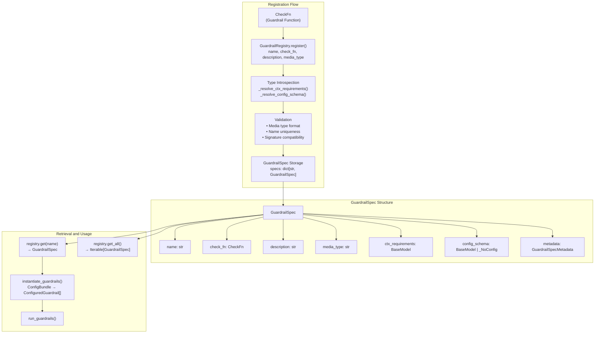
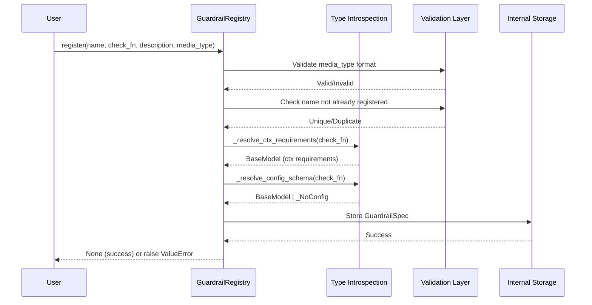
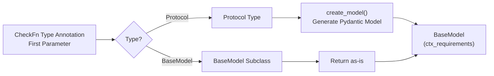
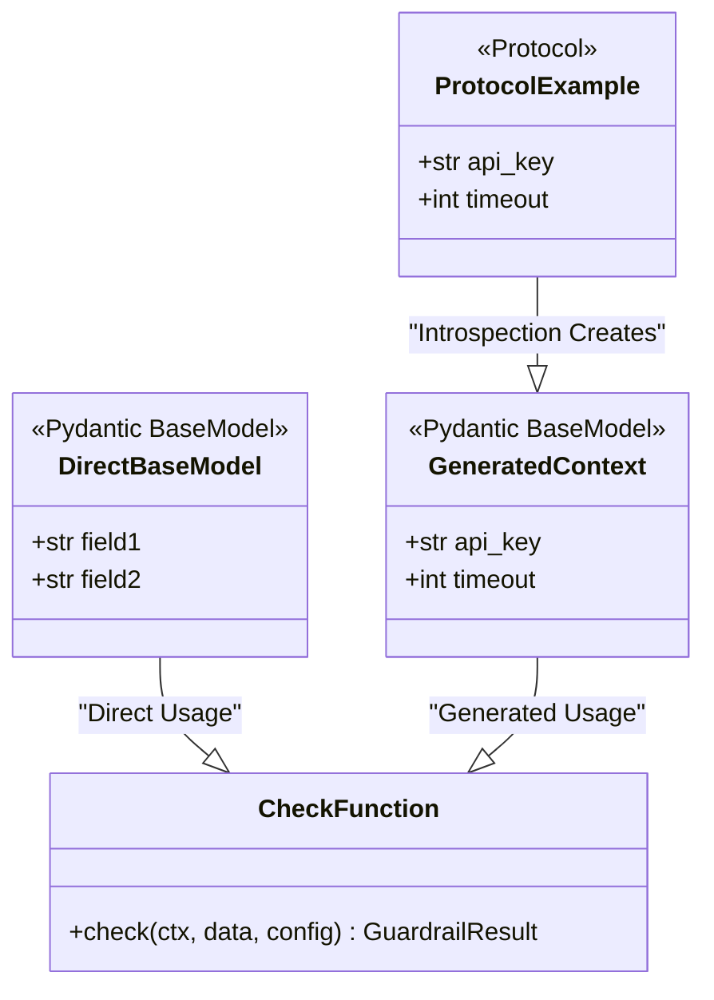
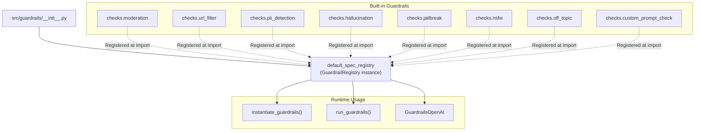
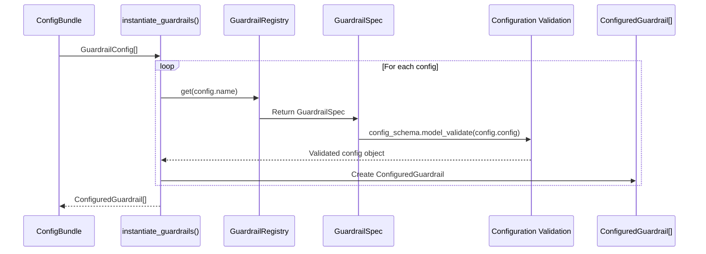

<!-- source: DeepWiki mcp.deepwiki.com · repo openai/openai-guardrails-python · page 3.4 Guardrail Registry System · fetched 2026-10-26 -->

# Guardrail Registry

<details>
<summary>Relevant source files</summary>

The following files were used as context for generating this wiki page:

- [pyproject.toml](pyproject.toml)
- [src/guardrails/__init__.py](src/guardrails/__init__.py)
- [src/guardrails/checks/text/llm_base.py](src/guardrails/checks/text/llm_base.py)

</details>


The Guardrail Registry is a central component that stores and manages guardrail implementations, enabling runtime lookup and instantiation of guardrails by name. It provides a type-safe registration system that validates guardrail function signatures, resolves context and configuration requirements, and enforces media type constraints.

This page documents the registry architecture and API. For information about writing guardrail functions, see [Guardrail Functions](#3.3). For details on how the runtime uses the registry to execute guardrails, see [Runtime Execution](#3.5). For examples of registered built-in guardrails, see [Built-in Guardrails](#6).

**Sources:** [src/guardrails/__init__.py:1-76](), [tests/unit/test_registry.py:1-177]()

## Registry Architecture

The registry acts as a mapping from guardrail names to `GuardrailSpec` objects, which encapsulate the guardrail function along with its metadata, type requirements, and configuration schema. The registry performs introspection on guardrail functions during registration to extract type information and validate compatibility.



**Diagram: Guardrail Registry Architecture and Data Flow**

The registration process performs compile-time type checking to ensure guardrails conform to the `CheckFn` protocol. The registry extracts context requirements and configuration schemas from type annotations, creating a fully typed specification that can be validated at configuration load time.

**Sources:** [tests/unit/test_registry.py:89-131](), [tests/unit/test_runtime.py:186-206]()

## Core API

The `GuardrailRegistry` class provides CRUD operations for managing guardrail specifications:

| Method | Signature | Description |
|--------|-----------|-------------|
| `register()` | `register(name, check_fn, description, media_type, metadata=None)` | Register a new guardrail with the given name and metadata |
| `get()` | `get(name) -> GuardrailSpec` | Retrieve a guardrail spec by name; raises `KeyError` if not found |
| `get_all()` | `get_all() -> Iterable[GuardrailSpec]` | Return all registered guardrail specs |
| `get_all_metadata()` | `get_all_metadata() -> Iterable[GuardrailSpecMetadata]` | Return metadata for all registered guardrails |
| `remove()` | `remove(name) -> None` | Unregister a guardrail by name |

**Sources:** [tests/unit/test_registry.py:89-177]()

### Registration

The `register()` method accepts a guardrail function and validates its signature before storing it:



**Diagram: Registration Sequence**

The registry enforces several constraints during registration:

1. **Name Uniqueness**: Attempting to register a guardrail with an existing name raises `ValueError` with message "already bound"
2. **Media Type Validation**: Media types must follow the format `type/subtype` (e.g., `text/plain`, `image/png`)
3. **Signature Compatibility**: The `check_fn` must conform to the `CheckFn` protocol with proper type annotations

**Sources:** [tests/unit/test_registry.py:133-177]()

### Example Registration

```python
from pydantic import BaseModel
from guardrails.registry import GuardrailRegistry
from guardrails.types import GuardrailResult

class MyConfig(BaseModel):
    threshold: int

class MyContext(BaseModel):
    api_key: str

def my_check(ctx: MyContext, data: str, config: MyConfig) -> GuardrailResult:
    # Implementation details
    return GuardrailResult(tripwire_triggered=len(data) > config.threshold)

registry = GuardrailRegistry()
registry.register(
    name="my_check",
    check_fn=my_check,
    description="Validates string length",
    media_type="text/plain"
)
```

**Sources:** [tests/unit/test_runtime.py:66-105]()

## Type Resolution System

The registry uses two internal functions to introspect guardrail function signatures and extract type requirements:

### Context Requirements Resolution

The `_resolve_ctx_requirements()` function examines the first parameter of a `CheckFn` to determine context requirements:



**Diagram: Context Requirements Resolution**

When a guardrail function uses a `Protocol` for its context parameter, the registry dynamically creates a Pydantic `BaseModel` with fields matching the protocol's attributes. This allows the runtime to validate that provided context objects contain all required fields.

**Sources:** [tests/unit/test_registry.py:25-48]()

### Configuration Schema Resolution

The `_resolve_config_schema()` function examines the third parameter to determine configuration requirements:

| Config Type Annotation | Resolved Schema |
|------------------------|-----------------|
| `BaseModel` subclass | Returns the model class unchanged |
| `None` type | Returns `_NoConfig` sentinel |
| Other types | Raises validation error |

The `_NoConfig` sentinel indicates that a guardrail requires no configuration. This is distinct from an empty configuration object.

**Sources:** [tests/unit/test_registry.py:67-87]()

### Type Introspection Example



**Diagram: Context Type Resolution Patterns**

**Sources:** [tests/unit/test_registry.py:25-64]()

## GuardrailSpec Structure

Each registered guardrail is stored as a `GuardrailSpec` object with the following attributes:

| Field | Type | Description |
|-------|------|-------------|
| `name` | `str` | Unique identifier for the guardrail |
| `check_fn` | `CheckFn` | The actual guardrail function implementation |
| `description` | `str` | Human-readable description of the guardrail's purpose |
| `media_type` | `str` | MIME type indicating what data format this guardrail validates |
| `ctx_requirements` | `BaseModel` | Pydantic model describing required context fields |
| `config_schema` | `BaseModel \| _NoConfig` | Pydantic model for configuration validation |
| `metadata` | `GuardrailSpecMetadata` | Optional additional metadata (engine type, etc.) |

The `GuardrailSpec` serves as a complete description of a guardrail's interface, enabling the runtime to:

1. Validate that context objects provide all required fields
2. Validate configuration objects against the schema
3. Filter guardrails by media type
4. Generate documentation and introspection data

**Sources:** [tests/unit/test_registry.py:122-124](), [src/guardrails/__init__.py:42-43]()

## Media Type Validation

The registry validates media type strings to ensure they follow RFC 6838 format: `type/subtype`. Common examples:

| Media Type | Usage |
|------------|-------|
| `text/plain` | Plain text guardrails (PII, jailbreak detection, etc.) |
| `application/json` | JSON structure validation |
| `image/png`, `image/jpeg` | Image-based guardrails (NSFW detection) |
| `multipart/form-data` | Complex request validation |

Invalid media type formats raise `ValueError` during registration:

```python
# Valid
registry.register(name="text_check", check_fn=fn, description="...", media_type="text/plain")

# Invalid - raises ValueError: "Invalid media-type"
registry.register(name="bad_check", check_fn=fn, description="...", media_type="not-a-type")
```

The runtime uses media types to match guardrails to appropriate data inputs, ensuring that text guardrails are not applied to images and vice versa.

**Sources:** [tests/unit/test_registry.py:166-172]()

## The Default Registry

The package exports a singleton instance `default_spec_registry` that contains all built-in guardrails:



**Diagram: Default Registry and Built-in Guardrails**

The default registry is populated when built-in guardrail modules are imported. Each module in `guardrails.checks` registers its implementation on import:

```python
from guardrails import default_spec_registry

# Access registered guardrails
spec = default_spec_registry.get("pii")
all_guardrails = list(default_spec_registry.get_all())
metadata_list = list(default_spec_registry.get_all_metadata())
```

**Sources:** [src/guardrails/__init__.py:31-65]()

## Registration Patterns

### Basic Registration

The simplest registration requires only name, function, description, and media type:

```python
def simple_check(ctx: Any, data: str, config: None) -> GuardrailResult:
    return GuardrailResult(tripwire_triggered=False)

registry.register(
    name="simple",
    check_fn=simple_check,
    description="A simple guardrail",
    media_type="text/plain"
)
```

**Sources:** [tests/unit/test_runtime.py:78-105]()

### Registration with Metadata

Additional metadata can be provided via `GuardrailSpecMetadata`:

```python
from guardrails.spec import GuardrailSpecMetadata

registry.register(
    name="advanced",
    check_fn=advanced_check,
    description="Advanced guardrail with metadata",
    media_type="text/plain",
    metadata=GuardrailSpecMetadata(engine="regex")
)
```

This metadata is accessible via `get_all_metadata()` for introspection and documentation generation.

**Sources:** [tests/unit/test_registry.py:119-130]()

### Protocol-Based Context

Using protocols for context parameters enables flexible context validation:

```python
from typing import Protocol

class APIContext(Protocol):
    api_key: str
    timeout: int

def api_check(ctx: APIContext, data: str, config: None) -> GuardrailResult:
    # ctx.api_key and ctx.timeout are guaranteed to exist
    return GuardrailResult(tripwire_triggered=False)

registry.register(
    name="api_check",
    check_fn=api_check,
    description="Validates API requests",
    media_type="application/json"
)
```

The registry automatically creates a Pydantic model from the protocol, enabling validation at runtime.

**Sources:** [tests/unit/test_registry.py:25-48]()

## Error Handling

The registry raises specific exceptions for different error conditions:

| Exception | Condition | Example Message |
|-----------|-----------|-----------------|
| `ValueError` | Duplicate name | "Guardrail 'name' already bound to the registry" |
| `ValueError` | Invalid media type | "Invalid media-type format: 'not-a-type'" |
| `KeyError` | Guardrail not found | (standard KeyError on `get()`) |
| `ConfigError` | Invalid configuration | "Configuration validation failed" |
| `ContextValidationError` | Context missing required fields | "Context does not satisfy requirements" |

**Sources:** [tests/unit/test_registry.py:158-177](), [tests/unit/test_runtime.py:270-290]()

## Integration with Runtime

The registry integrates with the runtime system through `instantiate_guardrails()`:



**Diagram: Registry Integration with Runtime**

This process ensures that:
1. All guardrail names in the configuration exist in the registry
2. All configuration objects are valid according to their schemas
3. The resulting `ConfiguredGuardrail` objects are ready for execution

**Sources:** [tests/unit/test_runtime.py:186-206]()

## Best Practices

### 1. Use Type Annotations

Always provide complete type annotations for guardrail functions. The registry relies on these for validation:

```python
# Good - Full type annotations
def good_check(ctx: MyContext, data: str, config: MyConfig) -> GuardrailResult:
    ...

# Bad - Missing annotations (will fail introspection)
def bad_check(ctx, data, config):
    ...
```

### 2. Use Protocols for Flexible Context

When your guardrail needs only specific fields from context, use a `Protocol`:

```python
from typing import Protocol

class MinimalContext(Protocol):
    user_id: str

def user_check(ctx: MinimalContext, data: str, config: None) -> GuardrailResult:
    # Works with any context object that has a user_id field
    return GuardrailResult(tripwire_triggered=False)
```

### 3. Choose Appropriate Media Types

Select media types that accurately describe the input data format:

```python
# Text-based guardrails
registry.register(..., media_type="text/plain")

# JSON structure validation
registry.register(..., media_type="application/json")

# Image validation
registry.register(..., media_type="image/jpeg")
```

### 4. Provide Descriptive Names and Descriptions

Use clear, descriptive names and thorough descriptions:

```python
registry.register(
    name="pii_email_detection",  # Specific and descriptive
    check_fn=email_check,
    description="Detects email addresses in text using regex patterns and validates against known PII patterns",
    media_type="text/plain"
)
```

**Sources:** [tests/unit/test_registry.py:89-177](), [tests/unit/test_runtime.py:66-105]()

## Registry Lifecycle

Custom registries can be created for testing or isolated environments:

```python
from guardrails.registry import GuardrailRegistry

# Create a custom registry
custom_registry = GuardrailRegistry()

# Register only specific guardrails
custom_registry.register(...)

# Use with runtime functions
results = await run_guardrails(
    ctx=ctx,
    data=data,
    media_type="text/plain",
    guardrails=instantiate_guardrails(bundle, custom_registry)
)
```

This is particularly useful for:
- Unit testing with mock guardrails
- Creating domain-specific guardrail sets
- Versioning guardrail implementations

**Sources:** [tests/unit/test_runtime.py:90-105](), [tests/unit/test_runtime.py:293-328]()

---

