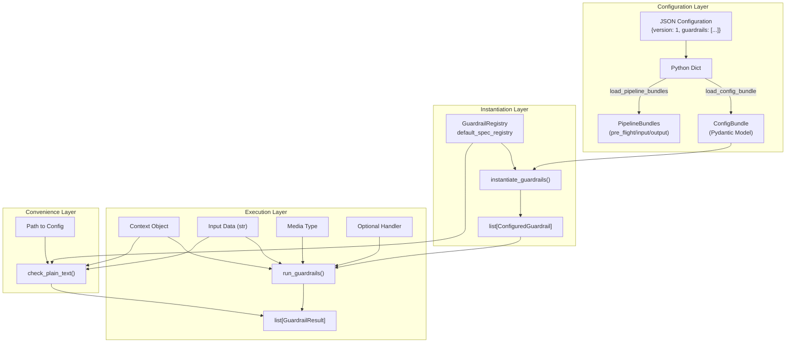
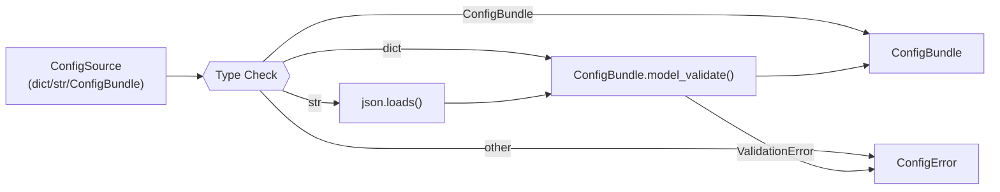
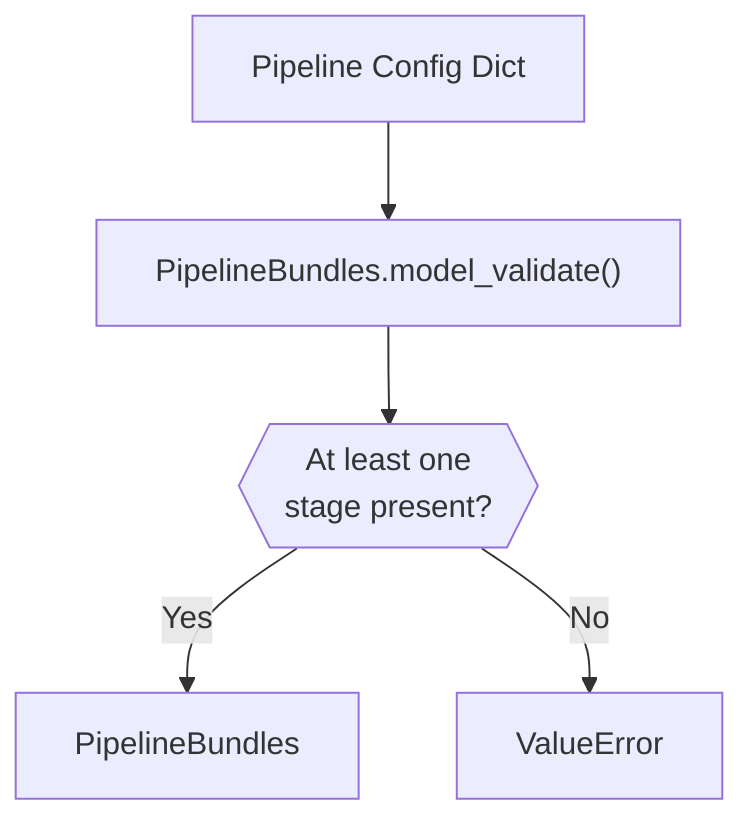
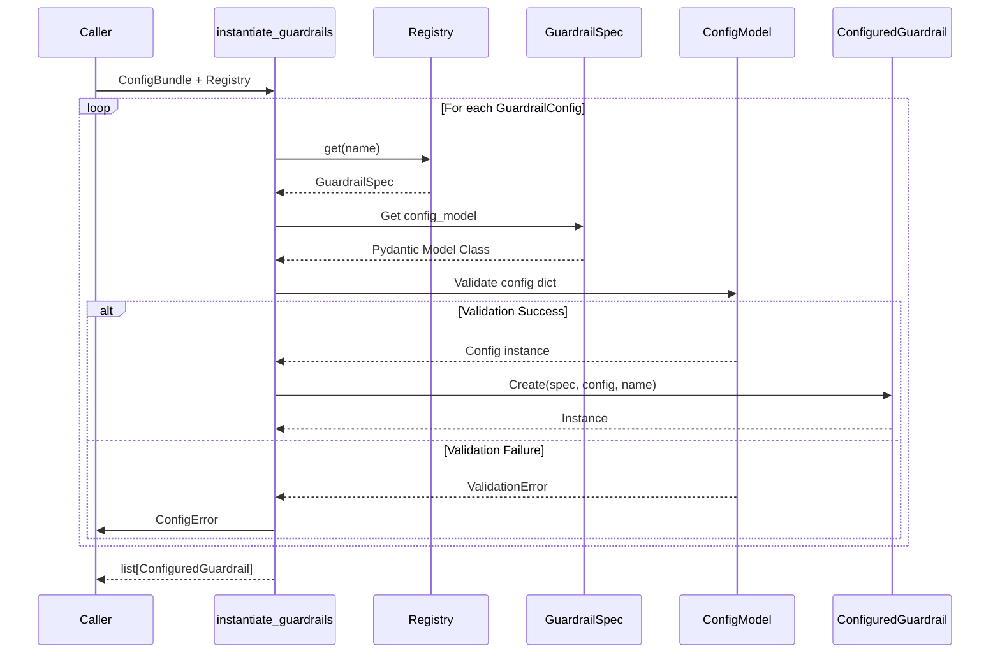
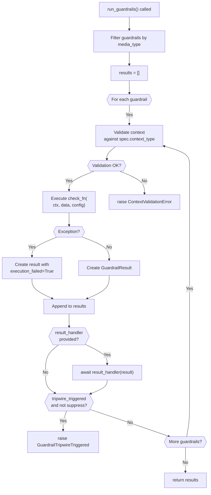
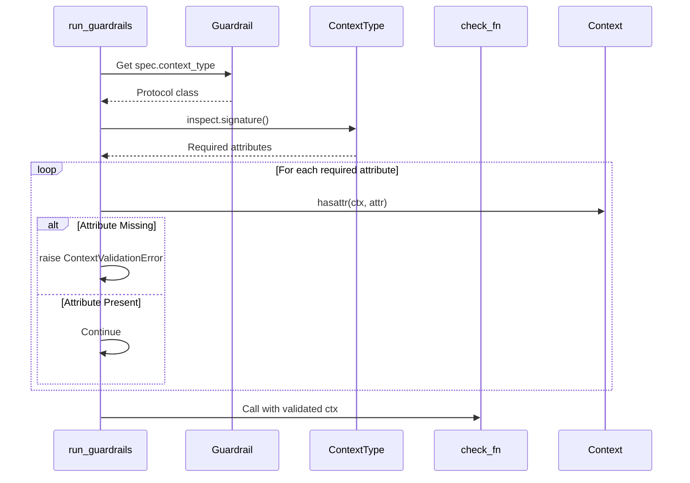
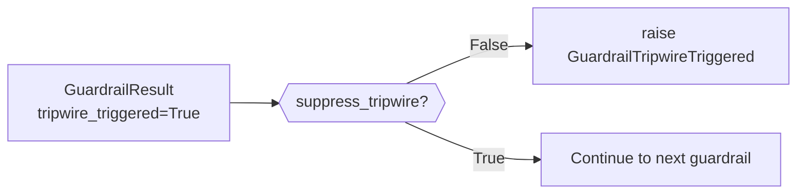
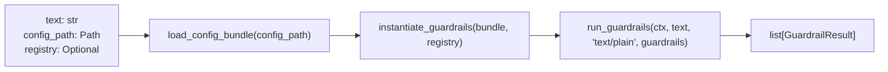
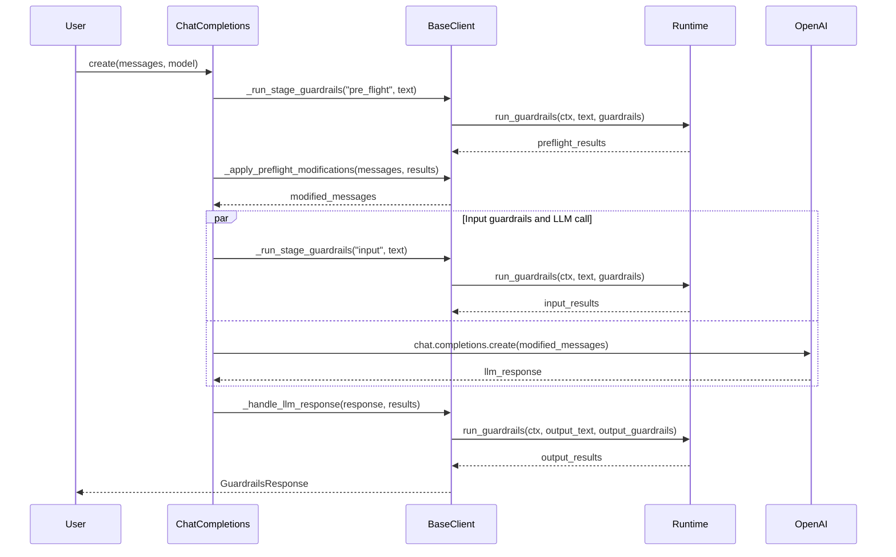

<!-- source: DeepWiki mcp.deepwiki.com · repo openai/openai-guardrails-python · page 3.5 Runtime Execution Model · fetched 2026-10-26 -->

# Runtime Execution Model

<details>
<summary>Relevant source files</summary>

The following files were used as context for generating this wiki page:

- [pyproject.toml](pyproject.toml)
- [src/guardrails/__init__.py](src/guardrails/__init__.py)
- [src/guardrails/evals/core/async_engine.py](src/guardrails/evals/core/async_engine.py)
- [tests/unit/evals/test_async_engine.py](tests/unit/evals/test_async_engine.py)

</details>


This page documents the runtime execution model of the guardrails framework, covering the mechanisms for instantiating and executing guardrail checks. It explains configuration loading, guardrail instantiation, the core `run_guardrails` function, batch processing patterns, concurrency strategies, and exception handling.

For information about the three-stage pipeline architecture and how these runtime functions are orchestrated by clients, see [Three-Stage Pipeline Architecture](#3.1). For details on the type system and guardrail function signatures, see [Type System and Context Propagation](#3.3).
</thinking>

**Sources**: [src/guardrails/__init__.py:32-41](), [src/guardrails/runtime.py:1-500](), [src/guardrails/evals/core/async_engine.py:1-463]()

## Overview

The runtime execution model provides four main capabilities:

1. **Configuration Loading**: Converting declarative JSON configurations into validated Python objects (`ConfigBundle`, `PipelineBundles`)
2. **Guardrail Instantiation**: Creating executable guardrail instances from configuration and registry entries
3. **Execution**: Running guardrail checks with context validation, exception handling, and result aggregation
4. **Batch Processing**: Efficiently processing multiple samples concurrently with configurable batch sizes

All core runtime functions are asynchronous to support efficient I/O operations and concurrent execution patterns.

**Sources**: [src/guardrails/__init__.py:32-41](), [src/guardrails/runtime.py:1-500](), [src/guardrails/evals/core/async_engine.py:1-463]()

## Runtime Function Architecture

The following diagram shows the relationship between runtime functions and their data flow:



**Sources**: [src/guardrails/runtime.py:50-200](), [tests/unit/test_runtime.py:116-327]()

## Configuration Loading

### load_config_bundle

The `load_config_bundle` function converts configuration dictionaries or JSON strings into validated `ConfigBundle` objects.

| Input Type | Processing | Output |
|------------|------------|--------|
| `dict` | Validates with Pydantic | `ConfigBundle` |
| `str` (JSON) | Parses then validates | `ConfigBundle` |
| `ConfigBundle` | Pass-through | `ConfigBundle` |
| `ConfigSource` TypeAlias | Union of above types | `ConfigBundle` |



The `ConfigBundle` structure contains:

- `version`: Integer schema version (currently 1)
- `guardrails`: List of `GuardrailConfig` objects, each specifying:
  - `name`: Guardrail identifier (must exist in registry)
  - `config`: Dictionary of guardrail-specific configuration
  - `enabled`: Optional boolean (default true)

**Example Usage**:

```python
# From dictionary
bundle = load_config_bundle({
    "version": 1,
    "guardrails": [
        {
            "name": "moderation",
            "config": {"model": "omni-moderation-latest"}
        }
    ]
})

# From JSON string
json_str = '{"version": 1, "guardrails": []}'
bundle = load_config_bundle(json_str)
```

**Sources**: [src/guardrails/runtime.py:60-80](), [tests/unit/test_runtime.py:116-133]()

### load_pipeline_bundles

The `load_pipeline_bundles` function converts pipeline configuration into a `PipelineBundles` object containing separate bundles for each pipeline stage.

| Field | Type | Required | Description |
|-------|------|----------|-------------|
| `version` | `int` | Yes | Schema version |
| `pre_flight` | `ConfigBundle` | No | Pre-flight stage guardrails |
| `input` | `ConfigBundle` | No | Input stage guardrails |
| `output` | `ConfigBundle` | No | Output stage guardrails |

At least one stage must be present. The `PipelineBundles` object provides a `stages()` method that returns a dictionary of non-None stages.



**Example Usage**:

```python
# Full pipeline
bundles = load_pipeline_bundles({
    "version": 1,
    "pre_flight": {"version": 1, "guardrails": [...]},
    "input": {"version": 1, "guardrails": [...]},
    "output": {"version": 1, "guardrails": [...]}
})

# Single stage
bundles = load_pipeline_bundles({
    "version": 1,
    "output": {"version": 1, "guardrails": [...]}
})
```

**Sources**: [src/guardrails/runtime.py:85-110](), [tests/unit/test_runtime.py:136-183]()

## Guardrail Instantiation

The `instantiate_guardrails` function creates executable `ConfiguredGuardrail` instances from a configuration bundle and registry.

### Instantiation Process



The `ConfiguredGuardrail` class is a dataclass containing:

- `spec`: Reference to the `GuardrailSpec` from the registry
- `config`: Validated configuration object (typed to spec's config model)
- `name`: Guardrail name for error reporting

**Sources**: [src/guardrails/runtime.py:115-145](), [tests/unit/test_runtime.py:186-205]()

### Configuration Validation

During instantiation, each guardrail's configuration dictionary is validated against its Pydantic config model:

1. Registry lookup retrieves the `GuardrailSpec` by name
2. Spec's `config_model` class is used for validation
3. Pydantic validates the config dict, applying defaults and type coercion
4. Validation errors are wrapped in `ConfigError` with context

```python
# Example: Instantiation with validation
registry = default_spec_registry
bundle = ConfigBundle(
    version=1,
    guardrails=[
        GuardrailConfig(
            name="moderation",
            config={"model": "omni-moderation-latest"}
        )
    ]
)

# This validates config against ModerationConfig model
guardrails = instantiate_guardrails(bundle, registry)
```

**Sources**: [src/guardrails/runtime.py:130-145](), [tests/unit/test_runtime.py:197-205]()

## Core Execution: run_guardrails

The `run_guardrails` function is the core runtime execution entry point. It validates context, executes guardrails in sequence, and handles results.

### Function Signature

```python
async def run_guardrails(
    ctx: Any,
    data: str,
    media_type: str,
    guardrails: list[ConfiguredGuardrail],
    suppress_tripwire: bool = False,
    result_handler: Callable[[GuardrailResult], Awaitable[None]] | None = None,
    conversation_history: Any = None,
) -> list[GuardrailResult]
```

| Parameter | Type | Purpose |
|-----------|------|---------|
| `ctx` | `Any` | Context object validated against guardrail protocols |
| `data` | `str` | Input data to validate |
| `media_type` | `str` | MIME type for media filtering (e.g., "text/plain") |
| `guardrails` | `list[ConfiguredGuardrail]` | Instantiated guardrails to execute |
| `suppress_tripwire` | `bool` | If True, return results without raising exceptions |
| `result_handler` | Optional callback | Called with each result for custom processing |
| `conversation_history` | `Any` | Optional conversation context for certain guardrails |

**Sources**: [src/guardrails/runtime.py:150-200]()

### Execution Flow



**Sources**: [src/guardrails/runtime.py:150-230](), [tests/unit/test_runtime.py:208-268]()

### Media Type Filtering

Guardrails are filtered based on their registered media type. Only guardrails matching the provided `media_type` are executed:

```python
# Registry specifies media_type during registration
registry.register(
    name="text_check",
    check_fn=my_check,
    media_type="text/plain"  # Only runs for text/plain data
)

# At runtime, mismatched guardrails are skipped
await run_guardrails(
    ctx=ctx,
    data=image_data,
    media_type="image/png",  # text_check is skipped
    guardrails=[...]
)
```

**Sources**: [src/guardrails/runtime.py:160-165]()

## Context Validation

Context validation ensures that the context object provided to `run_guardrails` satisfies the requirements of each guardrail's protocol.

### Validation Process



The validation checks that:
1. All attributes defined in the context protocol exist on the context object
2. Attribute types match protocol expectations (via runtime inspection)
3. Any methods defined in the protocol are callable

**Example**:

```python
# Protocol definition
class MyContextProto(Protocol):
    user: str
    def get_history(self) -> list: ...

# Valid context
@dataclass
class ValidCtx:
    user: str
    extra: str = "allowed"
    
    def get_history(self) -> list:
        return []

# Invalid context - missing user
@dataclass
class InvalidCtx:
    other: str

# This raises ContextValidationError
await run_guardrails(ctx=InvalidCtx("x"), ...)
```

**Sources**: [src/guardrails/runtime.py:180-195](), [tests/unit/test_runtime.py:270-289]()

## Exception Handling and Tripwire Behavior

### Tripwire Detection

When a guardrail's `check_fn` returns a result with `tripwire_triggered=True`, the runtime handles it based on the `suppress_tripwire` parameter:

| Mode | `suppress_tripwire` | Behavior |
|------|---------------------|----------|
| **Fail-Secure** | `False` (default) | Raises `GuardrailTripwireTriggered` immediately |
| **Fail-Safe** | `True` | Returns result without exception, continues execution |



**Sources**: [src/guardrails/runtime.py:210-220](), [tests/unit/test_runtime.py:208-242]()

### Execution Failure Handling

If a guardrail's `check_fn` raises an exception during execution, the runtime catches it and creates a `GuardrailResult` with `execution_failed=True`:

```python
# Inside run_guardrails
try:
    result = await guardrail.spec.check_fn(ctx, data, guardrail.config)
except Exception as e:
    result = GuardrailResult(
        tripwire_triggered=False,
        execution_failed=True,
        original_exception=e,
        info={"error": str(e)}
    )
```

This ensures that one guardrail's failure doesn't prevent others from executing (when `suppress_tripwire=True`).

**Sources**: [src/guardrails/runtime.py:195-210]()

## Result Handling

### Result Handler Callback

The optional `result_handler` parameter accepts an async callback that is invoked for each guardrail result:

```python
async def log_result(result: GuardrailResult) -> None:
    logger.info(f"Guardrail completed: {result}")

results = await run_guardrails(
    ctx=ctx,
    data=data,
    media_type="text/plain",
    guardrails=guardrails,
    result_handler=log_result  # Called for each result
)
```

The handler is called **before** tripwire checking, allowing custom processing even for results that will trigger exceptions.

**Sources**: [src/guardrails/runtime.py:205-210](), [tests/unit/test_runtime.py:245-268]()

### Result Aggregation

`run_guardrails` returns a list of `GuardrailResult` objects in execution order:

```python
results: list[GuardrailResult] = await run_guardrails(...)

# Access individual results
for i, result in enumerate(results):
    print(f"Guardrail {i}:")
    print(f"  Triggered: {result.tripwire_triggered}")
    print(f"  Failed: {result.execution_failed}")
    print(f"  Info: {result.info}")
```

**Sources**: [src/guardrails/runtime.py:220-230]()

## Convenience Utilities

### check_plain_text

The `check_plain_text` function provides a simplified interface for validating plain text without manually loading configs and instantiating guardrails.



**Function Signature**:

```python
async def check_plain_text(
    text: str,
    config_path: Path,
    registry: GuardrailRegistry | None = None,
    ctx: Any = None,
    suppress_tripwire: bool = False,
) -> list[GuardrailResult]
```

| Parameter | Default | Description |
|-----------|---------|-------------|
| `text` | Required | Input text to validate |
| `config_path` | Required | Path to `guardrails_config.json` |
| `registry` | `default_spec_registry` | Registry to use for guardrail lookup |
| `ctx` | `None` | Context object (uses default if None) |
| `suppress_tripwire` | `False` | Tripwire exception behavior |

**Example Usage**:

```python
from pathlib import Path
from guardrails import check_plain_text

# Simple text validation
results = await check_plain_text(
    text="Hello, world!",
    config_path=Path("configs/moderation.json")
)

# With custom context
class MyContext:
    user: str = "alice"

results = await check_plain_text(
    text="User message",
    config_path=Path("configs/all_checks.json"),
    ctx=MyContext(),
    suppress_tripwire=True
)
```

**Sources**: [src/guardrails/runtime.py:240-270](), [tests/unit/test_runtime.py:292-327]()

## Integration with Client Resources

The runtime functions are used throughout the client resource implementations to orchestrate guardrail execution.

### Chat Completions Integration



The synchronous path uses `ThreadPoolExecutor` to run input guardrails concurrently with the LLM call:

```python
# From chat.py
with ThreadPoolExecutor(max_workers=1) as executor:
    llm_future = executor.submit(
        self._client._resource_client.chat.completions.create,
        messages=modified_messages,
        model=model,
        **kwargs
    )
    input_results = self._client._run_stage_guardrails(
        "input",
        latest_message,
        suppress_tripwire=suppress_tripwire
    )
    llm_response = llm_future.result()
```

The asynchronous path uses `asyncio.gather`:

```python
# From chat.py (async)
input_check = self._client._run_stage_guardrails("input", text)
llm_call = self._client._resource_client.chat.completions.create(...)

input_results, llm_response = await asyncio.gather(input_check, llm_call)
```

**Sources**: [src/guardrails/resources/chat/chat.py:64-176](), [src/guardrails/resources/responses/responses.py:24-217]()

### Responses API Integration

The Responses API follows the same pattern, with special handling for different methods:

| Method | Pre-flight | Input | Output | Notes |
|--------|-----------|-------|--------|-------|
| `create()` | Yes | Concurrent | Yes | Standard flow |
| `parse()` | Yes | Concurrent | Yes | Structured output parsing |
| `retrieve()` | No | No | Yes | Only validates retrieved output |

```python
# From responses.py - retrieve method
def retrieve(self, response_id: str, suppress_tripwire: bool = False):
    # Fetch response
    response = self._client._resource_client.responses.retrieve(response_id)
    
    # Only output guardrails
    output_text = response.output_text if hasattr(response, "output_text") else ""
    output_results = self._client._run_stage_guardrails(
        "output", 
        output_text, 
        suppress_tripwire=suppress_tripwire
    )
    
    # Return wrapped response
    return self._client._create_guardrails_response(
        response, [], [], output_results
    )
```

**Sources**: [src/guardrails/resources/responses/responses.py:129-145]()

## Summary

The runtime execution layer provides:

1. **Configuration Loading**: `load_config_bundle()` and `load_pipeline_bundles()` for validated config objects
2. **Instantiation**: `instantiate_guardrails()` creates executable guardrail instances with validated configs
3. **Execution**: `run_guardrails()` provides context validation, async execution, exception handling, and result aggregation
4. **Utilities**: `check_plain_text()` offers simplified text validation without manual setup

These functions form the foundation that client resources use to implement the three-stage pipeline architecture, enabling consistent guardrail execution across all client variants (sync/async, OpenAI/Azure).

**Sources**: [src/guardrails/runtime.py:1-300](), [src/guardrails/__init__.py:32-41]()

---

