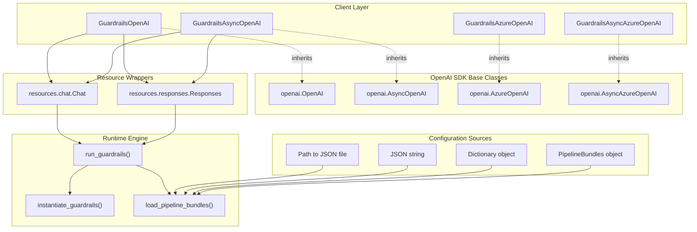
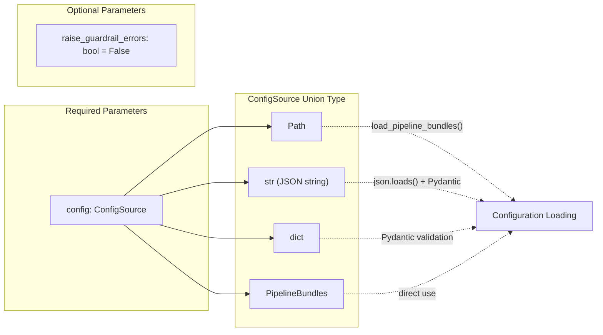
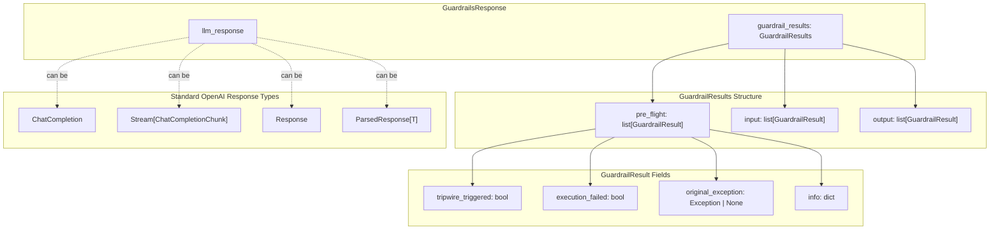
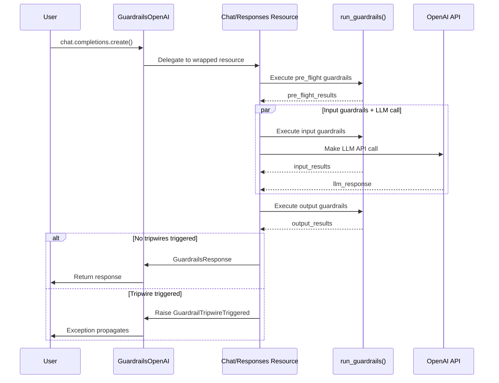
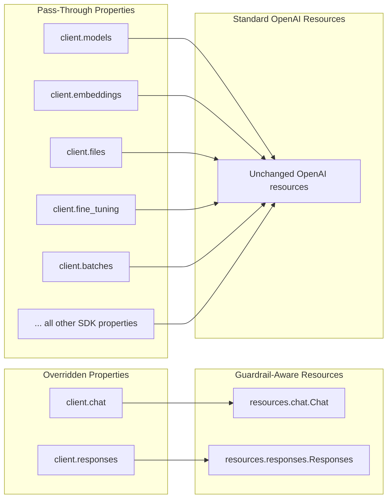

<!-- source: DeepWiki mcp.deepwiki.com · repo openai/openai-guardrails-python · page 4 Client Integration · fetched 2026-10-26 -->

# Client Integration

<details>
<summary>Relevant source files</summary>

The following files were used as context for generating this wiki page:

- [pyproject.toml](pyproject.toml)
- [src/guardrails/__init__.py](src/guardrails/__init__.py)
- [src/guardrails/resources/chat/chat.py](src/guardrails/resources/chat/chat.py)
- [src/guardrails/resources/responses/responses.py](src/guardrails/resources/responses/responses.py)
- [tests/unit/test_context.py](tests/unit/test_context.py)

</details>


## Purpose and Scope

This document describes how to integrate OpenAI Guardrails into your application using the client wrapper classes. These clients act as drop-in replacements for the standard OpenAI Python SDK clients (`OpenAI`, `AsyncOpenAI`, `AzureOpenAI`, `AsyncAzureOpenAI`), automatically applying guardrail validation to API calls without requiring changes to existing code structure.

For Agent SDK integration, see [Agent Integration](#5). For direct runtime usage without clients, see [Runtime Execution](#3.5).

**Sources:** [README.md:1-203](), [docs/quickstart.md:1-178]()

---

## Client Architecture Overview

The guardrails package provides four client wrapper classes that extend the OpenAI SDK clients. These wrappers intercept API calls, execute guardrails through the runtime engine, and return augmented response objects.



**Diagram: Client class hierarchy and integration with runtime engine**

The client wrappers override the `chat` and `responses` properties to inject guardrail-aware resource implementations. All other OpenAI SDK methods and properties pass through unchanged to the underlying base client.

**Sources:** [src/guardrails/__init__.py:14-27](), [README.md:36-62]()

---

## Available Client Classes

The package exports four primary client classes, organized by execution model and API provider:

| Class Name | Base Class | Execution Model | API Provider | Import Path |
|------------|-----------|-----------------|--------------|-------------|
| `GuardrailsOpenAI` | `openai.OpenAI` | Synchronous | Standard OpenAI | `from guardrails import GuardrailsOpenAI` |
| `GuardrailsAsyncOpenAI` | `openai.AsyncOpenAI` | Asynchronous | Standard OpenAI | `from guardrails import GuardrailsAsyncOpenAI` |
| `GuardrailsAzureOpenAI` | `openai.AzureOpenAI` | Synchronous | Azure OpenAI | `from guardrails import GuardrailsAzureOpenAI` |
| `GuardrailsAsyncAzureOpenAI` | `openai.AsyncAzureOpenAI` | Asynchronous | Azure OpenAI | `from guardrails import GuardrailsAsyncAzureOpenAI` |

All four classes share the same constructor signature for guardrail-specific parameters, while accepting standard OpenAI SDK parameters for API configuration.

**Sources:** [src/guardrails/__init__.py:16-27](), [docs/quickstart.md:54-156]()

---

## Client Initialization

### Constructor Parameters

Guardrails clients accept all standard OpenAI SDK constructor parameters (e.g., `api_key`, `base_url`, `timeout`) plus guardrail-specific parameters:



**Diagram: Client initialization parameter flow**

### Configuration Loading Options

The `config` parameter accepts multiple types through the `ConfigSource` type alias:

1. **Path object** - Path to `guardrails_config.json` file
2. **JSON string** - Inline JSON configuration
3. **Dictionary** - Python dict matching configuration schema
4. **PipelineBundles object** - Pre-constructed configuration object

**Sources:** [README.md:43-44](), [docs/quickstart.md:64-65](), [src/guardrails/__init__.py:33-39]()

### Error Handling Modes

Clients support two modes for handling guardrail execution failures (distinct from safety violations):

#### Fail-Safe Mode (Default)

When `raise_guardrail_errors=False` (default), guardrail execution errors are logged but do not halt processing. The guardrail returns `execution_failed=True` and `tripwire_triggered=False`, allowing the LLM call to proceed.

```python
# Default behavior - continues on guardrail execution errors
client = GuardrailsOpenAI(config=Path("config.json"))
```

#### Fail-Secure Mode

When `raise_guardrail_errors=True`, guardrail execution errors raise exceptions immediately, preventing the LLM call from proceeding.

```python
# Strict mode - raises on guardrail execution errors
client = GuardrailsOpenAI(
    config=Path("config.json"),
    raise_guardrail_errors=True
)
```

**Note:** This setting only affects guardrail execution errors (e.g., invalid model name, API failures). Safety violations (tripwires) always raise `GuardrailTripwireTriggered` exceptions regardless of this setting.

**Sources:** [docs/quickstart.md:84-109]()

---

## Standard OpenAI Client Example

```python
from pathlib import Path
from guardrails import GuardrailsOpenAI, GuardrailTripwireTriggered

# Initialize with configuration file
client = GuardrailsOpenAI(
    config=Path("guardrails_config.json"),
    api_key="sk-...",  # Standard OpenAI parameter
    timeout=30.0,      # Standard OpenAI parameter
    raise_guardrail_errors=False  # Guardrail-specific parameter
)

try:
    # Use standard OpenAI API methods
    response = client.chat.completions.create(
        model="gpt-5",
        messages=[{"role": "user", "content": "Hello"}]
    )
    
    # Access LLM response through .llm_response attribute
    print(response.llm_response.choices[0].message.content)
    
    # Access guardrail results
    for stage, results in response.guardrail_results.items():
        print(f"{stage}: {results}")
        
except GuardrailTripwireTriggered as e:
    print(f"Safety violation detected: {e.guardrail_result.info}")
```

**Sources:** [README.md:39-62]()

---

## Azure OpenAI Client Example

```python
from pathlib import Path
from guardrails import GuardrailsAzureOpenAI

# Initialize with Azure-specific parameters
client = GuardrailsAzureOpenAI(
    config=Path("guardrails_config.json"),
    azure_endpoint="https://your-resource.openai.azure.com/",
    api_key="your-azure-key",
    api_version="2025-01-01-preview"
)

# Use identical API methods as standard client
response = client.chat.completions.create(
    model="gpt-5-deployment",
    messages=[{"role": "user", "content": "Hello"}]
)
```

**Sources:** [docs/quickstart.md:142-156]()

---

## Third-Party Model Support

Guardrails clients work with any OpenAI-compatible API endpoint by setting the `base_url` parameter:

```python
from pathlib import Path
from guardrails import GuardrailsAsyncOpenAI

# Use with local Ollama model
client = GuardrailsAsyncOpenAI(
    config=Path("guardrails_config.json"),
    base_url="http://127.0.0.1:11434/v1/",
    api_key="ollama"  # Required by SDK but not validated
)

# Use with other OpenAI-compatible providers
client = GuardrailsAsyncOpenAI(
    config=Path("guardrails_config.json"),
    base_url="https://api.anthropic.com/v1/",
    api_key="your-anthropic-key"
)
```

**Sources:** [docs/quickstart.md:158-172]()

---

## Response Object Structure

All guardrail-wrapped API calls return a `GuardrailsResponse` object that wraps the standard OpenAI response and includes guardrail execution results.



**Diagram: GuardrailsResponse object composition**

### Accessing Response Data

```python
# Access LLM response (standard OpenAI response object)
response.llm_response.choices[0].message.content
response.llm_response.output_text  # For responses API

# Access guardrail results by stage
response.guardrail_results.pre_flight  # List[GuardrailResult]
response.guardrail_results.input       # List[GuardrailResult]
response.guardrail_results.output      # List[GuardrailResult]

# Check individual guardrail results
for result in response.guardrail_results.output:
    print(f"Tripwire: {result.tripwire_triggered}")
    print(f"Info: {result.info}")
```

**Sources:** [src/guardrails/__init__.py:17-20](), [README.md:52-59]()

---

## Request Flow Through Client

The following diagram shows how a request flows from client method call through guardrail execution to final response:



**Diagram: Request flow from client to runtime**

Key execution characteristics:

1. **Pre-flight stage** runs sequentially before the LLM call
2. **Input stage** runs in parallel with the LLM call using `ThreadPoolExecutor` (sync) or `asyncio.gather()` (async)
3. **Output stage** runs sequentially after the LLM response is received
4. **Tripwire exceptions** can be raised at any stage, halting execution immediately

**Sources:** [README.md:46-61](), Architecture Diagram 2 from context

---

## Method Coverage

### Wrapped Methods

The following OpenAI SDK methods are wrapped to include guardrail execution:

| Method | Description | Guardrail Support |
|--------|-------------|-------------------|
| `chat.completions.create()` | Chat completions API | Full three-stage pipeline |
| `responses.create()` | Responses API (single turn) | Full three-stage pipeline |
| `responses.parse()` | Structured output responses | Full three-stage pipeline |
| `responses.retrieve()` | Retrieve previous response | Output stage only |

For details on each method, see [Chat Completions API](#4.3) and [Responses API](#4.4).

### Pass-Through Methods

All other OpenAI SDK methods and properties are passed through unchanged to the base client. Examples include:

- `client.models.list()`
- `client.embeddings.create()`
- `client.files.create()`
- `client.fine_tuning.jobs.create()`
- `client.batches.create()`

These methods execute without guardrail validation.

**Sources:** [src/guardrails/__init__.py:16-21]()

---

## Client Property Access

Guardrails clients override specific resource properties while preserving all others:



**Diagram: Client property routing**

This design ensures that guardrails integration is transparent for non-wrapped methods while maintaining full OpenAI SDK compatibility.

**Sources:** [src/guardrails/__init__.py:28-29]()

---

## Summary

The guardrails client integration provides:

- **Drop-in compatibility** with OpenAI SDK through inheritance
- **Four client variants** covering sync/async × standard/Azure combinations
- **Flexible configuration** via file paths, JSON strings, dictionaries, or objects
- **Two error modes** (fail-safe and fail-secure) for guardrail execution failures
- **Transparent wrapping** of chat and responses APIs with guardrail execution
- **Full pass-through** of all other OpenAI SDK functionality
- **Third-party model support** via `base_url` parameter

For details on specific API usage patterns, see [Chat Completions API](#4.3), [Responses API](#4.4), and [Streaming vs Blocking Validation](#4.5).

**Sources:** [README.md:33-62](), [docs/quickstart.md:1-178](), [src/guardrails/__init__.py:1-76]()

---

