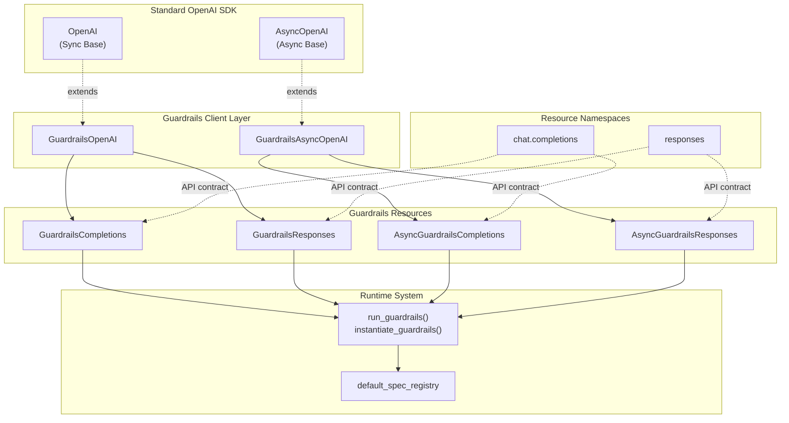
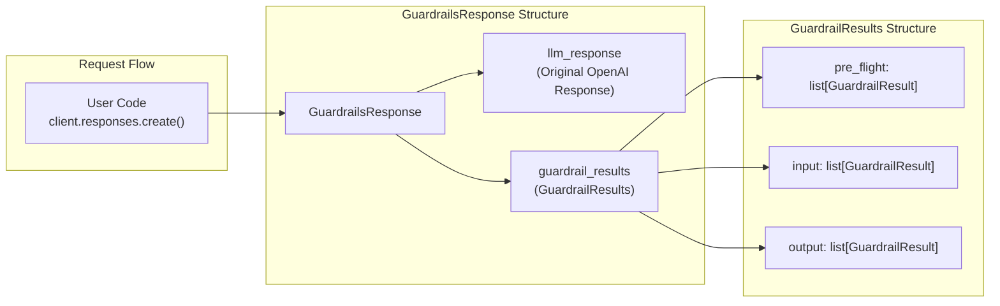
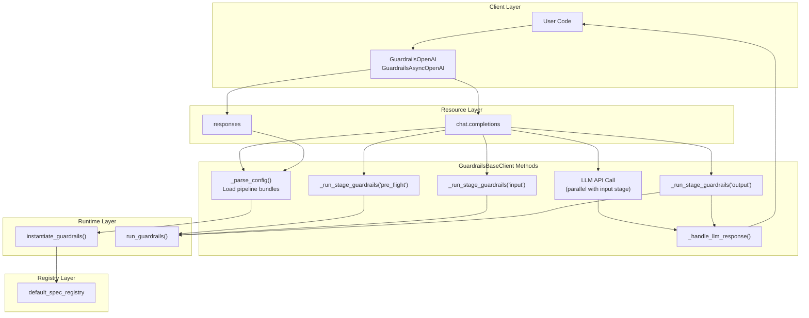

<!-- source: DeepWiki mcp.deepwiki.com · repo openai/openai-guardrails-python · page 4.1 GuardrailsOpenAI Client · fetched 2026-10-26 -->

# GuardrailsOpenAI Client

<details>
<summary>Relevant source files</summary>

The following files were used as context for generating this wiki page:

- [README.md](README.md)
- [docs/assets/images/guardrails-python-config-screenshot-100pct-q70.webp](docs/assets/images/guardrails-python-config-screenshot-100pct-q70.webp)
- [src/guardrails/resources/chat/chat.py](src/guardrails/resources/chat/chat.py)
- [src/guardrails/resources/responses/responses.py](src/guardrails/resources/responses/responses.py)
- [tests/unit/test_context.py](tests/unit/test_context.py)

</details>


## Purpose and Scope

This page documents the `GuardrailsOpenAI` and `GuardrailsAsyncOpenAI` client classes, which serve as drop-in replacements for the standard OpenAI Python client. These clients automatically apply guardrail validation to LLM requests based on declarative pipeline configurations.

This page focuses on client instantiation, configuration loading, and the core client behavior. For Azure-specific clients, see [Azure OpenAI Integration](#4.2). For details on specific API methods, see [Chat Completions API](#4.3) and [Responses API](#4.4). For streaming behavior, see [Streaming vs Blocking Validation](#4.5).

**Sources:** [README.md:1-204](), [docs/quickstart.md:1-178](), [src/guardrails/__init__.py:1-76]()

---

## Client Classes Overview

The package provides two client variants for standard OpenAI API access:

| Class | Base Class | Use Case |
|-------|-----------|----------|
| `GuardrailsOpenAI` | `OpenAI` | Synchronous blocking operations |
| `GuardrailsAsyncOpenAI` | `AsyncOpenAI` | Asynchronous concurrent operations |

Both clients extend their respective OpenAI base classes and maintain full API compatibility while adding automatic guardrail validation. They expose the same resource namespaces (`chat.completions`, `responses`) as the standard OpenAI clients.

**Sources:** [src/guardrails/__init__.py:16-21](), [README.md:37-62]()

---

## Client Class Architecture



This diagram shows how `GuardrailsOpenAI` and `GuardrailsAsyncOpenAI` extend the standard OpenAI clients while delegating to guardrails-aware resource implementations that integrate with the runtime system.

**Sources:** [src/guardrails/__init__.py:16-21](), [README.md:37-62]()

---

## Instantiation and Configuration

### Basic Instantiation

Both client classes require a configuration specifying which guardrails to apply. The configuration can be provided via file path, dictionary, or JSON string:

```python
from pathlib import Path
from guardrails import GuardrailsOpenAI, GuardrailsAsyncOpenAI

# Synchronous client with file path
client = GuardrailsOpenAI(config=Path("guardrails_config.json"))

# Asynchronous client with file path
async_client = GuardrailsAsyncOpenAI(config=Path("guardrails_config.json"))

# Using dictionary configuration
config_dict = {
    "version": 1,
    "input": {
        "version": 1,
        "guardrails": [{"name": "Moderation", "config": {}}]
    }
}
client = GuardrailsOpenAI(config=config_dict)
```

**Sources:** [README.md:37-62](), [docs/quickstart.md:52-80]()

### Constructor Parameters

| Parameter | Type | Required | Description |
|-----------|------|----------|-------------|
| `config` | `Path \| dict \| str` | Yes | Pipeline configuration (file path, dict, or JSON string) |
| `raise_guardrail_errors` | `bool` | No | Error handling mode (default: `False` for fail-safe) |
| `api_key` | `str \| None` | No | OpenAI API key (defaults to `OPENAI_API_KEY` env var) |
| `base_url` | `str \| None` | No | API base URL (for third-party compatible APIs) |
| Additional params | Various | No | All standard `OpenAI`/`AsyncOpenAI` constructor parameters |

The clients accept all standard OpenAI client constructor parameters (`timeout`, `max_retries`, `default_headers`, etc.) and forward them to the base class.

**Sources:** [docs/quickstart.md:52-172](), [README.md:37-62]()

---

## Drop-in Replacement Pattern

The clients are designed as drop-in replacements requiring minimal code changes:

```python
# Standard OpenAI client code:
# from openai import OpenAI
# client = OpenAI()

# Guardrails version (only 2 lines change):
from guardrails import GuardrailsOpenAI
client = GuardrailsOpenAI(config=Path("guardrails_config.json"))

# Existing code works unchanged:
response = client.chat.completions.create(
    model="gpt-5",
    messages=[{"role": "user", "content": "Hello"}]
)

# Only difference: access response via .llm_response
print(response.llm_response.choices[0].message.content)
```

The key difference is that API responses are wrapped in `GuardrailsResponse` objects, which provide access to both the original LLM response and guardrail results.

**Sources:** [README.md:34-62](), [docs/quickstart.md:52-83]()

---

## Response Wrapping

All API calls through guardrails clients return `GuardrailsResponse` objects instead of raw OpenAI responses:



The `GuardrailsResponse` object has two primary attributes:
- `llm_response`: The original OpenAI response object (unchanged)
- `guardrail_results`: A `GuardrailResults` object containing results from all pipeline stages

**Sources:** [src/guardrails/__init__.py:16-21](), [README.md:48-62]()

### GuardrailResults Structure

The `GuardrailResults` object organizes results by pipeline stage:

| Attribute | Type | Description |
|-----------|------|-------------|
| `pre_flight` | `list[GuardrailResult]` | Results from pre-flight guardrails (run before LLM) |
| `input` | `list[GuardrailResult]` | Results from input guardrails (run parallel with LLM) |
| `output` | `list[GuardrailResult]` | Results from output guardrails (run after LLM) |

Each `GuardrailResult` contains information about individual guardrail execution. For details on the `GuardrailResult` type, see [Type System and Protocols](#3.2).

**Sources:** [src/guardrails/__init__.py:16-21]()

---

## Error Handling Modes

The clients support two error handling modes for guardrail execution failures (distinct from safety violations):

### Fail-Safe Mode (Default)

When `raise_guardrail_errors=False` (default), guardrail execution errors are logged but do not halt the request:

```python
client = GuardrailsOpenAI(
    config=Path("config.json"),
    raise_guardrail_errors=False  # Default
)
```

In this mode:
- Guardrail execution exceptions are caught and logged
- The system returns `tripwire_triggered=False` for failed guardrails
- The LLM call proceeds normally
- Useful for graceful degradation in production

**Sources:** [docs/quickstart.md:84-109]()

### Fail-Secure Mode

When `raise_guardrail_errors=True`, guardrail execution errors cause immediate failure:

```python
client = GuardrailsOpenAI(
    config=Path("config.json"),
    raise_guardrail_errors=True
)
```

In this mode:
- Guardrail execution exceptions propagate to the caller
- Invalid configurations or runtime errors halt execution
- Useful for development and strict security requirements

**Important:** This setting only affects guardrail execution errors (e.g., invalid model name, network timeout). Safety violations (tripwire triggers) always raise `GuardrailTripwireTriggered` exceptions in both modes when a guardrail detects a violation.

**Sources:** [docs/quickstart.md:84-109]()

---

## Configuration Loading

The `config` parameter accepts three formats:

### File Path Configuration

```python
from pathlib import Path
client = GuardrailsOpenAI(config=Path("guardrails_config.json"))
```

The file must contain valid JSON matching the pipeline bundle schema. See [Configuration Files](#2.2) for schema details.

### Dictionary Configuration

```python
config = {
    "version": 1,
    "input": {
        "version": 1,
        "guardrails": [
            {"name": "URL Filter", "config": {}},
            {"name": "Moderation", "config": {"categories": ["hate"]}}
        ]
    },
    "output": {
        "version": 1,
        "guardrails": [
            {"name": "Contains PII", "config": {}}
        ]
    }
}
client = GuardrailsOpenAI(config=config)
```

### JSON String Configuration

```python
import json
config_json = json.dumps({
    "version": 1,
    "input": {"version": 1, "guardrails": [{"name": "Moderation", "config": {}}]}
})
client = GuardrailsOpenAI(config=config_json)
```

The configuration is processed by `load_pipeline_bundles()` which validates and instantiates guardrails. For runtime details, see [Runtime Execution](#3.5).

**Sources:** [docs/quickstart.md:17-40](), [src/guardrails/__init__.py:32-41]()

---

## Integration with Third-Party APIs

Both clients work with any OpenAI-compatible API via the `base_url` parameter:

### Local Models (Ollama)

```python
from guardrails import GuardrailsAsyncOpenAI

client = GuardrailsAsyncOpenAI(
    config=Path("config.json"),
    base_url="http://127.0.0.1:11434/v1/",
    api_key="ollama"  # Ollama doesn't validate keys
)
```

### Other Compatible Providers

Any API implementing the OpenAI API specification can be used:

```python
client = GuardrailsOpenAI(
    config=Path("config.json"),
    base_url="https://api.example.com/v1/",
    api_key="your-api-key"
)
```

The guardrails execute independently of the LLM provider, enabling consistent safety validation across different model backends.

**Sources:** [docs/quickstart.md:159-172]()

---

## Request Flow Architecture



This diagram shows how a typical request flows from user code through the client, resource layer, and runtime system. The three-stage pipeline (pre-flight, input, output) is orchestrated by the resource implementations with input stage running concurrently with the LLM call.

**Sources:** [README.md:34-62](), [docs/quickstart.md:52-83]()

---

## Tripwire Exception Handling

When a guardrail detects a violation, the system raises a `GuardrailTripwireTriggered` exception:

```python
from guardrails import GuardrailsOpenAI, GuardrailTripwireTriggered

client = GuardrailsOpenAI(config=Path("config.json"))

try:
    response = client.chat.completions.create(
        model="gpt-5",
        messages=[{"role": "user", "content": "violative content"}]
    )
    print(response.llm_response.choices[0].message.content)
    
except GuardrailTripwireTriggered as e:
    # Access the guardrail result that triggered
    print(f"Guardrail: {e.guardrail_result.info}")
    print(f"Stage: {e.stage}")
```

The exception provides:
- `guardrail_result`: The `GuardrailResult` object for the failed check
- `stage`: Which pipeline stage triggered ("pre_flight", "input", or "output")

Violations halt execution immediately. For details on exception types, see [Exception Types](#10.5). For agent-specific variants, see [Agent Exception Handling](#5.3).

**Sources:** [README.md:46-62](), [src/guardrails/__init__.py:30-30]()

---

## Usage Examples

### Synchronous Client with Chat Completions

```python
from pathlib import Path
from guardrails import GuardrailsOpenAI, GuardrailTripwireTriggered

client = GuardrailsOpenAI(config=Path("guardrails_config.json"))

try:
    response = client.chat.completions.create(
        model="gpt-5",
        messages=[{"role": "user", "content": "Hello world"}]
    )
    # Access via .llm_response
    print(response.llm_response.choices[0].message.content)
    
    # Inspect guardrail results
    for result in response.guardrail_results.input:
        print(f"Guardrail: {result.info}")
        
except GuardrailTripwireTriggered as e:
    print(f"Safety violation: {e}")
```

### Asynchronous Client with Responses API

```python
import asyncio
from pathlib import Path
from guardrails import GuardrailsAsyncOpenAI

async def main():
    client = GuardrailsAsyncOpenAI(config=Path("config.json"))
    
    response = await client.responses.create(
        model="gpt-5",
        input="What are the main features?"
    )
    
    print(response.llm_response.output_text)

asyncio.run(main())
```

**Sources:** [README.md:37-62](), [docs/quickstart.md:58-80]()

---

## Relationship to Other Components

The `GuardrailsOpenAI` and `GuardrailsAsyncOpenAI` clients are the primary user-facing entry points. They coordinate with:

- **Resource Implementations** ([Chat Completions API](#4.3), [Responses API](#4.4)): Handle specific API endpoints
- **Runtime System** ([Runtime Execution](#3.5)): Executes guardrails via `run_guardrails()` and `instantiate_guardrails()`
- **Registry** ([Guardrail Registry](#3.4)): Provides access to built-in and custom guardrails
- **Configuration System** ([Configuration Files](#2.2)): Loads and validates pipeline configurations

For Azure-specific variants with the same interface, see [Azure OpenAI Integration](#4.2).

**Sources:** [src/guardrails/__init__.py:1-76]()

---

