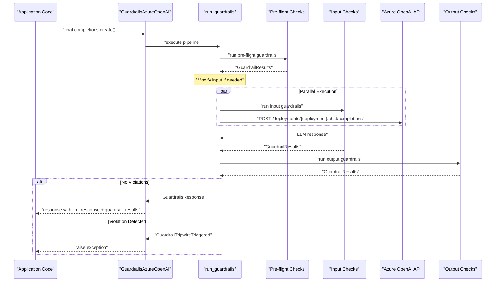

<!-- source: DeepWiki mcp.deepwiki.com · repo openai/openai-guardrails-python · page 4.2 Azure OpenAI Integration · fetched 2026-10-26 -->

# Azure OpenAI Integration

<details>
<summary>Relevant source files</summary>

The following files were used as context for generating this wiki page:

- [pyproject.toml](pyproject.toml)
- [src/guardrails/__init__.py](src/guardrails/__init__.py)
- [src/guardrails/resources/chat/chat.py](src/guardrails/resources/chat/chat.py)
- [src/guardrails/resources/responses/responses.py](src/guardrails/resources/responses/responses.py)
- [tests/unit/test_context.py](tests/unit/test_context.py)

</details>


This document covers integration with Azure OpenAI Service using `GuardrailsAzureOpenAI` and `GuardrailsAsyncAzureOpenAI`. These clients provide drop-in replacements for the standard Azure OpenAI clients while applying guardrail validation to all API calls.

For standard OpenAI API integration, see [GuardrailsOpenAI Client](#4.1). For chat completions and responses API details, see [Chat Completions API](#4.3) and [Responses API](#4.4).

---

## Overview

The Azure OpenAI integration maintains full compatibility with Azure-specific authentication and endpoint configuration while layering guardrail validation on top. The implementation follows the same three-stage pipeline architecture (pre-flight, input, output) as the standard OpenAI client but routes requests to Azure OpenAI Service deployments.

### Key Characteristics

| Aspect | Standard OpenAI | Azure OpenAI |
|--------|-----------------|--------------|
| **Base Class** | `OpenAI` / `AsyncOpenAI` | `AzureOpenAI` / `AsyncAzureOpenAI` |
| **Guardrails Wrapper** | `GuardrailsOpenAI` / `GuardrailsAsyncOpenAI` | `GuardrailsAzureOpenAI` / `GuardrailsAsyncAzureOpenAI` |
| **Endpoint Configuration** | `base_url` (optional) | `azure_endpoint` (required) |
| **Authentication** | API key or OAuth | API key or Azure AD token |
| **API Version** | Implicit | `api_version` (required) |
| **Deployment Names** | Model IDs (e.g., `gpt-4`) | Custom deployment names |

**Sources:** [src/guardrails/__init__.py:23-27](), [docs/quickstart.md:142-156]()

---

## Client Classes

The Azure integration provides two client classes that mirror the standard OpenAI client architecture:

```mermaid
graph TB
    subgraph "Azure OpenAI SDK"
        AzureBase["AzureOpenAI"]
        AsyncAzureBase["AsyncAzureOpenAI"]
    end
    
    subgraph "Guardrails Azure Clients"
        GAzOA["GuardrailsAzureOpenAI"]
        GAAzOA["GuardrailsAsyncAzureOpenAI"]
    end
    
    subgraph "Shared Base"
        BaseClient["GuardrailsBaseClient"]
    end
    
    subgraph "Resource Implementations"
        Chat["chat.completions"]
        Responses["responses"]
    end
    
    AzureBase --> GAzOA
    AsyncAzureBase --> GAAzOA
    
    GAzOA --> BaseClient
    GAAzOA --> BaseClient
    
    GAzOA --> Chat
    GAzOA --> Responses
    GAAzOA --> Chat
    GAAzOA --> Responses
    
    BaseClient -.."provides".-> Runtime["Runtime Orchestration"]
    Runtime --> PreFlight["Pre-flight Stage"]
    Runtime --> Input["Input Stage"]
    Runtime --> Output["Output Stage"]
```

**Diagram: Azure Client Class Hierarchy**

Both classes inherit from their respective Azure OpenAI SDK base classes and extend them with guardrail functionality through the `GuardrailsBaseClient` mixin pattern.

**Sources:** [src/guardrails/__init__.py:23-27]()

---

## Configuration and Authentication

### Required Parameters

Azure OpenAI clients require three mandatory parameters in addition to guardrail configuration:

```python
from pathlib import Path
from guardrails import GuardrailsAzureOpenAI

client = GuardrailsAzureOpenAI(
    config=Path("guardrails_config.json"),         # Guardrails configuration
    azure_endpoint="https://your-resource.openai.azure.com/",  # Azure resource endpoint
    api_key="your-azure-api-key",                   # Authentication
    api_version="2025-01-01-preview"                # API version
)
```

| Parameter | Type | Description |
|-----------|------|-------------|
| `config` | `Path \| str \| dict` | Guardrails pipeline configuration (see [Configuration Files](#2.2)) |
| `azure_endpoint` | `str` | Azure OpenAI resource endpoint URL |
| `api_key` | `str` | Azure API key or Azure AD token |
| `api_version` | `str` | Azure OpenAI API version string |

**Sources:** [docs/quickstart.md:142-156]()

### Authentication Methods

Azure OpenAI supports multiple authentication approaches:

#### API Key Authentication

```python
client = GuardrailsAsyncAzureOpenAI(
    config=Path("config.json"),
    azure_endpoint="https://your-resource.openai.azure.com/",
    api_key="your-azure-api-key",
    api_version="2025-01-01-preview"
)
```

#### Azure AD Token Authentication

```python
from azure.identity import DefaultAzureCredential

credential = DefaultAzureCredential()
token = credential.get_token("https://cognitiveservices.azure.com/.default")

client = GuardrailsAsyncAzureOpenAI(
    config=Path("config.json"),
    azure_endpoint="https://your-resource.openai.azure.com/",
    api_key=token.token,
    api_version="2025-01-01-preview"
)
```

#### Environment Variables

Azure credentials can be loaded from environment variables following Azure OpenAI SDK conventions:

- `AZURE_OPENAI_ENDPOINT` - Resource endpoint
- `AZURE_OPENAI_API_KEY` - API key
- `OPENAI_API_VERSION` - API version

**Sources:** [docs/quickstart.md:142-156]()

---

## Usage Patterns

### Synchronous Client

```python
from pathlib import Path
from guardrails import GuardrailsAzureOpenAI, GuardrailTripwireTriggered

client = GuardrailsAzureOpenAI(
    config=Path("guardrails_config.json"),
    azure_endpoint="https://your-resource.openai.azure.com/",
    api_key="your-azure-api-key",
    api_version="2025-01-01-preview"
)

try:
    # Chat Completions API
    response = client.chat.completions.create(
        model="gpt-4-deployment-name",  # Your Azure deployment name
        messages=[{"role": "user", "content": "Hello, world"}]
    )
    print(response.llm_response.choices[0].message.content)
    
    # Responses API
    response = client.responses.create(
        model="gpt-4-deployment-name",
        input="What is the weather today?"
    )
    print(response.llm_response.output_text)
    
except GuardrailTripwireTriggered as e:
    print(f"Guardrail violation: {e.guardrail_result.info}")
```

**Sources:** [README.md:39-62](), [docs/quickstart.md:142-156]()

### Asynchronous Client

```python
import asyncio
from pathlib import Path
from guardrails import GuardrailsAsyncAzureOpenAI, GuardrailTripwireTriggered

async def main():
    client = GuardrailsAsyncAzureOpenAI(
        config=Path("guardrails_config.json"),
        azure_endpoint="https://your-resource.openai.azure.com/",
        api_key="your-azure-api-key",
        api_version="2025-01-01-preview"
    )
    
    try:
        response = await client.responses.create(
            model="gpt-4-deployment-name",
            input="Explain quantum computing"
        )
        print(response.llm_response.output_text)
        
    except GuardrailTripwireTriggered as e:
        print(f"Guardrail violation: {e.guardrail_result.info}")

asyncio.run(main())
```

**Sources:** [docs/quickstart.md:59-80](), [docs/quickstart.md:142-156]()

---

## Azure-Specific Considerations

### Deployment Names vs Model IDs

Azure OpenAI uses custom deployment names instead of standard model IDs. When calling guardrailed methods, specify your deployment name:

```python
# Standard OpenAI
response = client.chat.completions.create(
    model="gpt-4",  # Model ID
    messages=[...]
)

# Azure OpenAI
response = client.chat.completions.create(
    model="my-gpt4-deployment",  # Your deployment name
    messages=[...]
)
```

The guardrail configuration references models by standard OpenAI model names (e.g., `gpt-4`, `gpt-5-mini`), but when making API calls, you must use your Azure deployment names.

**Sources:** [docs/quickstart.md:142-156]()

### API Versioning

Azure OpenAI requires explicit API version specification. The version determines available features:

| API Version | Features |
|-------------|----------|
| `2025-01-01-preview` | Latest preview features including structured outputs |
| `2024-10-01-preview` | Stable with most features |
| Earlier versions | Limited feature sets |

Ensure your `api_version` supports the features required by your guardrails (e.g., structured outputs for certain guardrails).

**Sources:** [docs/quickstart.md:142-156]()

### Regional Availability

Different Azure regions have varying model availability and API versions. Ensure your Azure resource region supports:

1. The models referenced in your guardrail configuration
2. The deployment names you've created
3. The API version specified in your client

**Sources:** [docs/quickstart.md:142-156]()

---

## Request Flow Architecture



**Diagram: Azure Request Flow with Guardrails**

The Azure client follows the same pipeline architecture as the standard client, with the only difference being the target API endpoint. All guardrail logic remains identical.

**Sources:** [src/guardrails/__init__.py:23-27]()

---

## Error Handling Modes

Azure clients support the same error handling modes as standard clients:

### Fail-Safe Mode (Default)

Guardrail execution failures do not halt the request:

```python
client = GuardrailsAzureOpenAI(
    config=Path("config.json"),
    azure_endpoint="https://your-resource.openai.azure.com/",
    api_key="your-key",
    api_version="2025-01-01-preview",
    raise_guardrail_errors=False  # Default
)
```

### Fail-Secure Mode

Guardrail execution failures raise exceptions:

```python
client = GuardrailsAzureOpenAI(
    config=Path("config.json"),
    azure_endpoint="https://your-resource.openai.azure.com/",
    api_key="your-key",
    api_version="2025-01-01-preview",
    raise_guardrail_errors=True
)
```

For more details, see [Error Handling Modes](#2.3).

**Sources:** [docs/quickstart.md:84-109]()

---

## Response Structure

All Azure client methods return `GuardrailsResponse` objects with the following structure:

```python
response = client.responses.create(
    model="gpt-4-deployment",
    input="Hello"
)

# Access the LLM response
print(response.llm_response.output_text)

# Access guardrail results by stage
print(response.guardrail_results.pre_flight)  # List[GuardrailResult]
print(response.guardrail_results.input)       # List[GuardrailResult]
print(response.guardrail_results.output)      # List[GuardrailResult]

# Check for violations
for result in response.guardrail_results.output:
    if result.tripwire_triggered:
        print(f"Violation: {result.info}")
```

The response structure is identical across all client types (OpenAI, Azure, sync, async).

**Sources:** [README.md:39-62]()

---

## Optional Import Behavior

Azure clients are optional imports and may not be available if dependencies are not met:

[src/guardrails/__init__.py:23-27]()

```python
try:  # Optional Azure variants
    from .client import GuardrailsAsyncAzureOpenAI, GuardrailsAzureOpenAI
except Exception:
    GuardrailsAsyncAzureOpenAI = None
    GuardrailsAzureOpenAI = None
```

Applications should handle import failures gracefully:

```python
from guardrails import GuardrailsAzureOpenAI

if GuardrailsAzureOpenAI is None:
    raise RuntimeError("Azure OpenAI support not available. Install: pip install openai-guardrails")

client = GuardrailsAzureOpenAI(...)
```

**Sources:** [src/guardrails/__init__.py:23-27]()

---

## Compatibility Matrix

| Feature | GuardrailsOpenAI | GuardrailsAzureOpenAI |
|---------|------------------|----------------------|
| Chat Completions | ✓ | ✓ |
| Responses API | ✓ | ✓ |
| Structured Outputs | ✓ | ✓ (API version dependent) |
| Streaming | ✓ | ✓ |
| Async/Await | ✓ | ✓ |
| Pre-flight Guardrails | ✓ | ✓ |
| Input Guardrails | ✓ | ✓ |
| Output Guardrails | ✓ | ✓ |
| Custom Guardrails | ✓ | ✓ |
| Fail-Safe/Fail-Secure | ✓ | ✓ |

All guardrail features function identically across OpenAI and Azure deployments.

**Sources:** [src/guardrails/__init__.py:16-27](), [docs/quickstart.md:142-156]()

---

## Complete Example

```python
import asyncio
from pathlib import Path
from guardrails import (
    GuardrailsAsyncAzureOpenAI,
    GuardrailTripwireTriggered,
)

async def process_request(user_input: str):
    """Process user input with Azure OpenAI and guardrails."""
    client = GuardrailsAsyncAzureOpenAI(
        config=Path("guardrails_config.json"),
        azure_endpoint="https://my-resource.openai.azure.com/",
        api_key="sk-...",
        api_version="2025-01-01-preview",
        raise_guardrail_errors=True  # Fail-secure mode
    )
    
    try:
        # Make request with guardrails
        response = await client.responses.create(
            model="my-gpt4-deployment",
            input=user_input
        )
        
        # Log guardrail results
        for stage_name, results in [
            ("pre_flight", response.guardrail_results.pre_flight),
            ("input", response.guardrail_results.input),
            ("output", response.guardrail_results.output),
        ]:
            print(f"\n{stage_name.upper()} GUARDRAILS:")
            for result in results:
                status = "PASSED" if not result.tripwire_triggered else "FAILED"
                print(f"  - {result.info.get('guardrail_name', 'Unknown')}: {status}")
        
        return response.llm_response.output_text
        
    except GuardrailTripwireTriggered as e:
        print(f"Request blocked by guardrail: {e.guardrail_result.info}")
        return None

# Run example
result = asyncio.run(process_request("Tell me about your product"))
if result:
    print(f"\nResponse: {result}")
```

**Sources:** [README.md:39-62](), [docs/quickstart.md:59-80](), [docs/quickstart.md:142-156]()

---

**Sources:** [src/guardrails/__init__.py:16-27](), [docs/quickstart.md:142-156](), [README.md:1-204](), [pyproject.toml:1-111]()

---

