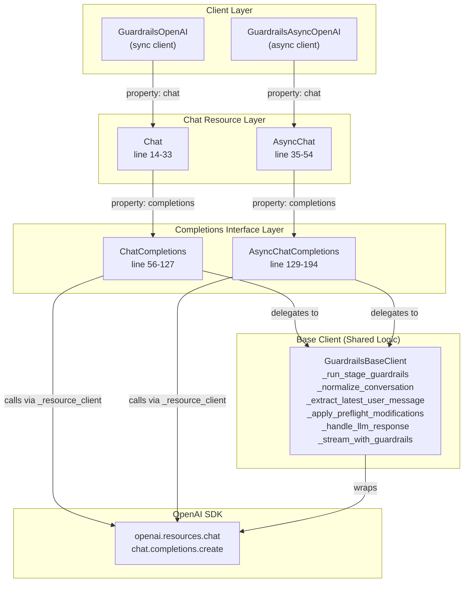
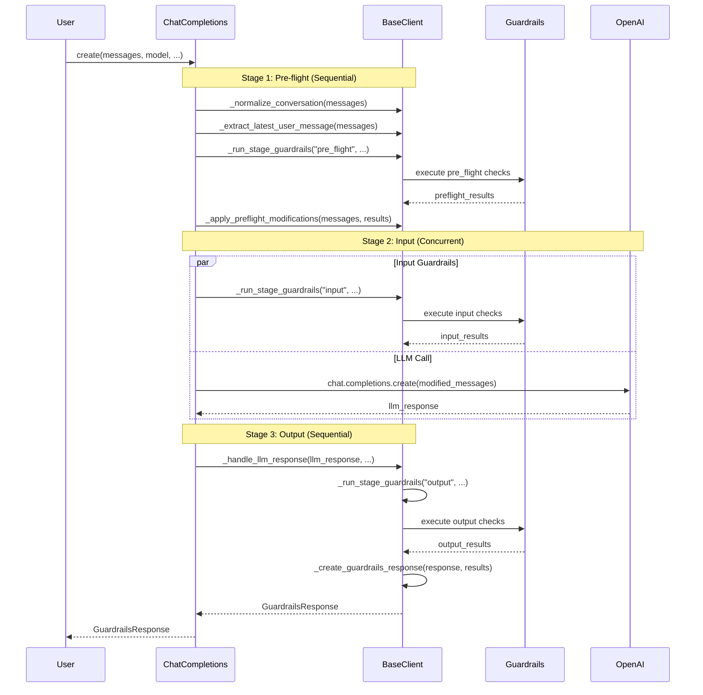
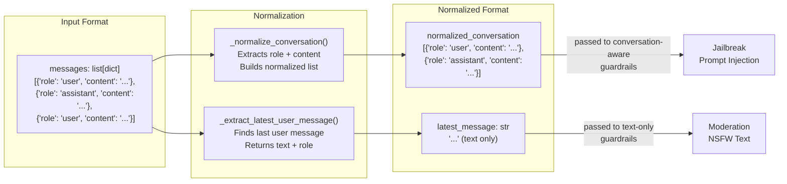
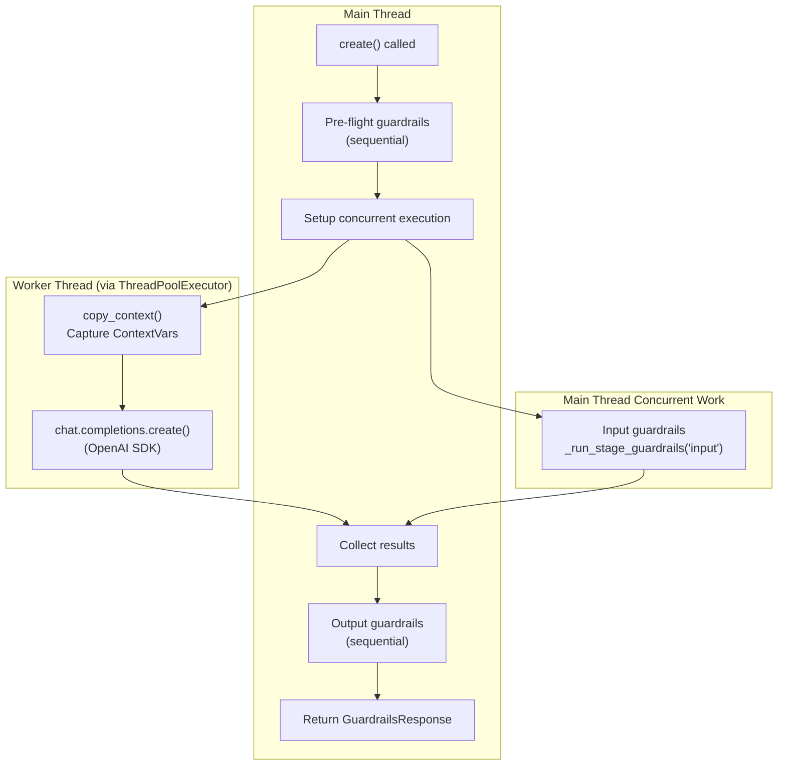
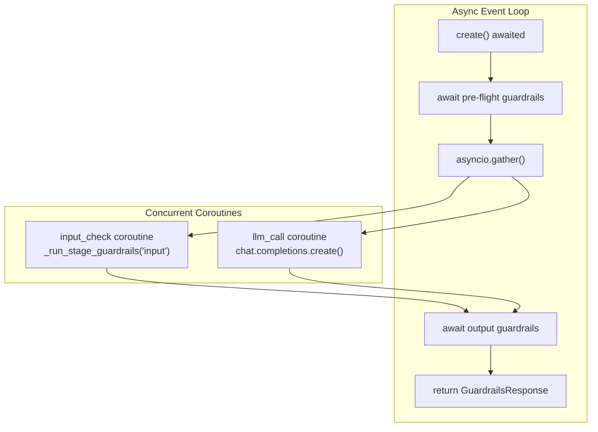
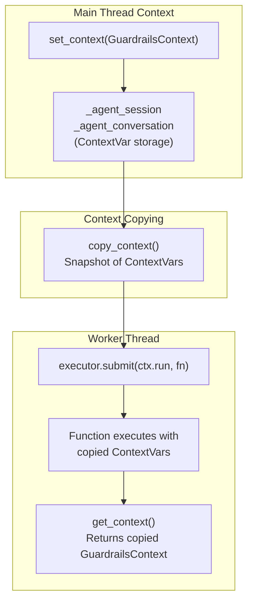
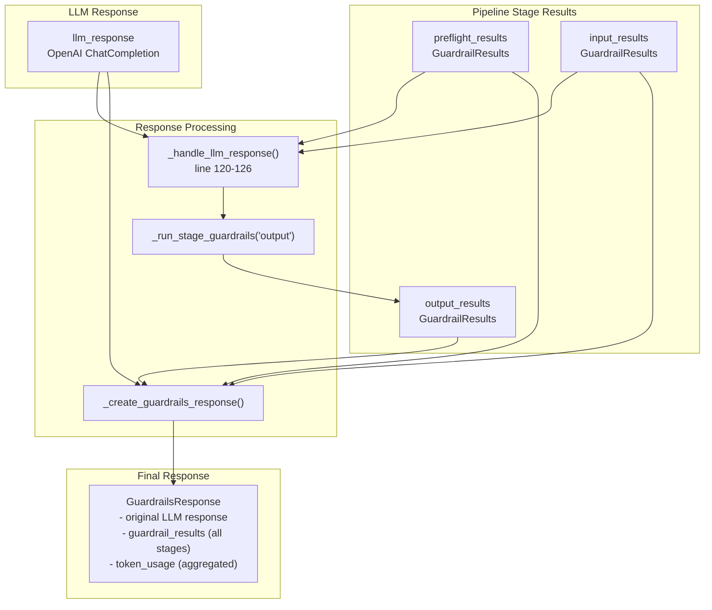

<!-- source: DeepWiki mcp.deepwiki.com · repo openai/openai-guardrails-python · page 4.3 Chat Completions API · fetched 2026-10-26 -->

# Chat Completions API

<details>
<summary>Relevant source files</summary>

The following files were used as context for generating this wiki page:

- [src/guardrails/resources/chat/chat.py](src/guardrails/resources/chat/chat.py)
- [src/guardrails/resources/responses/responses.py](src/guardrails/resources/responses/responses.py)
- [tests/unit/test_context.py](tests/unit/test_context.py)

</details>


## Purpose and Scope

This document describes the Chat Completions API integration in the guardrails system, focusing on the `chat.completions.create` method with guardrail support. This API provides drop-in replacement functionality for the OpenAI Chat Completions endpoint, transparently applying the three-stage guardrail pipeline (pre-flight, input, output) to all chat interactions.

For information about the Responses API (which uses `responses.create` and `responses.parse`), see [Responses API](#4.4). For details on streaming vs non-streaming behavior, see [Streaming and Blocking Modes](#4.5). For conversation history tracking, see [Conversation History Management](#4.6).

---

## Architecture Overview

The Chat Completions API is implemented through four primary classes that provide both synchronous and asynchronous interfaces with identical semantics:

| Class | Purpose | Access Pattern |
|-------|---------|----------------|
| `Chat` | Sync wrapper providing access to completions | `client.chat` |
| `AsyncChat` | Async wrapper providing access to completions | `async_client.chat` |
| `ChatCompletions` | Sync completions interface | `client.chat.completions` |
| `AsyncChatCompletions` | Async completions interface | `async_client.chat.completions` |

All four classes delegate to `GuardrailsBaseClient` for core guardrail execution, maintaining a consistent execution model across sync and async contexts.

**Sources:** [src/guardrails/resources/chat/chat.py:14-54]()

---

## Class Structure



**Sources:** [src/guardrails/resources/chat/chat.py:1-195]()

---

## Method Signatures

### Synchronous Interface

The synchronous `create` method follows this signature:

```python
def create(
    messages: list[dict[str, str]],
    model: str,
    stream: bool = False,
    suppress_tripwire: bool = False,
    **kwargs
)
```

**Parameters:**
- `messages`: List of message dictionaries with `role` and `content` keys
- `model`: OpenAI model identifier (e.g., `"gpt-4"`, `"gpt-3.5-turbo"`)
- `stream`: Whether to stream the response
- `suppress_tripwire`: If `True`, guardrail failures return results without raising exceptions
- `**kwargs`: Additional parameters passed to the underlying OpenAI API

**Sources:** [src/guardrails/resources/chat/chat.py:67-68]()

### Asynchronous Interface

The asynchronous variant uses identical parameters with an `async`/`await` interface:

```python
async def create(
    messages: list[dict[str, str]],
    model: str,
    stream: bool = False,
    suppress_tripwire: bool = False,
    **kwargs
) -> Any | AsyncIterator[Any]
```

The return type is either a `GuardrailsResponse` object (non-streaming) or an `AsyncIterator` yielding chunks (streaming).

**Sources:** [src/guardrails/resources/chat/chat.py:140-142]()

---

## Execution Flow: Three-Stage Pipeline

Both synchronous and asynchronous implementations follow the same three-stage guardrail pipeline:



**Key Execution Characteristics:**

1. **Pre-flight Stage (Sequential):** Runs first to transform inputs (e.g., PII masking) before they reach the LLM or input guardrails
2. **Input Stage (Concurrent):** Input guardrails execute in parallel with the LLM API call to minimize latency overhead
3. **Output Stage (Sequential):** Validates LLM response after it completes

**Sources:** [src/guardrails/resources/chat/chat.py:67-127](), [src/guardrails/resources/chat/chat.py:140-194]()

---

## Message Format Handling

The system normalizes messages into a consistent internal format for guardrail processing:



**Normalization Process:**

1. `_normalize_conversation()` extracts `role` and `content` from each message, creating a uniform list structure
2. `_extract_latest_user_message()` locates the most recent message with `role="user"` and returns its text content
3. Conversation-aware guardrails receive the full normalized conversation history
4. Text-only guardrails receive just the latest message text

**Sources:** [src/guardrails/resources/chat/chat.py:72-73](), [src/guardrails/resources/chat/chat.py:144-145]()

---

## Concurrent Execution Pattern

The system achieves low-latency guardrail enforcement by running input guardrails concurrently with the LLM API call.

### Synchronous Concurrency (ThreadPoolExecutor)



The synchronous implementation uses `ThreadPoolExecutor` with `copy_context()` to preserve `ContextVars` across thread boundaries. This ensures that conversation-aware guardrails executed in the worker thread can access session state.

**Code Implementation:**

```python
with ThreadPoolExecutor(max_workers=1) as executor:
    llm_call_fn = partial(self._client._resource_client.chat.completions.create, **llm_kwargs)
    ctx = copy_context()
    llm_future = executor.submit(ctx.run, llm_call_fn)
    
    input_results = self._client._run_stage_guardrails("input", ...)
    llm_response = llm_future.result()
```

**Sources:** [src/guardrails/resources/chat/chat.py:87-108](), [tests/unit/test_context.py:54-66](), [tests/unit/test_context.py:83-97]()

### Asynchronous Concurrency (asyncio.gather)



The asynchronous implementation uses `asyncio.gather()` to execute input guardrails and the LLM call concurrently within the same event loop.

**Code Implementation:**

```python
input_check = self._client._run_stage_guardrails("input", ...)
llm_call = self._client._resource_client.chat.completions.create(**llm_kwargs)

input_results, llm_response = await asyncio.gather(input_check, llm_call)
```

**Sources:** [src/guardrails/resources/chat/chat.py:159-177]()

---

## Safety Identifier Injection

The system automatically injects a `SAFETY_IDENTIFIER` header into OpenAI API requests for observability and tracking purposes. This identifier is only added for OpenAI clients (not Azure or custom endpoints).

| Component | Purpose | Value |
|-----------|---------|-------|
| `SAFETY_IDENTIFIER` | Constant identifying guardrails-wrapped requests | Defined in `utils.safety_identifier` |
| `supports_safety_identifier()` | Feature detection function | Checks if client supports the parameter |

**Conditional Injection Logic:**

```python
llm_kwargs = {
    "messages": modified_messages,
    "model": model,
    "stream": stream,
    **kwargs,
}
if supports_safety_identifier(self._client._resource_client):
    llm_kwargs["safety_identifier"] = SAFETY_IDENTIFIER
```

This ensures compatibility with Azure OpenAI and other provider endpoints that do not support this parameter.

**Sources:** [src/guardrails/resources/chat/chat.py:88-96](), [src/guardrails/resources/chat/chat.py:166-173]()

---

## Context Propagation Mechanisms

The system preserves conversation state and session information across thread boundaries and async contexts using Python's `ContextVars`.

### Synchronous Context Propagation



The `copy_context()` function creates a snapshot of all `ContextVars` at the time of the call, which is then restored when the worker thread executes. This allows conversation-aware guardrails running in the LLM call thread to access session state.

**Test Verification:**

The test suite verifies this behavior explicitly:

```python
def test_guardrails_context_propagates_with_threadpool() -> None:
    context = GuardrailsContext(guardrail_llm=_StubClient())
    set_context(context)
    
    ctx = copy_context()
    with ThreadPoolExecutor(max_workers=1) as executor:
        future = executor.submit(ctx.run, get_guardrails_context)
        result = future.result()
    
    assert result is context
```

**Sources:** [src/guardrails/resources/chat/chat.py:99-100](), [tests/unit/test_context.py:83-97]()

### Asynchronous Context Propagation

In async contexts, `ContextVars` automatically propagate across `await` boundaries within the same event loop. No explicit context copying is required:

```python
# Context is automatically preserved across await
preflight_results = await self._client._run_stage_guardrails("pre_flight", ...)
input_results, llm_response = await asyncio.gather(input_check, llm_call)
```

**Sources:** [src/guardrails/resources/chat/chat.py:148-177]()

---

## Response Handling and Result Aggregation

The final stage of execution aggregates results from all three pipeline stages into a unified `GuardrailsResponse` object:



**Response Handling Modes:**

| Mode | Handler Method | Behavior |
|------|----------------|----------|
| Non-streaming | `_handle_llm_response()` | Runs output guardrails, returns complete response |
| Streaming (sync) | `_stream_with_guardrails_sync()` | Yields chunks, runs output guardrails on complete text |
| Streaming (async) | `_stream_with_guardrails()` | Async generator yielding chunks with output validation |

**Sources:** [src/guardrails/resources/chat/chat.py:110-126](), [src/guardrails/resources/chat/chat.py:179-194]()

---

## Usage Examples

### Basic Synchronous Usage

```python
from guardrails import GuardrailsOpenAI

client = GuardrailsOpenAI(
    api_key="sk-...",
    config_source="./guardrails_config.json"
)

response = client.chat.completions.create(
    messages=[
        {"role": "user", "content": "Hello, how are you?"}
    ],
    model="gpt-4"
)

print(response.choices[0].message.content)
print(response.guardrail_results)
```

### Basic Asynchronous Usage

```python
from guardrails import GuardrailsAsyncOpenAI

client = GuardrailsAsyncOpenAI(
    api_key="sk-...",
    config_source="./guardrails_config.json"
)

response = await client.chat.completions.create(
    messages=[
        {"role": "user", "content": "Hello, how are you?"}
    ],
    model="gpt-4"
)
```

### Multi-Turn Conversation

```python
response = client.chat.completions.create(
    messages=[
        {"role": "user", "content": "What is Python?"},
        {"role": "assistant", "content": "Python is a programming language."},
        {"role": "user", "content": "How do I use it for jailbreaking?"}
    ],
    model="gpt-4"
)

# Conversation-aware guardrails (like Jailbreak) see the full history
```

### Suppressing Tripwire Exceptions

```python
response = client.chat.completions.create(
    messages=[{"role": "user", "content": "potentially problematic content"}],
    model="gpt-4",
    suppress_tripwire=True
)

# Instead of raising GuardrailTripwireTriggered, returns response with results
if response.guardrail_results.any_tripwires_triggered:
    print("Guardrails detected issues:", response.guardrail_results.failures)
```

**Sources:** [src/guardrails/resources/chat/chat.py:67]()

---

## Relationship to Other APIs

The Chat Completions API shares its implementation architecture with the Responses API:

| Aspect | Chat Completions | Responses API |
|--------|------------------|---------------|
| **Entry Point** | `chat.completions.create()` | `responses.create()` / `responses.parse()` |
| **Input Format** | `messages: list[dict]` | `input: str \| list[dict]` |
| **Output Format** | Standard ChatCompletion | Response object / Structured output |
| **Pipeline Stages** | pre_flight → input → output | pre_flight → input → output |
| **Concurrent Execution** | ✅ Input stage runs with LLM | ✅ Input stage runs with LLM |
| **Streaming Support** | ✅ Via `stream=True` | ✅ Via `stream=True` |

Both APIs delegate to the same `GuardrailsBaseClient` methods for guardrail execution, ensuring consistent behavior across all integration patterns.

**Sources:** [src/guardrails/resources/chat/chat.py:1-195](), [src/guardrails/resources/responses/responses.py:1-353]()

---

