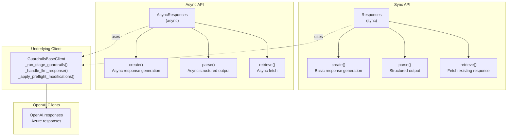
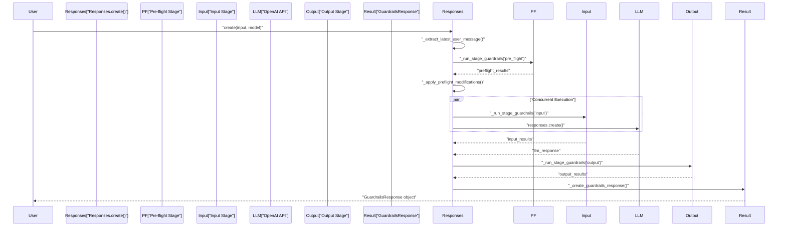
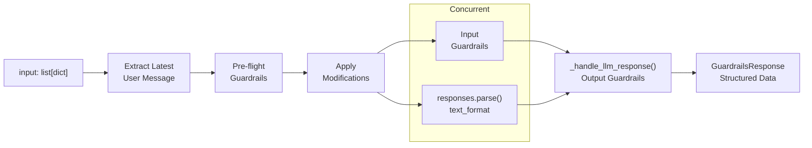
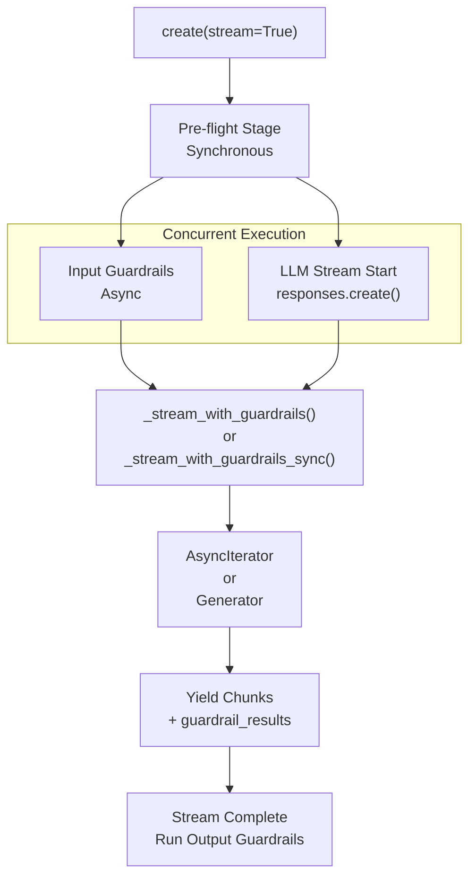
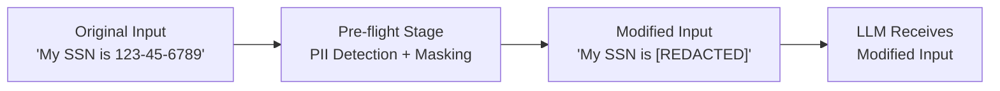

<!-- source: DeepWiki mcp.deepwiki.com · repo openai/openai-guardrails-python · page 4.4 Responses API · fetched 2026-10-26 -->

# Responses API

<details>
<summary>Relevant source files</summary>

The following files were used as context for generating this wiki page:

- [README.md](README.md)
- [docs/assets/images/guardrails-python-config-screenshot-100pct-q70.webp](docs/assets/images/guardrails-python-config-screenshot-100pct-q70.webp)
- [src/guardrails/resources/chat/chat.py](src/guardrails/resources/chat/chat.py)
- [src/guardrails/resources/responses/responses.py](src/guardrails/resources/responses/responses.py)
- [tests/unit/test_context.py](tests/unit/test_context.py)

</details>


The Responses API provides guardrail-enabled access to OpenAI's Responses API endpoint for stateful, multi-turn conversations. This page documents the `responses.create()`, `responses.parse()`, and `responses.retrieve()` methods available through `GuardrailsOpenAI` and `GuardrailsAsyncOpenAI` clients.

For chat completions using the `chat.completions.create()` method, see [Chat Completions API](#4.3). For information about the three-stage pipeline architecture that underlies both APIs, see [Three-Stage Pipeline Architecture](#3.1). For agent integration, see [Agent Integration](#5).

---

## Overview

The Responses API in the guardrails framework wraps OpenAI's Responses API to provide automatic validation at three stages: pre-flight, input, and output. The API maintains conversation state across turns and supports structured outputs, streaming, and response retrieval with guardrail validation.

**Key Features:**
- Stateful conversation tracking with `previous_response_id` parameter
- Structured output parsing via `responses.parse()`
- Response retrieval with output validation via `responses.retrieve()`
- Concurrent execution of input guardrails and LLM calls for latency optimization
- Support for both string and list-of-messages input formats
- PII masking and other input modifications via pre-flight stage

**Sources:** [src/guardrails/resources/responses/responses.py:1-284]()

---

## Class Structure



**Sources:** [src/guardrails/resources/responses/responses.py:13-22](), [src/guardrails/resources/responses/responses.py:147-156]()

---

## Execution Flow

### Three-Stage Pipeline for Responses API



**Sources:** [src/guardrails/resources/responses/responses.py:24-87](), [src/guardrails/resources/responses/responses.py:158-216]()

---

## Methods

### responses.create()

Creates a new response with guardrail validation. Supports both simple string input and list-of-messages format for multi-turn conversations.

**Method Signatures:**

```python
# Synchronous
def create(
    self,
    input: str | list[dict[str, str]],
    model: str,
    stream: bool = False,
    tools: list[dict] | None = None,
    suppress_tripwire: bool = False,
    **kwargs,
)

# Asynchronous
async def create(
    self,
    input: str | list[dict[str, str]],
    model: str,
    stream: bool = False,
    tools: list[dict] | None = None,
    suppress_tripwire: bool = False,
    **kwargs,
) -> Any | AsyncIterator[Any]
```

**Parameters:**
| Parameter | Type | Description |
|-----------|------|-------------|
| `input` | `str \| list[dict[str, str]]` | User input as string or conversation history |
| `model` | `str` | Model name (e.g., "gpt-5", "gpt-4.1-nano") |
| `stream` | `bool` | Enable streaming mode (default: False) |
| `tools` | `list[dict] \| None` | Optional tools for function calling |
| `suppress_tripwire` | `bool` | Suppress GuardrailTripwireTriggered exceptions |
| `**kwargs` | Various | Additional OpenAI API parameters |

**Execution Steps:**

1. **Extract latest user message** - If input is a list, extracts the most recent user message text via `_extract_latest_user_message()` [src/guardrails/resources/responses/responses.py:38-41]()
2. **Pre-flight stage** - Runs guardrails synchronously, can modify input (e.g., PII masking) [src/guardrails/resources/responses/responses.py:43-49]()
3. **Apply modifications** - Uses `_apply_preflight_modifications()` to update input based on pre-flight results [src/guardrails/resources/responses/responses.py:51-52]()
4. **Concurrent execution** - Runs input guardrails and LLM call concurrently via `ThreadPoolExecutor` (sync) or `asyncio.gather()` (async) [src/guardrails/resources/responses/responses.py:54-70](), [src/guardrails/resources/responses/responses.py:185-200]()
5. **Output validation** - For non-streaming, runs output guardrails via `_handle_llm_response()` [src/guardrails/resources/responses/responses.py:81-87]()

**Return Value:** `GuardrailsResponse` object containing:
- `llm_response`: Original OpenAI response object
- `guardrail_results`: Results from all three stages

**Sources:** [src/guardrails/resources/responses/responses.py:24-87](), [src/guardrails/resources/responses/responses.py:158-216]()

---

### responses.parse()

Creates a response with structured output parsing using Pydantic models. Validates input with guardrails before parsing and output after parsing.

**Method Signatures:**

```python
# Synchronous
def parse(
    self, 
    input: list[dict[str, str]], 
    model: str, 
    text_format: type[BaseModel], 
    suppress_tripwire: bool = False, 
    **kwargs
)

# Asynchronous
async def parse(
    self, 
    input: list[dict[str, str]], 
    model: str, 
    text_format: type[BaseModel], 
    stream: bool = False,
    suppress_tripwire: bool = False, 
    **kwargs
) -> Any | AsyncIterator[Any]
```

**Parameters:**
| Parameter | Type | Description |
|-----------|------|-------------|
| `input` | `list[dict[str, str]]` | Conversation history (messages format) |
| `model` | `str` | Model name |
| `text_format` | `type[BaseModel]` | Pydantic model for structured output |
| `stream` | `bool` | Enable streaming (async only) |
| `suppress_tripwire` | `bool` | Suppress exceptions |
| `**kwargs` | Various | Additional parameters |

**Key Differences from create():**
- Always requires list-of-messages format (not simple string)
- Includes `text_format` parameter for Pydantic schema
- Async version supports streaming structured output
- Output validation runs after structured parsing completes

**Execution Flow:**



**Sources:** [src/guardrails/resources/responses/responses.py:89-127](), [src/guardrails/resources/responses/responses.py:218-266]()

---

### responses.retrieve()

Retrieves a previously created response by ID and runs output guardrails on the retrieved content. Does not run pre-flight or input guardrails since no new input is provided.

**Method Signatures:**

```python
# Synchronous
def retrieve(
    self, 
    response_id: str, 
    suppress_tripwire: bool = False, 
    **kwargs
)

# Asynchronous
async def retrieve(
    self, 
    response_id: str, 
    suppress_tripwire: bool = False, 
    **kwargs
)
```

**Parameters:**
| Parameter | Type | Description |
|-----------|------|-------------|
| `response_id` | `str` | ID of the response to retrieve |
| `suppress_tripwire` | `bool` | Suppress exceptions |
| `**kwargs` | Various | Additional retrieval parameters |

**Execution Flow:**

1. Calls underlying `_resource_client.responses.retrieve()` to fetch response [src/guardrails/resources/responses/responses.py:132](), [src/guardrails/resources/responses/responses.py:271]()
2. Extracts `output_text` from response [src/guardrails/resources/responses/responses.py:135](), [src/guardrails/resources/responses/responses.py:274]()
3. Runs output stage guardrails only [src/guardrails/resources/responses/responses.py:136](), [src/guardrails/resources/responses/responses.py:275]()
4. Returns `GuardrailsResponse` with empty pre-flight and input results [src/guardrails/resources/responses/responses.py:139-144](), [src/guardrails/resources/responses/responses.py:278-283]()

**Use Case:** Retrieving and validating responses created in previous sessions or by other processes, ensuring output guardrails (hallucination detection, NSFW, off-topic) are applied to historical data.

**Sources:** [src/guardrails/resources/responses/responses.py:129-144](), [src/guardrails/resources/responses/responses.py:268-283]()

---

## Input Format Handling

The Responses API accepts two input formats, with automatic handling for guardrail text extraction:

### String Input

```python
response = client.responses.create(
    input="What are your business hours?",
    model="gpt-5"
)
```

When a string is provided, it is used directly for guardrail validation [src/guardrails/resources/responses/responses.py:40-41]().

### List of Messages Input

```python
response = client.responses.create(
    input=[
        {"role": "user", "content": "What are your business hours?"},
        {"role": "assistant", "content": "We are open 9-5 Monday-Friday."},
        {"role": "user", "content": "What about weekends?"}
    ],
    model="gpt-5"
)
```

When a list is provided:
1. The full conversation history is passed to the LLM API [src/guardrails/resources/responses/responses.py:58]()
2. The latest user message is extracted via `_extract_latest_user_message()` for guardrail validation [src/guardrails/resources/responses/responses.py:39]()
3. The full conversation is available to guardrails via the `conversation_history` parameter for prompt injection detection [src/guardrails/resources/responses/responses.py:47](), [src/guardrails/resources/responses/responses.py:67]()

**Sources:** [src/guardrails/resources/responses/responses.py:38-68](), [src/guardrails/resources/responses/responses.py:168-189]()

---

## Streaming Mode

Both `create()` and `parse()` (async only) support streaming responses. The streaming implementation differs slightly from blocking mode:

### Streaming Execution Flow



**Key Differences:**
- Input guardrails run concurrently with stream initialization [src/guardrails/resources/responses/responses.py:74]()
- Output guardrails run after stream completes, triggered by wrapper methods [src/guardrails/resources/responses/responses.py:74-79](), [src/guardrails/resources/responses/responses.py:202-208]()
- Each chunk includes accumulated guardrail results from pre-flight and input stages
- Stream wrapper methods: `_stream_with_guardrails_sync()` for sync, `_stream_with_guardrails()` for async

**Example:**

```python
stream = client.responses.create(
    input="Tell me a story",
    model="gpt-5",
    stream=True
)

for chunk in stream:
    print(chunk.llm_response.output_text, end="")
    # chunk.guardrail_results available after stream completes
```

**Sources:** [src/guardrails/resources/responses/responses.py:72-79](), [src/guardrails/resources/responses/responses.py:202-208](), [examples/implementation_code/blocking/blocking_responses.py:1-53]()

---

## Conversation State Management

The Responses API maintains conversation state across multiple turns using the `previous_response_id` parameter:

```python
# First turn
response1 = client.responses.create(
    input="What are your business hours?",
    model="gpt-5"
)

# Subsequent turn with state
response2 = client.responses.create(
    input="What about weekends?",
    model="gpt-5",
    previous_response_id=response1.llm_response.id
)
```

The framework:
1. Passes `previous_response_id` through to the underlying OpenAI API [src/guardrails/resources/responses/responses.py:56-62]()
2. Extracts the latest user message for guardrail validation
3. Maintains full conversation context accessible to guardrails via `conversation_history` parameter

**Sources:** [examples/implementation_code/blocking/blocking_responses.py:14-27]()

---

## Pre-flight Modifications

Pre-flight guardrails can modify the input before it reaches the LLM. This is commonly used for PII masking:



**Implementation:**

1. Pre-flight stage runs synchronously first [src/guardrails/resources/responses/responses.py:43-49]()
2. Results contain modification data in `guardrail_result.info` dictionary
3. `_apply_preflight_modifications()` processes results and updates input [src/guardrails/resources/responses/responses.py:51-52]()
4. Modified input is used for both input guardrails and LLM call [src/guardrails/resources/responses/responses.py:58]()

**Sources:** [src/guardrails/resources/responses/responses.py:43-52](), [src/guardrails/resources/responses/responses.py:175-183]()

---

## Error Handling

### GuardrailTripwireTriggered Exception

When a guardrail detects a violation and `suppress_tripwire=False` (default), a `GuardrailTripwireTriggered` exception is raised. For the Responses API, this can occur at any of the three stages:

| Stage | When Exception Raised | Access to LLM Response |
|-------|----------------------|------------------------|
| Pre-flight | Before LLM call, during input validation | No (call not made) |
| Input | During concurrent execution, before output stage | No (execution halted) |
| Output | After LLM call, during output validation | Yes (in exception object) |

**Example Exception Handling:**

```python
try:
    response = client.responses.create(
        input=user_input,
        model="gpt-5"
    )
    print(response.llm_response.output_text)
    
except GuardrailTripwireTriggered as e:
    stage = e.guardrail_result.info.get("stage_name")
    guardrail = e.guardrail_result.info.get("guardrail_name")
    print(f"Guardrail '{guardrail}' triggered in stage '{stage}'")
```

**Sources:** [examples/implementation_code/blocking/blocking_responses.py:29-49]()

### Suppress Tripwire Mode

Setting `suppress_tripwire=True` prevents exceptions from being raised, allowing you to inspect guardrail results programmatically:

```python
response = client.responses.create(
    input=user_input,
    model="gpt-5",
    suppress_tripwire=True
)

# Check for violations
for result in response.guardrail_results:
    if result.tripwire_triggered:
        print(f"Violation: {result.info['guardrail_name']}")

# LLM response is still available
if response.llm_response:
    print(response.llm_response.output_text)
```

This mode is useful for logging, analytics, or implementing custom violation handling logic. See [Error Handling Modes](#2.3) for more details.

**Sources:** [src/guardrails/resources/responses/responses.py:30](), [src/guardrails/resources/responses/responses.py:164]()

---

## Sync vs Async Usage

The Responses API provides both synchronous and asynchronous implementations with identical functionality:

### Synchronous (`Responses`)

```python
from guardrails import GuardrailsOpenAI

client = GuardrailsOpenAI(config="config.json")

# Blocking call
response = client.responses.create(
    input="Hello",
    model="gpt-5"
)
```

**Concurrency Implementation:**
- Uses `ThreadPoolExecutor` with max_workers=1 [src/guardrails/resources/responses/responses.py:55]()
- Submits LLM call to thread pool [src/guardrails/resources/responses/responses.py:56-62]()
- Runs input guardrails on main thread [src/guardrails/resources/responses/responses.py:64-69]()
- Waits for both via `llm_future.result()` [src/guardrails/resources/responses/responses.py:70]()

### Asynchronous (`AsyncResponses`)

```python
from guardrails import GuardrailsAsyncOpenAI
import asyncio

async def main():
    client = GuardrailsAsyncOpenAI(config="config.json")
    
    # Non-blocking call
    response = await client.responses.create(
        input="Hello",
        model="gpt-5"
    )

asyncio.run(main())
```

**Concurrency Implementation:**
- Uses `asyncio.gather()` for true parallel execution [src/guardrails/resources/responses/responses.py:200]()
- No thread pool overhead
- Better scalability for high-concurrency applications

**Sources:** [src/guardrails/resources/responses/responses.py:13-145](), [src/guardrails/resources/responses/responses.py:147-284](), [examples/implementation_code/blocking/blocking_responses.py:1-53]()

---

## Comparison: Responses vs Chat Completions

| Feature | Responses API | Chat Completions API |
|---------|---------------|---------------------|
| **Endpoint** | `client.responses.create()` | `client.chat.completions.create()` |
| **State Management** | Built-in via `previous_response_id` | Manual via conversation list |
| **Input Format** | String or list of messages | List of messages only |
| **Structured Output** | `responses.parse()` method | Via `response_format` parameter |
| **Response Retrieval** | `responses.retrieve()` method | Not available |
| **Use Case** | Multi-turn conversations with state | General chat completion |
| **Guardrail Integration** | Identical three-stage pipeline | Identical three-stage pipeline |

Both APIs:
- Use the same three-stage pipeline (pre-flight → input → output)
- Support streaming and non-streaming modes
- Apply identical guardrail validation
- Return `GuardrailsResponse` objects

**Sources:** [src/guardrails/resources/responses/responses.py:1-284](), [src/guardrails/resources/chat/chat.py:1-176]()

---

## Integration with Base Client

The Responses API delegates to `GuardrailsBaseClient` for core guardrail functionality:

```mermaid
graph TB
    subgraph "Responses API Layer"
        Create["responses.create()"]
        Parse["responses.parse()"]
        Retrieve["responses.retrieve()"]
    end
    
    subgraph "GuardrailsBaseClient Methods"
        Extract["_extract_latest_user_message()<br/>Extract text from messages"]
        RunStage["_run_stage_guardrails()<br/>Execute guardrails for stage"]
        ApplyMods["_apply_preflight_modifications()<br/>Apply PII masking etc."]
        HandleResp["_handle_llm_response()<br/>Process response + output stage"]
        StreamSync["_stream_with_guardrails_sync()<br/>Sync streaming wrapper"]
        StreamAsync["_stream_with_guardrails()<br/>Async streaming wrapper"]
        CreateResp["_create_guardrails_response()<br/>Build response object"]
    end
    
    subgraph "OpenAI Client"
        OpenAIResp["OpenAI.responses.create()<br/>OpenAI.responses.parse()<br/>OpenAI.responses.retrieve()"]
    end
    
    Create --> Extract
    Create --> RunStage
    Create --> ApplyMods
    Create --> HandleResp
    Create --> StreamSync
    Create --> OpenAIResp
    
    Parse --> Extract
    Parse --> RunStage
    Parse --> ApplyMods
    Parse --> HandleResp
    Parse --> OpenAIResp
    
    Retrieve --> RunStage
    Retrieve --> CreateResp
    Retrieve --> OpenAIResp
```



**Key Base Client Methods Used:**
- `_extract_latest_user_message()`: Extracts text from conversation for validation [src/guardrails/resources/responses/responses.py:39]()
- `_run_stage_guardrails()`: Executes guardrails for a specific stage [src/guardrails/resources/responses/responses.py:44-48]()
- `_apply_preflight_modifications()`: Applies input transformations [src/guardrails/resources/responses/responses.py:52]()
- `_handle_llm_response()`: Processes LLM response with output guardrails [src/guardrails/resources/responses/responses.py:81]()
- `_stream_with_guardrails()` / `_stream_with_guardrails_sync()`: Handles streaming responses [src/guardrails/resources/responses/responses.py:74]()
- `_create_guardrails_response()`: Constructs final response object [src/guardrails/resources/responses/responses.py:139]()

**Sources:** [src/guardrails/resources/responses/responses.py:1-284]()

---

## Complete Usage Example

```python
from pathlib import Path
from guardrails import GuardrailsAsyncOpenAI, GuardrailTripwireTriggered
import asyncio

async def main():
    # Initialize client with config
    client = GuardrailsAsyncOpenAI(
        config=Path("guardrails_config.json")
    )
    
    response_id = None
    
    while True:
        try:
            user_input = input("\nEnter message: ")
            
            # Create response with state
            response = await client.responses.create(
                input=user_input,
                model="gpt-4.1-nano",
                previous_response_id=response_id
            )
            
            print(f"Assistant: {response.llm_response.output_text}")
            
            # Store response ID for next turn
            response_id = response.llm_response.id
            
            # Inspect guardrail results
            for result in response.guardrail_results:
                if result.execution_failed:
                    print(f"Warning: {result.info['guardrail_name']} failed")
                    
        except GuardrailTripwireTriggered as e:
            stage = e.guardrail_result.info.get("stage_name")
            name = e.guardrail_result.info.get("guardrail_name")
            print(f"🛑 {name} triggered in {stage} stage")
            continue
        except (EOFError, KeyboardInterrupt):
            break

asyncio.run(main())
```

**Sources:** [examples/implementation_code/blocking/blocking_responses.py:1-53](), [README.md:54-62]()

---

