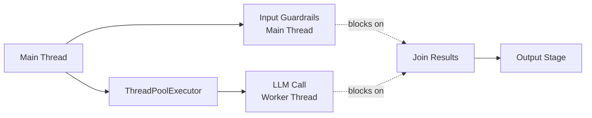
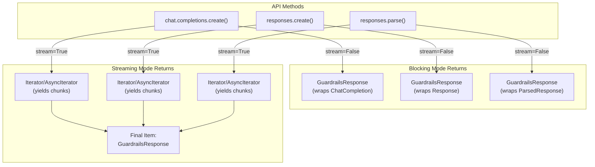

<!-- source: DeepWiki mcp.deepwiki.com · repo openai/openai-guardrails-python · page 4.5 Streaming and Blocking Modes · fetched 2026-10-26 -->

# Streaming and Blocking Modes

<details>
<summary>Relevant source files</summary>

The following files were used as context for generating this wiki page:

- [src/guardrails/resources/chat/chat.py](src/guardrails/resources/chat/chat.py)
- [src/guardrails/resources/responses/responses.py](src/guardrails/resources/responses/responses.py)
- [tests/unit/test_context.py](tests/unit/test_context.py)

</details>


This page explains how the OpenAI Guardrails package handles streaming versus non-streaming (blocking) responses, particularly how output guardrails are applied differently in each mode. The execution flow for pre-flight and input guardrails remains consistent across both modes, but output guardrail timing varies significantly.

For information about the overall three-stage pipeline architecture, see [Three-Stage Pipeline Architecture](#3.1). For details on conversation history management in multi-turn interactions, see [Conversation History Management](#4.6).

## Overview of Execution Modes

The guardrails framework supports two execution modes controlled by the `stream` parameter in API calls:

| Mode | Parameter | Output Available | Output Guardrails Timing | Use Case |
|------|-----------|------------------|--------------------------|----------|
| **Blocking** | `stream=False` | Complete response immediately | Run immediately on full content | Traditional request-response workflows |
| **Streaming** | `stream=True` | Incremental chunks via iterator | Run after all chunks collected | Real-time user interfaces, progressive display |

Both modes execute pre-flight and input guardrails identically (concurrently with the LLM call), but differ in when and how output guardrails are applied.

**Sources:** [src/guardrails/resources/responses/responses.py:31](), [src/guardrails/resources/chat/chat.py:67]()

## Pipeline Execution Flow by Mode

```mermaid
graph TB
    subgraph "Blocking Mode (stream=False)"
        B_Input["User Input"]
        B_Preflight["Pre-flight Stage<br/>_run_stage_guardrails('pre_flight')"]
        B_Modify["Apply Modifications<br/>_apply_preflight_modifications()"]
        
        subgraph "Concurrent Execution"
            B_Input_GR["Input Guardrails<br/>_run_stage_guardrails('input')"]
            B_LLM["LLM API Call<br/>chat.completions.create<br/>responses.create"]
        end
        
        B_Response["Complete LLM Response"]
        B_Output["Output Guardrails<br/>_run_stage_guardrails('output')"]
        B_Final["GuardrailsResponse<br/>_handle_llm_response()"]
        
        B_Input --> B_Preflight
        B_Preflight --> B_Modify
        B_Modify --> B_Input_GR
        B_Modify --> B_LLM
        B_Input_GR -.parallel.-> B_LLM
        B_LLM --> B_Response
        B_Response --> B_Output
        B_Input_GR --> B_Output
        B_Output --> B_Final
    end
    
    subgraph "Streaming Mode (stream=True)"
        S_Input["User Input"]
        S_Preflight["Pre-flight Stage<br/>_run_stage_guardrails('pre_flight')"]
        S_Modify["Apply Modifications<br/>_apply_preflight_modifications()"]
        
        subgraph "Concurrent Execution Stream"
            S_Input_GR["Input Guardrails<br/>_run_stage_guardrails('input')"]
            S_LLM["LLM API Call<br/>stream=True"]
        end
        
        S_Stream["Stream Iterator<br/>AsyncIterator[Chunk]"]
        S_Buffer["Buffer Chunks<br/>_stream_with_guardrails()"]
        S_Complete["All Chunks Collected"]
        S_Output["Output Guardrails<br/>_run_stage_guardrails('output')"]
        S_Yield["Yield Buffered Chunks<br/>+ GuardrailsResponse"]
        
        S_Input --> S_Preflight
        S_Preflight --> S_Modify
        S_Modify --> S_Input_GR
        S_Modify --> S_LLM
        S_Input_GR -.parallel.-> S_LLM
        S_LLM --> S_Stream
        S_Stream --> S_Buffer
        S_Buffer --> S_Complete
        S_Input_GR --> S_Complete
        S_Complete --> S_Output
        S_Output --> S_Yield
    end
```



**Sources:** [src/guardrails/resources/responses/responses.py:56-108](), [src/guardrails/resources/chat/chat.py:75-126]()

## Blocking Mode Implementation

### Execution Flow

In blocking mode (`stream=False`), the complete LLM response is available immediately, allowing output guardrails to execute synchronously on the full content. This is the default mode and provides the simplest execution model.

**Synchronous Flow:**
1. Pre-flight guardrails execute first via `_run_stage_guardrails("pre_flight", ...)`
2. Input modifications applied via `_apply_preflight_modifications()`
3. Input guardrails and LLM call execute concurrently using `ThreadPoolExecutor`
4. Complete response returned from LLM
5. Output guardrails execute via `_run_stage_guardrails("output", ...)`
6. Final response wrapped in `GuardrailsResponse` via `_handle_llm_response()`

**Asynchronous Flow:**
1. Pre-flight guardrails execute first via `await _run_stage_guardrails("pre_flight", ...)`
2. Input modifications applied via `_apply_preflight_modifications()`
3. Input guardrails and LLM call execute concurrently using `asyncio.gather()`
4. Complete response returned from LLM
5. Output guardrails execute via `await _run_stage_guardrails("output", ...)`
6. Final response wrapped in `GuardrailsResponse` via `await _handle_llm_response()`

**Sources:** [src/guardrails/resources/responses/responses.py:101-108](), [src/guardrails/resources/chat/chat.py:119-126]()

### Code Implementation

The blocking mode branches to `_handle_llm_response()` which immediately processes the complete response:

```
# Synchronous blocking mode (from responses.py:101-108)
if stream:
    return self._client._stream_with_guardrails_sync(...)
else:
    return self._client._handle_llm_response(
        llm_response,
        preflight_results,
        input_results,
        conversation_history=normalized_conversation,
        suppress_tripwire=suppress_tripwire,
    )
```

The `_handle_llm_response()` method extracts the complete output text, runs output guardrails on it, and wraps everything in a `GuardrailsResponse` object containing both the LLM response and all guardrail results.

**Sources:** [src/guardrails/resources/responses/responses.py:101-108](), [src/guardrails/resources/chat/chat.py:119-126]()

## Streaming Mode Implementation

### Buffering and Delayed Guardrails

In streaming mode (`stream=True`), the LLM response arrives as an iterator of chunks. To apply output guardrails, the framework must:

1. **Buffer all chunks** while allowing them to be yielded to the caller
2. **Reconstruct the complete content** from buffered chunks
3. **Execute output guardrails** on the complete content
4. **Yield the final `GuardrailsResponse`** after all chunks

This means output guardrails run **after** the stream completes, not during streaming. The client receives chunks immediately, but guardrail validation is deferred.

**Sources:** [src/guardrails/resources/responses/responses.py:93-100](), [src/guardrails/resources/chat/chat.py:111-118]()

### Async Streaming Flow

For async clients (`GuardrailsAsyncOpenAI`), the `_stream_with_guardrails()` method handles streaming:

```
# Async streaming mode (from responses.py:254-261)
if stream:
    return self._client._stream_with_guardrails(
        llm_response,
        preflight_results,
        input_results,
        conversation_history=normalized_conversation,
        suppress_tripwire=suppress_tripwire,
    )
```

The `_stream_with_guardrails()` method returns an async iterator that:
1. Yields each chunk as it arrives from the LLM stream
2. Accumulates chunks internally to reconstruct the full response
3. Runs output guardrails after the stream completes
4. Yields a final `GuardrailsResponse` object with all guardrail results

**Sources:** [src/guardrails/resources/responses/responses.py:254-261](), [src/guardrails/resources/chat/chat.py:179-186]()

### Sync Streaming Flow

For synchronous clients (`GuardrailsOpenAI`), the `_stream_with_guardrails_sync()` method handles streaming using a similar pattern:

```
# Synchronous streaming mode (from responses.py:93-100)
if stream:
    return self._client._stream_with_guardrails_sync(
        llm_response,
        preflight_results,
        input_results,
        conversation_history=normalized_conversation,
        suppress_tripwire=suppress_tripwire,
    )
```

The synchronous version maintains the same buffering logic but uses synchronous iteration patterns compatible with synchronous OpenAI client streams.

**Sources:** [src/guardrails/resources/responses/responses.py:93-100](), [src/guardrails/resources/chat/chat.py:111-118]()

## Concurrent Execution and Context Propagation

### ThreadPoolExecutor for Synchronous Concurrency

Both blocking and streaming modes execute input guardrails concurrently with the LLM call to minimize latency. For synchronous clients, this uses `ThreadPoolExecutor`:



**Context Propagation via copy_context:**

The synchronous implementation uses `copy_context()` to propagate `ContextVar` state to the worker thread executing the LLM call:

```python
# From responses.py:68-83
with ThreadPoolExecutor(max_workers=1) as executor:
    llm_call_fn = partial(self._client._resource_client.responses.create, **llm_kwargs)
    ctx = copy_context()  # Capture current context
    llm_future = executor.submit(ctx.run, llm_call_fn)  # Run in captured context
    
    input_results = self._client._run_stage_guardrails(...)  # Main thread
    llm_response = llm_future.result()  # Wait for worker thread
```

This ensures conversation history and guardrail context stored in `ContextVar` instances are available in the LLM call thread.

**Sources:** [src/guardrails/resources/responses/responses.py:68-90](), [src/guardrails/resources/chat/chat.py:87-108](), [tests/unit/test_context.py:54-67]()

### asyncio.gather for Asynchronous Concurrency

Asynchronous clients use `asyncio.gather()` to execute input guardrails and LLM calls concurrently:

```python
# From responses.py:231-252
input_check = self._client._run_stage_guardrails(...)
llm_call = self._client._resource_client.responses.create(**llm_kwargs)

input_results, llm_response = await asyncio.gather(input_check, llm_call)
```

Async execution naturally propagates context through the event loop, so explicit `copy_context()` is not required.

**Sources:** [src/guardrails/resources/responses/responses.py:231-252](), [src/guardrails/resources/chat/chat.py:159-177]()

## Method Dispatch Table

The following table maps execution modes to the internal methods called by the client wrappers:

| Client Type | Mode | Method Called | Purpose |
|-------------|------|---------------|---------|
| `GuardrailsOpenAI` | `stream=False` | `_handle_llm_response()` | Process complete response with output guardrails |
| `GuardrailsOpenAI` | `stream=True` | `_stream_with_guardrails_sync()` | Buffer stream, apply delayed output guardrails |
| `GuardrailsAsyncOpenAI` | `stream=False` | `await _handle_llm_response()` | Async process complete response with output guardrails |
| `GuardrailsAsyncOpenAI` | `stream=True` | `_stream_with_guardrails()` | Return async iterator with delayed output guardrails |

All modes call `_run_stage_guardrails()` for pre-flight, input, and output stages, with output stage timing varying by mode.

**Sources:** [src/guardrails/resources/responses/responses.py:92-108](), [src/guardrails/resources/responses/responses.py:254-269]()

## Response Type Mapping



In streaming mode, the iterator yields:
1. Multiple chunk objects (original LLM stream chunks)
2. One final `GuardrailsResponse` object containing guardrail results

The final `GuardrailsResponse` object includes `preflight_results`, `input_results`, and `output_results` attributes containing all guardrail outcomes.

**Sources:** [src/guardrails/resources/responses/responses.py:92-108](), [src/guardrails/resources/chat/chat.py:110-126]()

## Token Usage Tracking

Token usage is tracked consistently across both modes through the underlying OpenAI response objects. The framework preserves token usage metadata in the wrapped `GuardrailsResponse`:

- **Blocking mode**: Token usage available immediately in the complete response
- **Streaming mode**: Token usage accumulated from chunks and included in the final `GuardrailsResponse`

Output guardrails that call LLMs (e.g., jailbreak detection, hallucination detection) add their own token usage to the guardrail results, allowing applications to track both primary LLM usage and guardrail LLM usage separately.

**Sources:** [src/guardrails/resources/responses/responses.py:101-108](), [src/guardrails/resources/chat/chat.py:119-126]()

## API Method Support

Both `chat.completions.create()` and `responses.create()` support streaming and blocking modes:

| API | Blocking Support | Streaming Support | Notes |
|-----|------------------|-------------------|-------|
| `chat.completions.create()` | ✓ | ✓ | Full support for both modes |
| `responses.create()` | ✓ | ✓ | Full support for both modes |
| `responses.parse()` | ✓ | ✓ (OpenAI SDK ≥1.70.0) | Streaming structured outputs supported in newer SDK versions |
| `responses.retrieve()` | ✓ | N/A | Retrieval always returns complete response |

The `stream` parameter is passed directly through to the underlying OpenAI client after guardrails process the request.

**Sources:** [src/guardrails/resources/responses/responses.py:27-164](), [src/guardrails/resources/responses/responses.py:271-335](), [src/guardrails/resources/chat/chat.py:67-127]()

---

