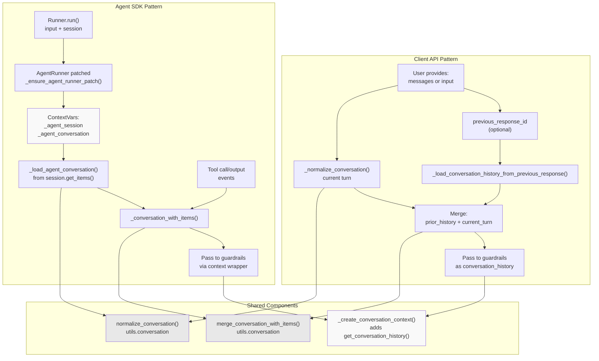
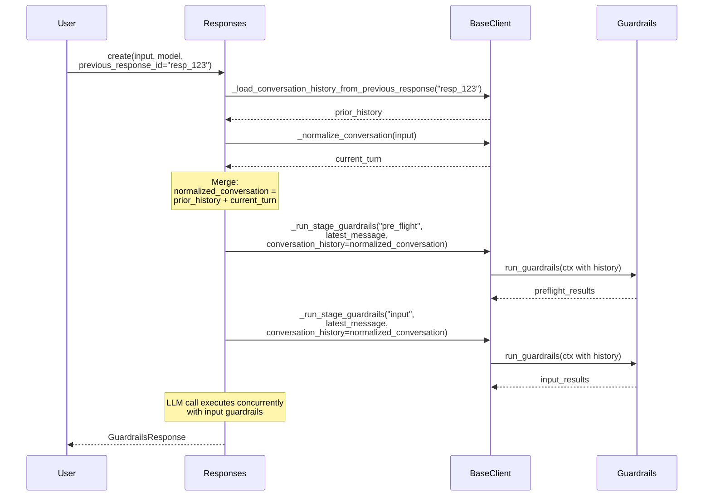
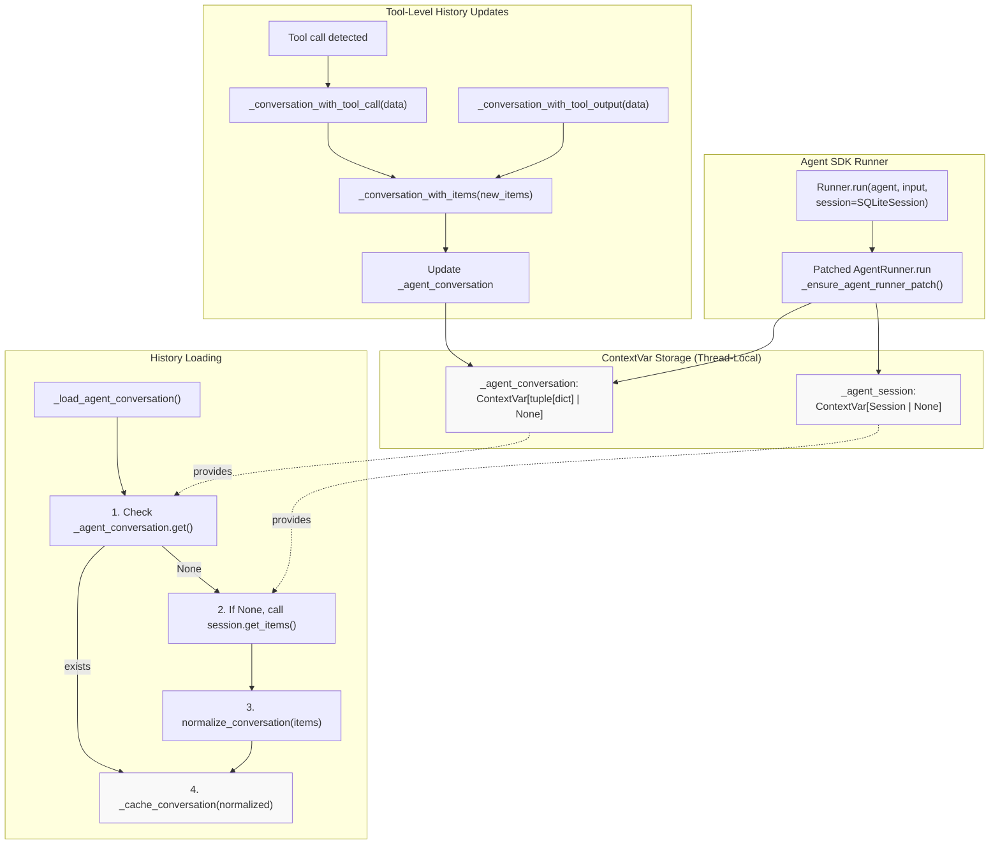
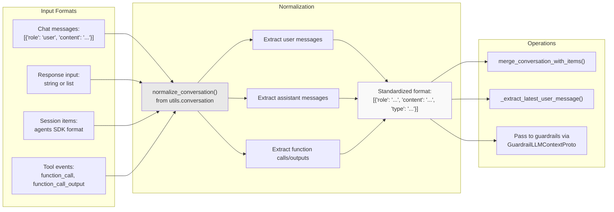
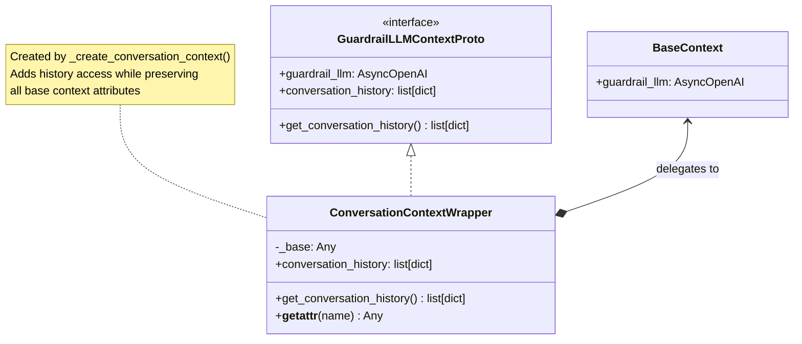
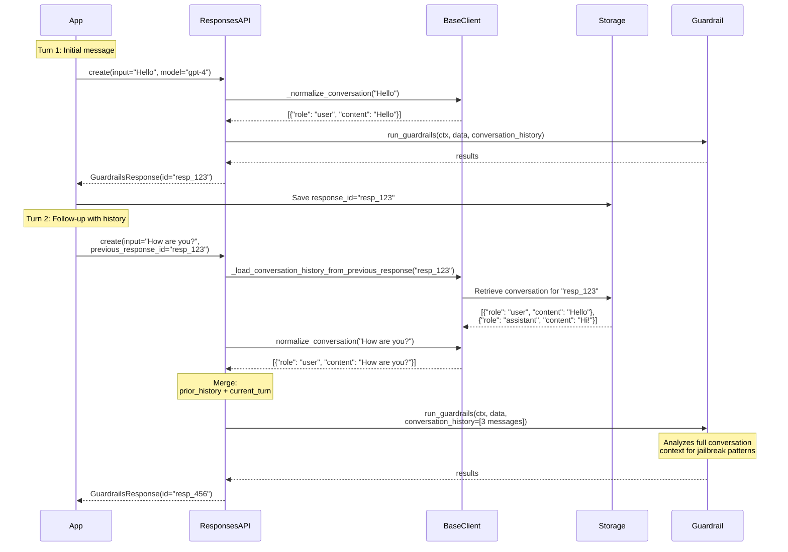
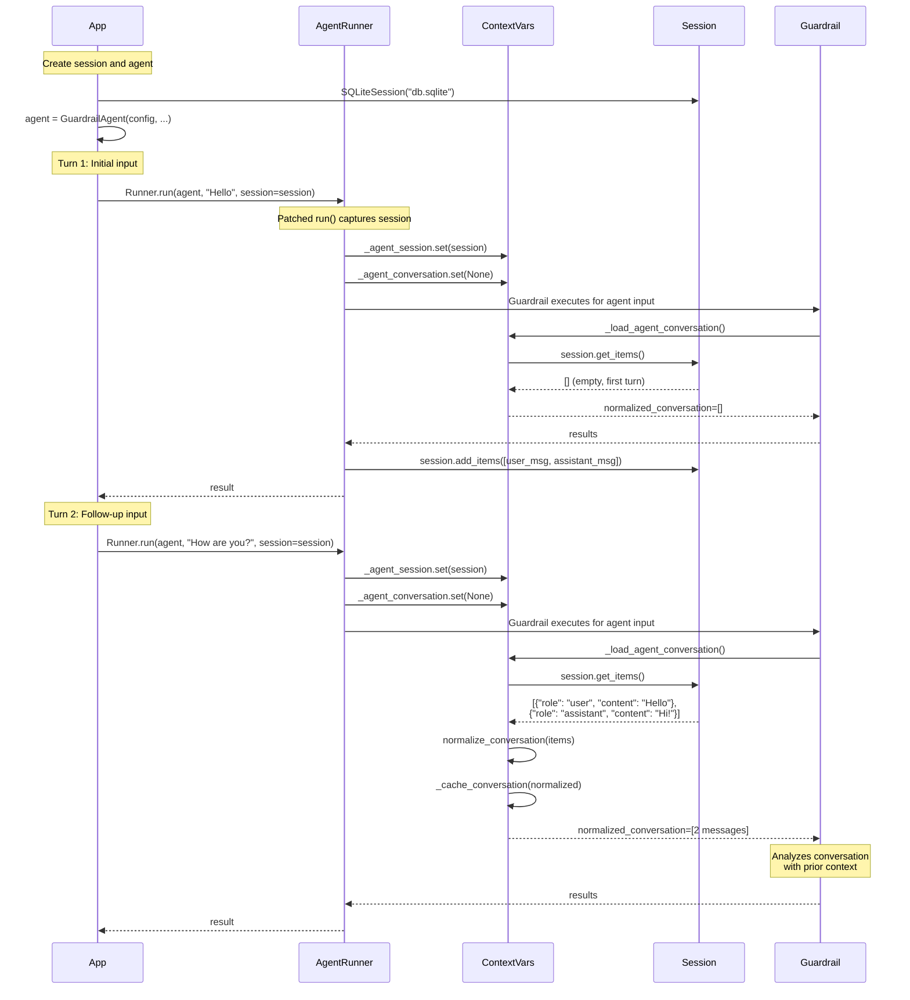

<!-- source: DeepWiki mcp.deepwiki.com · repo openai/openai-guardrails-python · page 4.6 Conversation History Management · fetched 2026-10-26 -->

# Conversation History Management

<details>
<summary>Relevant source files</summary>

The following files were used as context for generating this wiki page:

- [examples/basic/agents_sdk.py](examples/basic/agents_sdk.py)
- [src/guardrails/_streaming.py](src/guardrails/_streaming.py)
- [src/guardrails/agents.py](src/guardrails/agents.py)
- [src/guardrails/resources/chat/chat.py](src/guardrails/resources/chat/chat.py)
- [src/guardrails/resources/responses/responses.py](src/guardrails/resources/responses/responses.py)
- [tests/unit/test_agents.py](tests/unit/test_agents.py)
- [tests/unit/test_context.py](tests/unit/test_context.py)

</details>


This document describes how the OpenAI Guardrails package manages conversation history across different integration patterns. Conversation history enables **conversation-aware guardrails** (such as Jailbreak Detection and Prompt Injection Detection) to analyze multi-turn interactions rather than isolated messages.

For information about how guardrails access and use conversation history, see [Type System and Context Propagation](#3.3). For details on conversation-aware guardrail implementations, see [Jailbreak Detection](#6.2) and [Prompt Injection Detection](#6.4).

---

## Purpose and Scope

The conversation history management system provides three key capabilities:

1. **History Loading**: Retrieving prior conversation turns from stored response IDs (Responses API only)
2. **History Normalization**: Converting diverse message formats into a standardized internal representation
3. **History Propagation**: Making conversation context available to conversation-aware guardrails

The system supports two distinct integration patterns with different history management strategies:

- **Client API Pattern** (`GuardrailsOpenAI`, `GuardrailsAsyncOpenAI`): Stateless conversation management using `previous_response_id` parameter
- **Agent SDK Pattern** (`GuardrailAgent`): Session-based conversation management via `ContextVar` tracking

Sources: [src/guardrails/resources/responses/responses.py](), [src/guardrails/resources/chat/chat.py](), [src/guardrails/agents.py:1-100]()

---

## Conversation History Data Flow

### Overall Architecture



**Client API Pattern** loads history explicitly via `previous_response_id`, normalizes both prior and current turns, and merges them before passing to guardrails.

**Agent SDK Pattern** uses `ContextVar` tracking to automatically capture session state from `Runner.run()`, loading history on-demand and updating it as tool calls occur.

Both patterns converge on shared normalization and merging utilities, ultimately providing conversation history to guardrails through a context wrapper that exposes the `get_conversation_history()` method.

Sources: [src/guardrails/resources/responses/responses.py:40-48, 206-213](), [src/guardrails/agents.py:41-99](), [src/guardrails/utils/conversation.py]()

---

## Client API Conversation Management

### Responses API with `previous_response_id`

The Responses API supports multi-turn conversations through the `previous_response_id` parameter, which loads the complete conversation history from a prior API call.

#### Synchronous Flow



The synchronous flow in [src/guardrails/resources/responses/responses.py:40-48]() follows this pattern:

1. Extract `previous_response_id` from `kwargs`
2. Load prior conversation history (may be empty if no prior response)
3. Normalize current turn messages
4. Merge prior history with current turn
5. Pass merged conversation to all guardrail stages

Sources: [src/guardrails/resources/responses/responses.py:26-108]()

#### Asynchronous Flow

The async version follows the same pattern with concurrent execution:

```python
# From src/guardrails/resources/responses/responses.py:206-213
previous_response_id = kwargs.get("previous_response_id")
prior_history = await self._client._load_conversation_history_from_previous_response(previous_response_id)

current_turn = self._client._normalize_conversation(input)
if prior_history:
    normalized_conversation = [entry.copy() for entry in prior_history]
    normalized_conversation.extend(current_turn)
else:
    normalized_conversation = current_turn
```

The key difference is that `_load_conversation_history_from_previous_response()` is awaited, allowing async I/O if the history is retrieved from external storage.

Sources: [src/guardrails/resources/responses/responses.py:195-269]()

### Chat Completions API

The Chat Completions API does not support `previous_response_id` because the `messages` parameter already contains the full conversation history in OpenAI's native format:

```python
# From src/guardrails/resources/chat/chat.py:72-73
normalized_conversation = self._client._normalize_conversation(messages)
latest_message, _ = self._client._extract_latest_user_message(messages)
```

Users must manually maintain conversation state by appending assistant responses to the `messages` list for subsequent calls.

Sources: [src/guardrails/resources/chat/chat.py:67-126]()

### Conversation History API Surface

| API Method | Conversation History Support | Parameter | Notes |
|------------|------------------------------|-----------|-------|
| `responses.create()` | ✅ Explicit | `previous_response_id` | Loads prior history from stored response |
| `responses.parse()` | ✅ Explicit | `previous_response_id` | Same as `create()` |
| `responses.retrieve()` | ❌ No history | N/A | Validates single response only |
| `chat.completions.create()` | ✅ Implicit | `messages` | Full conversation must be in `messages` list |

Sources: [src/guardrails/resources/responses/responses.py:26-182](), [src/guardrails/resources/chat/chat.py:56-127]()

---

## Agent SDK Conversation Management

The Agent SDK integration uses a fundamentally different approach based on session persistence and `ContextVar` tracking.

### Session and ContextVar Architecture



The Agent SDK pattern uses two context variables defined in [src/guardrails/agents.py:33-37]():

- `_agent_session`: Stores the `Session` object from `Runner.run(..., session=session)`
- `_agent_conversation`: Caches the normalized conversation history as an immutable tuple

Sources: [src/guardrails/agents.py:33-99]()

### AgentRunner Patching

The system patches `AgentRunner.run()` to automatically capture session state:

```python
# From src/guardrails/agents.py:41-70
def _ensure_agent_runner_patch() -> None:
    """Patch AgentRunner.run once so sessions are exposed via ContextVars."""
    global _AGENT_RUNNER_PATCHED
    if _AGENT_RUNNER_PATCHED:
        return

    from agents.run import AgentRunner

    original_run = AgentRunner.run

    async def _patched_run(self, starting_agent, input, **kwargs):
        session = kwargs.get("session")
        fallback_history: list[dict[str, Any]] | None = None
        if session is None:
            fallback_history = normalize_conversation(input)

        session_token = _agent_session.set(session)
        conversation_token = _agent_conversation.set(
            tuple(dict(item) for item in fallback_history) if fallback_history else None
        )

        try:
            return await original_run(self, starting_agent, input, **kwargs)
        finally:
            _agent_session.reset(session_token)
            _agent_conversation.reset(conversation_token)

    AgentRunner.run = _patched_run
    _AGENT_RUNNER_PATCHED = True
```

This patch occurs once per process lifetime and ensures conversation state is available to all guardrails without requiring manual parameter passing.

**Key behaviors:**

1. **With Session**: Stores the session object in `_agent_session`, conversation loaded lazily
2. **Without Session**: Normalizes the input immediately and stores as fallback history
3. **Cleanup**: Resets context variables after `Runner.run()` completes

Sources: [src/guardrails/agents.py:41-71]()

### Lazy History Loading

Conversation history is loaded on-demand when guardrails need it:

```python
# From src/guardrails/agents.py:78-91
async def _load_agent_conversation() -> list[dict[str, Any]]:
    """Load the latest conversation snapshot from session or fallback storage."""
    cached = _agent_conversation.get()
    if cached is not None:
        return [dict(item) for item in cached]

    session = _agent_session.get()
    if session is not None:
        items = await session.get_items()
        conversation = normalize_conversation(items)
        _cache_conversation(conversation)
        return conversation

    return []
```

This function:
1. Checks the cached conversation first (avoids redundant session queries)
2. Falls back to loading from session if available
3. Normalizes session items and updates the cache
4. Returns empty list if no session or cached conversation exists

Sources: [src/guardrails/agents.py:78-91]()

### Tool Call History Updates

When tool-level guardrails execute, the conversation history is dynamically updated to include the tool interaction:

```python
# From src/guardrails/agents.py:102-110
async def _conversation_with_tool_call(data: Any) -> list[dict[str, Any]]:
    """Build conversation history including the current tool call."""
    event = {
        "type": "function_call",
        "tool_name": data.context.tool_name,
        "arguments": data.context.tool_arguments,
        "call_id": getattr(data.context, "tool_call_id", None),
    }
    return await _conversation_with_items([event])
```

Similar patterns exist for tool outputs [src/guardrails/agents.py:113-122](). These functions append new events to the existing history and update the cache, enabling guardrails to see the complete interaction context.

Sources: [src/guardrails/agents.py:102-122]()

### Example: Multi-Turn Agent Conversation

```python
# From examples/basic/agents_sdk.py:53-74
async def main() -> None:
    """Main input loop for the customer support agent with input/output guardrails."""
    # Create a session for the agent to store the conversation history
    session = SQLiteSession("guardrails-session")

    # Create agent with guardrails automatically configured
    AGENT = GuardrailAgent(
        config=PIPELINE_CONFIG,
        name="Customer support agent",
        instructions="You are a customer support agent.",
    )

    while True:
        user_input = input("Enter a message: ")
        result = await Runner.run(
            AGENT,
            user_input,
            run_config=RunConfig(tracing_disabled=True),
            session=session,  # Session persists conversation across turns
        )
        print(f"Assistant: {result.final_output}")
```

In this example:
- The `SQLiteSession` persists conversation history to disk
- Each call to `Runner.run()` automatically loads prior history from the session
- Guardrails receive the full conversation context for every check

Sources: [examples/basic/agents_sdk.py:53-92]()

---

## Normalized Conversation Format

Both client APIs and Agent SDK converge on a standardized conversation format used internally by guardrails.

### Normalization Operations



The `normalize_conversation()` function (from `utils.conversation`) handles diverse input formats and produces a consistent internal representation.

**Key normalization rules:**

1. **Message Types**: Identifies `user`, `assistant`, and `function_call` message types
2. **Content Extraction**: Handles both string content and complex content arrays
3. **Tool Interactions**: Converts tool calls and outputs into standardized events
4. **History Ordering**: Maintains chronological order of conversation turns

Sources: [src/guardrails/utils/conversation.py](), [src/guardrails/agents.py:94-122]()

### Conversation Merging

The `merge_conversation_with_items()` function combines existing history with new events:

```python
# Usage in streaming.py:51-54
history = merge_conversation_with_items(
    conversation_history or [],
    [{"role": "assistant", "content": accumulated_text}],
)
```

This ensures output guardrails see the complete conversation including the assistant's in-progress response during streaming.

Sources: [src/guardrails/_streaming.py:51-74](), [src/guardrails/utils/conversation.py]()

### Latest Message Extraction

For guardrails that operate on individual messages rather than full conversations, the system extracts the most recent user message:

```python
# From chat.py:73
latest_message, _ = self._client._extract_latest_user_message(messages)

# Used in responses.py:50-54
if isinstance(input, list):
    latest_message, _ = self._client._extract_latest_user_message(input)
else:
    latest_message = input
```

This extraction handles both simple strings and complex message structures.

**Agent SDK Extraction:**

For agents, a specialized `_extract_text_from_input()` function [src/guardrails/agents.py:358-418]() handles the Agents SDK's message format, which may include conversation history in list format or simple string inputs.

Sources: [src/guardrails/resources/chat/chat.py:73](), [src/guardrails/resources/responses/responses.py:50-54](), [src/guardrails/agents.py:358-418]()

---

## Conversation Context Propagation

### Context Wrapper Pattern

Conversation-aware guardrails receive history through a context wrapper that implements the `GuardrailLLMContextProto` interface:



The wrapper is created in [src/guardrails/agents.py:173-206]():

```python
class ConversationContextWrapper:
    """Wrapper that adds get_conversation_history() while preserving base context."""

    def __init__(self, base: Any, history: list) -> None:
        self._base = base
        # Expose conversation_history as public attribute per GuardrailLLMContextProto
        self.conversation_history = history

    def get_conversation_history(self) -> list:
        """Return conversation history for conversation-aware guardrails."""
        return self.conversation_history

    def __getattr__(self, name: str) -> Any:
        """Delegate all other attribute access to the base context."""
        return getattr(self._base, name)
```

This pattern allows conversation-aware guardrails to access history via `ctx.get_conversation_history()` while non-conversation-aware guardrails simply use the base context without modification.

Sources: [src/guardrails/agents.py:173-206]()

### History Access in Guardrails

Guardrails access conversation history through the context object:

```python
# Example from a conversation-aware guardrail (Jailbreak Detection)
conversation_history = ctx.get_conversation_history()

# The guardrail can then analyze the full conversation:
# - Check for jailbreak patterns across turns
# - Detect prompt injection in tool call sequences
# - Validate consistency across multi-turn interactions
```

The `uses_conversation_history` metadata flag in `GuardrailSpecMetadata` indicates which guardrails require conversation context:

```python
# From agents.py:476-478
needs_conversation_history = any(
    getattr(g.definition, "metadata", None) and g.definition.metadata.uses_conversation_history 
    for g in all_guardrails
)
```

This optimization ensures conversation history is only loaded when at least one guardrail needs it.

Sources: [src/guardrails/agents.py:476-502]()

### Client API Context Creation

In the client APIs, conversation history is passed directly to the guardrail execution:

```python
# From responses.py:84-89
input_results = self._client._run_stage_guardrails(
    "input",
    latest_message,
    conversation_history=normalized_conversation,
    suppress_tripwire=suppress_tripwire,
)
```

The `_run_stage_guardrails()` method creates the appropriate context wrapper internally before invoking guardrails.

Sources: [src/guardrails/resources/responses/responses.py:84-89](), [src/guardrails/resources/chat/chat.py:102-107]()

### Agent SDK Context Creation

For agent-level guardrails, the context is created with loaded conversation history:

```python
# From agents.py:494-501
if needs_conversation_history:
    conversation_history = await _load_agent_conversation()
    guardrail_context = _create_conversation_context(
        conversation_history=conversation_history,
        base_context=context,
    )
else:
    guardrail_context = context
```

For tool-level guardrails, the context includes the tool call/output events:

```python
# From agents.py:249-253
conversation_history = await _conversation_with_tool_call(data)
ctx = _create_conversation_context(
    conversation_history=conversation_history,
    base_context=context,
)
```

This ensures tool-level guardrails see the complete context including the tool interaction being validated.

Sources: [src/guardrails/agents.py:249-253, 494-501]()

---

## Conversation History Table Summary

| Component | Location | Purpose |
|-----------|----------|---------|
| `previous_response_id` | Responses API parameter | Load prior conversation from stored response |
| `_load_conversation_history_from_previous_response()` | `GuardrailsBaseClient` | Retrieve conversation from response ID |
| `normalize_conversation()` | `utils.conversation` | Convert various formats to standard representation |
| `merge_conversation_with_items()` | `utils.conversation` | Combine history with new events |
| `_extract_latest_user_message()` | `GuardrailsBaseClient` | Get most recent user message from conversation |
| `_agent_session` | `agents.py` ContextVar | Thread-local session storage for Agent SDK |
| `_agent_conversation` | `agents.py` ContextVar | Cached normalized conversation for agents |
| `_ensure_agent_runner_patch()` | `agents.py:41-70` | Patch `AgentRunner.run()` to capture session |
| `_load_agent_conversation()` | `agents.py:78-91` | Lazy-load conversation from session or cache |
| `_conversation_with_tool_call()` | `agents.py:102-110` | Add tool call event to conversation |
| `_conversation_with_tool_output()` | `agents.py:113-122` | Add tool output event to conversation |
| `_create_conversation_context()` | `agents.py:173-206` | Wrap context with `get_conversation_history()` |
| `_extract_text_from_input()` | `agents.py:358-418` | Extract text from Agents SDK input formats |

Sources: [src/guardrails/resources/responses/responses.py](), [src/guardrails/resources/chat/chat.py](), [src/guardrails/agents.py](), [src/guardrails/utils/conversation.py]()

---

## Complete History Flow Example

### Client API with previous_response_id



Sources: [src/guardrails/resources/responses/responses.py:26-108]()

### Agent SDK with Session



Sources: [src/guardrails/agents.py:41-91](), [examples/basic/agents_sdk.py:53-92]()

---

## Implementation Notes

### Thread Safety

Both client API and Agent SDK patterns use `ContextVar` for thread-safe context propagation:

```python
# From context.py (inferred from test_context.py usage)
# ContextVars automatically isolate per-thread/task
```

The `copy_context()` pattern in [tests/unit/test_context.py:42-66]() demonstrates how context propagates correctly across thread pools and async tasks.

Sources: [tests/unit/test_context.py:42-115]()

### Session Persistence

The Agent SDK relies on the `Session` interface from the agents package:

```python
# Session interface (from agents package):
# - get_items(limit: int | None = None) -> list[dict]
# - add_items(items: list[Any]) -> None
# - pop_item() -> Any | None
# - clear_session() -> None
```

The `SQLiteSession` implementation persists conversation to disk, enabling multi-session conversations across process restarts.

Sources: [tests/unit/test_agents.py:179-193](), [examples/basic/agents_sdk.py:56]()

### Conversation Caching

The agent conversation cache (`_agent_conversation`) stores normalized conversation as an immutable tuple:

```python
# From agents.py:75
_agent_conversation.set(tuple(dict(item) for item in conversation))
```

This immutability ensures conversation state cannot be accidentally modified by guardrails or other components, while the cache avoids redundant session queries within a single agent run.

Sources: [src/guardrails/agents.py:73-75]()

### Optimization: Lazy History Loading

Conversation history is only loaded when needed:

1. **Agent-level guardrails**: Load once per `Runner.run()` call if any guardrail has `uses_conversation_history=True`
2. **Tool-level guardrails**: Load before each tool call/output validation
3. **Client API**: Load once at request start if `previous_response_id` provided

This lazy approach minimizes database/storage queries while ensuring guardrails have access to complete conversation context.

Sources: [src/guardrails/agents.py:476-478, 494-501]()

---

