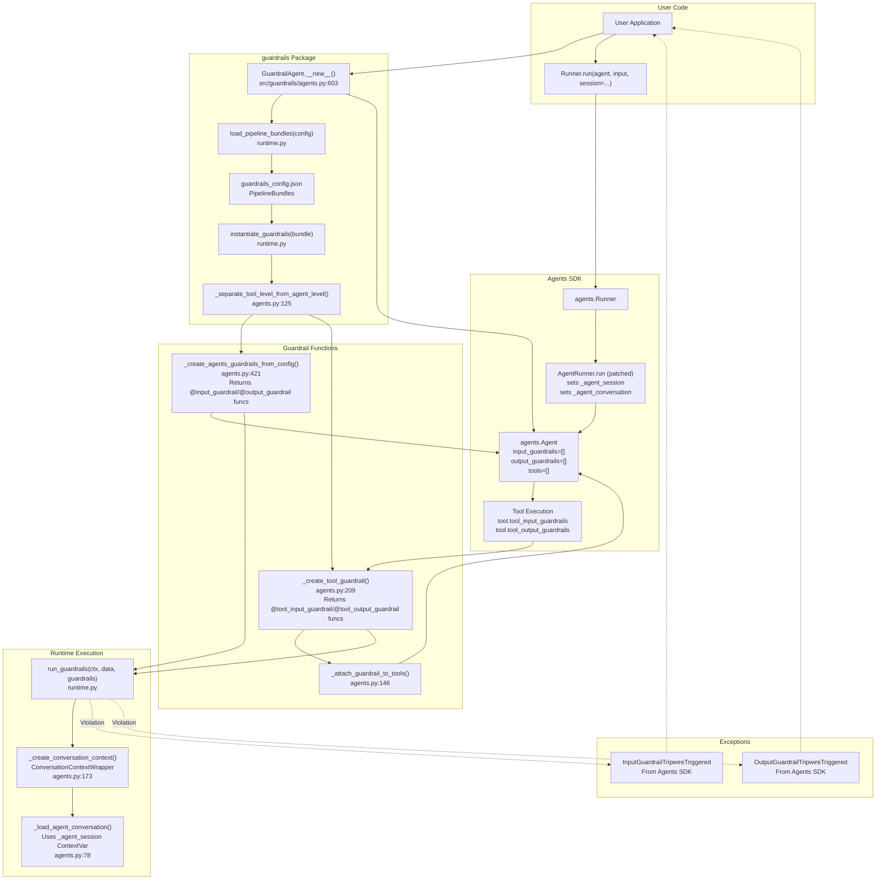
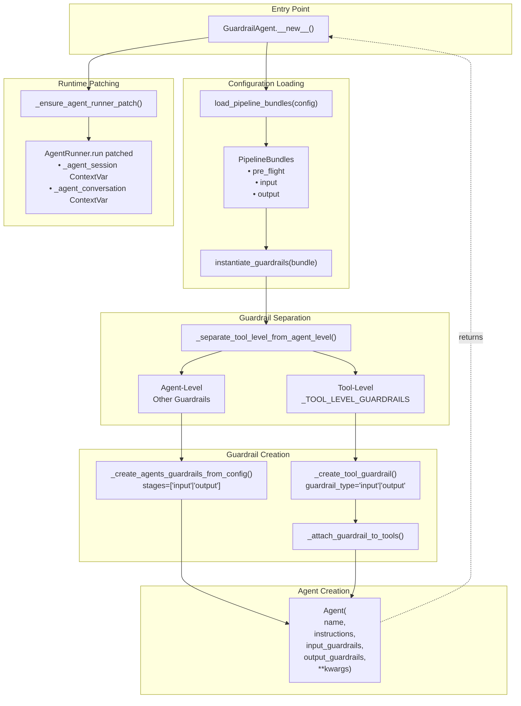
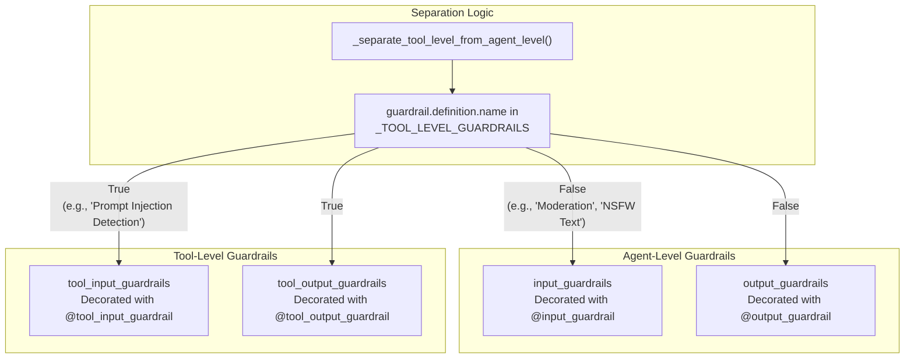
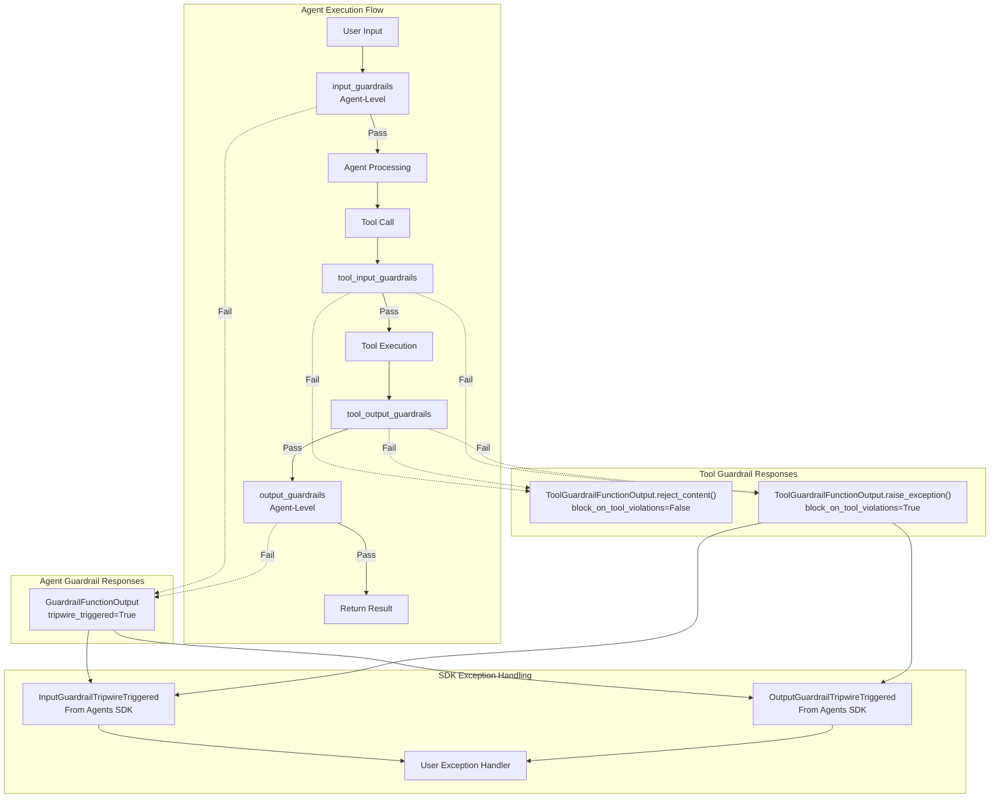
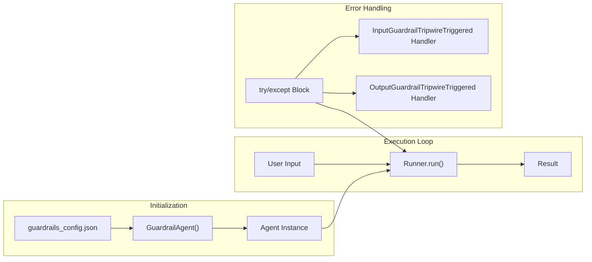
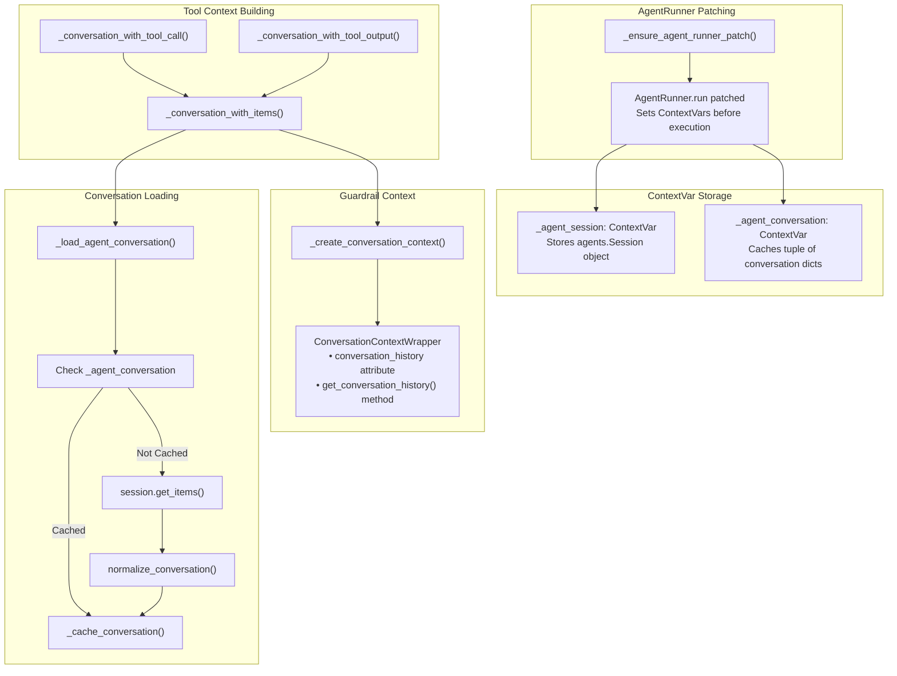

<!-- source: DeepWiki mcp.deepwiki.com · repo openai/openai-guardrails-python · page 5 Agent Integration · fetched 2026-10-26 -->

# Agent Integration

<details>
<summary>Relevant source files</summary>

The following files were used as context for generating this wiki page:

- [README.md](README.md)
- [docs/assets/images/guardrails-python-config-screenshot-100pct-q70.webp](docs/assets/images/guardrails-python-config-screenshot-100pct-q70.webp)
- [examples/basic/agents_sdk.py](examples/basic/agents_sdk.py)
- [src/guardrails/_streaming.py](src/guardrails/_streaming.py)
- [src/guardrails/agents.py](src/guardrails/agents.py)
- [tests/unit/test_agents.py](tests/unit/test_agents.py)

</details>


## Purpose and Scope

This document covers integration of OpenAI Guardrails with the OpenAI Agents SDK using the `GuardrailAgent` class. The `GuardrailAgent` provides a drop-in replacement for the standard `Agent` class, automatically configuring and applying guardrails to agent execution.

For general client integration with OpenAI APIs, see [Client Integration](#4). For information about guardrail configuration files and pipeline bundles, see [Configuration Files](#2.2).

**Sources**: [README.md:64-93](), [docs/agents_sdk_integration.md:1-90]()

---

## GuardrailAgent as a Drop-in Replacement

The `GuardrailAgent` class serves as a direct replacement for the Agents SDK's `Agent` class, requiring minimal code changes to add guardrails to an existing agent implementation.

### Basic Integration Pattern

```python
from guardrails import GuardrailAgent
from pathlib import Path

# Replace Agent with GuardrailAgent
agent = GuardrailAgent(
    config=Path("guardrails_config.json"),
    name="Customer support agent",
    instructions="You are a customer support agent.",
)
```

The key characteristics of `GuardrailAgent`:

| Characteristic | Description |
|---------------|-------------|
| **Drop-in Replacement** | Accepts same parameters as `Agent` class |
| **Configuration-Driven** | Loads guardrails from pipeline configuration files |
| **Returns Agent Instance** | Returns a standard `Agent` object that works with all Agents SDK features |
| **Transparent Integration** | No changes needed to `Runner.run()` or other SDK components |

**Sources**: [README.md:66-91](), [docs/agents_sdk_integration.md:7-16](), [src/guardrails/__init__.py:15]()

---

## Agent Integration Architecture

The following diagram illustrates how `GuardrailAgent` integrates with the Agents SDK and the guardrails runtime system:

**Diagram: GuardrailAgent Integration Architecture with Code Entities**



**Sources**: [src/guardrails/agents.py:603-742](), [src/guardrails/agents.py:125-143](), [src/guardrails/agents.py:146-159](), [src/guardrails/agents.py:173-206](), [src/guardrails/agents.py:209-355](), [src/guardrails/agents.py:421-563]()

---

## GuardrailAgent Implementation Details

The `GuardrailAgent` class is implemented as a factory function using the `__new__` method pattern [src/guardrails/agents.py:603-742](). It returns a standard `agents.Agent` instance with guardrails automatically attached based on configuration.

### Factory Pattern Architecture

**Diagram: GuardrailAgent Factory Implementation**



### Initialization Steps

The initialization flow [src/guardrails/agents.py:603-742]() follows these steps:

1. **Runtime Patching** (`_ensure_agent_runner_patch`): Patches `AgentRunner.run` to expose session via `ContextVar` [src/guardrails/agents.py:41-70]()
2. **Configuration Loading** (`load_pipeline_bundles`): Parses configuration into `PipelineBundles` structure [src/guardrails/agents.py:655]()
3. **Guardrail Instantiation** (`instantiate_guardrails`): Creates guardrail instances from each bundle [src/guardrails/agents.py:658-663]()
4. **Separation** (`_separate_tool_level_from_agent_level`): Divides guardrails based on `_TOOL_LEVEL_GUARDRAILS` list [src/guardrails/agents.py:666-668]()
5. **Agent-Level Creation** (`_create_agents_guardrails_from_config`): Creates input/output guardrail functions [src/guardrails/agents.py:685-691](), [src/guardrails/agents.py:700-705]()
6. **Tool-Level Creation** (`_create_tool_guardrail`): Creates tool input/output guardrail wrappers [src/guardrails/agents.py:720-739]()
7. **Attachment** (`_attach_guardrail_to_tools`): Attaches tool guardrails to each tool object [src/guardrails/agents.py:728-729](), [src/guardrails/agents.py:738-739]()
8. **Agent Construction**: Returns configured `Agent` instance [src/guardrails/agents.py:742]()

### Key Implementation Constants

| Constant | Location | Value | Purpose |
|----------|----------|-------|---------|
| `_TOOL_LEVEL_GUARDRAILS` | [src/guardrails/agents.py:30]() | `["Prompt Injection Detection"]` | Defines which guardrails run at tool level |
| `_agent_session` | [src/guardrails/agents.py:33]() | `ContextVar` | Stores agent session for conversation history |
| `_agent_conversation` | [src/guardrails/agents.py:34-37]() | `ContextVar` | Caches conversation history tuple |

**Sources**: [src/guardrails/agents.py:1-742](), [tests/unit/test_agents.py:543-591]()

---

## Tool-Level vs Agent-Level Guardrails

The agent integration implements a two-tier guardrail architecture determined by the `_TOOL_LEVEL_GUARDRAILS` list [src/guardrails/agents.py:30]().

### Architectural Distinction

**Diagram: Two-Tier Guardrail Architecture**



| Level | Guardrails | Implementation | Execution Timing |
|-------|-----------|----------------|------------------|
| **Tool-Level** | Names in `_TOOL_LEVEL_GUARDRAILS` | `_create_tool_guardrail()` [src/guardrails/agents.py:209-355]() | Before and after **each** tool call |
| **Agent-Level** | All other guardrails | `_create_agents_guardrails_from_config()` [src/guardrails/agents.py:421-563]() | Once per agent interaction |

### Tool-Level Guardrail Execution

Tool-level guardrails are attached to individual tool objects via `_attach_guardrail_to_tools()` [src/guardrails/agents.py:146-159]():

```
User Input → Agent Input Guardrails → Agent Processing
                                            ↓
                                    Tool Call 1
                                            ↓
                        tool_input_guardrails (Check tool arguments)
                                            ↓
                                    Tool Execution
                                            ↓
                        tool_output_guardrails (Check tool result)
                                            ↓
                                    Tool Call 2
                                            ↓
                        tool_input_guardrails (Check tool arguments)
                                            ↓
                                    Tool Execution
                                            ↓
                        tool_output_guardrails (Check tool result)
                                            ↓
                              Agent Output Guardrails → Response
```

Each tool guardrail:
- Receives `ToolInputGuardrailData` or `ToolOutputGuardrailData` [src/guardrails/agents.py:244](), [src/guardrails/agents.py:302]()
- Builds conversation context via `_conversation_with_tool_call()` or `_conversation_with_tool_output()` [src/guardrails/agents.py:249](), [src/guardrails/agents.py:307]()
- Returns `ToolGuardrailFunctionOutput` with `tripwire_triggered` flag [src/guardrails/agents.py:282-284](), [src/guardrails/agents.py:340-342]()

### Agent-Level Guardrail Execution

Agent-level guardrails execute once per interaction:

- **Input Stage**: Runs on user input text before agent processing [src/guardrails/agents.py:685-691]()
- **Output Stage**: Runs on final agent response before returning [src/guardrails/agents.py:700-705]()

Each agent guardrail:
- Decorated with `@input_guardrail` or `@output_guardrail` from Agents SDK [src/guardrails/agents.py:556-559]()
- Extracts text via `_extract_text_from_input()` for conversation-aware processing [src/guardrails/agents.py:491]()
- Returns `GuardrailFunctionOutput` with `tripwire_triggered` and `output_info` [src/guardrails/agents.py:521](), [src/guardrails/agents.py:524-527]()

### Configuration Mapping

Pipeline stages map to guardrail types as follows:

| Pipeline Stage | Maps To | Guardrail Type |
|----------------|---------|----------------|
| `pre_flight` + `input` | Tool-level guardrails → `tool_input_guardrails` | [src/guardrails/agents.py:720-728]() |
| `output` | Tool-level guardrails → `tool_output_guardrails` | [src/guardrails/agents.py:731-739]() |
| `pre_flight` + `input` | Agent-level guardrails → `input_guardrails` | [src/guardrails/agents.py:685-691]() |
| `output` | Agent-level guardrails → `output_guardrails` | [src/guardrails/agents.py:700-705]() |

**Sources**: [src/guardrails/agents.py:28-30](), [src/guardrails/agents.py:125-143](), [src/guardrails/agents.py:146-159](), [src/guardrails/agents.py:209-355](), [src/guardrails/agents.py:421-563](), [src/guardrails/agents.py:666-739]()

---

## Exception Handling in Agent Integration

The agent integration uses specialized exception types from the Agents SDK for guardrail violations, with configurable behavior via `raise_guardrail_errors` and `block_on_tool_violations` parameters.

### Exception Configuration Parameters

| Parameter | Type | Default | Scope | Behavior |
|-----------|------|---------|-------|----------|
| `raise_guardrail_errors` | `bool` | `False` | All guardrails | If `True`, raises exceptions on guardrail execution errors. If `False`, treats errors as safe [src/guardrails/agents.py:608]() |
| `block_on_tool_violations` | `bool` | `False` | Tool-level guardrails only | If `True`, tool violations use `raise_exception()`. If `False`, use `reject_content()` [src/guardrails/agents.py:609]() |

### Exception Flow Architecture

**Diagram: Exception Flow in Agent Execution**



### Tool-Level Exception Behavior

Tool guardrails return `ToolGuardrailFunctionOutput` with two violation modes:

| Mode | Condition | Return Value | Effect |
|------|-----------|--------------|--------|
| **Reject Content** | `block_on_tool_violations=False` | `ToolGuardrailFunctionOutput.reject_content(message, output_info)` [src/guardrails/agents.py:284]() | Agent receives rejection message and continues |
| **Raise Exception** | `block_on_tool_violations=True` | `ToolGuardrailFunctionOutput.raise_exception(output_info)` [src/guardrails/agents.py:282]() | Triggers `InputGuardrailTripwireTriggered` or `OutputGuardrailTripwireTriggered` |

Implementation in `_create_tool_guardrail()` [src/guardrails/agents.py:281-284](), [src/guardrails/agents.py:339-342]():
```python
if block_on_violations:
    return ToolGuardrailFunctionOutput.raise_exception(output_info=result.info)
else:
    return ToolGuardrailFunctionOutput.reject_content(message=message, output_info=result.info)
```

### Agent-Level Exception Behavior

Agent guardrails return `GuardrailFunctionOutput` which the Agents SDK automatically converts to exceptions:

- **Tripwire Triggered**: Returns `GuardrailFunctionOutput(tripwire_triggered=True, output_info=result.info)` [src/guardrails/agents.py:521]()
- **SDK Conversion**: Agents SDK converts this to `InputGuardrailTripwireTriggered` or `OutputGuardrailTripwireTriggered`

### Error Handling Modes

When `raise_guardrail_errors=True`:

**Agent Guardrails**: Re-raises the original exception [src/guardrails/agents.py:531-532]()
**Tool Guardrails**: Returns `raise_exception` output [src/guardrails/agents.py:291-292](), [src/guardrails/agents.py:349-350]()

When `raise_guardrail_errors=False` (default):

**Agent Guardrails**: Returns tripwire with error info [src/guardrails/agents.py:536-541]()
**Tool Guardrails**: Logs warning and returns safe output [src/guardrails/agents.py:294-295](), [src/guardrails/agents.py:352-353]()

### Exception Handling Pattern

```python
from agents import InputGuardrailTripwireTriggered, OutputGuardrailTripwireTriggered

try:
    result = await Runner.run(agent, user_input)
    print(result.final_output)
except InputGuardrailTripwireTriggered as exc:
    # Handle input violations - includes tool input violations if block_on_tool_violations=True
    print(f"🛑 Input guardrail triggered: {exc.guardrail_result.guardrail.name}")
    print(f"Details: {exc.guardrail_result.output.output_info}")
except OutputGuardrailTripwireTriggered as exc:
    # Handle output violations - includes tool output violations if block_on_tool_violations=True
    print(f"🛑 Output guardrail triggered: {exc.guardrail_result.guardrail.name}")
    print(f"Details: {exc.guardrail_result.output.output_info}")
```

**Sources**: [src/guardrails/agents.py:209-355](), [src/guardrails/agents.py:421-563](), [src/guardrails/agents.py:608-609](), [examples/basic/agents_sdk.py:79-88](), [tests/unit/test_agents.py:269-350]()

---

## Configuration Options

`GuardrailAgent` supports three configuration input formats, matching the configuration patterns used across the guardrails package.

### Configuration Format Support

| Format | Use Case | Example |
|--------|----------|---------|
| **File Path** | Recommended for production use | `config=Path("guardrails_config.json")` |
| **Dictionary** | Dynamic configuration generation | `config={"version": 1, "input": {...}}` |
| **JSON String** | Serialized configuration | `config=JsonString('{"version": 1, ...}')` |

### Configuration Format Examples

**File Path (Recommended)**:
```python
from pathlib import Path
agent = GuardrailAgent(
    config=Path("guardrails_config.json"),
    name="Support Agent",
    instructions="..."
)
```

**Dictionary**:
```python
config_dict = {
    "version": 1,
    "input": {
        "version": 1,
        "guardrails": [
            {"name": "Jailbreak", "config": {"model": "gpt-5"}}
        ]
    },
    "output": {
        "version": 1,
        "guardrails": [
            {"name": "NSFW Text", "config": {"model": "gpt-5"}}
        ]
    }
}
agent = GuardrailAgent(config=config_dict, name="Agent", instructions="...")
```

**JSON String**:
```python
from guardrails import JsonString
json_config = JsonString('{"version": 1, "input": {...}, "output": {...}}')
agent = GuardrailAgent(config=json_config, name="Agent", instructions="...")
```

The configuration structure follows the `PipelineBundles` schema with `pre_flight`, `input`, and `output` stages. See [Configuration Files](#2.2) for detailed schema documentation.

**Sources**: [docs/agents_sdk_integration.md:64-82](), [src/guardrails/__init__.py:33-41]()

---

## Complete Usage Example

The following example demonstrates a complete agent integration with guardrails, including configuration loading, agent creation, execution, and exception handling:

```python
import asyncio
from pathlib import Path
from agents import InputGuardrailTripwireTriggered, OutputGuardrailTripwireTriggered, Runner
from agents.run import RunConfig
from guardrails import GuardrailAgent

# Create agent with guardrails from configuration file
agent = GuardrailAgent(
    config=Path("guardrails_config.json"),
    name="Customer support agent",
    instructions="You are a customer support agent. You help customers with their questions.",
)

async def main():
    while True:
        try:
            user_input = input("Enter a message: ")
            result = await Runner.run(
                agent,
                user_input,
                run_config=RunConfig(tracing_disabled=True),
            )
            print(f"Assistant: {result.final_output}")
        except InputGuardrailTripwireTriggered:
            print("🛑 Input guardrail triggered!")
            continue
        except OutputGuardrailTripwireTriggered:
            print("🛑 Output guardrail triggered!")
            continue

if __name__ == "__main__":
    asyncio.run(main())
```

### Key Integration Points

**Diagram: Complete Agent Execution Lifecycle**



**Sources**: [README.md:69-91](), [docs/agents_sdk_integration.md:20-54]()

---

## Conversation Context Management

The agent integration uses `ContextVar` objects to track conversation history and session state across asynchronous agent execution.

### Context Variable Architecture

**Diagram: Conversation Context Propagation**



### Context Variable Details

| Variable | Type | Purpose | Set By | Read By |
|----------|------|---------|--------|---------|
| `_agent_session` | `ContextVar[Session \| None]` | Stores session object for persistent history | `AgentRunner.run` patch [src/guardrails/agents.py:60]() | `_load_agent_conversation()` [src/guardrails/agents.py:84]() |
| `_agent_conversation` | `ContextVar[tuple[dict, ...] \| None]` | Caches normalized conversation | `_cache_conversation()` [src/guardrails/agents.py:75]() | `_load_agent_conversation()` [src/guardrails/agents.py:81]() |

### Session Integration

When `Runner.run()` is called with a `session` parameter:

1. **Patch Intercepts**: The patched `AgentRunner.run` [src/guardrails/agents.py:54-67]() sets `_agent_session` ContextVar
2. **History Loading**: Guardrails call `_load_agent_conversation()` [src/guardrails/agents.py:78-91]() which:
   - Checks cache in `_agent_conversation`
   - Falls back to `session.get_items()` if no cache
   - Normalizes via `normalize_conversation()` [src/guardrails/agents.py:87]()
   - Caches result in `_agent_conversation`
3. **Context Wrapping**: Conversation history is wrapped in `ConversationContextWrapper` [src/guardrails/agents.py:190-206]() exposing:
   - `conversation_history` attribute [src/guardrails/agents.py:196]()
   - `get_conversation_history()` method [src/guardrails/agents.py:198-200]()

### Conversation Building for Tool Guardrails

Tool guardrails build conversation context dynamically:

| Function | Purpose | Adds to History |
|----------|---------|-----------------|
| `_conversation_with_tool_call()` | Build context for tool input validation | Function call event with tool name and arguments [src/guardrails/agents.py:104-110]() |
| `_conversation_with_tool_output()` | Build context for tool output validation | Function output event with result [src/guardrails/agents.py:114-122]() |
| `_conversation_with_items()` | Merge new items into existing history | Generic items appended to base history [src/guardrails/agents.py:97-99]() |

Each function:
1. Loads base conversation via `_load_agent_conversation()` [src/guardrails/agents.py:96]()
2. Merges new items via `merge_conversation_with_items()` [src/guardrails/agents.py:97]()
3. Caches updated conversation [src/guardrails/agents.py:98]()
4. Returns merged conversation list [src/guardrails/agents.py:99]()

**Sources**: [src/guardrails/agents.py:32-37](), [src/guardrails/agents.py:41-99](), [src/guardrails/agents.py:102-122](), [src/guardrails/agents.py:173-206]()

---

## Integration with Agents SDK Features

The `Agent` instance returned by `GuardrailAgent` maintains full compatibility with all Agents SDK features through transparent runtime patching and guardrail attachment.

### Feature Compatibility Matrix

| SDK Feature | Compatibility | Implementation Notes |
|------------|---------------|----------------------|
| **Runner.run()** | ✅ Full | Patched to expose session via ContextVar [src/guardrails/agents.py:41-70]() |
| **RunConfig** | ✅ Full | All configuration options pass through unchanged |
| **Tool Registration** | ✅ Full | Tools receive guardrails via `_attach_guardrail_to_tools()` [src/guardrails/agents.py:146-159]() |
| **Streaming** | ✅ Full | Streaming responses work with guardrail validation |
| **Multi-turn Conversations** | ✅ Full | Conversation history tracked via `_agent_conversation` ContextVar |
| **Handoffs** | ✅ Full | Agent handoffs work with guardrail propagation |
| **Session Persistence** | ✅ Full | Session integration via `_agent_session` ContextVar [src/guardrails/agents.py:33]() |

### Runtime Patching Mechanism

The `_ensure_agent_runner_patch()` function [src/guardrails/agents.py:41-70]() implements a one-time patch:

1. **Patch Check**: Global `_AGENT_RUNNER_PATCHED` flag prevents duplicate patching [src/guardrails/agents.py:38](), [src/guardrails/agents.py:43-45]()
2. **Method Preservation**: Original `AgentRunner.run` saved as `original_run` [src/guardrails/agents.py:52]()
3. **Wrapper Creation**: New `_patched_run` wraps original with ContextVar setup [src/guardrails/agents.py:54-67]()
4. **Method Replacement**: Patched method assigned to `AgentRunner.run` [src/guardrails/agents.py:69]()

The patch ensures:
- Session object available to guardrails via `_agent_session.get()` [src/guardrails/agents.py:84]()
- Conversation history available via `_agent_conversation.get()` [src/guardrails/agents.py:81]()
- Proper cleanup via token-based reset [src/guardrails/agents.py:66-67]()

**Sources**: [src/guardrails/agents.py:38-70](), [src/guardrails/agents.py:146-159](), [tests/unit/test_agents.py:159-207]()

---

## Dependencies and Requirements

Agent integration requires the following dependencies:

| Package | Minimum Version | Purpose |
|---------|----------------|---------|
| `openai-agents` | 0.3.3 | OpenAI Agents SDK base framework |
| `openai` | 1.75.0 | OpenAI API client (used by guardrails) |
| `pydantic` | 2.11.3 | Configuration validation |

**Sources**: [pyproject.toml:10-15]()

---

## Next Steps

- **Generate Configuration**: Use the [Guardrails Wizard](https://guardrails.openai.com/) to create pipeline configurations
- **Explore Guardrails**: See [Built-in Guardrails](#6) for available checks
- **Learn Configuration Structure**: Review [Configuration Files](#2.2) for detailed schema
- **View Examples**: Check [Agents SDK Example](#9.5) for additional usage patterns
- **Understand Exceptions**: See [Error Handling Modes](#2.3) for exception behavior details

**Sources**: [docs/agents_sdk_integration.md:84-89]()

---

