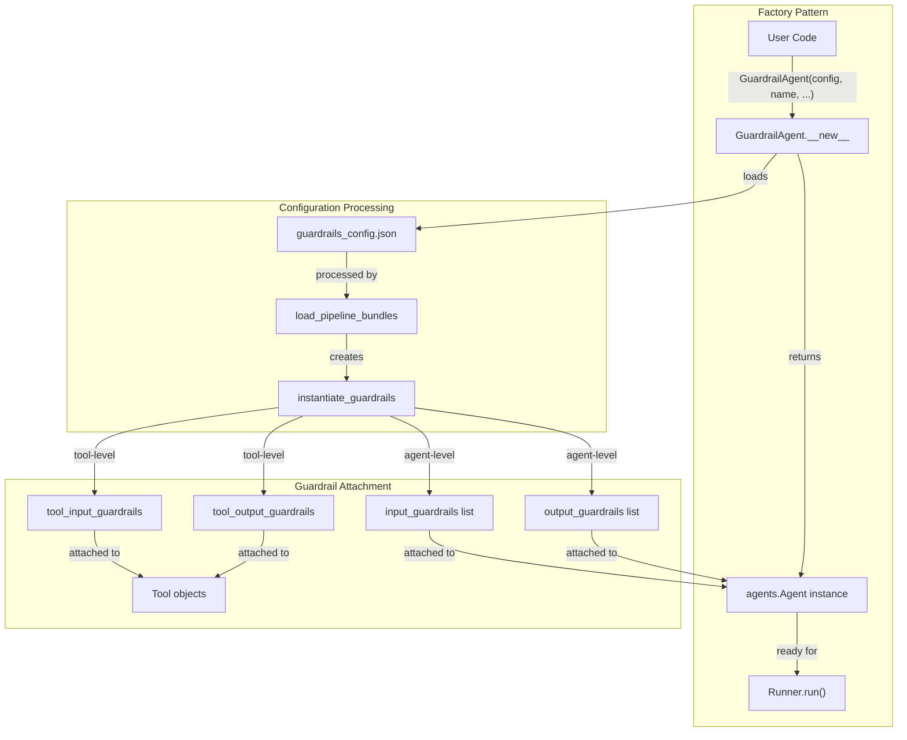
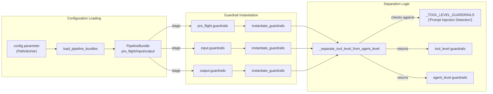
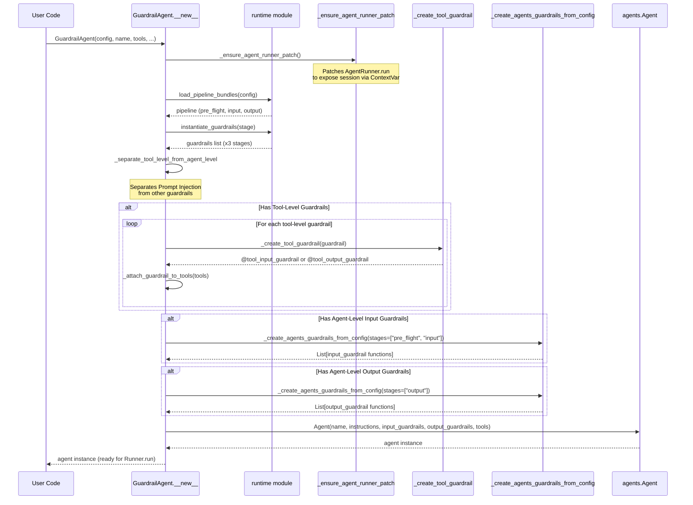
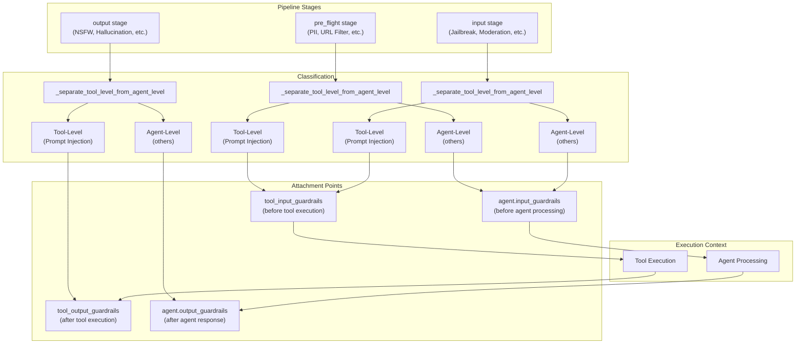
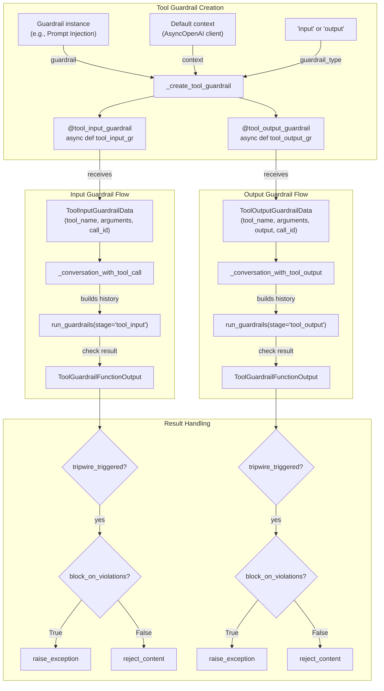
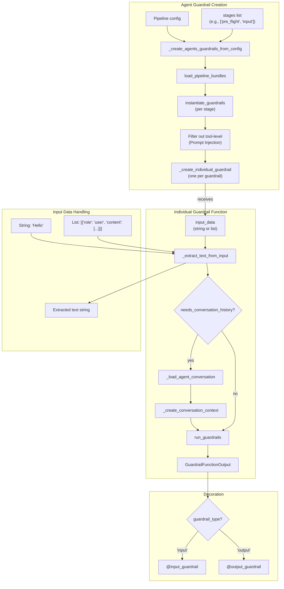
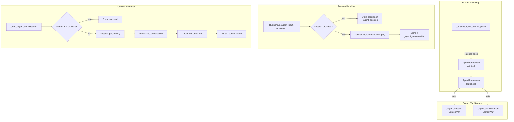
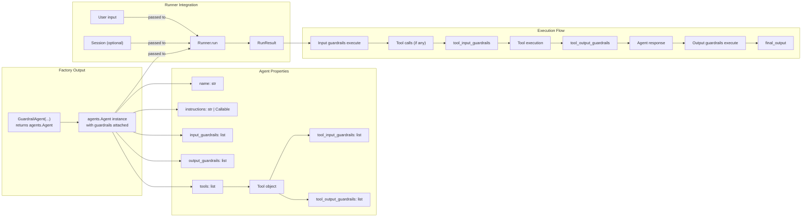

<!-- source: DeepWiki mcp.deepwiki.com · repo openai/openai-guardrails-python · page 5.1 GuardrailAgent Overview · fetched 2026-10-26 -->

# GuardrailAgent Overview

<details>
<summary>Relevant source files</summary>

The following files were used as context for generating this wiki page:

- [README.md](README.md)
- [docs/assets/images/guardrails-python-config-screenshot-100pct-q70.webp](docs/assets/images/guardrails-python-config-screenshot-100pct-q70.webp)
- [examples/basic/agents_sdk.py](examples/basic/agents_sdk.py)
- [src/guardrails/_streaming.py](src/guardrails/_streaming.py)
- [src/guardrails/agents.py](src/guardrails/agents.py)
- [tests/unit/test_agents.py](tests/unit/test_agents.py)

</details>


This page documents the `GuardrailAgent` factory class, which provides integration between the OpenAI Guardrails framework and the OpenAI Agents SDK. `GuardrailAgent` acts as a drop-in replacement for `agents.Agent`, automatically configuring guardrails from a pipeline configuration file and returning a fully configured `agents.Agent` instance ready for use with `Runner.run()`.

**Scope**: This page covers the factory pattern architecture, configuration loading, and integration mechanics. For details on the separation between tool-level and agent-level guardrails, see [Tool-Level vs Agent-Level Guardrails](#5.2). For conversation context management, see [Conversation Context in Agents](#5.3). For exception handling behavior, see [Agent Exception Handling](#5.4).

## Factory Pattern Architecture

`GuardrailAgent` is not a subclass of `agents.Agent`. Instead, it uses the factory pattern via `__new__` to create and return a standard `agents.Agent` instance with guardrails pre-configured.



**Factory Implementation Pattern**

The `__new__` method implementation is at [src/guardrails/agents.py:603-742](). Key characteristics:

| Aspect | Implementation Detail |
|--------|----------------------|
| Method | `__new__` instead of `__init__` |
| Return Type | `agents.Agent` instance (not `GuardrailAgent`) |
| Input | Pipeline config + standard `Agent` parameters |
| Output | Fully configured `Agent` with guardrails attached |

**Sources**: [src/guardrails/agents.py:1-27](), [src/guardrails/agents.py:566-742](), [tests/unit/test_agents.py:543-591]()

## Configuration Loading and Guardrail Separation

The factory loads the pipeline configuration, instantiates all guardrails, and separates them into tool-level and agent-level categories.



**Separation Constants**

The classification of guardrails is determined by the `_TOOL_LEVEL_GUARDRAILS` constant at [src/guardrails/agents.py:28-30]():

```python
_TOOL_LEVEL_GUARDRAILS = ["Prompt Injection Detection"]
```

Any guardrail whose `definition.name` matches an entry in this list is treated as tool-level. All others are agent-level. The separation logic is implemented at [src/guardrails/agents.py:125-143]().

**Sources**: [src/guardrails/agents.py:28-30](), [src/guardrails/agents.py:125-143](), [src/guardrails/agents.py:654-668](), [tests/unit/test_agents.py:260-266]()

## Agent Creation Flow

The complete agent creation flow involves multiple steps, from loading configuration to attaching guardrails to returning the configured agent.



**Key Functions in the Flow**

| Function | Location | Purpose |
|----------|----------|---------|
| `GuardrailAgent.__new__` | [agents.py:603-742]() | Main factory entry point |
| `_ensure_agent_runner_patch` | [agents.py:41-70]() | Patches `AgentRunner.run` once |
| `load_pipeline_bundles` | runtime module | Loads pipeline configuration |
| `instantiate_guardrails` | runtime module | Creates guardrail instances |
| `_separate_tool_level_from_agent_level` | [agents.py:125-143]() | Classifies guardrails |
| `_create_tool_guardrail` | [agents.py:209-355]() | Wraps tool guardrails |
| `_attach_guardrail_to_tools` | [agents.py:146-159]() | Attaches to tool objects |
| `_create_agents_guardrails_from_config` | [agents.py:421-563]() | Creates agent-level functions |

**Sources**: [src/guardrails/agents.py:603-742](), [src/guardrails/agents.py:421-563](), [src/guardrails/agents.py:209-355](), [tests/unit/test_agents.py:543-591]()

## Pipeline Stage Mapping

The factory maps pipeline stages to different guardrail attachment points based on their classification.



**Mapping Rules**

| Source Stage | Guardrail Type | Attachment Point | Execution Timing |
|--------------|---------------|------------------|------------------|
| `pre_flight` | Tool-level | `tool_input_guardrails` | Before each tool call |
| `pre_flight` | Agent-level | `agent.input_guardrails` | Before agent processing |
| `input` | Tool-level | `tool_input_guardrails` | Before each tool call |
| `input` | Agent-level | `agent.input_guardrails` | Before agent processing |
| `output` | Tool-level | `tool_output_guardrails` | After each tool call |
| `output` | Agent-level | `agent.output_guardrails` | After agent response |

The mapping logic is implemented at [src/guardrails/agents.py:710-739]().

**Sources**: [src/guardrails/agents.py:654-739](), [src/guardrails/agents.py:28-30](), [tests/unit/test_agents.py:543-591]()

## Tool Guardrail Wrapping

Tool-level guardrails are wrapped in functions decorated with `@tool_input_guardrail` or `@tool_output_guardrail` from the Agents SDK.



**Wrapper Implementation**

Tool guardrail wrappers are created at [src/guardrails/agents.py:209-355](). Key aspects:

- **Conversation Building**: Uses `_conversation_with_tool_call()` [agents.py:102-110]() or `_conversation_with_tool_output()` [agents.py:113-122]() to build conversation history including the current tool interaction
- **Context Wrapping**: Uses `_create_conversation_context()` [agents.py:173-206]() to expose conversation history via `get_conversation_history()`
- **Stage Names**: Uses simple stage names `"tool_input"` and `"tool_output"` when calling `run_guardrails()`
- **Error Handling**: Wraps guardrail execution errors based on `raise_guardrail_errors` parameter

**Sources**: [src/guardrails/agents.py:209-355](), [src/guardrails/agents.py:102-122](), [src/guardrails/agents.py:173-206](), [tests/unit/test_agents.py:269-351]()

## Agent Guardrail Creation

Agent-level guardrails are created as individual functions decorated with `@input_guardrail` or `@output_guardrail` from the Agents SDK.



**Function Creation Details**

The `_create_agents_guardrails_from_config()` function at [src/guardrails/agents.py:421-563]() creates one function per individual guardrail:

| Aspect | Implementation |
|--------|---------------|
| **Granularity** | One function per guardrail (not one function for all) |
| **Concurrency** | Agents SDK runs them concurrently |
| **Input Handling** | Supports both string and conversation list formats via `_extract_text_from_input()` |
| **Conversation Loading** | Only loads if `metadata.uses_conversation_history` is True |
| **Stage Name** | Uses guardrail type (`"input"` or `"output"`) as stage name |
| **Function Naming** | Sets `__name__` to guardrail name with underscores |

**Sources**: [src/guardrails/agents.py:421-563](), [src/guardrails/agents.py:358-418](), [src/guardrails/agents.py:78-91](), [tests/unit/test_agents.py:385-451]()

## Conversation Context Management

The factory patches `AgentRunner.run` to expose conversation state via ContextVars, enabling conversation-aware guardrails.



**ContextVar Usage**

Two ContextVars track conversation state at [src/guardrails/agents.py:33-37]():

- `_agent_session`: Stores `agents.Session` object if provided to `Runner.run()`
- `_agent_conversation`: Stores normalized conversation tuple as fallback

The patching mechanism at [src/guardrails/agents.py:41-70]() ensures guardrails can access conversation history regardless of whether a session is used.

For detailed information on conversation context propagation, see [Conversation Context in Agents](#5.3).

**Sources**: [src/guardrails/agents.py:33-70](), [src/guardrails/agents.py:78-99](), [tests/unit/test_agents.py:159-207]()

## Usage Patterns

### Basic Usage

```python
from guardrails import GuardrailAgent
from agents import Runner

# Create agent with guardrails from config
agent = GuardrailAgent(
    config="guardrails_config.json",
    name="Customer Support Agent",
    instructions="You help customers with questions.",
    tools=[get_weather, book_appointment],
)

# Use with Agents SDK Runner
result = await Runner.run(agent, "What's the weather in Tokyo?")
```

### With Session for Multi-Turn

```python
from agents import SQLiteSession

session = SQLiteSession("my-conversation")

agent = GuardrailAgent(
    config="guardrails_config.json",
    name="Assistant",
    instructions="You are a helpful assistant.",
)

# Conversation history automatically tracked via session
result = await Runner.run(agent, "Hello", session=session)
result = await Runner.run(agent, "Tell me more", session=session)
```

### With Custom Error Handling

```python
agent = GuardrailAgent(
    config="guardrails_config.json",
    name="Strict Agent",
    instructions="You follow policies strictly.",
    raise_guardrail_errors=True,  # Raise on guardrail failures
    block_on_tool_violations=True,  # Halt on tool violations
    tools=[sensitive_tool],
)
```

**Configuration Parameters**

| Parameter | Type | Default | Description |
|-----------|------|---------|-------------|
| `config` | `str \| Path \| dict` | (required) | Pipeline configuration |
| `name` | `str` | (required) | Agent name |
| `instructions` | `str \| Callable \| None` | `None` | Agent instructions (can be dynamic) |
| `raise_guardrail_errors` | `bool` | `False` | Raise exceptions on guardrail execution errors |
| `block_on_tool_violations` | `bool` | `False` | Use `raise_exception` vs `reject_content` for tool violations |
| `tools` | `list[Any]` | (via kwargs) | List of tool objects |
| `input_guardrails` | `list[Callable]` | (via kwargs) | Additional user input guardrails (merged with config) |
| `output_guardrails` | `list[Callable]` | (via kwargs) | Additional user output guardrails (merged with config) |

**Sources**: [examples/basic/agents_sdk.py:1-93](), [README.md:66-93](), [src/guardrails/agents.py:603-643](), [tests/unit/test_agents.py:640-719]()

## Return Value and Integration

The factory returns a fully configured `agents.Agent` instance, ready for use with the standard Agents SDK `Runner`.



**Integration Characteristics**

| Aspect | Details |
|--------|---------|
| **Type Compatibility** | Returns `agents.Agent`, not `GuardrailAgent` |
| **SDK Compatibility** | Works with all `Runner` methods and features |
| **Session Support** | Automatically integrates with `agents.Session` |
| **Tracing Support** | Compatible with `RunConfig(tracing_disabled=...)` |
| **Exception Types** | Raises `InputGuardrailTripwireTriggered` / `OutputGuardrailTripwireTriggered` |

The agent is created at [src/guardrails/agents.py:742]() as a standard `Agent` instance with all guardrails pre-configured.

**Sources**: [src/guardrails/agents.py:636-742](), [examples/basic/agents_sdk.py:53-89](), [README.md:66-93](), [tests/unit/test_agents.py:543-591]()

---

