<!-- source: DeepWiki mcp.deepwiki.com · repo openai/openai-guardrails-python · page 5.3 Conversation Context in Agents · fetched 2026-10-26 -->

# Conversation Context in Agents

<details>
<summary>Relevant source files</summary>

The following files were used as context for generating this wiki page:

- [examples/basic/agents_sdk.py](examples/basic/agents_sdk.py)
- [src/guardrails/_streaming.py](src/guardrails/_streaming.py)
- [src/guardrails/agents.py](src/guardrails/agents.py)
- [tests/unit/test_agents.py](tests/unit/test_agents.py)

</details>


This page explains how conversation history is tracked and made available to guardrails when using `GuardrailAgent` with the OpenAI Agents SDK. It covers the ContextVar-based state management system, AgentRunner patching mechanism, and the conversation loading/caching infrastructure that enables conversation-aware guardrails to analyze multi-turn interactions.

For information about GuardrailAgent's factory pattern and configuration, see [GuardrailAgent Overview](#5.1). For details on how tool-level versus agent-level guardrails are separated and applied, see [Tool-Level vs Agent-Level Guardrails](#5.2).

---

## Overview

Conversation-aware guardrails like Jailbreak Detection and Prompt Injection Detection require access to previous turns of dialogue to detect multi-turn attack patterns. When using the Agents SDK, conversation history can come from two sources:

1. **Agents SDK Session**: Persistent conversation storage via `session.get_items()`
2. **Fallback Conversation**: Normalized from the input passed to `Runner.run()`

The conversation context system uses Python's `contextvars` module to expose this history thread-safely during guardrail execution, and patches `AgentRunner.run` to populate the context variables at the start of each agent run.

**Key Design Goals:**
- Thread-safe conversation access for concurrent guardrail execution
- Zero configuration required for users (automatic via patching)
- Support both stateful (session-based) and stateless (single-turn) operation
- Minimize redundant session API calls through caching

Sources: [src/guardrails/agents.py:1-124]()

---

## ContextVar State Management

The conversation context system uses two module-level `ContextVar` instances to store conversation state:

```python
_agent_session: ContextVar[Any | None]
_agent_conversation: ContextVar[tuple[dict[str, Any], ...] | None]
```

| ContextVar | Purpose | Type | Default |
|------------|---------|------|---------|
| `_agent_session` | Holds reference to Agents SDK Session object | `Any \| None` | `None` |
| `_agent_conversation` | Cached normalized conversation history | `tuple[dict, ...] \| None` | `None` |

**Why ContextVars?**

ContextVars provide isolated storage per async context, ensuring that:
- Multiple concurrent agent runs don't interfere with each other
- Guardrails executing in parallel access the correct conversation
- No global state pollution between requests

The conversation is stored as an immutable tuple to prevent accidental modification during guardrail execution.

Sources: [src/guardrails/agents.py:32-38]()

---

## AgentRunner Patching Mechanism

### Patch Application

The `_ensure_agent_runner_patch()` function performs one-time patching of `agents.run.AgentRunner.run`:

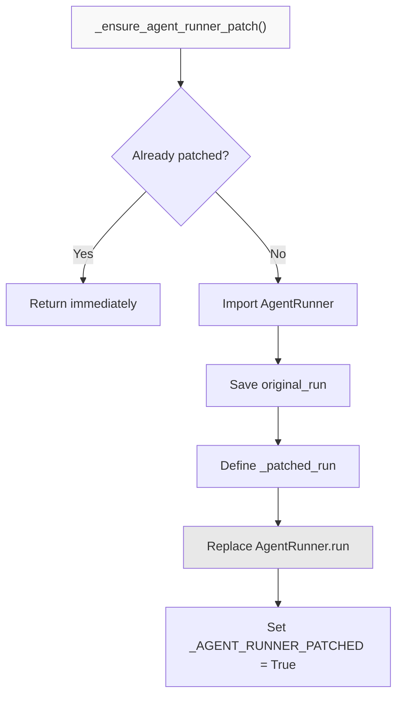

**When Patching Occurs:**
- First time `GuardrailAgent.__new__()` is called
- Only patches once per Python process (global flag)
- Silently skips if `agents` package not available

Sources: [src/guardrails/agents.py:41-71]()

### Patched Behavior

The patched `_patched_run` wrapper intercepts every agent execution:

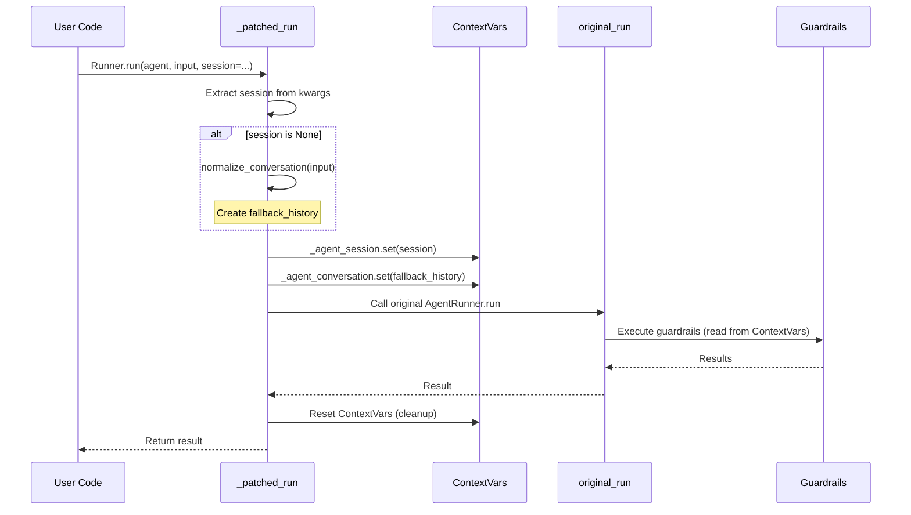

**Key Operations:**

1. **Session Extraction**: Reads `session` kwarg from `Runner.run()`
2. **Fallback Creation**: If no session, normalizes input into conversation format
3. **ContextVar Population**: Sets both session and conversation ContextVars
4. **Delegation**: Calls original `AgentRunner.run()` with all args
5. **Cleanup**: Resets ContextVars in finally block (even on exception)

Sources: [src/guardrails/agents.py:52-70]()

---

## Conversation History Loading

### Loading Strategy

The `_load_agent_conversation()` function implements a three-tier loading strategy:

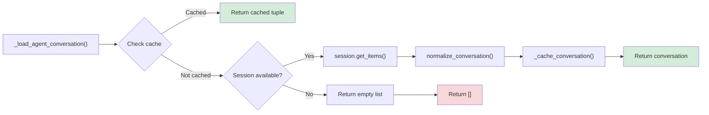

**Loading Tiers:**

1. **Cache Hit**: Return cached conversation (most common case during a single run)
2. **Session Load**: Fetch from `session.get_items()` and normalize
3. **Fallback**: Return empty list (no session, no fallback set)

Sources: [src/guardrails/agents.py:78-92]()

### Caching Mechanism

The `_cache_conversation()` function stores normalized conversation as immutable tuple:

| Function | Purpose | Input Type | Storage Type |
|----------|---------|------------|--------------|
| `_cache_conversation()` | Store normalized conversation | `list[dict]` | `tuple[dict, ...]` |
| `_load_agent_conversation()` | Retrieve and convert to list | N/A | `list[dict]` |

**Why Immutable Tuple?**
- Prevents accidental modification during guardrail execution
- Signals intent: conversation is read-only during a run
- Efficient memory sharing across concurrent guardrails

Sources: [src/guardrails/agents.py:73-76](), [tests/unit/test_agents.py:176-207]()

---

## Tool-Level Context Augmentation

Tool guardrails need conversation context that includes the current tool interaction. Two specialized functions build augmented conversation snapshots:

### Function Call Context

`_conversation_with_tool_call()` builds context for `tool_input_guardrail`:

```mermaid
graph LR
    A["ToolInputGuardrailData"] --> B["_conversation_with_tool_call()"]
    B --> C["_load_agent_conversation()"]
    C --> D["Build function_call event"]
    D --> E["merge_conversation_with_items()"]
    E --> F["_cache_conversation()"]
    F --> G["Return augmented history"]
    
    style A fill:#fff3cd
    style G fill:#d4edda
```

**Event Structure:**
```python
{
    "type": "function_call",
    "tool_name": data.context.tool_name,
    "arguments": data.context.tool_arguments,
    "call_id": data.context.tool_call_id
}
```

Sources: [src/guardrails/agents.py:102-111](), [tests/unit/test_agents.py:160-173]()

### Function Output Context

`_conversation_with_tool_output()` builds context for `tool_output_guardrail`:

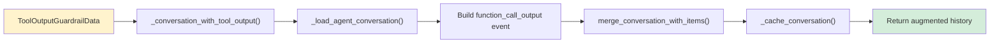

**Event Structure:**
```python
{
    "type": "function_call_output",
    "tool_name": data.context.tool_name,
    "arguments": data.context.tool_arguments,
    "output": str(data.output),
    "call_id": data.context.tool_call_id
}
```

Sources: [src/guardrails/agents.py:113-123](), [tests/unit/test_agents.py:210-222]()

### Conversation Merging

The `merge_conversation_with_items()` utility (from `guardrails.utils.conversation`) appends new events to existing history while maintaining conversation structure. This ensures tool interactions are visible as part of the conversation flow when guardrails execute.

Sources: [src/guardrails/agents.py:22](), [src/guardrails/agents.py:97-100]()

---

## Context Wrapper Pattern

### GuardrailLLMContextProto Interface

Conversation-aware guardrails expect a context object implementing the `GuardrailLLMContextProto` protocol:

```python
class GuardrailLLMContextProto(Protocol):
    guardrail_llm: AsyncOpenAI
    conversation_history: list[dict[str, Any]]
    
    def get_conversation_history(self) -> list[dict[str, Any]]:
        ...
```

### Wrapper Implementation

`_create_conversation_context()` creates a wrapper that augments any base context:

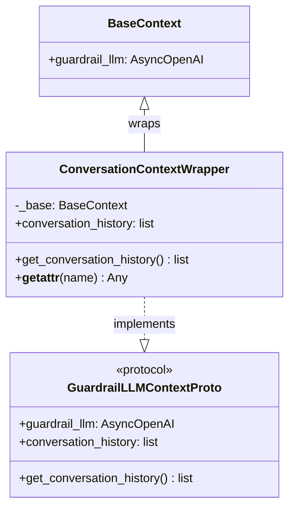

**Wrapper Behavior:**

1. **Preserves Base Context**: Delegates all attribute access to `_base`
2. **Adds Conversation Methods**: Implements `get_conversation_history()`
3. **Public Attribute**: Exposes `conversation_history` per protocol
4. **Transparent**: Guardrails see unified context with all fields

Sources: [src/guardrails/agents.py:173-207](), [tests/unit/test_agents.py:224-231]()

### Usage in Guardrails

Both tool-level and agent-level guardrails use the wrapper:

| Guardrail Type | Context Creation Location | Conversation Source |
|----------------|---------------------------|---------------------|
| Tool Input | `_create_tool_guardrail()` [src/guardrails/agents.py:249-253]() | `_conversation_with_tool_call()` |
| Tool Output | `_create_tool_guardrail()` [src/guardrails/agents.py:307-311]() | `_conversation_with_tool_output()` |
| Agent Input/Output | `_create_agents_guardrails_from_config()` [src/guardrails/agents.py:494-501]() | `_load_agent_conversation()` |

Sources: [src/guardrails/agents.py:173-207]()

---

## Session vs Fallback Behavior

### Session-Based Operation

When `Runner.run()` is called with a `session` parameter:

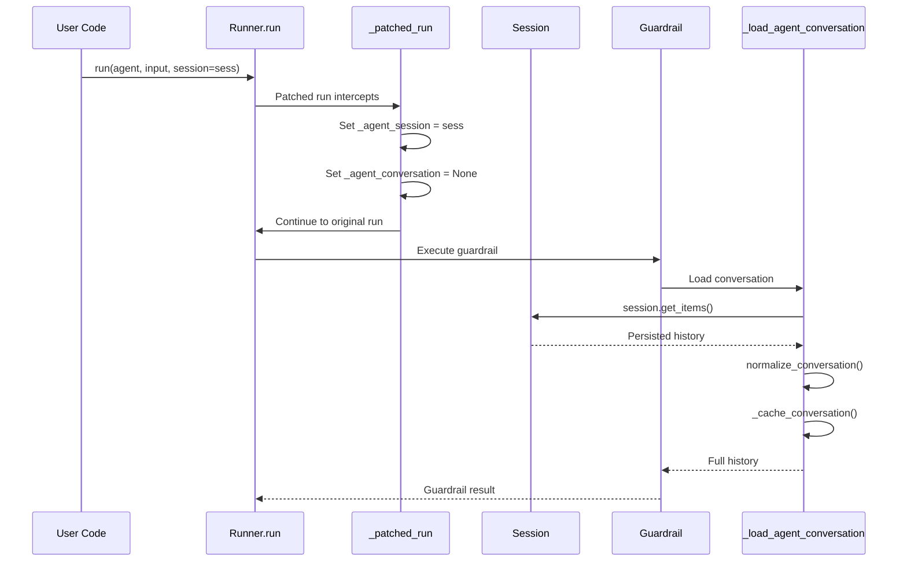

**Characteristics:**
- Conversation persists across multiple `Runner.run()` calls
- History includes all previous turns from session
- Changes automatically saved by Agents SDK
- Ideal for production chat applications

Sources: [tests/unit/test_agents.py:176-207](), [examples/basic/agents_sdk.py:56-74]()

### Fallback Operation

When `Runner.run()` is called without a `session`:

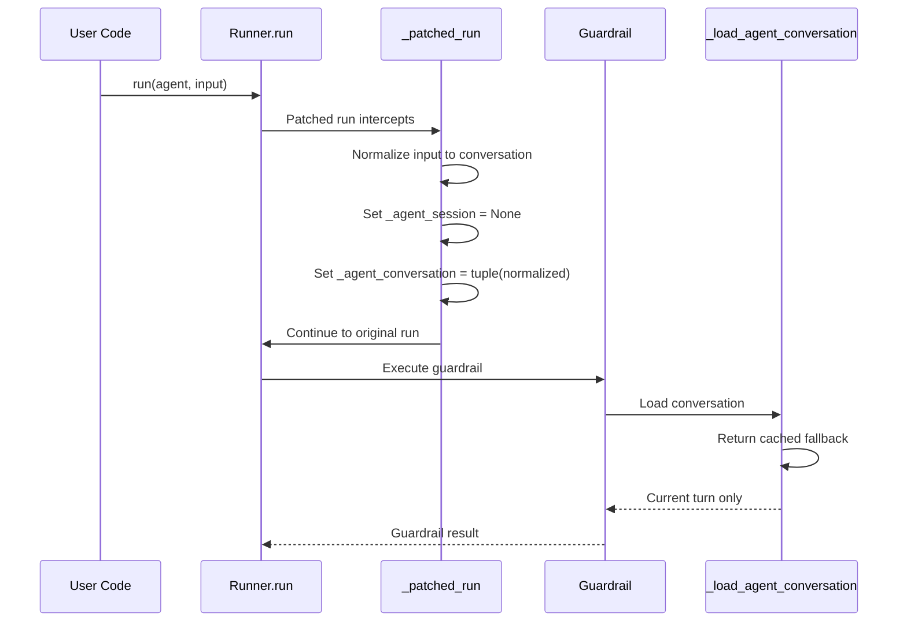

**Characteristics:**
- Stateless operation (no persistence)
- History only includes current turn's input
- Suitable for one-off requests or testing
- No database or session storage required

Sources: [src/guardrails/agents.py:56-61](), [tests/unit/test_agents.py:1155-1200]()

### Comparison Table

| Aspect | Session-Based | Fallback |
|--------|---------------|----------|
| **Persistence** | Stored in session | Lost after run |
| **History Depth** | All previous turns | Current turn only |
| **Session Parameter** | `session=SQLiteSession(...)` | `session=None` (omitted) |
| **ContextVar Values** | `_agent_session` = Session object | `_agent_session` = None |
| | `_agent_conversation` initially None | `_agent_conversation` = normalized input |
| **Use Cases** | Production chat, multi-turn guardrails | Testing, single-turn checks |

Sources: [src/guardrails/agents.py:54-67]()

---

## Integration with Guardrail Execution

### Agent-Level Guardrails

Agent-level guardrails receive conversation context when they need it:

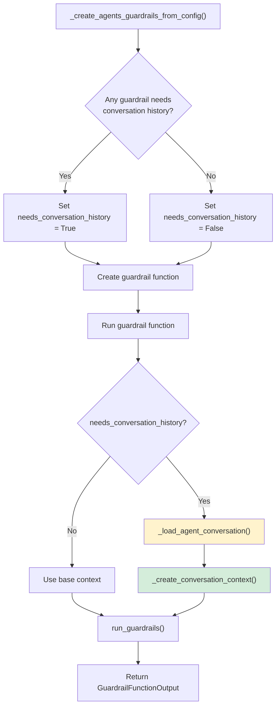

**Optimization:**
The system checks `guardrail.definition.metadata.uses_conversation_history` to avoid loading conversation unnecessarily. This prevents redundant session API calls for guardrails that don't need historical context.

Sources: [src/guardrails/agents.py:476-502](), [tests/unit/test_agents.py:1073-1152]()

### Tool-Level Guardrails

Tool-level guardrails always receive augmented conversation including the current tool interaction:

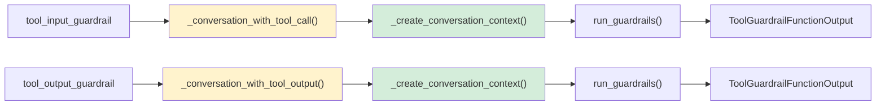

Tool guardrails always build conversation context because they need to analyze tool interactions in the context of the conversation flow, particularly for Prompt Injection Detection.

Sources: [src/guardrails/agents.py:244-296](), [src/guardrails/agents.py:301-355]()

---

## Example: Multi-Turn Conversation Flow

The following diagram illustrates how conversation context is tracked across multiple turns with a session:

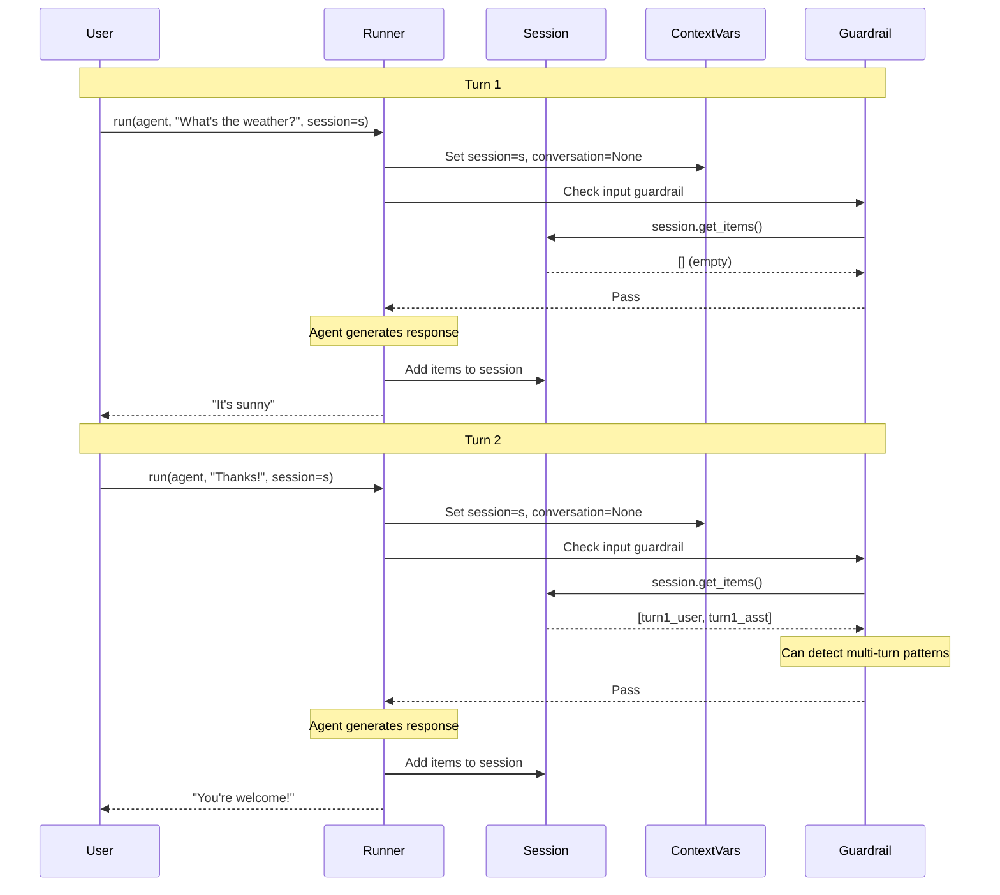

Sources: [examples/basic/agents_sdk.py:53-89](), [tests/unit/test_agents.py:1076-1152]()

---

## Best Practices

### Using Sessions

For production applications with conversation-aware guardrails:

```python
from agents import Runner, SQLiteSession
from guardrails import GuardrailAgent

# Create persistent session
session = SQLiteSession("app-session")

agent = GuardrailAgent(
    config="guardrails_config.json",
    name="Assistant",
    instructions="You are a helpful assistant."
)

# Session persists across calls
result = await Runner.run(agent, "First message", session=session)
result = await Runner.run(agent, "Follow-up message", session=session)
```

**When to use:**
- Production chat applications
- Multi-turn attack detection (Jailbreak, Prompt Injection)
- User-specific conversation history
- Long-running conversations

Sources: [examples/basic/agents_sdk.py:56-74]()

### Stateless Operation

For testing or single-turn requests:

```python
agent = GuardrailAgent(
    config="guardrails_config.json",
    name="Assistant",
    instructions="You are a helpful assistant."
)

# No session - each call is independent
result = await Runner.run(agent, "One-off question")
```

**When to use:**
- Unit testing guardrails
- One-off queries without conversation
- Stateless API endpoints
- Simple content filtering

Sources: [tests/unit/test_agents.py:1155-1200]()

### Custom Context

For advanced use cases needing custom guardrail context:

```python
from openai import AsyncOpenAI

# The context parameter in _create_agents_guardrails_from_config
# allows overriding the default AsyncOpenAI client
custom_context = CustomContext(
    guardrail_llm=AsyncOpenAI(api_key="custom-key")
)
```

Sources: [src/guardrails/agents.py:466-474]()

---

## Implementation Notes

### Thread Safety

ContextVars provide async-context-local storage, ensuring:
- Each `Runner.run()` call has isolated conversation state
- Concurrent agent runs don't interfere
- Nested async calls maintain separate contexts

Sources: [src/guardrails/agents.py:32-38]()

### Memory Efficiency

The caching mechanism prevents redundant session loads:
- First guardrail loads from session
- Subsequent guardrails in same run use cache
- Cache cleared automatically at run completion

Sources: [src/guardrails/agents.py:73-92]()

### Error Handling

ContextVar cleanup happens in finally block:
- Guarantees cleanup even on exception
- Prevents context leakage between runs
- Token-based reset ensures proper restoration

Sources: [src/guardrails/agents.py:63-67]()

---

