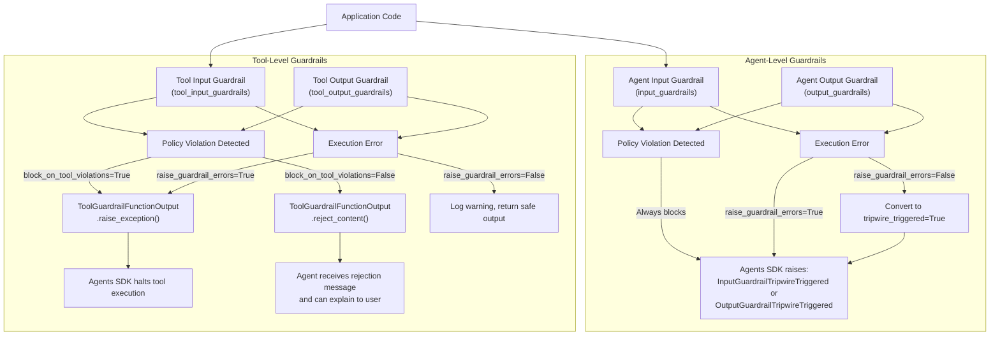
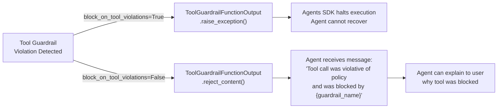
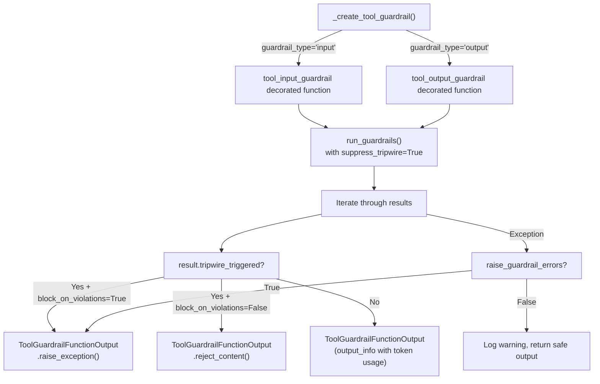
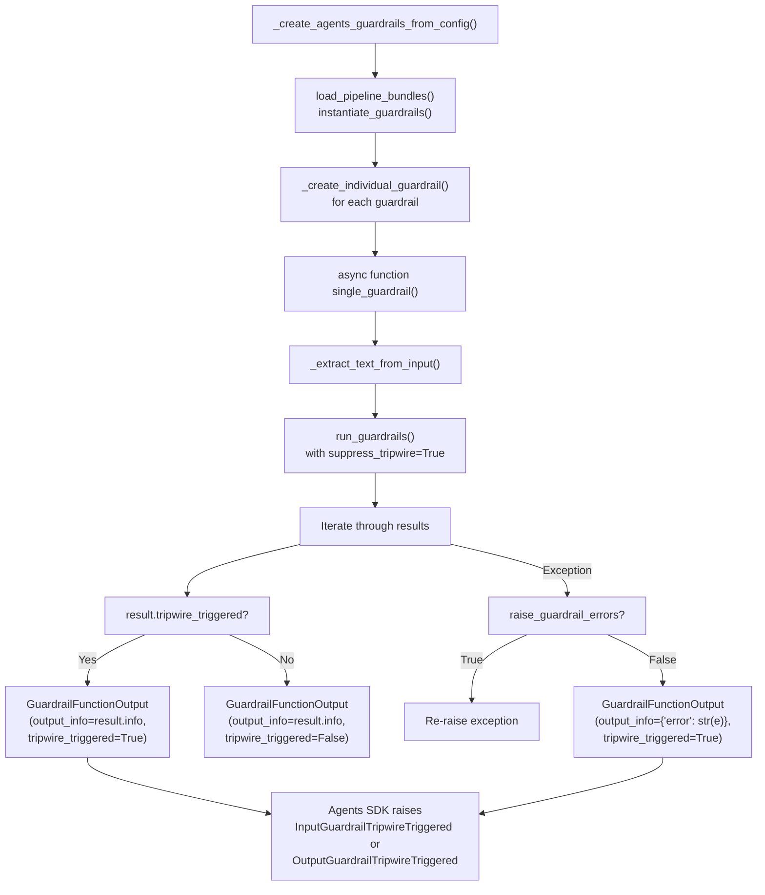

<!-- source: DeepWiki mcp.deepwiki.com · repo openai/openai-guardrails-python · page 5.4 Agent Exception Handling · fetched 2026-10-26 -->

# Agent Exception Handling

<details>
<summary>Relevant source files</summary>

The following files were used as context for generating this wiki page:

- [examples/basic/agents_sdk.py](examples/basic/agents_sdk.py)
- [src/guardrails/_streaming.py](src/guardrails/_streaming.py)
- [src/guardrails/agents.py](src/guardrails/agents.py)
- [tests/unit/test_agents.py](tests/unit/test_agents.py)

</details>


This page documents exception handling behavior for guardrails in `GuardrailAgent` when integrating with the OpenAI Agents SDK. It covers the two configuration parameters that control error propagation and violation responses, and explains the distinction between agent-level and tool-level exception handling.

For information about GuardrailAgent configuration and usage patterns, see [GuardrailAgent Overview](#5.1). For details on separating tool-level from agent-level guardrails, see [Tool-Level vs Agent-Level Guardrails](#5.2).

---

## Overview

The `GuardrailAgent` class provides two boolean parameters that control exception handling behavior:

| Parameter | Scope | Purpose | Default |
|-----------|-------|---------|---------|
| `raise_guardrail_errors` | All guardrails | Controls whether guardrail execution errors propagate as exceptions or are treated as safe | `False` |
| `block_on_tool_violations` | Tool-level only | Controls whether tool guardrail violations halt execution (raise) or allow continuation (reject) | `False` |

These parameters affect different aspects of the guardrail lifecycle:

- **Execution errors**: When a guardrail check fails to execute (network error, invalid configuration, etc.), `raise_guardrail_errors` determines the behavior
- **Policy violations**: When a guardrail detects violative content, the behavior depends on the guardrail level and `block_on_tool_violations`

**Sources:** [src/guardrails/agents.py:608-642]()

---

## Exception Flow Architecture



**Exception Flow for Agent-Level and Tool-Level Guardrails**

This diagram shows how exceptions flow through both agent-level and tool-level guardrails. Agent-level guardrails always block on violations, while tool-level guardrails can either block or allow continuation based on `block_on_tool_violations`.

**Sources:** [src/guardrails/agents.py:209-356](), [src/guardrails/agents.py:421-563]()

---

## Agent-Level Exception Handling

Agent-level guardrails (attached via `input_guardrails` and `output_guardrails` parameters) use the Agents SDK's `GuardrailFunctionOutput` return type and always block execution when violations are detected.

### Violation Handling

When an agent-level guardrail detects a policy violation:

1. The guardrail function returns `GuardrailFunctionOutput(tripwire_triggered=True, output_info=...)`
2. The Agents SDK automatically raises either `InputGuardrailTripwireTriggered` or `OutputGuardrailTripwireTriggered`
3. Execution stops and the exception propagates to the application

This behavior is **not configurable** - agent-level guardrails always halt execution on violations to prevent unsafe agent interactions.

**Sources:** [src/guardrails/agents.py:515-527]()

### Error Handling

When an agent-level guardrail encounters an execution error (e.g., network failure, invalid configuration), the behavior depends on `raise_guardrail_errors`:

#### With `raise_guardrail_errors=False` (default)

The error is converted to a tripwire violation:

```python
# From _create_agents_guardrails_from_config
except Exception as e:
    if raise_guardrail_errors:
        raise
    else:
        # Treat errors as tripwires
        return GuardrailFunctionOutput(
            output_info={
                "error": str(e),
                "guardrail_name": guardrail.definition.name,
            },
            tripwire_triggered=True,
        )
```

The Agents SDK then raises `InputGuardrailTripwireTriggered` or `OutputGuardrailTripwireTriggered` with the error details in `output_info`.

**Sources:** [src/guardrails/agents.py:529-542]()

#### With `raise_guardrail_errors=True`

The original exception propagates immediately:

```python
except Exception as e:
    if raise_guardrail_errors:
        raise  # Preserves full traceback
```

This allows developers to distinguish between policy violations and infrastructure errors during development and testing.

**Sources:** [src/guardrails/agents.py:529-532](), [tests/unit/test_agents.py:487-511]()

---

## Tool-Level Exception Handling

Tool-level guardrails (attached via `tool_input_guardrails` and `tool_output_guardrails` on tool objects) use the Agents SDK's `ToolGuardrailFunctionOutput` return type, which provides two distinct response methods:

1. **`raise_exception()`**: Signals that tool execution should halt
2. **`reject_content()`**: Signals that the tool call was blocked, but the agent can continue and explain the rejection

### Violation Handling

The `block_on_tool_violations` parameter determines which method is used when a tool-level guardrail detects a violation:



**Tool-Level Violation Response Methods**

**Sources:** [src/guardrails/agents.py:209-214](), [src/guardrails/agents.py:276-284](), [src/guardrails/agents.py:336-342]()

#### Example: `block_on_tool_violations=False` (default)

```python
# Tool guardrail detects prompt injection
if result.tripwire_triggered:
    observation = result.info.get("observation", f"{guardrail_name} triggered")
    message = f"Tool call was violative of policy and was blocked by {guardrail_name}: {observation}."
    
    if block_on_violations:
        return ToolGuardrailFunctionOutput.raise_exception(output_info=result.info)
    else:
        # Agent receives this message and can explain to user
        return ToolGuardrailFunctionOutput.reject_content(
            message=message, 
            output_info=result.info
        )
```

With `reject_content()`, the agent sees:

```
Tool call was violative of policy and was blocked by Prompt Injection Detection: 
Detected attempt to manipulate tool arguments with injected instructions.
```

The agent can then respond to the user: "I cannot execute that tool call because it appears to contain an injection attack. Can I help you with something else?"

**Sources:** [src/guardrails/agents.py:276-284](), [tests/unit/test_agents.py:270-298]()

#### Example: `block_on_tool_violations=True`

```python
# Same code path, but now raises exception
if block_on_violations:
    return ToolGuardrailFunctionOutput.raise_exception(output_info=result.info)
```

With `raise_exception()`, the Agents SDK halts tool execution and the agent cannot recover. The application must catch and handle the exception.

**Sources:** [src/guardrails/agents.py:281-282](), [tests/unit/test_agents.py:302-325]()

### Error Handling

When a tool-level guardrail encounters an execution error, the behavior depends on `raise_guardrail_errors`:

#### With `raise_guardrail_errors=False` (default)

The error is logged and a safe output is returned, allowing execution to continue:

```python
except Exception as e:
    if raise_guardrail_errors:
        return ToolGuardrailFunctionOutput.raise_exception(
            output_info={"error": f"{guardrail_name} check error: {str(e)}"}
        )
    else:
        logger.warning(f"{guardrail_name} check error (treating as safe): {e}")
        return ToolGuardrailFunctionOutput(
            output_info=f"{guardrail_name} check skipped due to error"
        )
```

This treats infrastructure errors as "safe" and allows the tool to execute, which is appropriate for production environments where guardrail availability should not block user requests.

**Sources:** [src/guardrails/agents.py:290-295](), [src/guardrails/agents.py:348-353]()

#### With `raise_guardrail_errors=True`

The error is converted to a `raise_exception()` response:

```python
if raise_guardrail_errors:
    return ToolGuardrailFunctionOutput.raise_exception(
        output_info={"error": f"{guardrail_name} check error: {str(e)}"}
    )
```

This halts tool execution, allowing developers to diagnose infrastructure issues during development.

**Sources:** [src/guardrails/agents.py:291-292](), [tests/unit/test_agents.py:328-351]()

---

## Exception Types Reference

The Agents SDK defines two exception types that are raised when agent-level guardrails trigger:

| Exception | Raised By | Context |
|-----------|-----------|---------|
| `InputGuardrailTripwireTriggered` | Agents SDK | When an agent input guardrail returns `tripwire_triggered=True` |
| `OutputGuardrailTripwireTriggered` | Agents SDK | When an agent output guardrail returns `tripwire_triggered=True` |

Both exceptions provide:
- `guardrail_result.guardrail.name`: The name of the triggered guardrail
- `guardrail_result.output.output_info`: The `info` dict containing violation details

### Usage Example

```python
from agents import (
    InputGuardrailTripwireTriggered,
    OutputGuardrailTripwireTriggered,
    Runner,
)
from guardrails import GuardrailAgent

agent = GuardrailAgent(
    config="guardrails_config.json",
    name="Support Agent",
    instructions="Help users with questions.",
)

try:
    result = await Runner.run(agent, user_input, session=session)
    print(f"Assistant: {result.final_output}")
except InputGuardrailTripwireTriggered as exc:
    print(f"🛑 Input blocked by {exc.guardrail_result.guardrail.name}")
    print(f"Details: {exc.guardrail_result.output.output_info}")
except OutputGuardrailTripwireTriggered as exc:
    print(f"🛑 Output blocked by {exc.guardrail_result.guardrail.name}")
    print(f"Details: {exc.guardrail_result.output.output_info}")
```

**Sources:** [examples/basic/agents_sdk.py:79-88]()

---

## Configuration Decision Matrix

The following table summarizes exception handling behavior for all combinations of parameters and error conditions:

| Guardrail Level | Condition | `raise_guardrail_errors=False` | `raise_guardrail_errors=True` |
|-----------------|-----------|-------------------------------|------------------------------|
| **Agent Input** | Policy violation | Agents SDK raises `InputGuardrailTripwireTriggered` | Agents SDK raises `InputGuardrailTripwireTriggered` |
| **Agent Input** | Execution error | Converts to tripwire → Agents SDK raises `InputGuardrailTripwireTriggered` | Original exception propagates |
| **Agent Output** | Policy violation | Agents SDK raises `OutputGuardrailTripwireTriggered` | Agents SDK raises `OutputGuardrailTripwireTriggered` |
| **Agent Output** | Execution error | Converts to tripwire → Agents SDK raises `OutputGuardrailTripwireTriggered` | Original exception propagates |
| **Tool** (violation) | `block_on_tool_violations=False` | Returns `reject_content()`, agent continues | Returns `reject_content()`, agent continues |
| **Tool** (violation) | `block_on_tool_violations=True` | Returns `raise_exception()`, execution halts | Returns `raise_exception()`, execution halts |
| **Tool** | Execution error | Logs warning, returns safe output | Returns `raise_exception()`, execution halts |

---

## Configuration Examples

### Development Configuration

For development and testing, use `raise_guardrail_errors=True` to surface infrastructure errors immediately:

```python
agent = GuardrailAgent(
    config="guardrails_config.json",
    name="Dev Agent",
    instructions="Testing guardrails behavior.",
    raise_guardrail_errors=True,  # Surface all errors
    block_on_tool_violations=True,  # Strict tool checking
    tools=[my_tool],
)
```

**Behavior:**
- Guardrail execution errors propagate as exceptions
- Tool violations halt execution
- Easier to diagnose configuration and infrastructure issues

**Sources:** [src/guardrails/agents.py:608-609]()

### Production Configuration

For production, use defaults to maximize availability and allow graceful degradation:

```python
agent = GuardrailAgent(
    config="guardrails_config.json",
    name="Production Agent",
    instructions="Help users with questions.",
    raise_guardrail_errors=False,  # Treat errors as safe (default)
    block_on_tool_violations=False,  # Agent can explain rejections (default)
    tools=[my_tool],
)
```

**Behavior:**
- Guardrail execution errors are logged but don't block requests
- Tool violations allow agent to explain rejection to user
- Service remains available even if guardrail infrastructure has issues

**Sources:** [src/guardrails/agents.py:608-609]()

### Strict Production Configuration

For high-security production environments where tool execution must be strictly controlled:

```python
agent = GuardrailAgent(
    config="guardrails_config.json",
    name="Secure Agent",
    instructions="Handle sensitive operations.",
    raise_guardrail_errors=False,  # Don't block on infrastructure errors
    block_on_tool_violations=True,  # Strict tool blocking
    tools=[sensitive_tool],
)
```

**Behavior:**
- Guardrail execution errors are logged but don't block requests
- Tool violations immediately halt execution (no explanation possible)
- Maximum security for tool execution while maintaining service availability

**Sources:** [src/guardrails/agents.py:608-642]()

---

## Implementation Details

### Tool Guardrail Factory

The `_create_tool_guardrail()` function creates tool-level guardrail wrappers that implement the exception handling logic:



**Tool Guardrail Exception Handling Flow**

**Sources:** [src/guardrails/agents.py:209-356]()

### Agent Guardrail Factory

The `_create_agents_guardrails_from_config()` function creates agent-level guardrail wrappers:



**Agent Guardrail Exception Handling Flow**

**Sources:** [src/guardrails/agents.py:421-563]()

---

## Testing Exception Handling

The test suite verifies exception handling behavior across all configurations:

| Test | File | Lines | Verifies |
|------|------|-------|----------|
| `test_create_tool_guardrail_rejects_on_tripwire` | tests/unit/test_agents.py | 270-298 | Tool guardrail uses `reject_content()` with `block_on_violations=False` |
| `test_create_tool_guardrail_blocks_on_violation` | tests/unit/test_agents.py | 302-325 | Tool guardrail uses `raise_exception()` with `block_on_violations=True` |
| `test_create_tool_guardrail_propagates_errors` | tests/unit/test_agents.py | 328-351 | Tool guardrail propagates errors with `raise_guardrail_errors=True` |
| `test_create_agents_guardrails_from_config_tripwire` | tests/unit/test_agents.py | 420-450 | Agent guardrail converts violations to tripwires |
| `test_create_agents_guardrails_from_config_error` | tests/unit/test_agents.py | 454-483 | Agent guardrail converts errors to tripwires with `raise_guardrail_errors=False` |
| `test_create_agents_guardrails_from_config_error_raises` | tests/unit/test_agents.py | 487-511 | Agent guardrail propagates errors with `raise_guardrail_errors=True` |

**Sources:** [tests/unit/test_agents.py:270-511]()

---

