<!-- source: DeepWiki mcp.deepwiki.com · repo openai/openai-guardrails-python · page 6 Built-in Guardrails · fetched 2026-10-26 -->

# Built-in Guardrails

<details>
<summary>Relevant source files</summary>

The following files were used as context for generating this wiki page:

- [README.md](README.md)
- [docs/assets/images/guardrails-python-config-screenshot-100pct-q70.webp](docs/assets/images/guardrails-python-config-screenshot-100pct-q70.webp)

</details>


This page provides a comprehensive overview of all built-in guardrail checks included in the OpenAI Guardrails Python package. Each guardrail implements a specific safety or compliance check that can be applied at different stages of the LLM interaction pipeline.

For detailed information about individual guardrails, see the child pages under this section (#6.1-#6.10). For information about how to configure and execute these guardrails, see [Runtime Execution Model](#3.5) and [Configuration Files](#2.2). For information about creating custom guardrails, see [LLM-Based Guardrail Framework](#6.8).

---

## Guardrail Categories

Built-in guardrails are organized into two primary categories based on their execution engine:

### API-Based Guardrails

API-based guardrails leverage external services or specialized libraries for content analysis. These guardrails typically have lower latency and more deterministic behavior than LLM-based checks.

| Guardrail | Description | Engine | Stage Compatibility |
|-----------|-------------|--------|-------------------|
| **Moderation** | Content moderation using OpenAI's Moderation API across 13 categories | API | input, output |
| **URL Filter** | Domain allowlist/blocklist validation and URL filtering | API | input, pre_flight |
| **Contains PII** | Personally Identifiable Information detection using Presidio framework | API | input, output, pre_flight |

### LLM-Based Guardrails

LLM-based guardrails use language models to perform nuanced content analysis. These guardrails can be conversation-aware and support multi-turn reasoning.

| Guardrail | Description | Engine | Stage Compatibility | Conversation Aware |
|-----------|-------------|--------|--------------------|--------------------|
| **Jailbreak** | Detects jailbreak attempts using 7-technique taxonomy | LLM | input | Yes |
| **NSFW Text** | Detects workplace-inappropriate content | LLM | output | No |
| **Hallucination Detection** | Validates responses against vector stores and file search | LLM | output | No |
| **Prompt Injection** | Detects prompt injection in tool calls and validates intent alignment | LLM | input | Yes |
| **Off Topic Prompts** | Ensures prompts stay within defined business scope | LLM | input | Yes |
| **User-defined LLM** | Custom LLM-based guardrails with user-provided system prompts | LLM | input, output | Configurable |

**Sources:** [README.md:183-195]()

---

## Guardrail Registry System

All built-in guardrails register themselves with the `default_spec_registry`, which maintains metadata about each guardrail's capabilities and configuration schema.

```mermaid
graph TB
    subgraph "Registry Components"
        Registry["default_spec_registry<br/>(Central Registry)"]
        Metadata["GuardrailSpecMetadata<br/>- spec_id: str<br/>- engine: 'API' | 'LLM'<br/>- media_type: 'text' | 'conversation'<br/>- stage_compatibility"]
    end
    
    subgraph "API-Based Guardrails"
        Mod["Moderation<br/>src/guardrails/checks/moderation.py"]
        URL["URL Filter<br/>src/guardrails/checks/url_filter.py"]
        PII["Contains PII<br/>src/guardrails/checks/contains_pii.py"]
    end
    
    subgraph "LLM-Based Guardrails"
        JB["Jailbreak<br/>src/guardrails/checks/jailbreak.py"]
        NSFW["NSFW Text<br/>src/guardrails/checks/nsfw_text.py"]
        Hal["Hallucination Detection<br/>src/guardrails/checks/hallucination.py"]
        PI["Prompt Injection<br/>src/guardrails/checks/prompt_injection.py"]
        OT["Off Topic Prompts<br/>src/guardrails/checks/off_topic.py"]
        Custom["User-defined LLM<br/>src/guardrails/checks/custom_llm.py"]
    end
    
    Mod -->|"registers with"| Registry
    URL -->|"registers with"| Registry
    PII -->|"registers with"| Registry
    JB -->|"registers with"| Registry
    NSFW -->|"registers with"| Registry
    Hal -->|"registers with"| Registry
    PI -->|"registers with"| Registry
    OT -->|"registers with"| Registry
    Custom -->|"registers with"| Registry
    
    Registry -->|"contains"| Metadata
    
    Runtime["run_guardrails<br/>(Execution Engine)"] -->|"queries"| Registry
    Config["guardrails_config.json"] -->|"references spec_id"| Registry
```

### Registry Discovery Flow

When the runtime engine executes guardrails, it:

1. Reads `spec_id` from configuration (e.g., `"Moderation"`, `"Jailbreak"`)
2. Queries `default_spec_registry` to retrieve `GuardrailSpecMetadata`
3. Instantiates the guardrail check function using metadata
4. Executes the check with appropriate context based on metadata (e.g., conversation history for conversation-aware checks)

**Sources:** [README.md:149-154](), Diagram 4 from high-level architecture

---

## Pipeline Stage Integration

Guardrails execute at different stages of the LLM interaction pipeline. The stage determines when the check runs and what data it has access to.

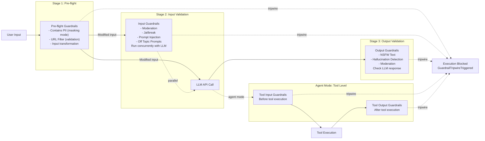

### Stage Characteristics

- **Pre-flight**: Transforms input before LLM processing (e.g., PII masking). Can modify the input that reaches the LLM.
- **Input**: Validates user input concurrently with LLM call to minimize latency. Cannot modify input.
- **Output**: Validates LLM responses before returning to user. Runs after LLM completes.
- **Tool-level** (Agents only): Validates tool inputs and outputs during agent execution.

**Sources:** Diagram 2 from high-level architecture, [README.md:66-94]()

---

## LLM-Based Guardrail Infrastructure

All LLM-based guardrails share common infrastructure provided by the `llm_base` module. This module provides factory functions, configuration schemas, and standardized interfaces for LLM-powered checks.

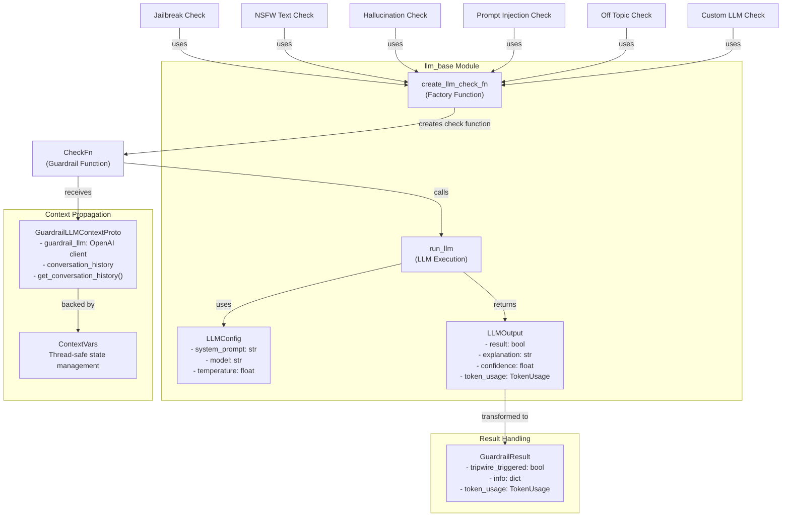

### Key Components

**`create_llm_check_fn`**: Factory function that creates standardized guardrail check functions. Accepts:
- `system_prompt`: The prompt that defines the guardrail's behavior
- `model`: LLM model to use (defaults from configuration)
- `parse_fn`: Function to parse LLM response into structured output

**`GuardrailLLMContextProto`**: Context object passed to LLM-based guardrails providing:
- `guardrail_llm`: OpenAI client configured for guardrail checks
- `conversation_history`: List of previous messages for conversation-aware checks
- `get_conversation_history()`: Method to retrieve normalized conversation history

**`LLMOutput`**: Structured output from LLM guardrail checks containing:
- `result`: Boolean indicating if check passed/failed
- `explanation`: Human-readable explanation of the decision
- `confidence`: Confidence score (0.0-1.0)
- `token_usage`: Token consumption details

**Sources:** Diagram 4 from high-level architecture

---

## Conversation-Aware Guardrails

Several guardrails support multi-turn conversation analysis, enabling them to detect attacks that span multiple messages (e.g., gradual jailbreak attempts).

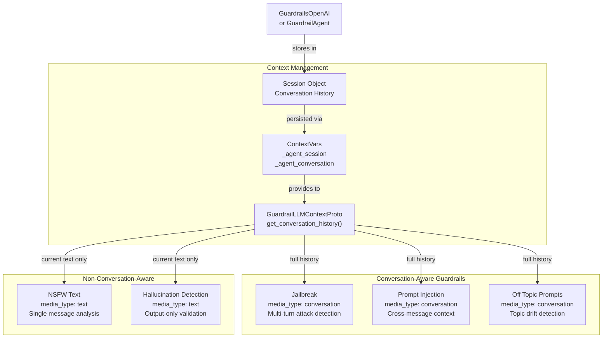

### Conversation History Format

Conversation-aware guardrails receive history in normalized format:
```json
[
  {"role": "user", "content": "First message"},
  {"role": "assistant", "content": "First response"},
  {"role": "user", "content": "Current message"}
]
```

The `GuardrailLLMContextProto.get_conversation_history()` method provides this normalized format regardless of whether the client is using chat completions, responses API, or agents SDK.

**Sources:** Diagram 6 from high-level architecture, [README.md:66-94]()

---

## API-Based Guardrail Details

### Moderation Guardrail

Uses OpenAI's Moderation API to check content across 13 predefined categories:

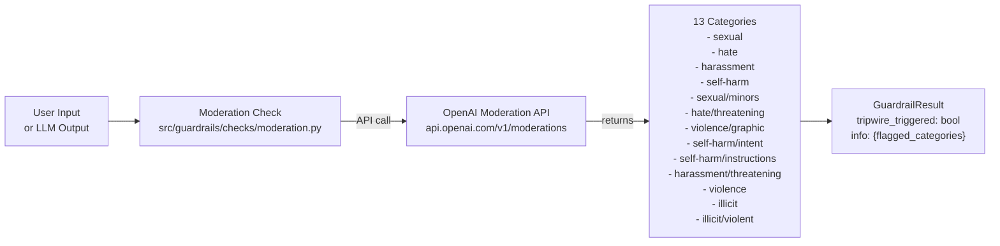

**Configuration**: Accepts category-specific thresholds and can be configured to trigger only on specific categories.

**See:** [Moderation Guardrail](#6.1) for detailed documentation.

### URL Filter Guardrail

Validates URLs against allowlists and blocklists:

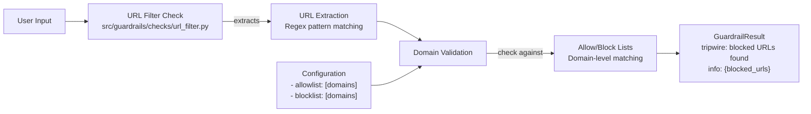

**Configuration**: Supports both domain-level and full URL matching with wildcard patterns.

**See:** [PII Detection and URL Filtering](#6.6) for detailed documentation.

### Contains PII Guardrail

Detects and optionally masks Personally Identifiable Information using Microsoft's Presidio framework:

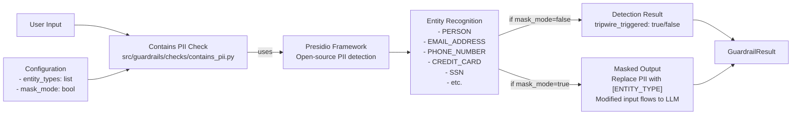

**Configuration**: 
- `entity_types`: List of PII entity types to detect
- `mask_mode`: If true, runs in pre_flight stage and masks detected PII

**See:** [PII Detection and URL Filtering](#6.6) for detailed documentation.

**Sources:** [README.md:183-195]()

---

## LLM-Based Guardrail Details

### Jailbreak Detection

Detects jailbreak attempts using a 7-technique taxonomy with multi-turn conversation analysis:

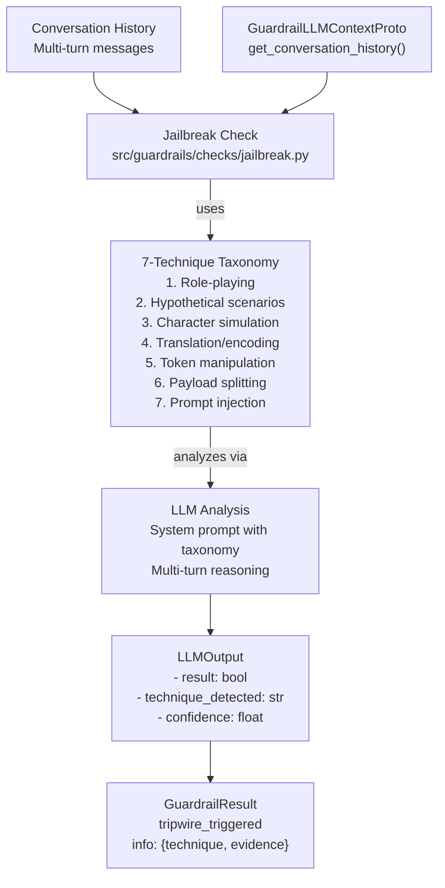

**Conversation Awareness**: Analyzes full conversation history to detect gradual jailbreak attempts across multiple turns.

**See:** [Jailbreak Detection](#6.2) for detailed documentation and benchmarks.

### NSFW Text Detection

Detects workplace-inappropriate content in LLM outputs:

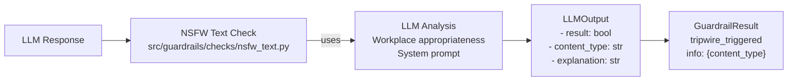

**Stage**: Output only - validates LLM responses for workplace appropriateness.

**See:** [NSFW Text Detection](#6.3) for detailed documentation.

### Hallucination Detection

Validates LLM responses against vector stores and file search tools:

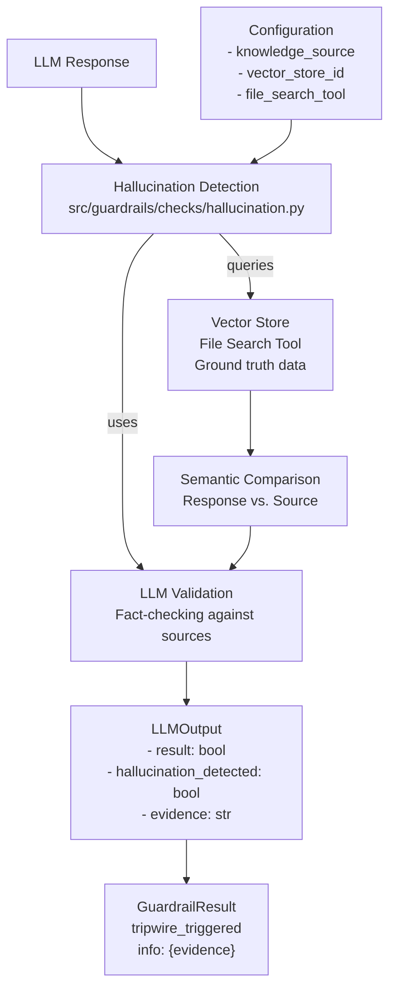

**Configuration**: Requires `knowledge_source` configuration pointing to vector store or file search tool.

**See:** [Hallucination Detection](#6.5) for detailed documentation.

### Prompt Injection Detection

Detects prompt injection attempts, particularly in tool call scenarios:

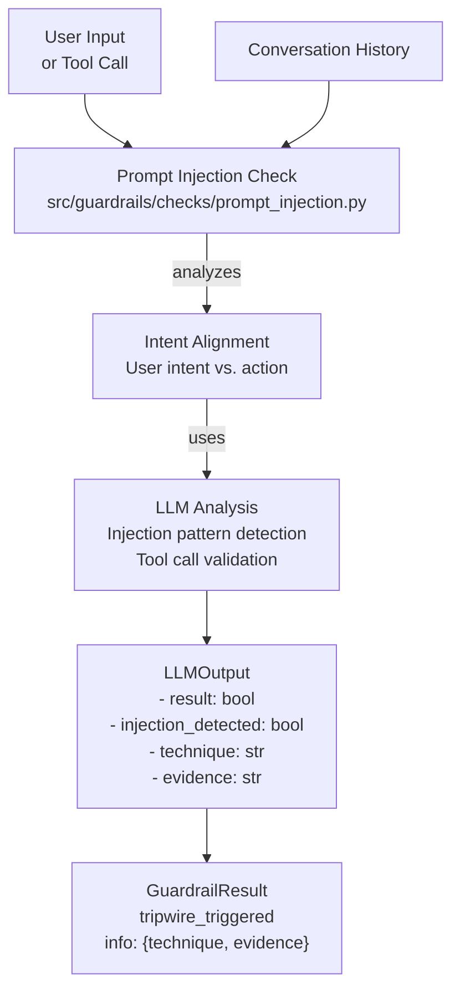

**Use Cases**:
- Validating tool calls in agent systems
- Detecting indirect prompt injection in retrieved content
- Ensuring alignment between user intent and executed actions

**See:** [Prompt Injection Detection](#6.4) for detailed documentation.

### Off Topic Prompts

Ensures user prompts stay within defined business scope:

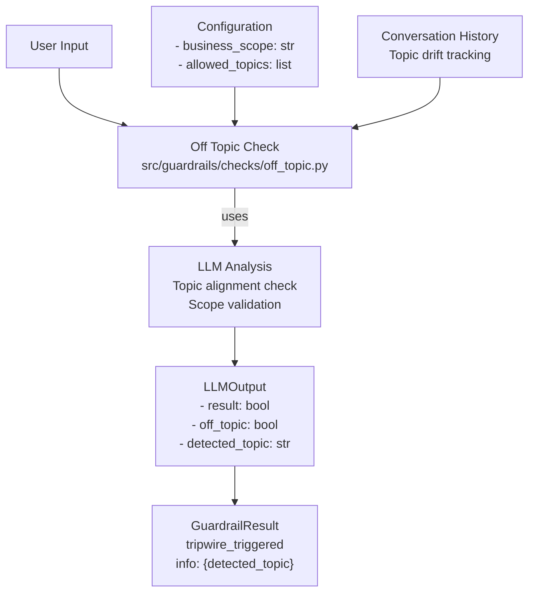

**Configuration**: Requires `business_scope` description or list of `allowed_topics`.

**See:** [Off-Topic Prompts and Custom Checks](#6.7) for detailed documentation.

### User-defined LLM (Custom Checks)

Extensible framework for custom LLM-based guardrails:

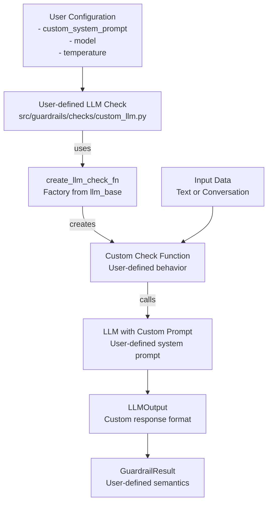

**Use Cases**:
- Domain-specific content policies
- Custom safety requirements
- Organization-specific compliance checks

**See:** [Off-Topic Prompts and Custom Checks](#6.7) for detailed documentation.

**Sources:** [README.md:183-195](), Diagram 4 from high-level architecture

---

## Configuration and Execution Flow

Guardrails are configured via `guardrails_config.json` and executed by the runtime engine:

```mermaid
graph TB
    subgraph "Configuration"
        Portal["guardrails.openai.com<br/>Web Configuration UI"] --> ConfigJSON["guardrails_config.json<br/>Pipeline Definition"]
        ConfigJSON --> LoadConfig["load_config_bundle<br/>Configuration Loader"]
    end
    
    subgraph "Execution"
        LoadConfig --> Instantiate["instantiate_guardrails<br/>Create check functions"]
        Instantiate -->|"queries"| Registry["default_spec_registry<br/>Guardrail metadata"]
        Instantiate --> CheckFns["List of CheckFn<br/>Instantiated guardrails"]
        
        CheckFns --> Runtime["run_guardrails<br/>Execution Engine"]
        Runtime -->|"executes by stage"| PreFlight["Pre-flight Checks"]
        Runtime -->|"executes by stage"| Input["Input Checks"]
        Runtime -->|"executes by stage"| Output["Output Checks"]
    end
    
    subgraph "Results"
        PreFlight --> Results["GuardrailResults<br/>Aggregated results"]
        Input --> Results
        Output --> Results
        Results --> Response["GuardrailsResponse<br/>LLM response + results"]
    end
    
    Client["GuardrailsOpenAI<br/>or GuardrailAgent"] -->|"calls"| Runtime
```

### Configuration Schema Example

```json
{
  "pipeline": {
    "pre_flight": [
      {
        "spec_id": "Contains PII",
        "config": {
          "entity_types": ["PERSON", "EMAIL_ADDRESS"],
          "mask_mode": true
        }
      }
    ],
    "input": [
      {
        "spec_id": "Moderation",
        "config": {
          "categories": ["sexual", "violence"]
        }
      },
      {
        "spec_id": "Jailbreak",
        "config": {
          "model": "gpt-4o-mini"
        }
      }
    ],
    "output": [
      {
        "spec_id": "NSFW Text",
        "config": {}
      },
      {
        "spec_id": "Hallucination Detection",
        "config": {
          "knowledge_source": "vector_store_id"
        }
      }
    ]
  }
}
```

**Sources:** [README.md:36-64](), Diagram 2 from high-level architecture

---

## Guardrail Reference Table

Complete reference of all built-in guardrails with key characteristics:

| Guardrail | spec_id | Engine | Media Type | Stages | Conv. Aware | External Dependency |
|-----------|---------|--------|------------|--------|-------------|---------------------|
| Moderation | `"Moderation"` | API | text | input, output | No | OpenAI Moderation API |
| URL Filter | `"URL Filter"` | API | text | input, pre_flight | No | None |
| Contains PII | `"Contains PII"` | API | text | input, output, pre_flight | No | Presidio (optional) |
| Jailbreak | `"Jailbreak"` | LLM | conversation | input | Yes | None |
| NSFW Text | `"NSFW Text"` | LLM | text | output | No | None |
| Hallucination Detection | `"Hallucination Detection"` | LLM | text | output | No | Vector Store / File Search |
| Prompt Injection | `"Prompt Injection"` | LLM | conversation | input | Yes | None |
| Off Topic Prompts | `"Off Topic Prompts"` | LLM | conversation | input | Yes | None |
| User-defined LLM | `"Custom"` | LLM | text / conversation | input, output | Configurable | None |

### Field Descriptions

- **spec_id**: Identifier used in `guardrails_config.json` to reference the guardrail
- **Engine**: Execution engine type (`API` or `LLM`)
- **Media Type**: Input format (`text` for single messages, `conversation` for multi-turn)
- **Stages**: Pipeline stages where guardrail can execute
- **Conv. Aware**: Whether guardrail analyzes full conversation history
- **External Dependency**: Third-party services or tools required

**Sources:** [README.md:183-195](), Diagram 4 from high-level architecture

---

## Token Usage and Performance

All guardrails track token consumption and return it in `GuardrailResult`:

```typescript
interface GuardrailResult {
  tripwire_triggered: boolean;
  info: Record<string, any>;
  token_usage?: {
    prompt_tokens: number;
    completion_tokens: number;
    total_tokens: number;
  };
}
```

### Performance Characteristics

- **API-Based Guardrails**: Typical latency 100-500ms, deterministic results
- **LLM-Based Guardrails**: Latency varies by model:
  - `gpt-4o-mini`: 500-1500ms (P50: ~800ms)
  - `gpt-4o`: 1000-3000ms (P50: ~1800ms)
- **Conversation-Aware Guardrails**: Additional latency proportional to conversation length

For detailed performance benchmarks including ROC AUC metrics, latency percentiles, and model comparisons, see [Performance Benchmarks](#6.10).

**Sources:** Diagram 6 from high-level architecture

---

## Next Steps

For detailed information about each guardrail:

- [Moderation Guardrail](#6.1) - OpenAI Moderation API integration
- [Jailbreak Detection](#6.2) - Multi-turn attack detection with taxonomy
- [NSFW Text Detection](#6.3) - Workplace content filtering
- [Prompt Injection Detection](#6.4) - Tool call validation and intent alignment
- [Hallucination Detection](#6.5) - Vector store validation
- [PII Detection and URL Filtering](#6.6) - Presidio integration and domain filtering
- [Off-Topic Prompts and Custom Checks](#6.7) - Business scope validation and extensibility
- [LLM-Based Guardrail Framework](#6.8) - Creating custom guardrails
- [Guardrail Configuration Reference](#6.9) - Complete configuration options
- [Performance Benchmarks](#6.10) - ROC AUC, latency, and model comparisons

For information about integrating guardrails into your application:

- [Client Integration](#4) - Using guardrails with OpenAI clients
- [Agent Integration](#5) - Using guardrails with Agents SDK
- [Runtime Execution Model](#3.5) - How guardrails are executed

**Sources:** [README.md:1-205]()

---

