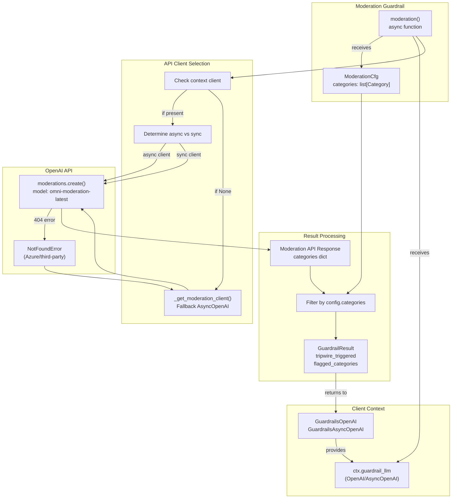
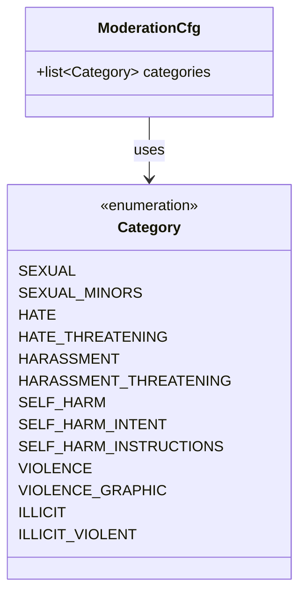
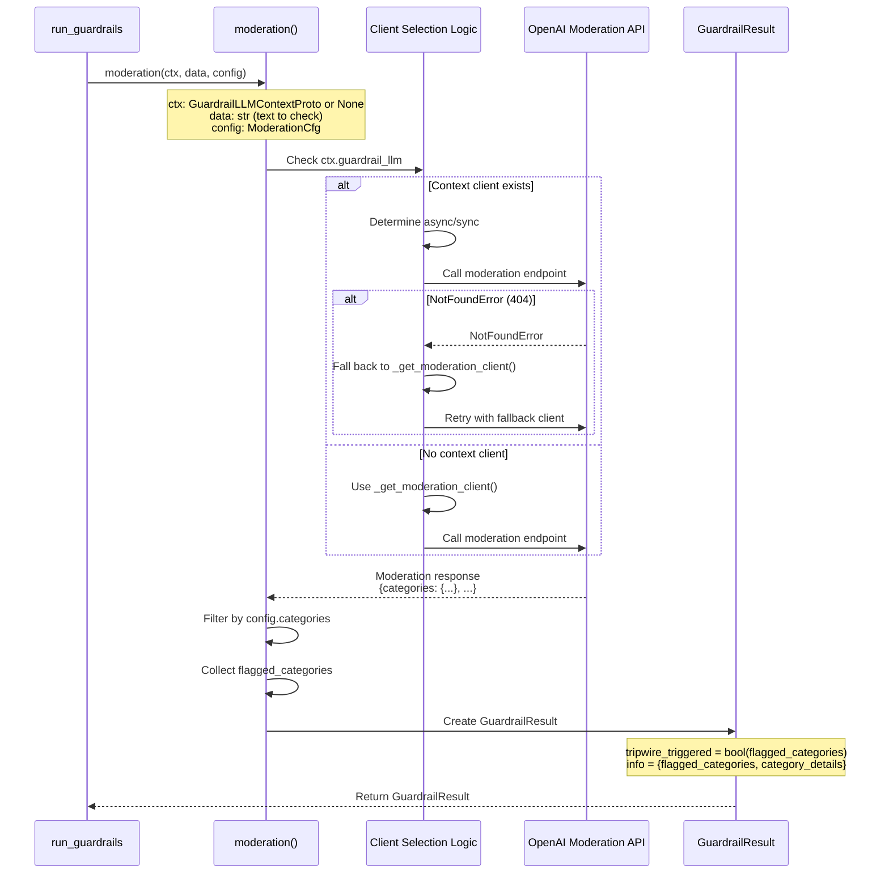
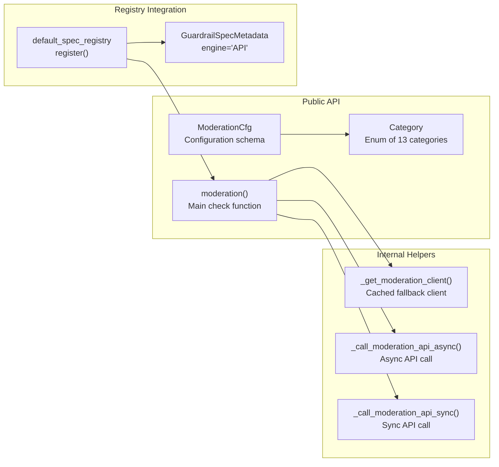

<!-- source: DeepWiki mcp.deepwiki.com · repo openai/openai-guardrails-python · page 6.1 Moderation Guardrail · fetched 2026-10-26 -->

# Moderation Guardrail

<details>
<summary>Relevant source files</summary>

The following files were used as context for generating this wiki page:

- [README.md](README.md)
- [docs/assets/images/guardrails-python-config-screenshot-100pct-q70.webp](docs/assets/images/guardrails-python-config-screenshot-100pct-q70.webp)
- [src/guardrails/checks/text/moderation.py](src/guardrails/checks/text/moderation.py)
- [tests/conftest.py](tests/conftest.py)
- [tests/unit/checks/test_moderation.py](tests/unit/checks/test_moderation.py)
- [tests/unit/checks/test_secret_keys.py](tests/unit/checks/test_secret_keys.py)

</details>


This page documents the **Moderation** guardrail, which detects harmful or policy-violating content using OpenAI's moderation API. This is an API-based guardrail that analyzes text inputs or outputs against 13 predefined content categories.

For information about other text-based guardrails, see [NSFW Text Detection](#6.3) for workplace-inappropriate content filtering, [Jailbreak Detection](#6.2) for adversarial prompt detection, and [Prompt Injection Detection](#6.4) for tool call validation.

---

## Overview

The Moderation guardrail provides content safety checks by calling OpenAI's `omni-moderation-latest` endpoint. It supports selective category filtering, allowing applications to flag only specific types of harmful content based on their requirements.

**Key Characteristics:**
- **Engine Type**: API-based (not LLM-based)
- **Media Type**: `text/plain`
- **Execution Stage**: Can run in `pre_flight`, `input`, or `output` stages
- **Conversation-Aware**: No (operates on individual text strings)

Sources: [src/guardrails/checks/text/moderation.py:1-26](), [src/guardrails/checks/text/moderation.py:245-251]()

---

## Architecture and Integration



**Client Selection Logic:**

The moderation guardrail implements a fallback mechanism to handle different provider configurations:

1. **Context Client First**: Attempts to use `ctx.guardrail_llm` if provided by the runtime
2. **Async/Sync Detection**: Determines whether the context client is `AsyncOpenAI` or `OpenAI` (sync)
3. **Fallback on 404**: If the moderation endpoint returns `NotFoundError` (common with Azure or third-party providers), falls back to a cached OpenAI client using the `OPENAI_API_KEY` environment variable
4. **Thread Pool for Sync**: Sync clients are executed via `asyncio.to_thread()` to avoid blocking the event loop

Sources: [src/guardrails/checks/text/moderation.py:166-210](), [tests/unit/checks/test_moderation.py:62-91](), [tests/unit/checks/test_moderation.py:94-136]()

---

## Configuration Schema

The moderation guardrail is configured using the `ModerationCfg` class:



**Configuration Parameters:**

| Parameter | Type | Default | Description |
|-----------|------|---------|-------------|
| `categories` | `list[Category]` | All categories | List of specific categories to check. If not specified, all 13 categories are checked. |

**Example Configuration:**

```json
{
  "name": "Moderation",
  "categories": ["hate", "harassment", "violence"]
}
```

Sources: [src/guardrails/checks/text/moderation.py:86-119](), [src/guardrails/checks/text/moderation.py:48-83]()

---

## Content Categories Reference

The moderation API recognizes 13 distinct content categories. The guardrail will only trigger if one of the **configured** categories is flagged by the API.

| Category | Enum Value | Description |
|----------|------------|-------------|
| Sexual | `SEXUAL` | Sexually explicit or suggestive content |
| Sexual/Minors | `SEXUAL_MINORS` | Sexual content involving individuals under 18 |
| Hate | `HATE` | Hateful or discriminatory language |
| Hate/Threatening | `HATE_THREATENING` | Hateful content that also includes violence or serious harm |
| Harassment | `HARASSMENT` | Content involving harassment or bullying |
| Harassment/Threatening | `HARASSMENT_THREATENING` | Harassment content that also includes violence or serious harm |
| Self-harm | `SELF_HARM` | Content promoting or depicting self-harm |
| Self-harm/Intent | `SELF_HARM_INTENT` | Content where the speaker expresses intent to harm oneself |
| Self-harm/Instructions | `SELF_HARM_INSTRUCTIONS` | Content that provides instructions for self-harm or encourages it |
| Violence | `VIOLENCE` | Content that depicts death, violence, or physical injury |
| Violence/Graphic | `VIOLENCE_GRAPHIC` | Content depicting death, violence, or physical injury in graphic detail |
| Illicit | `ILLICIT` | Content giving advice or instruction on committing illicit acts (e.g., "how to shoplift") |
| Illicit/Violent | `ILLICIT_VIOLENT` | Illicit content that also includes references to violence or procuring a weapon |

**Category Filtering:**

The guardrail only triggers if categories specified in `config.categories` are flagged. Categories not in the configuration are ignored, even if the API flags them.

Sources: [src/guardrails/checks/text/moderation.py:48-83](), [src/guardrails/checks/text/moderation.py:92-111]()

---

## Function Interface and Execution Flow



**Core Function Signature:**

The `moderation` function implements the standard guardrail check function interface:

```python
async def moderation(
    ctx: Any,  # GuardrailLLMContextProto or None
    data: str,  # Text to analyze
    config: ModerationCfg,  # Category configuration
) -> GuardrailResult
```

Sources: [src/guardrails/checks/text/moderation.py:166-242]()

---

## Result Structure

The moderation guardrail returns a `GuardrailResult` with the following structure:

**GuardrailResult Fields:**

| Field | Type | Description |
|-------|------|-------------|
| `tripwire_triggered` | `bool` | `True` if any configured category was flagged |
| `info` | `dict` | Contains detailed moderation results |

**Info Dictionary Contents:**

| Key | Type | Description |
|-----|------|-------------|
| `guardrail_name` | `str` | Always `"Moderation"` |
| `flagged_categories` | `list[str]` | List of category names that were flagged and match the configuration |
| `categories_checked` | `list[Category]` | List of categories that were checked (from config) |
| `category_details` | `dict[str, bool]` | Mapping of each checked category to its flagged status |

**Example Result:**

```python
GuardrailResult(
    tripwire_triggered=True,
    info={
        "guardrail_name": "Moderation",
        "flagged_categories": ["hate"],
        "categories_checked": [Category.HATE, Category.VIOLENCE],
        "category_details": {
            "hate": True,
            "violence": False
        }
    }
)
```

**Empty Results Handling:**

If the API returns no results (empty `results` array), the guardrail returns:

```python
GuardrailResult(
    tripwire_triggered=False,
    info={"error": "No moderation results returned"}
)
```

Sources: [src/guardrails/checks/text/moderation.py:221-242](), [tests/unit/checks/test_moderation.py:44-58]()

---

## Usage Patterns

### Basic Usage with GuardrailsOpenAI

```python
from guardrails import GuardrailsOpenAI
from pathlib import Path

client = GuardrailsOpenAI(config=Path("guardrails_config.json"))

# Moderation runs automatically based on configuration
response = client.chat.completions.create(
    model="gpt-4",
    messages=[{"role": "user", "content": "User input here"}]
)
```

**Configuration File Example:**

```json
{
  "input_guardrails": [
    {
      "name": "Moderation",
      "categories": ["hate", "harassment", "violence"]
    }
  ]
}
```

Sources: [README.md:39-64]()

### Testing with Custom Categories

```python
import asyncio
from guardrails.checks.text.moderation import moderation, ModerationCfg, Category

async def test_moderation():
    # Configure to check only hate and violence
    config = ModerationCfg(categories=[Category.HATE, Category.VIOLENCE])
    
    # Test with potentially harmful content
    result = await moderation(None, "test content", config)
    
    if result.tripwire_triggered:
        print(f"Flagged categories: {result.info['flagged_categories']}")
    else:
        print("Content passed moderation")

asyncio.run(test_moderation())
```

Sources: [tests/unit/checks/test_moderation.py:30-40]()

### Handling Azure OpenAI Fallback

When using Azure OpenAI or other third-party providers without moderation endpoints, the guardrail automatically falls back to OpenAI's API:

```python
from guardrails import GuardrailsAzureOpenAI
from pathlib import Path

# Azure client without moderation endpoint
client = GuardrailsAzureOpenAI(
    api_key="azure-key",
    azure_endpoint="https://your-resource.openai.azure.com",
    api_version="2024-02-01",
    config=Path("guardrails_config.json")
)

# Moderation automatically falls back to OpenAI API
# (requires OPENAI_API_KEY environment variable)
response = client.chat.completions.create(
    model="gpt-4",
    messages=[{"role": "user", "content": "User input"}]
)
```

Sources: [tests/unit/checks/test_moderation.py:172-222]()

---

## Implementation Details

### Key Implementation Components



**Client Caching:**

The `_get_moderation_client()` function uses Python's `@cache` decorator to create a singleton OpenAI client for fallback scenarios:

```python
@cache
def _get_moderation_client() -> AsyncOpenAI:
    """Return a cached instance of the OpenAI async client."""
    return AsyncOpenAI()
```

This prevents redundant client instantiation across multiple moderation checks.

Sources: [src/guardrails/checks/text/moderation.py:122-131]()

**API Call Wrappers:**

The guardrail provides separate wrapper functions for async and sync clients:

- `_call_moderation_api_async()`: Direct async call to `moderations.create()`
- `_call_moderation_api_sync()`: Synchronous call, executed via `asyncio.to_thread()` in the main function

Both use the `omni-moderation-latest` model.

Sources: [src/guardrails/checks/text/moderation.py:134-163]()

**Registry Metadata:**

The moderation guardrail registers itself with the following metadata:

| Property | Value |
|----------|-------|
| `name` | `"Moderation"` |
| `check_fn` | `moderation` |
| `description` | `"Flags text containing disallowed content categories."` |
| `media_type` | `"text/plain"` |
| `engine` | `"API"` |

This metadata informs the runtime that moderation is an API-based check (not LLM-based) and operates on plain text.

Sources: [src/guardrails/checks/text/moderation.py:245-251]()

---

## Error Handling and Edge Cases

### NotFoundError Fallback

When the moderation endpoint is unavailable (common with Azure OpenAI or third-party providers), the guardrail catches `NotFoundError` and automatically retries with the fallback client:

```python
try:
    resp = await _call_moderation_api_async(client, data)
except NotFoundError as e:
    logger.debug(
        "Moderation endpoint not available on context client, falling back to OpenAI: %s",
        e,
    )
    client = _get_moderation_client()
    resp = await _call_moderation_api_async(client, data)
```

Sources: [src/guardrails/checks/text/moderation.py:198-206]()

### Empty Results Handling

If the API response contains an empty `results` array, the guardrail returns a non-triggering result with an error message:

```python
results = resp.results or []
if not results:
    return GuardrailResult(
        tripwire_triggered=False,
        info={"error": "No moderation results returned"},
    )
```

Sources: [src/guardrails/checks/text/moderation.py:211-216]()

### Sync Client Thread Pool Execution

To prevent blocking the event loop when using synchronous OpenAI clients, the guardrail runs sync API calls in a thread pool:

```python
if is_async:
    resp = await _call_moderation_api_async(client, data)
else:
    # Sync client - run in thread pool to avoid blocking event loop
    resp = await asyncio.to_thread(_call_moderation_api_sync, client, data)
```

Sources: [src/guardrails/checks/text/moderation.py:193-197]()

---

## Testing and Validation

The moderation guardrail includes comprehensive tests covering various scenarios:

| Test Scenario | Coverage |
|---------------|----------|
| Category filtering | Verifies only configured categories trigger the guardrail |
| Empty results | Handles API responses with no moderation results |
| Context client usage | Uses `ctx.guardrail_llm` when available |
| Third-party fallback | Falls back to OpenAI when provider lacks moderation endpoint |
| Sync client support | Properly handles synchronous OpenAI clients |
| Azure OpenAI fallback | Specifically tests Azure client fallback behavior |

**Test Stub Pattern:**

Tests use a stubbed moderation client to avoid real API calls:

```python
class _StubModerationClient:
    def __init__(self, categories: dict[str, bool]) -> None:
        self._categories = categories

    async def create(self, model: str, input: str) -> Any:
        class _Result:
            def model_dump(self) -> dict[str, Any]:
                return {"categories": self._categories}
        
        return SimpleNamespace(results=[_Result()])
```

Sources: [tests/unit/checks/test_moderation.py:13-26](), [tests/unit/checks/test_moderation.py:30-58]()

---

## Performance Considerations

**Latency Characteristics:**

As an API-based guardrail, moderation performance is dominated by network latency to the OpenAI API. Typical characteristics:

- **Execution Type**: External API call (not local processing)
- **Concurrency**: Can run concurrently with input guardrails during Stage 2 execution
- **Caching**: Client instance is cached to reduce overhead
- **Thread Safety**: Async-first design with proper sync client handling

**Optimization Strategies:**

1. **Selective Categories**: Configure only required categories to reduce false positives
2. **Stage Placement**: Run in `input` stage (concurrent with LLM call) to minimize latency impact
3. **Client Reuse**: Leverages cached client instance for reduced initialization overhead

Sources: [src/guardrails/checks/text/moderation.py:122-131]()

---

