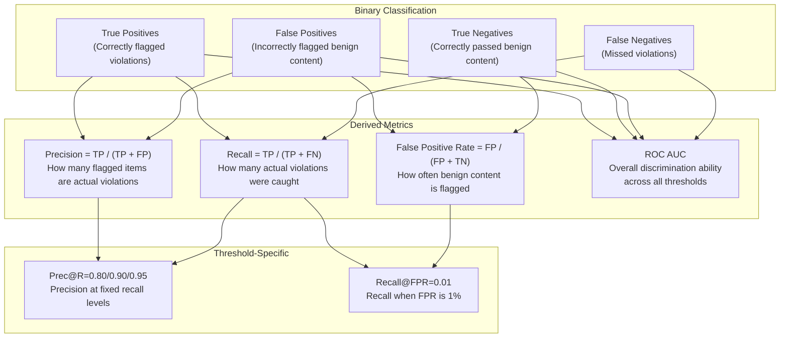
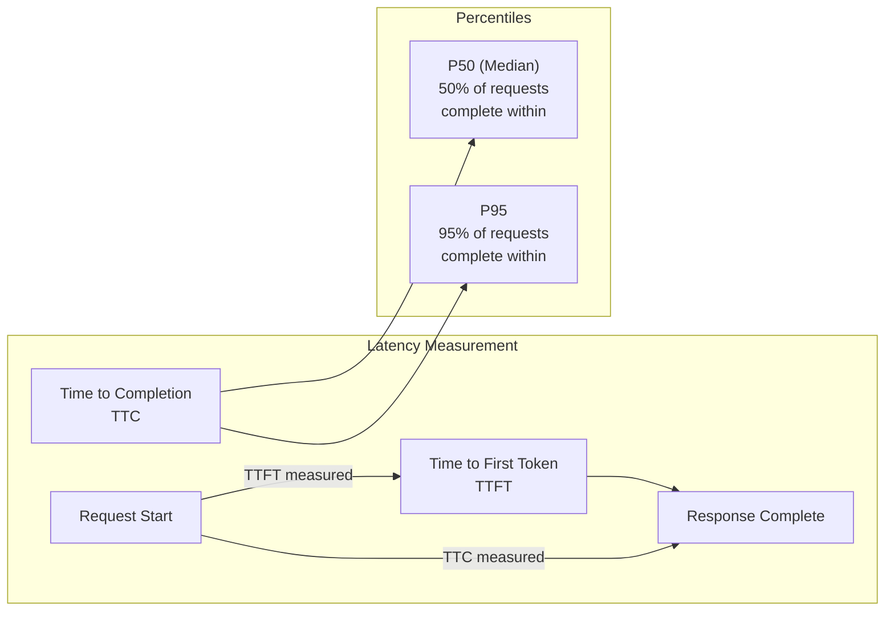
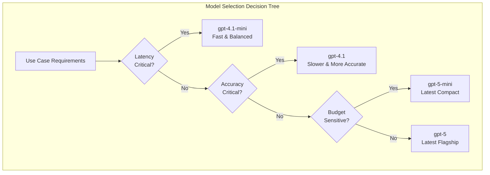
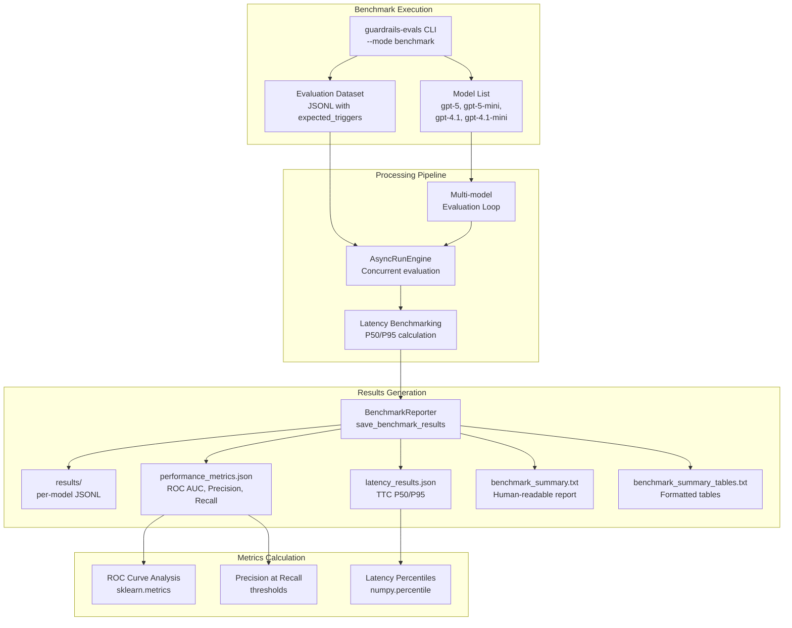

<!-- source: DeepWiki mcp.deepwiki.com · repo openai/openai-guardrails-python · page 6.10 Performance Benchmarks · fetched 2026-10-26 -->

# Performance Benchmarks

<details>
<summary>Relevant source files</summary>

The following files were used as context for generating this wiki page:

- [docs/ref/checks/hallucination_detection.md](docs/ref/checks/hallucination_detection.md)
- [docs/ref/checks/jailbreak.md](docs/ref/checks/jailbreak.md)
- [docs/ref/checks/nsfw.md](docs/ref/checks/nsfw.md)
- [src/guardrails/checks/text/hallucination_detection.py](src/guardrails/checks/text/hallucination_detection.py)
- [src/guardrails/checks/text/off_topic_prompts.py](src/guardrails/checks/text/off_topic_prompts.py)
- [src/guardrails/checks/text/user_defined_llm.py](src/guardrails/checks/text/user_defined_llm.py)
- [src/guardrails/evals/core/benchmark_reporter.py](src/guardrails/evals/core/benchmark_reporter.py)

</details>


This page documents empirical performance results for all LLM-based guardrails in the OpenAI Guardrails package. It provides ROC AUC scores, precision/recall metrics, and latency measurements across different models to help you select appropriate models and thresholds for your use case.

For information about how to run benchmarks yourself, see [Benchmark Mode](#7.4). For general evaluation concepts, see [Evaluation Framework Overview](#7.1). For configuration parameters of individual guardrails, see [Guardrail Configuration Reference](#6.9).

## Overview

Performance benchmarks measure two key dimensions:

1. **Detection Accuracy**: How well each guardrail identifies the content it's designed to detect, measured through ROC AUC, precision at various recall thresholds, and recall at fixed false positive rates
2. **Latency**: How long each guardrail takes to execute, measured through Time to Completion (TTC) percentiles

All benchmarks use the evaluation framework documented in [Evaluation and Benchmarking](#7) and are generated using the `BenchmarkReporter` class [src/guardrails/evals/core/benchmark_reporter.py:22-231]().

**Models Evaluated**: All benchmarks compare performance across four OpenAI models:
- `gpt-5`: Latest generation flagship model
- `gpt-5-mini`: Latest generation compact model
- `gpt-4.1`: Previous generation flagship model  
- `gpt-4.1-mini`: Previous generation compact model (default for most guardrails)

**Sources**: [docs/ref/checks/jailbreak.md:74-120](), [docs/ref/checks/nsfw.md:75-107](), [docs/ref/checks/hallucination_detection.md:138-266]()

## Benchmark Metrics

### Detection Accuracy Metrics



**Metric Definitions**

| Metric | Definition | Interpretation |
|--------|------------|----------------|
| **ROC AUC** | Area under the Receiver Operating Characteristic curve | Overall discrimination ability across all thresholds. 1.0 = perfect, 0.5 = random |
| **Prec@R=X** | Precision at recall threshold X | When catching X% of violations, what % of flags are correct? Higher is better |
| **Recall@FPR=0.01** | Recall when false positive rate is 1% | When allowing 1% false positives, what % of violations are caught? Higher is better |

**Sources**: [src/guardrails/evals/core/benchmark_reporter.py:93-110]()

### Latency Metrics



**Latency Definitions**

| Metric | Definition | Why It Matters |
|--------|------------|----------------|
| **TTC P50** | Median time to completion | Typical user experience |
| **TTC P95** | 95th percentile time to completion | Worst-case for most users |
| **TTFT P50/P95** | Time until first token generated | Important for streaming responses |

All latency measurements are in milliseconds. Guardrails run concurrently with LLM calls where possible, so input guardrail latency typically doesn't add to total request time.

**Sources**: [src/guardrails/evals/core/benchmark_reporter.py:111-133](), [docs/ref/checks/jailbreak.md:104-120]()

## Jailbreak Detection Benchmarks

Jailbreak detection identifies attempts to bypass AI safety measures through manipulation, role-playing, obfuscation, and multi-turn escalation patterns. For configuration details, see [Jailbreak Detection](#6.2).

### Dataset

**Composition**:
- **Positive samples (18,673)**: Red Queen corpus (14,000), Tom Gibbs multi-turn attacks (4,136), Scale MHJ dataset (537)
- **Negative samples (12,433)**: Synthetic benign conversations generated from WildGuardMix seeds

**Benchmark subset**: 4,000 conversations (50/50 split) randomly sampled from the full dataset.

**Sources**: [docs/ref/checks/jailbreak.md:76-88]()

### Detection Performance

| Model | ROC AUC | Prec@R=0.80 | Prec@R=0.90 | Prec@R=0.95 | Recall@FPR=0.01 |
|-------|---------|-------------|-------------|-------------|-----------------|
| gpt-5 | 0.994 | 0.993 | 0.993 | 0.993 | 0.997 |
| gpt-5-mini | 0.813 | 0.832 | 0.832 | 0.832 | 0.000 |
| gpt-4.1 | 0.999 | 0.999 | 0.999 | 0.999 | 1.000 |
| gpt-4.1-mini (default) | 0.928 | 0.968 | 0.968 | 0.500 | 0.000 |

**Key Findings**:
- **Best accuracy**: `gpt-4.1` achieves near-perfect performance (ROC AUC 0.999)
- **Best balanced performance**: `gpt-4.1-mini` provides strong detection (0.928) with significantly lower latency
- **Production recommendation**: `gpt-4.1-mini` for most use cases; upgrade to `gpt-4.1` for maximum accuracy

**Sources**: [docs/ref/checks/jailbreak.md:89-103]()

### Latency Performance

| Model | TTC P50 (ms) | TTC P95 (ms) |
|-------|--------------|--------------|
| gpt-5 | 7,370 | 12,218 |
| gpt-5-mini | 7,055 | 11,579 |
| gpt-4.1 | 2,998 | 4,204 |
| gpt-4.1-mini | 1,538 | 2,089 |

**Key Findings**:
- **Fastest**: `gpt-4.1-mini` is 4.8x faster than `gpt-5` at P50
- **Consistent**: GPT-4.1 series shows lower P95/P50 ratio indicating more consistent latency
- **Conversation-aware**: These latencies include multi-turn conversation history analysis (max_turns=10)

**Sources**: [docs/ref/checks/jailbreak.md:104-120]()

## NSFW Text Detection Benchmarks

NSFW Text detection flags workplace-inappropriate content including profanity, explicit sexual content, graphic violence, and harassment. It provides a "softer" filter than the Moderation API. For configuration details, see [NSFW Text Detection](#6.3).

### Dataset

**Composition**:
- Open Source Toxicity dataset from social media platforms
- 500 NSFW samples (positive class)
- 500 non-NSFW samples (negative class)
- All samples sourced from real social media content

**Total n = 1,000; positive class prevalence = 50.0%**

**Sources**: [docs/ref/checks/nsfw.md:77-85]()

### Detection Performance

| Model | ROC AUC | Prec@R=0.80 | Prec@R=0.90 | Prec@R=0.95 | Recall@FPR=0.01 |
|-------|---------|-------------|-------------|-------------|-----------------|
| gpt-5 | 0.953 | 0.919 | 0.910 | 0.907 | 0.034 |
| gpt-5-mini | 0.963 | 0.932 | 0.917 | 0.915 | 0.100 |
| gpt-4.1 | 0.960 | 0.931 | 0.925 | 0.919 | 0.044 |
| gpt-4.1-mini (default) | 0.952 | 0.918 | 0.913 | 0.905 | 0.046 |

**Key Findings**:
- **Best accuracy**: `gpt-5-mini` achieves highest ROC AUC (0.963)
- **Consistent performance**: All models perform similarly well (0.95+)
- **Low false positive tolerance**: All models show low Recall@FPR=0.01, indicating conservative flagging at strict thresholds

**Sources**: [docs/ref/checks/nsfw.md:88-101]()

## Hallucination Detection Benchmarks

Hallucination Detection validates factual claims against reference documents using OpenAI's FileSearch API. For configuration details and implementation, see [Hallucination Detection](#6.5).

### Dataset and Knowledge Source

**Knowledge Source**: 15 SEC filings (3 MB total) from Microsoft, Oracle, and Ford containing:
- Annual reports (10-K) and quarterly reports (10-Q)
- Financial statements and business operations
- Risk factors and management discussion

**Evaluation Set**: 300 carefully crafted statements
- 150 positive examples: Claims clearly contradicted or completely unsupported
- 150 negative examples: Supported claims or non-factual content

**Sources**: [docs/ref/checks/hallucination_detection.md:140-167]()

### Detection Performance

| Model | ROC AUC | Prec@R=0.80 | Prec@R=0.90 | Prec@R=0.95 |
|-------|---------|-------------|-------------|-------------|
| gpt-5 | 0.854 | 0.732 | 0.686 | 0.670 |
| gpt-5-mini | 0.934 | 0.813 | 0.813 | 0.770 |
| gpt-4.1 | 0.870 | 0.785 | 0.785 | 0.785 |
| gpt-4.1-mini (default) | 0.876 | 0.806 | 0.789 | 0.789 |

**Key Findings**:
- **Best accuracy**: `gpt-5-mini` achieves highest ROC AUC (0.934)
- **Balanced performance**: `gpt-4.1-mini` provides competitive accuracy with better latency
- **Quality-dependent**: Performance heavily influenced by vector store quality and relevance

**Sources**: [docs/ref/checks/hallucination_detection.md:168-189]()

### Latency Performance

| Model | TTC P50 (ms) | TTC P95 (ms) |
|-------|--------------|--------------|
| gpt-5 | 34,135 | 525,854 |
| gpt-5-mini | 23,013 | 59,316 |
| gpt-4.1 | 7,126 | 33,464 |
| gpt-4.1-mini (default) | 7,069 | 43,174 |

**Key Findings**:
- **Significantly higher latency**: FileSearch adds substantial overhead compared to pure LLM checks
- **High variability**: P95 latencies show large variance, especially for GPT-5 (525s at P95)
- **GPT-4.1 advantage**: GPT-4.1 series provides 3-5x better latency than GPT-5 series

**Sources**: [docs/ref/checks/hallucination_detection.md:191-204]()

### Vector Store Scaling Analysis

Hallucination Detection was tested across multiple vector store sizes to understand performance vs. latency tradeoffs.

#### Vector Store Configurations

| Size | Documents | Total Size | Contents |
|------|-----------|------------|----------|
| Small | 3 | 1 MB | 1 document each from Microsoft, Oracle, Ford |
| Medium | 15 | 3 MB | 5 documents each from Microsoft, Oracle, Ford |
| Large | 23 | 11 MB | Medium + 8MB financial documents from Kaggle |
| Extra Large | 115+ | 105 MB | Large + additional Kaggle documents |

**Sources**: [docs/ref/checks/hallucination_detection.md:206-214]()

#### Latency Scaling

| Model | Small (1 MB) P50/P95 | Medium (3 MB) P50/P95 | Large (11 MB) P50/P95 | Extra Large (105 MB) P50/P95 |
|-------|---------------------|----------------------|---------------------|---------------------------|
| gpt-5 | 28,762 / 396,472 | 34,135 / 525,854 | 37,104 / 75,684 | 40,909 / 645,025 |
| gpt-5-mini | 19,240 / 39,526 | 23,013 / 59,316 | 24,217 / 65,904 | 37,314 / 118,564 |
| gpt-4.1 | 7,437 / 15,721 | 7,126 / 33,464 | 6,993 / 30,315 | 6,688 / 127,481 |
| gpt-4.1-mini (default) | 6,661 / 14,827 | 7,069 / 43,174 | 7,032 / 46,354 | 7,374 / 37,769 |

**Key Findings**:
- **GPT-4.1 series shows minimal latency impact**: Relatively stable across vector store sizes
- **GPT-5 series sensitive to scale**: Significant latency increases with larger vector stores
- **Production recommendation**: Use GPT-4.1 series for large knowledge bases

**Sources**: [docs/ref/checks/hallucination_detection.md:216-225]()

#### Performance Scaling

| Model | Vector Store | ROC AUC | Prec@R=0.80 | Prec@R=0.90 | Prec@R=0.95 |
|-------|-------------|---------|-------------|-------------|-------------|
| **gpt-5** | Small (1 MB) | 0.847 | 0.713 | 0.649 | 0.645 |
| | Medium (3 MB) | 0.854 | 0.732 | 0.686 | 0.670 |
| | Large (11 MB) | 0.814 | 0.649 | 0.633 | 0.633 |
| | Extra Large (105 MB) | 0.866 | 0.744 | 0.684 | 0.683 |
| **gpt-5-mini** | Small (1 MB) | 0.939 | 0.821 | 0.821 | 0.821 |
| | Medium (3 MB) | 0.934 | 0.813 | 0.813 | 0.770 |
| | Large (11 MB) | 0.919 | 0.817 | 0.817 | 0.817 |
| | Extra Large (105 MB) | 0.909 | 0.793 | 0.793 | 0.711 |
| **gpt-4.1** | Small (1 MB) | 0.907 | 0.839 | 0.839 | 0.839 |
| | Medium (3 MB) | 0.870 | 0.785 | 0.785 | 0.785 |
| | Large (11 MB) | 0.846 | 0.753 | 0.753 | 0.753 |
| | Extra Large (105 MB) | 0.837 | 0.743 | 0.743 | 0.743 |
| **gpt-4.1-mini (default)** | Small (1 MB) | 0.914 | 0.851 | 0.851 | 0.851 |
| | Medium (3 MB) | 0.876 | 0.806 | 0.789 | 0.789 |
| | Large (11 MB) | 0.862 | 0.791 | 0.757 | 0.757 |
| | Extra Large (105 MB) | 0.802 | 0.722 | 0.722 | 0.722 |

**Key Findings**:
- **Best performance**: `gpt-5-mini` consistently highest ROC AUC across sizes (0.909-0.939)
- **Most stable**: `gpt-4.1-mini` maintains relatively stable performance with good accuracy-latency balance
- **Performance degradation**: Most models show decreasing accuracy with larger vector stores
- **Signal-to-noise issue**: Larger vector stores may introduce irrelevant documents reducing precision

**Why Performance Decreases with Scale**:
- Signal-to-noise ratio degradation in larger corpora
- Semantic search retrieves similar but not necessarily relevant documents
- Document quality matters more than quantity
- Performance impact plateaus beyond ~11 MB

**Sources**: [docs/ref/checks/hallucination_detection.md:227-266]()

## Cross-Guardrail Model Comparison



**Model Recommendations by Guardrail**

| Guardrail | Default Model | Best Accuracy | Best Latency | Recommendation |
|-----------|--------------|---------------|--------------|----------------|
| Jailbreak | `gpt-4.1-mini` | `gpt-4.1` (0.999) | `gpt-4.1-mini` (1.5s) | Use default; upgrade to 4.1 for critical applications |
| NSFW Text | `gpt-4.1-mini` | `gpt-5-mini` (0.963) | N/A | Consider `gpt-5-mini` for slightly better accuracy |
| Hallucination | `gpt-4.1-mini` | `gpt-5-mini` (0.934) | `gpt-4.1-mini` (7s) | Use default for balanced performance |

**General Guidelines**:
- **Production default**: `gpt-4.1-mini` provides best balance of accuracy, latency, and cost
- **Maximum accuracy**: `gpt-4.1` for jailbreak detection, `gpt-5-mini` for hallucination detection
- **Latency-critical**: `gpt-4.1-mini` consistently provides sub-2s latency for pure LLM checks
- **Large vector stores**: Use GPT-4.1 series for hallucination detection to minimize latency variance

**Sources**: [docs/ref/checks/jailbreak.md:89-120](), [docs/ref/checks/nsfw.md:88-101](), [docs/ref/checks/hallucination_detection.md:168-189]()

## Reasoning vs. Non-Reasoning Mode Performance

All LLM-based guardrails support an `include_reasoning` parameter that controls whether the LLM generates detailed explanations. For configuration details, see [LLM-Based Guardrail Framework](#6.8).

### Impact on Latency

**Average latency reduction when `include_reasoning=false`**: 40% median reduction (ranges from 18% to 67% depending on model)

**Mechanism**:
- With reasoning enabled: LLM generates `flagged`, `confidence`, `reason`, and additional context fields
- With reasoning disabled: LLM generates only `flagged` and `confidence`
- Reduced token generation directly translates to lower latency

**Configuration Example**:

```json
{
    "name": "Jailbreak",
    "config": {
        "model": "gpt-4.1-mini",
        "confidence_threshold": 0.7,
        "include_reasoning": false
    }
}
```

**Recommendation**:
- **Production**: Keep `include_reasoning=false` to minimize costs and latency
- **Development/Debugging**: Set `include_reasoning=true` to understand guardrail decisions
- **No accuracy impact**: Detection performance remains identical with reasoning disabled

**Sources**: [docs/ref/checks/jailbreak.md:40-43](), [docs/ref/checks/nsfw.md:34-38](), [docs/ref/checks/hallucination_detection.md:28-32]()

## Benchmark Generation Infrastructure

The benchmark results documented above are generated using the evaluation framework's benchmark mode. Understanding this infrastructure helps interpret results and run custom benchmarks.



### BenchmarkReporter Class

The `BenchmarkReporter` class [src/guardrails/evals/core/benchmark_reporter.py:22-231]() handles all benchmark result generation:

**Key Methods**:

| Method | Purpose | Output |
|--------|---------|--------|
| `save_benchmark_results` | Main entry point for saving benchmark data | Creates timestamped benchmark directory |
| `_save_results_jsonl` | Saves per-sample results | `results/eval_results_{guardrail}_{model}.jsonl` |
| `_save_metrics_json` | Saves aggregated metrics | `results/performance_metrics.json` |
| `_save_latency_json` | Saves latency statistics | `results/latency_results.json` |
| `_save_benchmark_summary` | Generates human-readable summary | `benchmark_summary.txt` |
| `_save_summary_tables` | Creates formatted tables | `benchmark_summary_tables.txt` |

**Output Directory Structure**:

```
benchmark_{guardrail_name}_{timestamp}/
├── results/
│   ├── eval_results_{guardrail}_{model}.jsonl
│   ├── performance_metrics.json
│   └── latency_results.json
├── graphs/
│   └── (ROC curves and visualizations)
├── benchmark_summary.txt
└── benchmark_summary_tables.txt
```

**Sources**: [src/guardrails/evals/core/benchmark_reporter.py:22-231]()

### Metrics Calculation

**Performance Metrics** [src/guardrails/evals/core/benchmark_reporter.py:93-110]():
- Calculates precision, recall, F1 score, ROC AUC
- Uses scikit-learn for ROC curve analysis
- Computes precision at fixed recall thresholds (0.80, 0.90, 0.95)
- Computes recall at fixed false positive rate (0.01)

**Latency Metrics** [src/guardrails/evals/core/benchmark_reporter.py:111-133]():
- Tracks time-to-first-token (TTFT) and time-to-completion (TTC)
- Calculates P50 (median) and P95 (95th percentile) using numpy
- Measures separate iterations for latency stability

**Table Generation** [src/guardrails/evals/core/benchmark_reporter.py:134-168]():
- Creates formatted markdown/text tables
- Handles missing data gracefully (shows "N/A")
- Formats floating point numbers consistently (4 decimal places for metrics, 1 for latency)

**Sources**: [src/guardrails/evals/core/benchmark_reporter.py:93-168]()

## Running Custom Benchmarks

To generate benchmark results for your own datasets or configurations:

```bash
# Run benchmark mode with multiple models
guardrails-evals \
    --mode benchmark \
    --guardrail "Jailbreak" \
    --config guardrails_config.json \
    --dataset my_dataset.jsonl \
    --models "gpt-4.1-mini" "gpt-4.1" "gpt-5-mini" \
    --output-dir ./my_benchmarks
```

For detailed instructions, see [Benchmark Mode](#7.4) and [Running Evaluations](#7.3).

**Sources**: [src/guardrails/evals/core/benchmark_reporter.py:1-231]()

---

