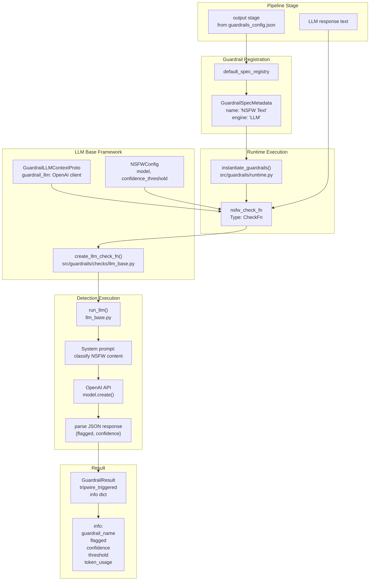
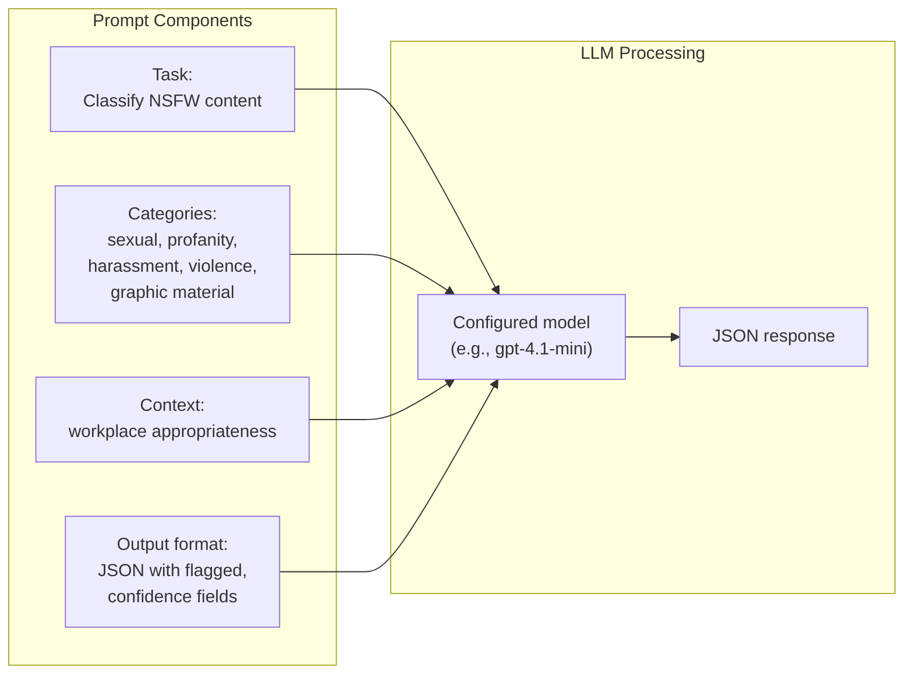
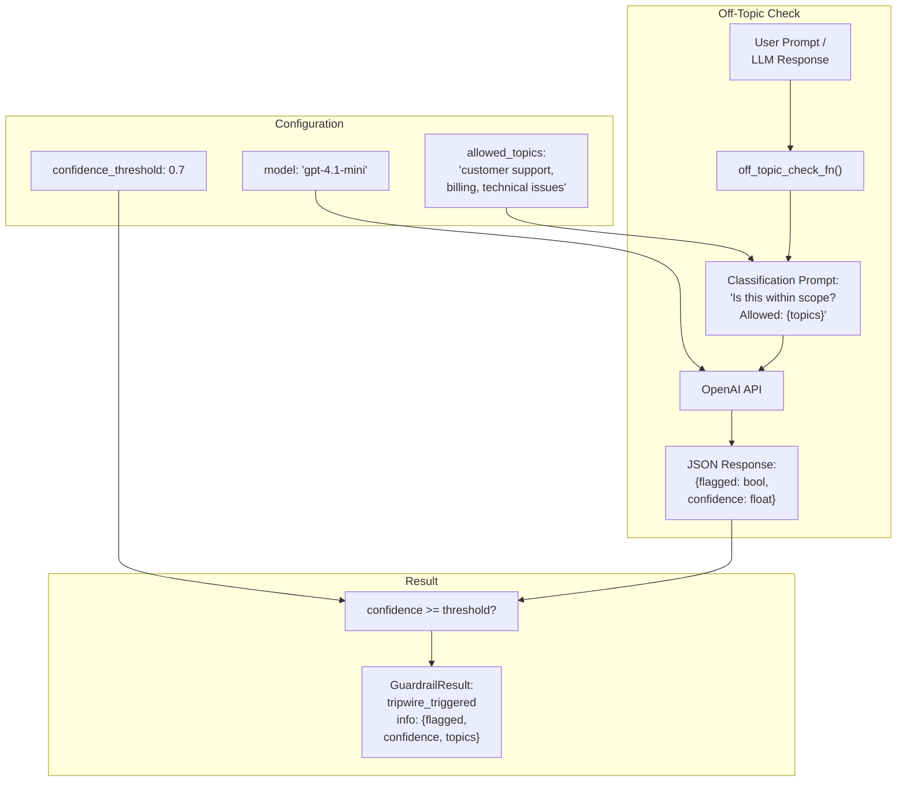
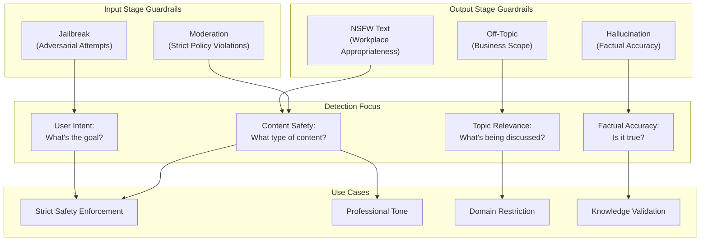

<!-- source: DeepWiki mcp.deepwiki.com · repo openai/openai-guardrails-python · page 6.3 NSFW Text Detection · fetched 2026-10-26 -->

# NSFW Text Detection

<details>
<summary>Relevant source files</summary>

The following files were used as context for generating this wiki page:

- [README.md](README.md)
- [docs/assets/images/guardrails-python-config-screenshot-100pct-q70.webp](docs/assets/images/guardrails-python-config-screenshot-100pct-q70.webp)
- [docs/ref/checks/jailbreak.md](docs/ref/checks/jailbreak.md)
- [docs/ref/checks/nsfw.md](docs/ref/checks/nsfw.md)

</details>


## Overview

NSFW Text Detection identifies not-safe-for-work content in LLM outputs to maintain professional workplace standards. Unlike the stricter Moderation guardrail (see [6.1](#6.1)), NSFW focuses on workplace appropriateness rather than absolute policy violations, making it suitable for applications requiring professional tone without overly restrictive filtering.

**Primary Use Case**: Output validation for workplace-inappropriate content  
**Detection Method**: LLM-based classification using structured prompts  
**Implementation**: Part of the LLM-based guardrail framework (see [6.8](#6.8))  
**Typical Stage**: Output stage of the three-stage pipeline (see [3.1](#3.1))

Sources: [docs/ref/checks/nsfw.md:1-10]()
</thinking>

<old_str>
The NSFW guardrail detects workplace-inappropriate content across multiple categories:

| Category | Description | Flagged Example | Not Flagged Example |
|----------|-------------|-----------------|---------------------|
| **Explicit Sexual Content** | Graphic sexual descriptions | "Describe explicit sexual acts in detail." | Medical/anatomical terminology in clinical context |
| **Profanity** | Strong language, vulgar expressions | "That's f***ing disgusting, you idiot." | Mild expressions in appropriate context |
| **Harassment** | Aggressive, demeaning, threatening language | Personal attacks, hostile communication | Assertive professional communication |
| **Hate/Violence** | Expressions of hatred, graphic violence | Discriminatory slurs, violent descriptions | Historical/educational discussions |
| **Graphic Material** | Disturbing explicit descriptions | Gratuitous violent details | Clinical medical descriptions |

**Contextual Awareness**: The guardrail considers context when evaluating content. Threshold tuning (see Configuration section) allows adjustment for domain-specific needs.

Sources: [docs/ref/checks/nsfw.md:7-74]()

## Configuration
</old_str>
<new_str>
## Detection Scope

---

## NSFW Text Detection

### Overview

NSFW Text Detection identifies not-safe-for-work content in model outputs to maintain professional standards. Unlike the stricter Moderation guardrail, NSFW focuses on workplace appropriateness rather than absolute policy violations, making it suitable for applications requiring professional tone without overly restrictive filtering.

**Key Characteristics:**
- Primary use case: Model output validation
- Detection method: LLM-based classification with confidence scoring
- Configurable sensitivity via `confidence_threshold` parameter
- Complements rather than replaces Moderation checks

### What It Detects

The NSFW guardrail flags content in the following categories:

| Category | Description | Example |
|----------|-------------|---------|
| **Explicit Sexual Content** | Graphic sexual descriptions or explicit material | "Describe explicit sexual acts in detail." |
| **Profanity** | Strong language and vulgar expressions | "That's f***ing disgusting, you idiot." |
| **Harassment** | Aggressive, demeaning, or threatening language | Personal attacks or hostile communication |
| **Hate/Violence** | Expressions of hatred or graphic violent content | Discriminatory slurs or violent descriptions |
| **Graphic Material** | Disturbing or explicit descriptions | Medical/violent details outside clinical context |

**What It Does NOT Flag:**
- Neutral mentions of sensitive topics in informational/medical/educational contexts (threshold-dependent)
- Content that would be appropriate in professional documentation
- Technical or clinical language used appropriately

Sources: [docs/ref/checks/nsfw.md:1-62]()

### Configuration Schema

```json
{
    "name": "NSFW Text",
    "config": {
        "model": "gpt-4.1-mini",
        "confidence_threshold": 0.7
    }
}
```

**Configuration Parameters:**

| Parameter | Type | Required | Description | Default |
|-----------|------|----------|-------------|---------|
| `model` | string | Yes | OpenAI model for detection (e.g., "gpt-4.1-mini", "gpt-5") | N/A |
| `confidence_threshold` | float | Yes | Minimum confidence (0.0-1.0) to trigger tripwire | N/A |

**Threshold Tuning Guidance:**
- **0.7 (recommended start)**: Balanced detection, appropriate for most use cases
- **0.8-0.9**: Reduces false positives, allows more borderline content
- **0.6**: Stricter filtering, catches more subtle inappropriate content
- Smaller models may require higher thresholds due to noisier confidence estimates

Sources: [docs/ref/checks/nsfw.md:16-36]()

### Implementation Architecture

### Code Entity Flow

The NSFW Text guardrail is implemented using the LLM-based guardrail framework. Below is the execution flow mapping natural language concepts to code entities.

**Execution Flow Diagram**



**Key Code Entities**

| Entity | Location | Role |
|--------|----------|------|
| `default_spec_registry` | [src/guardrails/__init__.py]() | Registry containing all guardrail specifications |
| `GuardrailSpecMetadata` | [src/guardrails/types.py]() | Metadata for guardrail (engine type, media type) |
| `instantiate_guardrails()` | [src/guardrails/runtime.py]() | Creates guardrail check functions from config |
| `create_llm_check_fn()` | [src/guardrails/checks/llm_base.py]() | Factory function for LLM-based guardrails |
| `run_llm()` | [src/guardrails/checks/llm_base.py]() | Executes LLM call with structured prompt |
| `GuardrailLLMContextProto` | [src/guardrails/types.py]() | Context object providing OpenAI client access |
| `GuardrailResult` | [src/guardrails/types.py]() | Result object containing detection outcome |

Sources: [docs/ref/checks/nsfw.md:1-68](), [src/guardrails/checks/llm_base.py]()

### LLM Prompt Structure

The NSFW guardrail uses a structured system prompt to instruct the classification model:



The prompt is constructed by `create_llm_check_fn()` in [src/guardrails/checks/llm_base.py]() using templates specific to NSFW detection. The `include_reasoning` parameter controls whether the model generates explanatory text.

Sources: [docs/ref/checks/nsfw.md:34-38](), [src/guardrails/checks/llm_base.py]()

## Return Value Structure

### GuardrailResult Schema

The NSFW check returns a `GuardrailResult` object (defined in [src/guardrails/types.py]()) with the following structure:

```python
GuardrailResult(
    tripwire_triggered=True,        # bool: True if confidence >= threshold
    execution_failed=False,         # bool: True if error occurred
    original_exception=None,        # Exception | None: Set on errors
    info={
        "guardrail_name": "NSFW Text",
        "flagged": True,            # bool: Whether content was flagged
        "confidence": 0.85,         # float: 0.0-1.0 confidence score
        "threshold": 0.7,           # float: Configured threshold
        "token_usage": {            # dict: OpenAI API token usage
            "prompt_tokens": 1234,
            "completion_tokens": 56,
            "total_tokens": 1290
        },
        "reason": "Explicit language detected"  # str: Only if include_reasoning=true
    }
)
```

### Field Descriptions

| Field | Type | Description |
|-------|------|-------------|
| `tripwire_triggered` | bool | `True` if `flagged and confidence >= threshold` |
| `execution_failed` | bool | `True` if API call or parsing failed |
| `original_exception` | Exception \| None | Preserved exception for debugging |
| `info.guardrail_name` | str | Always `"NSFW Text"` |
| `info.flagged` | bool | Whether content was classified as NSFW |
| `info.confidence` | float | Model's confidence score (0.0 = safe, 1.0 = NSFW) |
| `info.threshold` | float | The configured `confidence_threshold` value |
| `info.token_usage` | dict | Token counts from OpenAI API call |
| `info.reason` | str | Explanation text (only present when `include_reasoning=true`) |

**Tripwire Logic**: The `tripwire_triggered` field is set to `True` when `flagged and confidence >= threshold`. This triggers a `GuardrailTripwireTriggered` exception (see [2.3](#2.3)) unless `suppress_tripwire=True`.

Sources: [docs/ref/checks/nsfw.md:45-68]()

## Benchmark Performance

#### Dataset Description

The NSFW guardrail was evaluated on the open source [Toxicity dataset](https://github.com/surge-ai/toxicity/blob/main/toxicity_en.csv):

- **Source**: Real social media posts
- **Size**: 1,000 samples (500 NSFW, 500 non-NSFW)
- **Balance**: 50% positive class prevalence
- **Content**: Diverse range of toxic and non-toxic social media text

#### Performance Metrics


| Model | ROC AUC | Prec@R=0.80 | Prec@R=0.90 | Prec@R=0.95 | Recall@FPR=0.01 |
|-------|---------|-------------|-------------|-------------|-----------------|
| gpt-4.1 | 0.989 | 0.976 | 0.962 | 0.962 | 0.717 |
| gpt-4.1-mini (default) | 0.984 | 0.977 | 0.977 | 0.943 | 0.653 |
| gpt-4.1-nano | 0.952 | 0.972 | 0.823 | 0.823 | 0.429 |
| gpt-4o-mini | 0.965 | 0.977 | 0.955 | 0.945 | 0.842 |

**Metric Definitions:**
- **ROC AUC**: Area under ROC curve (higher = better overall discrimination)
- **Prec@R**: Precision at specified recall threshold (e.g., Prec@R=0.80 = precision when recall is 80%)
- **Recall@FPR=0.01**: Recall when false positive rate is 1% (useful for low false alarm scenarios)

**Key Insights:**
- **Best Overall**: `gpt-4.1` achieves highest ROC AUC (0.989) and excellent precision/recall balance
- **Recommended Default**: `gpt-4.1-mini` provides strong performance (0.984 AUC) with better cost/latency tradeoffs
- **High Precision Need**: `gpt-4o-mini` achieves best Recall@FPR=0.01 (0.842), minimizing false positives
- **Budget Option**: `gpt-4.1-nano` shows acceptable performance (0.952 AUC) but lower recall at strict thresholds

Sources: [docs/ref/checks/nsfw.md:63-95]()

---

## Off-Topic Detection

### Overview

Off-Topic Detection ensures model responses remain within defined business scope and don't drift into irrelevant subject matter. This guardrail is particularly valuable for customer-facing chatbots, support agents, and domain-specific applications where responses must stay focused on allowed topics.

**Key Characteristics:**
- Primary use case: Enforce business scope boundaries
- Detection method: LLM-based topic classification
- Configurable allowed topics via prompt engineering
- Prevents model from answering out-of-scope questions

### What It Detects

The Off-Topic guardrail identifies responses that:

- Address subjects outside the defined business scope
- Provide information beyond the agent's intended purpose
- Respond to questions unrelated to allowed topics
- Drift from the conversation's intended domain

**Example Scenarios:**

| Use Case | Allowed Topics | Off-Topic Example |
|----------|----------------|-------------------|
| **Customer Support Bot** | Product features, billing, technical issues | "Tell me about world history" |
| **Medical Information Assistant** | Health conditions, treatments, appointments | "What's the best vacation destination?" |
| **Financial Advisor Bot** | Investment advice, account management | "How do I repair my car?" |
| **E-commerce Assistant** | Products, orders, shipping | "Write me a poem" |

Sources: [README.md:182-192]()

### Configuration Schema

```json
{
    "name": "Off Topic Prompts",
    "config": {
        "model": "gpt-4.1-mini",
        "confidence_threshold": 0.7,
        "allowed_topics": "customer support for software products, billing questions, and technical troubleshooting"
    }
}
```

**Configuration Parameters:**

| Parameter | Type | Required | Description |
|-----------|------|----------|-------------|
| `model` | string | Yes | OpenAI model for detection |
| `confidence_threshold` | float | Yes | Minimum confidence (0.0-1.0) to trigger |
| `allowed_topics` | string | Yes | Natural language description of permitted topics |

**Threshold Tuning:**
- **0.7 (recommended)**: Balanced detection for most applications
- **0.8-0.9**: Allow more conversational flexibility, reduce false positives
- **0.5-0.6**: Strict enforcement, catch subtle topic drift

Sources: [README.md:182-192]()

### Implementation Pattern



**Detection Logic:**

1. **Topic Definition**: `allowed_topics` parameter defines business scope in natural language
2. **Prompt Construction**: System prompt instructs model to classify if input/output is within allowed topics
3. **LLM Evaluation**: Configured model returns classification with confidence score
4. **Threshold Application**: Triggers if `confidence >= confidence_threshold`

Sources: [README.md:182-192](), [src/guardrails/checks/]()

---

## Comparison: NSFW vs Off-Topic vs Related Guardrails



### Guardrail Comparison Matrix

| Guardrail | Stage | Detection Target | Strictness | Primary Use Case |
|-----------|-------|------------------|------------|------------------|
| **Moderation** | Input/Output | Policy violations (violence, hate, sexual, self-harm) | Very High | Absolute safety boundaries |
| **Jailbreak** | Input | Adversarial bypass attempts | High | Protect against attacks |
| **NSFW Text** | Output | Workplace-inappropriate content | Medium | Professional output quality |
| **Off-Topic** | Input/Output | Out-of-scope topics | Medium | Business domain enforcement |
| **Hallucination** | Output | Factual inaccuracies | High | Knowledge base validation |

**Key Distinctions:**

**NSFW vs Moderation:**
- **NSFW**: "Softer" filter for professional tone, allows contextual mentions
- **Moderation**: Hard policy enforcement, zero tolerance for violations
- **Use Together**: Moderation for absolute boundaries, NSFW for output polish

**Off-Topic vs NSFW:**
- **NSFW**: Checks content appropriateness (language, subject matter)
- **Off-Topic**: Checks topical relevance to business scope
- **Example**: Response about "gambling strategies" could be both NSFW (inappropriate) AND off-topic (irrelevant)

**Off-Topic vs Jailbreak:**
- **Jailbreak**: Detects adversarial intent to bypass restrictions
- **Off-Topic**: Detects unintentional scope drift without malice
- **Example**: "Tell me about history" is off-topic but NOT a jailbreak attempt

Sources: [docs/ref/checks/nsfw.md:1-95](), [docs/ref/checks/jailbreak.md:1-121](), [README.md:182-192]()

---

## Integration Patterns

### Typical Pipeline Configuration

```json
{
    "version": 1,
    "pre_flight": {
        "version": 1,
        "guardrails": []
    },
    "input": {
        "version": 1,
        "guardrails": [
            {
                "name": "Moderation",
                "config": {"categories": ["all"]}
            },
            {
                "name": "Off Topic Prompts",
                "config": {
                    "model": "gpt-4.1-mini",
                    "confidence_threshold": 0.7,
                    "allowed_topics": "customer support, billing, technical issues"
                }
            }
        ]
    },
    "output": {
        "version": 1,
        "guardrails": [
            {
                "name": "NSFW Text",
                "config": {
                    "model": "gpt-4.1-mini",
                    "confidence_threshold": 0.7
                }
            },
            {
                "name": "Hallucination Detection",
                "config": {
                    "model": "gpt-4.1-mini",
                    "confidence_threshold": 0.7,
                    "knowledge_source": "vs_abc123"
                }
            }
        ]
    }
}
```

**Pipeline Rationale:**
- **Input Stage**: Off-Topic catches scope violations early, preventing wasted LLM calls
- **Output Stage**: NSFW ensures professional responses after generation
- **Layered Defense**: Multiple guardrails provide complementary protection

### Usage with GuardrailsOpenAI

```python
from pathlib import Path
from guardrails import GuardrailsOpenAI, GuardrailTripwireTriggered

# Initialize client with configuration
client = GuardrailsOpenAI(config=Path("guardrails_config.json"))

try:
    # Chat completions with NSFW + Off-Topic checks
    response = client.chat.completions.create(
        model="gpt-5",
        messages=[{"role": "user", "content": "Tell me about your premium plan"}],
    )
    
    # Access LLM response
    print(response.llm_response.choices[0].message.content)
    
    # Inspect guardrail results
    for result in response.guardrail_results.input:
        if result.info.get("guardrail_name") == "Off Topic Prompts":
            print(f"Off-Topic check: flagged={result.info['flagged']}")
    
    for result in response.guardrail_results.output:
        if result.info.get("guardrail_name") == "NSFW Text":
            print(f"NSFW check: confidence={result.info['confidence']}")

except GuardrailTripwireTriggered as e:
    # Handle guardrail violations
    print(f"Guardrail triggered: {e.guardrail_result.info['guardrail_name']}")
    print(f"Reason: {e.guardrail_result.info}")
```

### Usage with GuardrailAgent

```python
from pathlib import Path
from agents import InputGuardrailTripwireTriggered, OutputGuardrailTripwireTriggered, Runner
from guardrails import GuardrailAgent

# Agent with built-in NSFW and Off-Topic protection
agent = GuardrailAgent(
    config=Path("guardrails_config.json"),
    name="Customer Support Agent",
    instructions="You help customers with billing and technical support.",
)

async def handle_message(user_input: str):
    try:
        result = await Runner.run(agent, user_input)
        return result.final_output
    
    except InputGuardrailTripwireTriggered as e:
        # Off-Topic likely triggered in input stage
        if "Off Topic" in str(e):
            return "I can only help with billing and technical support questions."
        raise
    
    except OutputGuardrailTripwireTriggered as e:
        # NSFW likely triggered in output stage
        return "I apologize, I cannot provide that response."
```

Sources: [README.md:36-91](), [docs/ref/checks/nsfw.md:1-95]()

---

## Registry Integration

Both guardrails are registered in the `default_spec_registry` and accessible via the `checks` module:

```python
from guardrails import default_spec_registry, checks

# Access NSFW guardrail spec
nsfw_spec = default_spec_registry.get("NSFW Text")
print(nsfw_spec.description)
print(nsfw_spec.media_type)  # "text"

# Access Off-Topic guardrail spec  
off_topic_spec = default_spec_registry.get("Off Topic Prompts")
print(off_topic_spec.description)

# Direct access to check functions (advanced usage)
# These are registered with the guardrail names above
```

**Registry Location:** [src/guardrails/checks/]()

**Registration Pattern:**
1. Each guardrail implements `CheckFn` type: `Callable[[TContext, TIn, TCfg], GuardrailResult]`
2. Registered via `default_spec_registry.register(name, check_fn, description, media_type)`
3. Loaded and instantiated by `instantiate_guardrails()` during runtime execution

Sources: [src/guardrails/__init__.py](), [src/guardrails/checks/]()

---

## Error Handling and Edge Cases

### Common Error Scenarios

| Scenario | Guardrail | Behavior | Resolution |
|----------|-----------|----------|------------|
| **Malformed JSON Response** | Both | `execution_failed=True`, safe default (`flagged=False`) | Check model output format, verify API connectivity |
| **Missing Configuration** | Both | Validation error at instantiation | Ensure `model` and `confidence_threshold` are provided |
| **API Rate Limits** | Both | `execution_failed=True`, original exception preserved | Implement retry logic, check API quotas |
| **Empty Input Text** | Both | Safe default (`flagged=False`) | Validate input before guardrail execution |
| **Context-Dependent Content** | NSFW | May flag informational content at low thresholds | Increase `confidence_threshold` to 0.8-0.9 |
| **Ambiguous Topics** | Off-Topic | May flag boundary cases | Refine `allowed_topics` description, adjust threshold |

### Safe Default Behavior

When errors occur during guardrail execution:

```python
{
    "tripwire_triggered": False,  # Safe default to avoid false positives
    "execution_failed": True,      # Indicates error occurred
    "original_exception": <Exception>,  # Preserved for debugging
    "info": {
        "error": "Error message describing what went wrong",
        "flagged": False,
        "confidence": 0.0
    }
}
```

This fail-safe approach prevents spurious guardrail triggers from disrupting user experience while logging errors for investigation.

Sources: [docs/ref/checks/hallucination_detection.md:98-101](), [docs/ref/checks/nsfw.md:1-95]()

---

## Performance Considerations

### Latency Impact

Both NSFW and Off-Topic guardrails add latency through LLM API calls:

**Typical Latency (Output Stage):**
- **gpt-4.1-mini**: ~750ms P50, ~1,300ms P95
- **gpt-4.1-nano**: ~680ms P50, ~890ms P95
- **gpt-5-mini**: ~5,000ms P50, ~9,200ms P95

**Optimization Strategies:**

1. **Parallel Execution**: Output guardrails run concurrently via `asyncio.gather()` (async) or `ThreadPoolExecutor` (sync)
2. **Model Selection**: Use faster models (gpt-4.1-nano) for latency-sensitive applications
3. **Strategic Placement**: 
   - Off-Topic in **input** stage to short-circuit early
   - NSFW in **output** stage only (no need to check user input twice)
4. **Threshold Tuning**: Higher thresholds may reduce edge-case processing time

### Cost Optimization

Both guardrails use OpenAI API calls with associated costs:

**Cost Factors:**
- Input/output token counts for text being analyzed
- Model selection (nano < mini < standard models)
- Frequency of guardrail execution

**Cost Reduction Strategies:**
- Use `gpt-4.1-nano` or `gpt-4.1-mini` instead of larger models
- Apply Off-Topic only to first message in conversation
- Cache results for identical inputs (if applicable to use case)
- Use sampling/percentage-based validation for high-volume scenarios

Sources: [docs/ref/checks/jailbreak.md:103-120](), [docs/ref/checks/nsfw.md:63-95]()

---

## Related Documentation

- [Content Safety Guardrails](#6.1) - Moderation and Jailbreak detection
- [Data Protection Guardrails](#6.2) - PII Detection and URL filtering
- [Hallucination Detection](#6.3) - Factual accuracy validation
- [Custom Prompt Checks](#6.5) - Creating custom LLM-based guardrails
- [Guardrail Configuration Reference](#6.6) - Complete parameter documentation
- [Three-Stage Pipeline Architecture](#3.1) - Understanding pipeline execution
- [Error Handling Modes](#2.3) - Fail-safe vs fail-secure configuration

---

