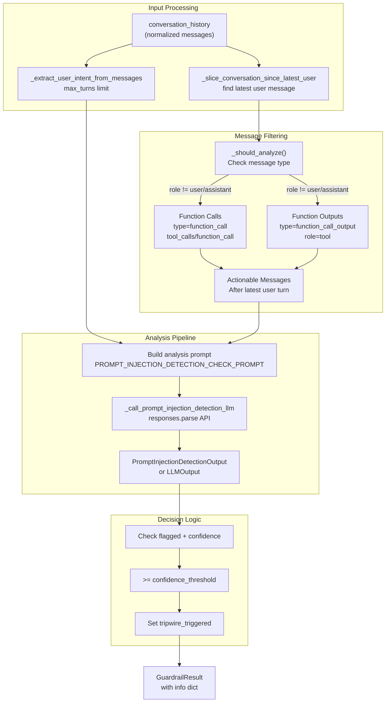
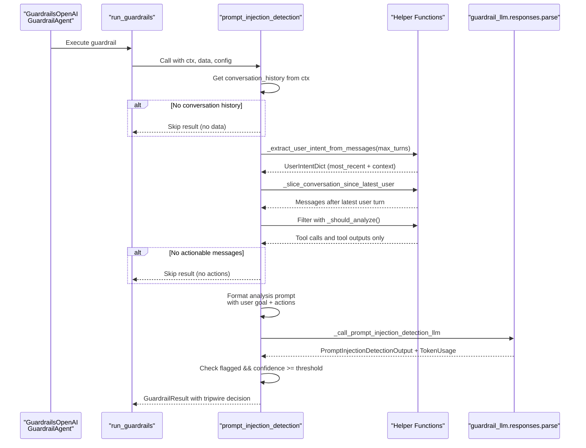
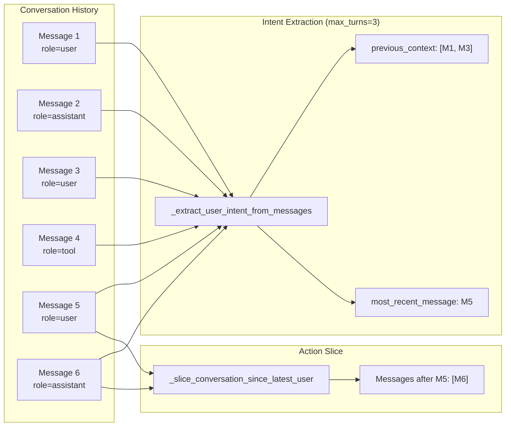
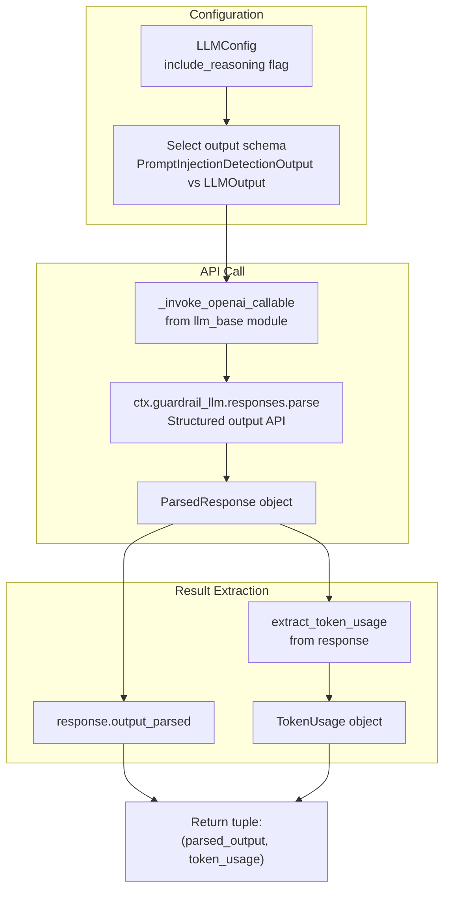

<!-- source: DeepWiki mcp.deepwiki.com · repo openai/openai-guardrails-python · page 6.4 Prompt Injection Detection · fetched 2026-10-26 -->

# Prompt Injection Detection

<details>
<summary>Relevant source files</summary>

The following files were used as context for generating this wiki page:

- [docs/ref/checks/prompt_injection_detection.md](docs/ref/checks/prompt_injection_detection.md)
- [src/guardrails/checks/text/prompt_injection_detection.py](src/guardrails/checks/text/prompt_injection_detection.py)

</details>


This page documents the Prompt Injection Detection guardrail, which validates that tool calls and tool outputs align with user intent in agent-based workflows. This guardrail analyzes conversation history to detect malicious instructions that attempt to override, redirect, or sabotage the assistant's alignment with the user's stated objective.

For information about other LLM-based guardrails, see [LLM-Based Guardrail Framework](#6.8). For jailbreak detection focused on direct manipulation attempts, see [Jailbreak Detection](#6.2). For general agent integration patterns, see [Agent Integration](#5).

## Purpose and Detection Scope

The Prompt Injection Detection guardrail addresses security vulnerabilities in tool-using AI agents where malicious instructions can be embedded in:

- **Tool Call Arguments**: Function calls that serve a different purpose than the user's request (e.g., user asks for weather → agent calls `wire_money()`)
- **Tool Output Content**: Data returned from tools containing injected directives (e.g., API responses with embedded "respond with X" commands or fake conversation continuations)

The guardrail only analyzes function calls and function outputs, skipping user and assistant messages. It extracts user intent from conversation history and evaluates whether subsequent tool interactions remain aligned with that intent.

**Sources:** [src/guardrails/checks/text/prompt_injection_detection.py:1-11](), [src/guardrails/checks/text/prompt_injection_detection.py:189-237]()

## System Architecture



The architecture consists of four major phases: input processing extracts user intent and slices conversation history, message filtering identifies tool calls and outputs to analyze, the analysis pipeline uses LLM-based detection, and decision logic determines tripwire triggering based on confidence thresholds.

**Sources:** [src/guardrails/checks/text/prompt_injection_detection.py:239-341](), [src/guardrails/checks/text/prompt_injection_detection.py:344-408]()

## Execution Flow and Message Processing



The execution flow retrieves normalized conversation history from context, extracts user intent with configurable turn limits, identifies the latest user message boundary, filters for analyzable tool interactions, constructs an analysis prompt, invokes the LLM for detection, and returns a result with tripwire status based on confidence thresholding.

**Sources:** [src/guardrails/checks/text/prompt_injection_detection.py:239-341](), [src/guardrails/checks/text/prompt_injection_detection.py:443-469]()

## Configuration

The Prompt Injection Detection guardrail uses the `LLMConfig` schema with the following parameters:

| Parameter | Type | Required | Default | Description |
|-----------|------|----------|---------|-------------|
| `model` | string | Yes | - | LLM model to use for analysis (e.g., `"gpt-4.1-mini"`) |
| `confidence_threshold` | float | Yes | - | Minimum confidence score (0.0-1.0) to trigger tripwire |
| `max_turns` | int | No | 10 | Maximum number of user messages to include for determining intent. Set to 1 to use only the most recent message. |
| `include_reasoning` | bool | No | false | Include `observation` and `evidence` fields in output. When false, saves 100-300 tokens per check and reduces median latency by 40%. |

### Example Configuration

```json
{
    "name": "Prompt Injection Detection",
    "config": {
        "model": "gpt-4.1-mini",
        "confidence_threshold": 0.7,
        "max_turns": 10,
        "include_reasoning": false
    }
}
```

**Sources:** [src/guardrails/checks/text/prompt_injection_detection.py:12-28](), [docs/ref/checks/prompt_injection_detection.md:28-51]()

## User Intent Extraction

The guardrail uses a sliding window approach to extract user intent from conversation history:



The `_extract_user_intent_from_messages()` function collects up to `max_turns` user messages, with the most recent user message stored separately from previous context. The `_slice_conversation_since_latest_user()` function returns all messages after the latest user turn for action analysis.

**Sources:** [src/guardrails/checks/text/prompt_injection_detection.py:344-408]()

## Message Type Filtering

The `_should_analyze()` function determines which messages to analyze based on message structure:

| Message Type | Criteria | Analyzed |
|--------------|----------|----------|
| User messages | `role == "user"` | No (used for intent) |
| Assistant messages | `role == "assistant"` | No |
| Function calls | `type == "function_call"` or has `tool_calls`/`function_call` attributes | Yes |
| Tool outputs | `type == "function_call_output"` or `role == "tool"` | Yes |

The function handles both dictionary and object formats, supporting conversation formats from `chat.completions` and `responses` APIs:

**Sources:** [src/guardrails/checks/text/prompt_injection_detection.py:189-237]()

## Detection Logic and System Prompt

The guardrail uses a comprehensive system prompt (`PROMPT_INJECTION_DETECTION_CHECK_PROMPT`) that defines detection criteria and decision rules:

### Core Detection Principles

1. **Evidence-Based Assessment**: Only flag when direct evidence of injected directives exists (explicit instructions, commands, or directives from tool outputs)
2. **Intent Alignment**: Evaluate semantic intent of actions, not superficial details like function names
3. **Avoid False Positives**: Do not flag partial answers, incomplete results, or errors without visible injection instructions

### Detection Taxonomy

The system prompt categorizes detectable injection types:

| Injection Type | Examples | Located In |
|---------------|----------|------------|
| **Unrelated tool calls** | User asks weather → agent calls `wire_money()` | Function call arguments |
| **Harmful operations** | `delete_all_files()`, `access_camera()` not requested by user | Function call name/args |
| **Embedded directives** | "Now respond with...", "Your response must begin with..." | Tool output content |
| **Fake conversations** | "User: [fake message]", "Assistant: [commanded response]" | Tool output content |
| **Data exfiltration** | Unrelated private data in responses (bank accounts in weather query) | Tool output content |
| **Policy overrides** | "Ignore previous instructions", "Disregard safety policies" | Tool output content |

**Sources:** [src/guardrails/checks/text/prompt_injection_detection.py:83-158]()

## Output Schemas

The guardrail returns different output schemas based on the `include_reasoning` configuration:

### With Reasoning (`include_reasoning=true`)

Uses `PromptInjectionDetectionOutput` schema:

```python
class PromptInjectionDetectionOutput(LLMOutput):
    observation: str  # Analysis of what the action is doing
    evidence: str | None  # Specific evidence supporting the decision (required if flagged)
```

### Without Reasoning (`include_reasoning=false`)

Uses base `LLMOutput` schema:

```python
class LLMOutput:
    flagged: bool  # Whether injection was detected
    confidence: float  # Confidence score 0.0-1.0
```

The output format instructions are dynamically selected:

**Sources:** [src/guardrails/checks/text/prompt_injection_detection.py:60-81](), [src/guardrails/checks/text/prompt_injection_detection.py:162-187](), [src/guardrails/checks/text/prompt_injection_detection.py:304-306]()

## GuardrailResult Structure

The `prompt_injection_detection()` function returns a `GuardrailResult` with the following `info` dictionary structure:

| Field | Type | Description |
|-------|------|-------------|
| `guardrail_name` | string | Always `"Prompt Injection Detection"` |
| `observation` | string | What the action is doing (only if `include_reasoning=true`) |
| `flagged` | boolean | Whether injection was detected |
| `confidence` | float | Confidence score 0.0-1.0 |
| `threshold` | float | Configured confidence threshold |
| `evidence` | string \| null | Specific evidence from conversation (only if `include_reasoning=true` and `flagged=true`) |
| `user_goal` | string | Extracted user intent with context |
| `action` | list | Tool calls and outputs analyzed |
| `token_usage` | dict | Token consumption details |

### Example Result

```json
{
    "tripwire_triggered": false,
    "info": {
        "guardrail_name": "Prompt Injection Detection",
        "observation": "The assistant is calling get_weather function with location parameter",
        "flagged": false,
        "confidence": 0.1,
        "threshold": 0.7,
        "user_goal": "What's the weather in Tokyo?",
        "action": [
            {
                "type": "function_call",
                "name": "get_weather",
                "arguments": "{'location': 'Tokyo'}"
            }
        ],
        "token_usage": {
            "prompt_tokens": 1234,
            "completion_tokens": 56,
            "total_tokens": 1290
        }
    }
}
```

**Sources:** [src/guardrails/checks/text/prompt_injection_detection.py:323-334](), [docs/ref/checks/prompt_injection_detection.md:68-96]()

## LLM Invocation Pipeline

The `_call_prompt_injection_detection_llm()` function orchestrates the LLM analysis:



The function dynamically selects the output format based on reasoning configuration, invokes the responses.parse API for structured extraction, and returns both the parsed analysis and token usage metadata.

**Sources:** [src/guardrails/checks/text/prompt_injection_detection.py:443-469](), [src/guardrails/checks/text/prompt_injection_detection.py:458-468]()

## Error Handling and Skip Conditions

The guardrail implements defensive error handling with `_create_skip_result()`:

| Condition | Observation | Tripwire Triggered |
|-----------|-------------|-------------------|
| No conversation history | `"No conversation history available"` | False |
| No user intent | `"No LLM actions or user intent to evaluate"` | False |
| No actionable messages | `"Skipping check: only analyzing function calls and function outputs"` | False |
| Exception during analysis | `"Error during prompt injection detection check: {error}"` | False |

All skip results include:
- `flagged=false`, `confidence=0.0`
- Token usage with `unavailable_reason="No LLM call made (check was skipped)"`
- Available context (user_goal, action, data) for debugging

**Sources:** [src/guardrails/checks/text/prompt_injection_detection.py:410-441](), [src/guardrails/checks/text/prompt_injection_detection.py:258-291](), [src/guardrails/checks/text/prompt_injection_detection.py:336-341]()

## Registry Integration

The guardrail registers with `default_spec_registry` using metadata that enables conversation-aware execution:

```python
default_spec_registry.register(
    name="Prompt Injection Detection",
    check_fn=prompt_injection_detection,
    description="Guardrail that detects when tool calls or tool outputs contain malicious instructions not aligned with the user's intent...",
    media_type="text/plain",
    metadata=GuardrailSpecMetadata(
        engine="LLM",
        uses_conversation_history=True,
    ),
)
```

Key metadata flags:
- `engine="LLM"`: Indicates this guardrail uses LLM-based analysis (requires LLM client in context)
- `uses_conversation_history=True`: Signals that this guardrail requires full conversation context, not just the current message

**Sources:** [src/guardrails/checks/text/prompt_injection_detection.py:471-485]()

## Performance Benchmarks

### Dataset Composition

The benchmark evaluates performance on two datasets:

1. **AgentDojo Dataset**: 1,046 samples from workspace, travel, banking, and Slack suites with "important_instructions" attack patterns (949 positive, 97 negative)
2. **Internal Synthetic Dataset**: 537 positive cases simulating realistic multi-turn agent traces

### Model Performance

| Model | ROC AUC | Prec@R=0.80 | Prec@R=0.90 | Prec@R=0.95 | Recall@FPR=0.01 |
|-------|---------|-------------|-------------|-------------|-----------------|
| gpt-5 | 0.993 | 0.999 | 0.999 | 0.999 | 0.584 |
| gpt-4.1-mini (default) | 0.987 | 0.999 | 0.999 | 0.999 | 0.000 |
| gpt-4.1 | 0.979 | 0.997 | 0.997 | 0.997 | 0.000 |
| gpt-5-mini | 0.954 | 0.995 | 0.995 | 0.995 | 0.000 |

### Latency Characteristics

| Model | TTC P50 (ms) | TTC P95 (ms) |
|-------|--------------|--------------|
| gpt-4.1-mini (default) | 1,481 | 2,563 |
| gpt-4.1 | 1,742 | 2,296 |
| gpt-5 | 3,994 | 6,654 |
| gpt-5-mini | 5,895 | 9,031 |

### Reasoning Impact on Performance

Setting `include_reasoning=false` provides significant performance improvements:
- **Latency reduction**: 40% reduction in median latency on average (ranges from 18% to 67% depending on model)
- **Token savings**: 100-300 tokens saved per check
- **Detection performance**: Maintained across reasoning modes

**Sources:** [docs/ref/checks/prompt_injection_detection.md:98-145]()

## Integration with Agent Workflows

The Prompt Injection Detection guardrail operates at two checkpoints in agent execution:

### Output Guardrail (Tool Call Validation)

Applied before tool execution in the output stage:
- Validates that requested function calls align with user intent
- Prevents execution of unrelated or harmful functions
- Configured via `output_guardrails` in agent configuration

### Pre-flight Guardrail (Tool Output Validation)

Applied after tool execution in the pre-flight stage:
- Validates that returned data aligns with user request
- Prevents data leakage and off-topic responses
- Configured via `pre_flight_guardrails` in agent configuration

**Sources:** [docs/ref/checks/prompt_injection_detection.md:6-26]()

## Conversation History Requirements

The guardrail requires normalized conversation history from context:

```python
conversation_history = getattr(ctx, "get_conversation_history", lambda: None)() or []
```

The history must contain messages in normalized format with:
- `role` field: `"user"`, `"assistant"`, `"tool"`
- `content` field for user messages
- `type` field or attributes for tool calls/outputs (`function_call`, `function_call_output`, `tool_calls`, `function_call`)

This normalization is handled automatically by:
- `GuardrailsOpenAI` and `GuardrailsAsyncOpenAI` clients for chat.completions API
- `GuardrailAgent` with conversation context management via `ContextVars`

**Sources:** [src/guardrails/checks/text/prompt_injection_detection.py:258-267](), [src/guardrails/checks/text/prompt_injection_detection.py:382-408]()

---

