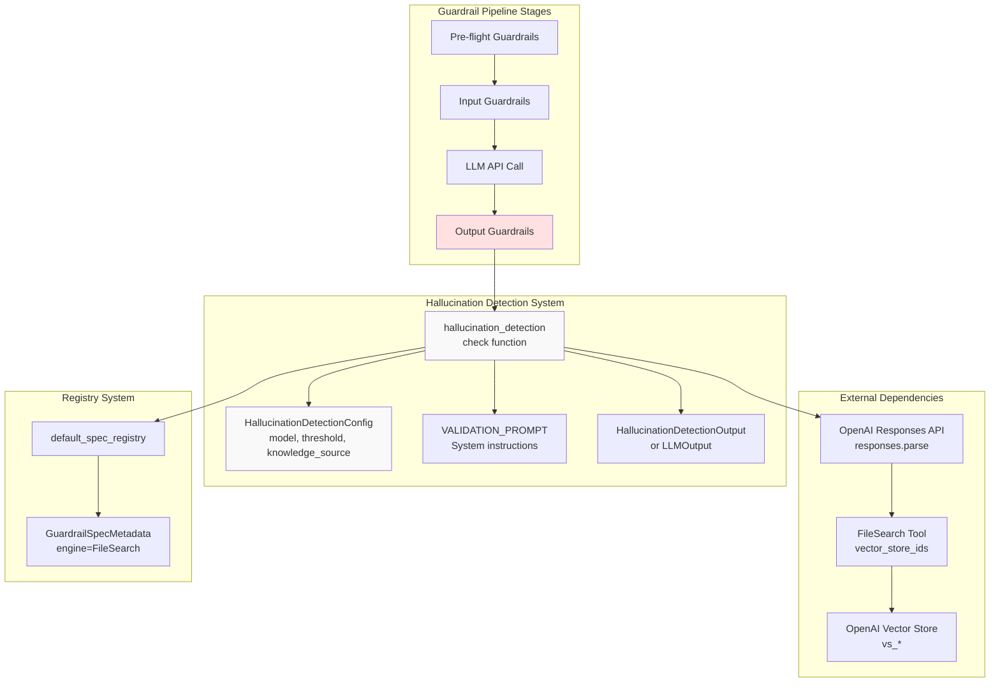
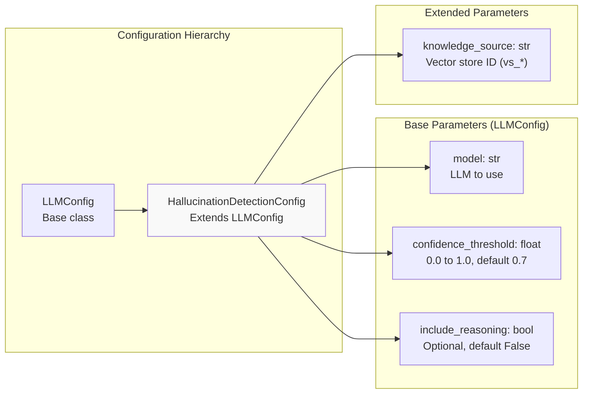
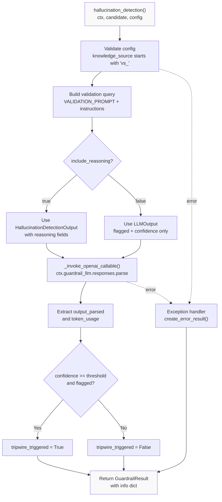
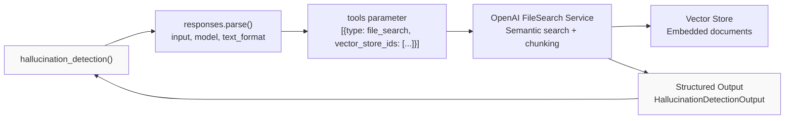
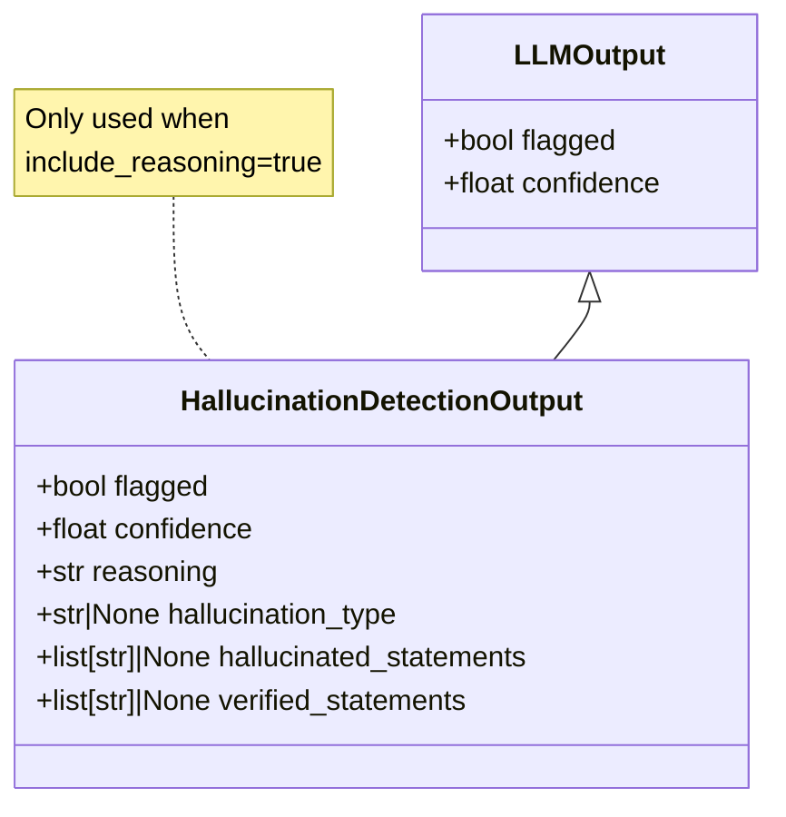
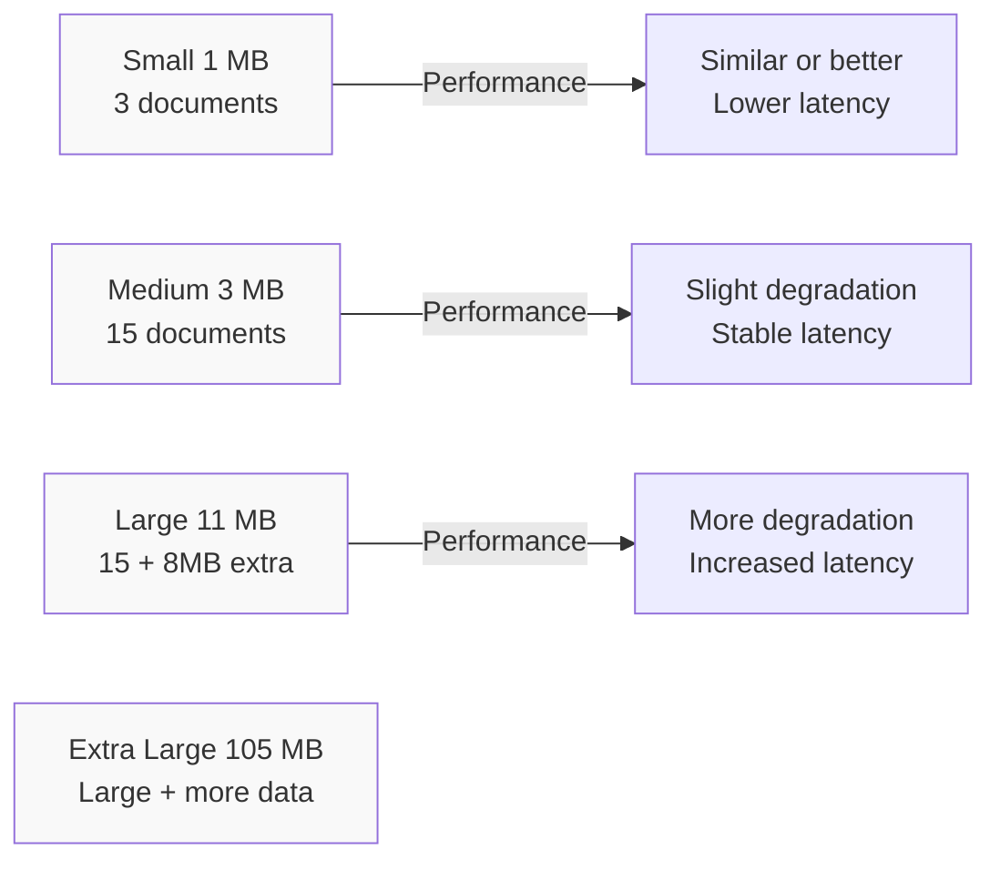
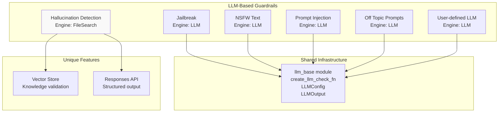

<!-- source: DeepWiki mcp.deepwiki.com · repo openai/openai-guardrails-python · page 6.5 Hallucination Detection · fetched 2026-10-26 -->

# Hallucination Detection

<details>
<summary>Relevant source files</summary>

The following files were used as context for generating this wiki page:

- [README.md](README.md)
- [docs/assets/images/guardrails-python-config-screenshot-100pct-q70.webp](docs/assets/images/guardrails-python-config-screenshot-100pct-q70.webp)
- [docs/ref/checks/hallucination_detection.md](docs/ref/checks/hallucination_detection.md)
- [src/guardrails/checks/text/hallucination_detection.py](src/guardrails/checks/text/hallucination_detection.py)
- [src/guardrails/checks/text/off_topic_prompts.py](src/guardrails/checks/text/off_topic_prompts.py)
- [src/guardrails/checks/text/user_defined_llm.py](src/guardrails/checks/text/user_defined_llm.py)
- [src/guardrails/evals/core/benchmark_reporter.py](src/guardrails/evals/core/benchmark_reporter.py)

</details>


## Purpose and Scope

This document describes the **Hallucination Detection** guardrail, an LLM-based validation check that detects when AI-generated text contains factual claims that are contradicted or unsupported by reference documents. It validates LLM outputs against a knowledge base stored in an OpenAI vector store using the FileSearch API.

This guardrail operates in the **output** stage of the guardrail pipeline. For information about the overall pipeline architecture, see [3.1 Three-Stage Pipeline Architecture](#3.1). For details on LLM-based guardrail infrastructure, see [6.8 LLM-Based Guardrail Framework](#6.8).

**What it detects**: Factual claims about products, prices, policies, dates, statistics, technical details, or company information that cannot be verified or are contradicted by the knowledge source.

**What it does not detect**: Opinions, conversational content, questions, or claims that are supported by the documents (even if incomplete).

Sources: [src/guardrails/checks/text/hallucination_detection.py:1-43](), [docs/ref/checks/hallucination_detection.md:1-10]()

---

## System Architecture

### Position in Guardrail Ecosystem



**Diagram: Hallucination Detection in Pipeline Context**

The `hallucination_detection` function is registered as an output guardrail with engine type `"FileSearch"` to distinguish it from standard LLM-based checks. It executes after the LLM generates a response but before returning to the user.

Sources: [src/guardrails/checks/text/hallucination_detection.py:332-343](), [README.md:183-195]()

### Registration and Discovery

The guardrail is registered with the global registry at module load time:

```python
# Registration in hallucination_detection.py
default_spec_registry.register(
    name="Hallucination Detection",
    check_fn=hallucination_detection,
    description="Detects potential hallucinations...",
    media_type="text/plain",
    metadata=GuardrailSpecMetadata(engine="FileSearch"),
)
```

The `engine="FileSearch"` metadata indicates this check uses OpenAI's FileSearch tool rather than standard LLM calls, which affects cost calculation and execution characteristics.

Sources: [src/guardrails/checks/text/hallucination_detection.py:332-343]()

---

## Configuration Schema

### HallucinationDetectionConfig Class



**Diagram: Configuration Class Hierarchy**

Sources: [src/guardrails/checks/text/hallucination_detection.py:74-89]()

### Configuration Parameters

| Parameter | Type | Required | Default | Description |
|-----------|------|----------|---------|-------------|
| `model` | `str` | Yes | - | OpenAI model for validation (e.g., `"gpt-4.1-mini"`) |
| `confidence_threshold` | `float` | Yes | `0.7` | Minimum confidence (0.0-1.0) to trigger tripwire |
| `knowledge_source` | `str` | Yes | - | Vector store ID starting with `"vs_"` |
| `include_reasoning` | `bool` | No | `False` | Include detailed reasoning in output |

### Configuration Example

```json
{
    "name": "Hallucination Detection",
    "config": {
        "model": "gpt-4.1-mini",
        "confidence_threshold": 0.7,
        "knowledge_source": "vs_abc123",
        "include_reasoning": false
    }
}
```

### Tuning Guidance

**Confidence Threshold:**
- Start at `0.7` for balanced precision/recall
- Increase to `0.8-0.9` to reduce false positives (higher precision)
- Decrease to `0.6` to catch more subtle errors (higher recall)

**Include Reasoning:**
- `false` (recommended): Reduces latency by 18-67% depending on model
- `true`: Provides detailed explanations for debugging and development

**Vector Store Quality:**
- Precision and recall strongly depend on knowledge source relevance
- Prefer concise, authoritative documents over large, noisy corpora
- Monitor performance as vector store size increases

Sources: [docs/ref/checks/hallucination_detection.md:34-37](), [docs/ref/checks/hallucination_detection.md:28-32]()

---

## Execution Flow

### Main Function: `hallucination_detection`



**Diagram: Execution Flow Through hallucination_detection Function**

Sources: [src/guardrails/checks/text/hallucination_detection.py:215-329]()

### Step-by-Step Processing

1. **Validation** [hallucination_detection.py:239-240]()
   - Ensures `knowledge_source` is valid vector store ID (starts with `"vs_"`)
   - Raises `ValueError` if invalid

2. **Prompt Construction** [hallucination_detection.py:252-260]()
   - Selects output format based on `include_reasoning`
   - Combines `VALIDATION_PROMPT` with output instructions
   - Appends candidate text to validate

3. **API Invocation** [hallucination_detection.py:263-269]()
   - Calls `ctx.guardrail_llm.responses.parse()`
   - Passes FileSearch tool with `vector_store_ids`
   - Uses structured output with `text_format` parameter

4. **Response Parsing** [hallucination_detection.py:272-278]()
   - Extracts `output_parsed` directly from response
   - Extracts token usage for cost tracking
   - Determines tripwire status based on confidence threshold

5. **Error Handling** [hallucination_detection.py:290-329]()
   - Catches `ValueError` for validation errors
   - Catches generic exceptions for API failures
   - Returns safe default (`flagged=False`, `confidence=0.0`)

Sources: [src/guardrails/checks/text/hallucination_detection.py:215-329]()

### FileSearch Integration



**Diagram: FileSearch Tool Integration**

The `tools` parameter in the API call configures FileSearch:

```python
tools=[{
    "type": "file_search",
    "vector_store_ids": [config.knowledge_source]
}]
```

This instructs the Responses API to use FileSearch with the specified vector store for document validation.

Sources: [src/guardrails/checks/text/hallucination_detection.py:263-269]()

---

## Validation Prompt Design

### VALIDATION_PROMPT Structure

The system prompt is approximately 60 lines of detailed instructions defining:

1. **What to flag**: Factual claims that are:
   - Clearly contradicted by documents
   - Completely unsupported by documents

2. **What NOT to flag**:
   - Greetings, pleasantries, conversational content
   - Opinions or subjective statements
   - General advice without specific claims
   - Incomplete but accurate statements
   - Minor phrasing differences with same core meaning

3. **Factual claim types**:
   - Product features, specifications, capabilities
   - Prices, costs, fees
   - Policies, terms, conditions
   - Dates, times, schedules
   - Statistics, numbers, percentages
   - Company information, history

4. **Confidence scoring**:
   - `1.0` = Certain hallucinated
   - `0.0` = Certain not hallucinated
   - Use full range `[0.0-1.0]` to reflect certainty

### Output Instructions

Two sets of instructions based on `include_reasoning`:

**With Reasoning (REASONING_OUTPUT_INSTRUCTION):**
```json
{
  "flagged": "boolean",
  "confidence": "float 0.0-1.0",
  "reasoning": "detailed explanation",
  "hallucination_type": "factual_error | unsupported_claim | none",
  "hallucinated_statements": ["array of strings"],
  "verified_statements": ["array of strings"]
}
```

**Without Reasoning (BASE_OUTPUT_INSTRUCTION):**
```json
{
  "flagged": "boolean",
  "confidence": "float 0.0-1.0"
}
```

Sources: [src/guardrails/checks/text/hallucination_detection.py:125-213]()

---

## Output Schema

### HallucinationDetectionOutput Class



**Diagram: Output Schema Class Hierarchy**

Sources: [src/guardrails/checks/text/hallucination_detection.py:91-123]()

### GuardrailResult Info Dictionary

The function returns a `GuardrailResult` with the following `info` dictionary structure:

**With `include_reasoning=true`:**

| Field | Type | Description |
|-------|------|-------------|
| `guardrail_name` | `str` | Always `"Hallucination Detection"` |
| `flagged` | `bool` | Whether content was flagged |
| `confidence` | `float` | Confidence score 0.0-1.0 |
| `threshold` | `float` | Configured threshold value |
| `reasoning` | `str` | Explanation of analysis |
| `hallucination_type` | `str\|None` | `"factual_error"`, `"unsupported_claim"`, or `"none"` |
| `hallucinated_statements` | `list[str]\|None` | Specific unsupported claims |
| `verified_statements` | `list[str]\|None` | Specific supported claims |
| `token_usage` | `dict` | Token consumption details |

**With `include_reasoning=false`:**

| Field | Type | Description |
|-------|------|-------------|
| `guardrail_name` | `str` | Always `"Hallucination Detection"` |
| `flagged` | `bool` | Whether content was flagged |
| `confidence` | `float` | Confidence score 0.0-1.0 |
| `threshold` | `float` | Configured threshold value |
| `token_usage` | `dict` | Token consumption details |

### Error Handling

When errors occur, the guardrail returns a safe default:

```python
GuardrailResult(
    tripwire_triggered=False,
    info={
        "guardrail_name": "Hallucination Detection",
        "flagged": False,
        "confidence": 0.0,
        "threshold": config.confidence_threshold,
        "reasoning": "Analysis failed: {error_message}",
        "token_usage": {
            "unavailable_reason": "LLM call failed before usage could be recorded"
        }
    }
)
```

Sources: [src/guardrails/checks/text/hallucination_detection.py:280-329](), [docs/ref/checks/hallucination_detection.md:104-107]()

---

## Integration Patterns

### Vector Store Prerequisites

Before using the hallucination detection guardrail, you must create an OpenAI vector store containing your reference documents.

**Option 1: Guardrails Wizard**
- Configure at [guardrails.openai.com](https://guardrails.openai.com/)
- Provides option to create vector store during setup

**Option 2: OpenAI Dashboard**
- Create directly in [OpenAI Dashboard](https://platform.openai.com/storage/vector_stores/)

**Option 3: Utility Script**
```bash
python src/guardrails/utils/create_vector_store.py your_document.pdf
```

**Option 4: OpenAI API**
- Follow [File Search documentation](https://platform.openai.com/docs/guides/tools-file-search)

The vector store ID will have format `vs_abc123...` which is required for the `knowledge_source` configuration parameter.

Sources: [src/guardrails/checks/text/hallucination_detection.py:7-14](), [docs/ref/checks/hallucination_detection.md:40-50]()

### Usage with GuardrailsOpenAI Client

```python
from pathlib import Path
from guardrails import GuardrailsAsyncOpenAI

# Configuration bundle
bundle = {
    "version": 1,
    "output": {
        "version": 1,
        "guardrails": [
            {
                "name": "Hallucination Detection",
                "config": {
                    "model": "gpt-4.1-mini",
                    "confidence_threshold": 0.7,
                    "knowledge_source": "vs_abc123",
                    "include_reasoning": False
                }
            }
        ]
    }
}

# Initialize client
client = GuardrailsAsyncOpenAI(config=bundle)

# Make API call - guardrails automatically applied
response = await client.responses.create(
    model="gpt-5",
    input="What is Microsoft's revenue in 2023?"
)

# Check results
if response.guardrail_results.output_guardrails:
    for result in response.guardrail_results.output_guardrails:
        if result.tripwire_triggered:
            print(f"Hallucination detected!")
            print(f"Confidence: {result.info['confidence']}")
```

Sources: [docs/ref/checks/hallucination_detection.md:54-86]()

### Usage with GuardrailAgent

```python
from pathlib import Path
from guardrails import GuardrailAgent

# Create agent with guardrails
agent = GuardrailAgent(
    config=Path("guardrails_config.json"),
    name="Customer support agent",
    instructions="You answer questions about our products."
)

# Guardrails automatically applied to agent outputs
result = await Runner.run(agent, "What are your prices?")
```

The hallucination detection guardrail validates agent responses against the configured vector store before returning to the user.

Sources: [README.md:66-93]()

---

## Performance Characteristics

### Benchmark Dataset

**Knowledge Source**: 15 SEC filings (3 MB total) from:
- Microsoft Corporation (5 filings)
- Oracle Corporation (5 filings)
- Ford Motor Company (5 filings)

**Evaluation Set**: 300 statements
- 150 positive (contradicted/unsupported)
- 150 negative (supported or non-factual)
- 50% positive class prevalence

Sources: [docs/ref/checks/hallucination_detection.md:140-166]()

### Model Performance (Medium Vector Store - 3 MB)

| Model | ROC AUC | Prec@R=0.80 | Prec@R=0.90 | Prec@R=0.95 |
|-------|---------|-------------|-------------|-------------|
| `gpt-5` | 0.854 | 0.732 | 0.686 | 0.670 |
| `gpt-5-mini` | 0.934 | 0.813 | 0.813 | 0.770 |
| `gpt-4.1` | 0.870 | 0.785 | 0.785 | 0.785 |
| `gpt-4.1-mini` (default) | 0.876 | 0.806 | 0.789 | 0.789 |

**Metrics Explanation**:
- **ROC AUC**: Area under ROC curve (higher is better, max 1.0)
- **Prec@R=X**: Precision when recall is fixed at X threshold

Sources: [docs/ref/checks/hallucination_detection.md:178-189]()

### Latency Performance (Medium Vector Store - 3 MB)

| Model | TTC P50 (ms) | TTC P95 (ms) |
|-------|--------------|--------------|
| `gpt-5` | 34,135 | 525,854 |
| `gpt-5-mini` | 23,013 | 59,316 |
| `gpt-4.1` | 7,126 | 33,464 |
| `gpt-4.1-mini` (default) | 7,069 | 43,174 |

**Metrics Explanation**:
- **TTC P50**: Median time to completion (50th percentile)
- **TTC P95**: 95th percentile time to completion
- Includes FileSearch processing time

Sources: [docs/ref/checks/hallucination_detection.md:192-204]()

### Vector Store Scaling Analysis



**Diagram: Vector Store Size Impact**

Sources: [docs/ref/checks/hallucination_detection.md:206-226]()

### Latency Scaling by Vector Store Size

| Model | Small (1 MB) P50/P95 | Medium (3 MB) P50/P95 | Large (11 MB) P50/P95 | XL (105 MB) P50/P95 |
|-------|---------------------|----------------------|---------------------|---------------------|
| `gpt-5` | 28,762 / 396,472 | 34,135 / 525,854 | 37,104 / 75,684 | 40,909 / 645,025 |
| `gpt-5-mini` | 19,240 / 39,526 | 23,013 / 59,316 | 24,217 / 65,904 | 37,314 / 118,564 |
| `gpt-4.1` | 7,437 / 15,721 | 7,126 / 33,464 | 6,993 / 30,315 | 6,688 / 127,481 |
| `gpt-4.1-mini` | 6,661 / 14,827 | 7,069 / 43,174 | 7,032 / 46,354 | 7,374 / 37,769 |

**Key Observations**:
- GPT-4.1 series shows minimal latency impact across sizes
- GPT-5 series shows significant increases with larger stores
- Latency impact varies significantly by model family

Sources: [docs/ref/checks/hallucination_detection.md:218-225]()

### Performance Scaling by Vector Store Size

| Model | Vector Store | ROC AUC | Prec@R=0.80 | Prec@R=0.90 | Prec@R=0.95 |
|-------|-------------|---------|-------------|-------------|-------------|
| **gpt-5** | Small (1 MB) | 0.847 | 0.713 | 0.649 | 0.645 |
| | Medium (3 MB) | 0.854 | 0.732 | 0.686 | 0.670 |
| | Large (11 MB) | 0.814 | 0.649 | 0.633 | 0.633 |
| | XL (105 MB) | 0.866 | 0.744 | 0.684 | 0.683 |
| **gpt-5-mini** | Small (1 MB) | 0.939 | 0.821 | 0.821 | 0.821 |
| | Medium (3 MB) | 0.934 | 0.813 | 0.813 | 0.770 |
| | Large (11 MB) | 0.919 | 0.817 | 0.817 | 0.817 |
| | XL (105 MB) | 0.909 | 0.793 | 0.793 | 0.711 |
| **gpt-4.1** | Small (1 MB) | 0.907 | 0.839 | 0.839 | 0.839 |
| | Medium (3 MB) | 0.870 | 0.785 | 0.785 | 0.785 |
| | Large (11 MB) | 0.846 | 0.753 | 0.753 | 0.753 |
| | XL (105 MB) | 0.837 | 0.743 | 0.743 | 0.743 |
| **gpt-4.1-mini** | Small (1 MB) | 0.914 | 0.851 | 0.851 | 0.851 |
| | Medium (3 MB) | 0.876 | 0.806 | 0.789 | 0.789 |
| | Large (11 MB) | 0.862 | 0.791 | 0.757 | 0.757 |
| | XL (105 MB) | 0.802 | 0.722 | 0.722 | 0.722 |

**Key Insights**:
- **Best Performance**: `gpt-5-mini` consistently highest ROC AUC (0.909-0.939)
- **Best Latency**: `gpt-4.1-mini` lowest median latencies with strong accuracy
- **Most Stable**: `gpt-4.1-mini` maintains stable performance across sizes
- **Scale Sensitivity**: Performance generally decreases with larger stores
- **Recommended**: `gpt-4.1-mini` for production (balanced accuracy/latency)

Sources: [docs/ref/checks/hallucination_detection.md:231-258]()

### Why Performance Decreases with Scale

1. **Signal-to-noise ratio degradation**: Larger stores contain more irrelevant documents
2. **Semantic search limitations**: FileSearch retrieves semantically similar but not necessarily factually relevant documents
3. **Document quality over quantity**: Relevance and accuracy matter more than total size
4. **Performance plateaus**: Beyond 11 MB, impact becomes less severe

**Recommendation**: Use focused, high-quality document sets rather than comprehensive but noisy knowledge bases.

Sources: [docs/ref/checks/hallucination_detection.md:260-265]()

---

## Cost Considerations

### FileSearch Pricing

The Hallucination Detection guardrail uses OpenAI's FileSearch tool, which incurs additional costs beyond standard LLM API calls:

- **Vector Store Storage**: Ongoing cost per GB per day
- **FileSearch Usage**: Per-request cost for semantic search

Refer to the [OpenAI pricing page](https://openai.com/api/pricing/) Built-in Tools section for current rates.

### Token Usage Tracking

The guardrail tracks token consumption for cost analysis:

```python
# Token usage included in result.info
{
    "token_usage": {
        "prompt_tokens": 1250,
        "completion_tokens": 85,
        "total_tokens": 1335
    }
}
```

This includes:
- System prompt tokens
- Candidate text tokens
- FileSearch context tokens
- Structured output generation tokens

Sources: [src/guardrails/checks/text/hallucination_detection.py:16-16](), [docs/ref/checks/hallucination_detection.md:101-101]()

---

## Code Organization

### File Structure

```
src/guardrails/checks/text/
├── hallucination_detection.py    # Main implementation
├── llm_base.py                   # Shared LLM infrastructure
├── jailbreak.py                  # Similar LLM-based check
├── nsfw_text.py                  # Similar LLM-based check
└── prompt_injection.py           # Similar LLM-based check
```

### Key Classes and Functions

| Entity | Location | Purpose |
|--------|----------|---------|
| `hallucination_detection()` | [hallucination_detection.py:215-329]() | Main check function |
| `HallucinationDetectionConfig` | [hallucination_detection.py:74-89]() | Configuration schema |
| `HallucinationDetectionOutput` | [hallucination_detection.py:91-123]() | Extended output schema |
| `VALIDATION_PROMPT` | [hallucination_detection.py:125-188]() | System instructions |
| `REASONING_OUTPUT_INSTRUCTION` | [hallucination_detection.py:192-202]() | Reasoning format spec |
| `BASE_OUTPUT_INSTRUCTION` | [hallucination_detection.py:206-212]() | Minimal format spec |
| `_invoke_openai_callable()` | [llm_base.py]() | Shared API wrapper |
| `create_error_result()` | [llm_base.py]() | Shared error handler |

Sources: [src/guardrails/checks/text/hallucination_detection.py:1-343]()

---

## Comparison with Other LLM-Based Guardrails



**Diagram: Hallucination Detection vs Other LLM-Based Guardrails**

**Key Differences**:

1. **Engine Type**: Hallucination Detection uses `"FileSearch"` while others use `"LLM"`
2. **External Knowledge**: Requires vector store; others operate on text alone
3. **API Method**: Uses `responses.parse()` with FileSearch tool; others use standard chat completions
4. **Cost Model**: Incurs FileSearch charges; others only pay for LLM calls
5. **Implementation**: Direct implementation; others use `create_llm_check_fn()` factory

Sources: [src/guardrails/checks/text/hallucination_detection.py:1-343](), [src/guardrails/checks/text/off_topic_prompts.py:1-90](), [src/guardrails/checks/text/user_defined_llm.py:1-86]()

---

