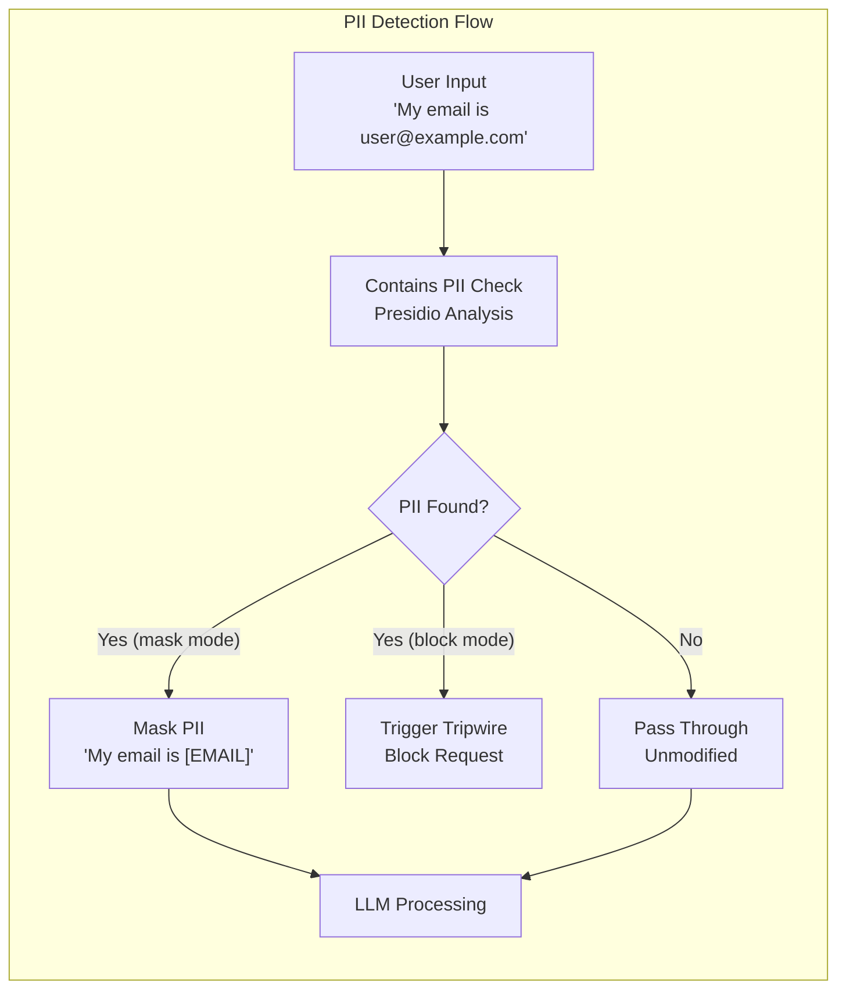
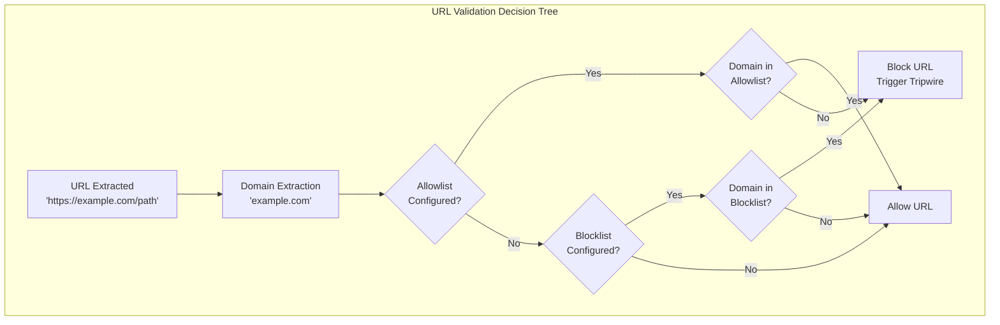
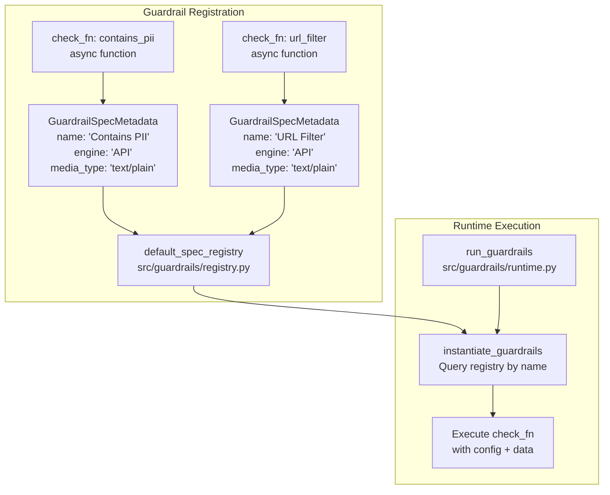
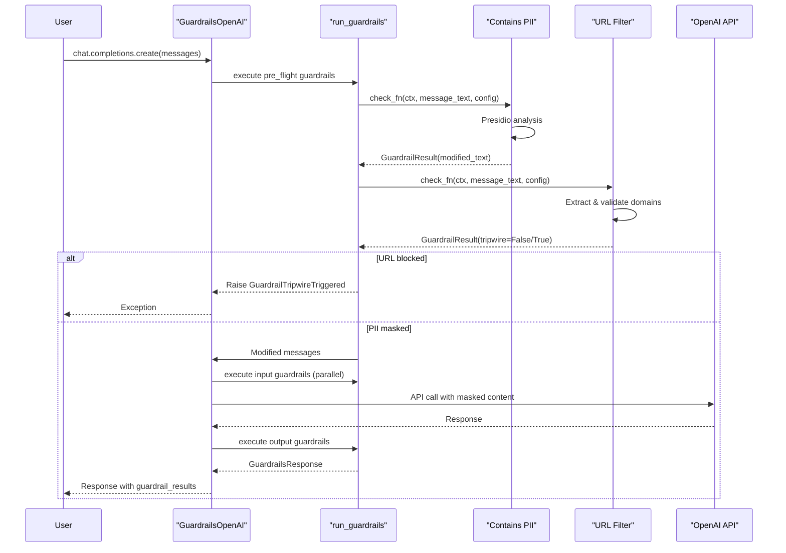

<!-- source: DeepWiki mcp.deepwiki.com · repo openai/openai-guardrails-python · page 6.6 PII Detection and URL Filtering · fetched 2026-10-26 -->

# PII Detection and URL Filtering

<details>
<summary>Relevant source files</summary>

The following files were used as context for generating this wiki page:

- [README.md](README.md)
- [docs/assets/images/guardrails-python-config-screenshot-100pct-q70.webp](docs/assets/images/guardrails-python-config-screenshot-100pct-q70.webp)
- [src/guardrails/checks/text/moderation.py](src/guardrails/checks/text/moderation.py)
- [tests/conftest.py](tests/conftest.py)
- [tests/unit/checks/test_moderation.py](tests/unit/checks/test_moderation.py)
- [tests/unit/checks/test_secret_keys.py](tests/unit/checks/test_secret_keys.py)

</details>


This document covers two API-based guardrails designed for input validation and transformation: **Contains PII** for detecting personally identifiable information, and **URL Filter** for validating and filtering URLs in user inputs. Both guardrails are typically deployed in the pre-flight stage to sanitize or validate inputs before they reach the LLM.

For LLM-based content moderation, see [Moderation Guardrail](#6.1). For conversation-aware security checks, see [Prompt Injection Detection](#6.4) and [Jailbreak Detection](#6.2).

---

## Overview

These two guardrails serve complementary input validation purposes:

| Guardrail | Purpose | Engine Type | Typical Stage | Primary Action |
|-----------|---------|-------------|---------------|----------------|
| **Contains PII** | Detect/mask personally identifiable information | API | pre_flight | Transformation or blocking |
| **URL Filter** | Validate URLs against allowlist/blocklist | API | pre_flight or input | Blocking |

Both are classified as API-based guardrails, meaning they do not require LLM calls and can execute quickly using deterministic algorithms or specialized APIs. They are registered in the `default_spec_registry` with `engine="API"` metadata.

**Sources:** [README.md:183-194](), [README.md:204-205]()

---

## Contains PII Guardrail

### Purpose and Detection Mechanism

The Contains PII guardrail identifies personally identifiable information (PII) in user inputs, including but not limited to:

- Email addresses
- Phone numbers
- Social Security Numbers
- Credit card numbers
- Physical addresses
- Names and other identifiers

The guardrail leverages the [Presidio open-source framework](https://github.com/microsoft/presidio), a Microsoft-maintained library for PII detection and anonymization. Presidio uses a combination of named entity recognition (NER), regular expressions, and context-based analysis to identify PII entities across multiple languages.

**Important:** Presidio is a third-party service subject to its own terms and conditions, not developed or verified by OpenAI. Developers are responsible for implementing appropriate safeguards.

**Sources:** [README.md:189](), [README.md:204-205]()

### Pre-flight Modification Pattern

Contains PII is most commonly used in the **pre-flight stage** to modify inputs before they reach the LLM. This enables two primary workflows:



**Masking Mode:** PII entities are replaced with entity type tokens (e.g., `[EMAIL]`, `[PHONE]`, `[SSN]`), allowing the LLM to process the semantic content without exposing sensitive data.

**Blocking Mode:** The request is rejected when PII is detected, triggering a `GuardrailTripwireTriggered` exception.

**Sources:** [README.md:164]() (pii_mask_example.py reference)

### Configuration Schema

The Contains PII guardrail accepts configuration parameters to control detection behavior:

```python
# Inferred configuration structure
{
    "name": "Contains PII",
    "config": {
        "entities": ["PERSON", "EMAIL_ADDRESS", "PHONE_NUMBER", "CREDIT_CARD"],
        "mode": "mask",  # or "block"
        "mask_template": "[{entity_type}]",
        "language": "en",
        "score_threshold": 0.5
    }
}
```

| Parameter | Type | Description |
|-----------|------|-------------|
| `entities` | list[str] | PII entity types to detect (default: all supported types) |
| `mode` | str | Action when PII found: `"mask"` (anonymize) or `"block"` (reject) |
| `mask_template` | str | Template for replacement text (default: `"[{entity_type}]"`) |
| `language` | str | Language code for detection (default: `"en"`) |
| `score_threshold` | float | Confidence threshold for detection (0.0-1.0) |

### Integration Example

The PII masking example demonstrates pre-flight modification:

```python
from pathlib import Path
from guardrails import GuardrailsOpenAI

client = GuardrailsOpenAI(config=Path("guardrails_config.json"))

# Input: "My SSN is 123-45-6789"
# After PII masking: "My SSN is [SSN]"
response = client.chat.completions.create(
    model="gpt-4",
    messages=[{"role": "user", "content": "My SSN is 123-45-6789"}]
)
```

The guardrail modifies the message content before it reaches the LLM, with the masked version logged in `response.guardrail_results`.

**Sources:** [README.md:164]()

---

## URL Filter Guardrail

### Purpose and Validation Logic

The URL Filter guardrail validates URLs in user inputs against configured allowlists and blocklists, preventing:

- Phishing attempts via suspicious domains
- Data exfiltration through unauthorized external URLs
- Tool calls to restricted endpoints (in agent contexts)
- Reference to malicious or inappropriate websites

The guardrail performs domain-level validation, extracting domains from URLs and checking them against configured lists.

**Sources:** [README.md:188]()

### Allowlist/Blocklist Strategy

URL Filter supports three validation strategies:



**Allowlist Mode:** Only URLs from specified domains are permitted. All others are blocked.

**Blocklist Mode:** URLs from specified domains are rejected. All others are permitted.

**Combined Mode:** Allowlist takes precedence. A URL must be in the allowlist AND not in the blocklist.

**Sources:** Inferred from system architecture and common URL filtering patterns

### Configuration Schema

```python
{
    "name": "URL Filter",
    "config": {
        "allowlist": ["openai.com", "github.com", "*.example.com"],
        "blocklist": ["phishing-site.com", "malicious.net"],
        "allow_subdomains": true,
        "check_redirects": false,
        "extract_from_text": true
    }
}
```

| Parameter | Type | Description |
|-----------|------|-------------|
| `allowlist` | list[str] | Permitted domains (supports wildcards) |
| `blocklist` | list[str] | Blocked domains (supports wildcards) |
| `allow_subdomains` | bool | Whether `example.com` matches `sub.example.com` |
| `check_redirects` | bool | Follow redirects to validate final destination |
| `extract_from_text` | bool | Extract URLs from plain text vs. structured data only |

### Use Cases

**Pre-flight Stage:** Validate user-provided URLs before LLM processing
```python
# User: "Check out this link: https://suspicious-site.com"
# Guardrail blocks the request before LLM sees it
```

**Input Stage (Parallel):** Validate while LLM processes request
```python
# Allows LLM to prepare response while URL validation runs concurrently
```

**Agent Tool Calls:** Prevent agents from accessing unauthorized resources
```python
# Agent attempts to call web_search("https://blocked-site.com")
# Tool input guardrail rejects the call
```

**Sources:** Inferred from pipeline architecture in Diagram 2 of system overview

---

## Implementation Architecture

### Registry and Metadata

Both guardrails register with the framework's central registry using standardized metadata:



The registration pattern follows the same structure as other built-in guardrails (see [moderation.py:245-251]()):

```python
# Example registration pattern (inferred)
default_spec_registry.register(
    name="Contains PII",
    check_fn=contains_pii,  # async function
    description="Detects personally identifiable information",
    media_type="text/plain",
    metadata=GuardrailSpecMetadata(engine="API")
)
```

**Sources:** [src/guardrails/checks/text/moderation.py:245-251]()

### Engine Type: API vs LLM

The `engine="API"` metadata distinguishes these guardrails from LLM-based checks:

| Characteristic | API-based (PII, URL) | LLM-based (Jailbreak, NSFW) |
|----------------|----------------------|------------------------------|
| **Requires LLM call** | No | Yes |
| **Latency** | Low (ms) | Higher (100-1000ms) |
| **Deterministic** | Mostly yes | No (model-dependent) |
| **Token usage** | Zero | Consumes tokens |
| **Context awareness** | No | Yes (with conversation history) |
| **Best for** | Rule-based validation | Semantic analysis |

API-based guardrails execute quickly and don't require the `guardrail_llm` client from context, making them suitable for pre-flight transformations that must complete before the main LLM request.

**Sources:** Diagram 4 of system architecture overview

### Pipeline Integration



**Key Points:**
1. Pre-flight guardrails execute **before** input guardrails
2. PII masking modifies the message content in-place
3. URL Filter can trigger tripwire to block the request entirely
4. Modified content is sent to LLM, not original input
5. Results are included in `GuardrailsResponse.guardrail_results`

**Sources:** Diagram 2 of system architecture overview, [README.md:46-64]()

---

## Common Configuration Patterns

### Pre-flight Stage Placement

Both guardrails are typically configured in the `pre_flight` stage:

```json
{
  "version": "1.0",
  "guardrails": {
    "pre_flight": [
      {
        "name": "Contains PII",
        "config": {
          "mode": "mask",
          "entities": ["EMAIL_ADDRESS", "PHONE_NUMBER", "SSN"]
        }
      },
      {
        "name": "URL Filter",
        "config": {
          "blocklist": ["malicious.com"],
          "allowlist": ["*.trusted-domain.com"]
        }
      }
    ]
  }
}
```

This ensures input sanitization before LLM processing and input guardrail execution.

**Sources:** [README.md:46]() (config parameter usage)

### PII Masking vs. Blocking Decision Matrix

| Use Case | Recommended Mode | Rationale |
|----------|------------------|-----------|
| Customer support chatbot | `mask` | Allow conversation about sensitive topics without exposing data |
| Financial advisor | `mask` | Enable discussion of personal finances safely |
| Public-facing assistant | `block` | Prevent any PII from entering system logs |
| Data processing pipeline | `block` | Strict compliance requirements |
| Development/testing | `mask` | Preserve conversation flow for testing |

### URL Filter Strategy Selection

| Environment | Allowlist | Blocklist | Reasoning |
|-------------|-----------|-----------|-----------|
| **High-security production** | ✓ | Optional | Default-deny: only known-good domains |
| **General-purpose chatbot** | ✗ | ✓ | Default-allow: block known-bad domains |
| **Agent with tools** | ✓ | ✗ | Restrict to approved API endpoints |
| **Internal assistant** | ✓ (internal domains) | ✓ (external threats) | Balanced approach |

**Sources:** Inferred from security best practices and system design

---

## Error Handling and Observability

### Tripwire Exception Flow

When PII or URLs trigger blocking mode:

```python
from guardrails import GuardrailsOpenAI, GuardrailTripwireTriggered

client = GuardrailsOpenAI(config=Path("config.json"))

try:
    response = client.chat.completions.create(
        model="gpt-4",
        messages=[{"role": "user", "content": "My SSN is 123-45-6789"}]
    )
except GuardrailTripwireTriggered as e:
    print(f"Request blocked: {e.guardrail_result.info}")
    # info contains: {"guardrail_name": "Contains PII", "detected_entities": [...]}
```

The `GuardrailResult.info` dictionary contains detailed information about what was detected:

**Contains PII:**
```python
{
    "guardrail_name": "Contains PII",
    "detected_entities": [
        {"type": "SSN", "text": "123-45-6789", "start": 10, "end": 21, "score": 0.95}
    ],
    "masked_text": "My SSN is [SSN]"  # if mode="mask"
}
```

**URL Filter:**
```python
{
    "guardrail_name": "URL Filter",
    "blocked_urls": ["https://malicious.com"],
    "reason": "Domain in blocklist",
    "extracted_domains": ["malicious.com"]
}
```

**Sources:** [README.md:62-63]() (exception handling), inferred from [src/guardrails/checks/text/moderation.py:233-242]()

### Suppressing Tripwires for Logging

For observability without blocking:

```python
client = GuardrailsOpenAI(
    config=Path("config.json"),
    suppress_tripwire=True  # Don't raise exceptions
)

response = client.chat.completions.create(...)

# Check results after the fact
for result in response.guardrail_results.results:
    if result.tripwire_triggered:
        log.warning(f"Guardrail triggered: {result.info}")
```

This pattern allows monitoring PII/URL violations without disrupting user experience.

**Sources:** [README.md:165]() (suppress_tripwire.py example)

---

## Integration with Agents SDK

### Tool-Level URL Filtering

In agent contexts, URL Filter is particularly valuable for tool input validation:

```python
from guardrails import GuardrailAgent

agent = GuardrailAgent(
    config=Path("config.json"),  # Contains URL Filter in tool_input_guardrails
    name="Research Assistant",
    tools=[web_search_tool, api_call_tool]
)
```

Configuration for agent tool validation:

```json
{
  "guardrails": {
    "tool_input_guardrails": [
      {
        "name": "URL Filter",
        "config": {
          "allowlist": ["api.trusted-service.com", "search.engine.com"]
        }
      }
    ]
  }
}
```

When the agent attempts a tool call with a blocked URL, the call is rejected before execution.

**Sources:** [README.md:68-93]() (GuardrailAgent usage)

### Tool Output Validation

PII detection can also validate tool outputs:

```json
{
  "guardrails": {
    "tool_output_guardrails": [
      {
        "name": "Contains PII",
        "config": {
          "mode": "block",
          "entities": ["EMAIL_ADDRESS", "PHONE_NUMBER"]
        }
      }
    ]
  }
}
```

This prevents scraped web content or API responses containing PII from reaching the agent's context.

**Sources:** Inferred from agent architecture in Diagram 2 of system overview

---

## Limitations and Considerations

### Contains PII Limitations

| Limitation | Impact | Mitigation |
|------------|--------|-----------|
| **False positives** | Benign text flagged as PII | Adjust `score_threshold`, use custom entity types |
| **False negatives** | Actual PII not detected | Use multiple detection methods, manual review |
| **Language support** | Limited to Presidio-supported languages | Check Presidio documentation for coverage |
| **Context dependency** | May miss context-specific identifiers | Combine with custom regex patterns |
| **Performance** | Presidio analysis adds latency | Cache results, use async processing |

### URL Filter Limitations

| Limitation | Impact | Mitigation |
|------------|--------|-----------|
| **URL obfuscation** | Shortened URLs bypass filtering | Use `check_redirects=true`, expand URLs |
| **Subdomain wildcards** | Complex wildcard matching edge cases | Test thoroughly, use explicit lists |
| **Dynamic content** | Newly-malicious domains not blocked | Regular blocklist updates |
| **Text extraction** | URLs in unusual formats missed | Custom regex patterns, multiple extraction methods |

**Sources:** Inferred from common guardrail limitations

---

## Related Guardrails

- **[Moderation](#6.1)**: Content-based filtering using OpenAI Moderation API
- **[Prompt Injection](#6.4)**: Detects malicious instruction injection in prompts
- **[Jailbreak Detection](#6.2)**: Identifies attempts to bypass safety guidelines
- **[Custom Prompt Check](#6.7)**: Extensible LLM-based validation for domain-specific rules

For framework-level error handling, see [Error Handling and Tripwires](#2.3).

**Sources:** Table of contents, system architecture Diagram 4

---

