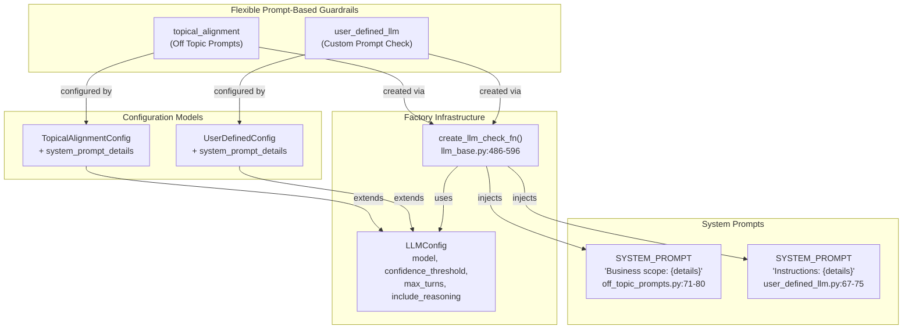
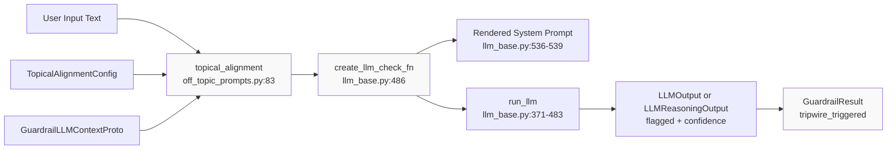
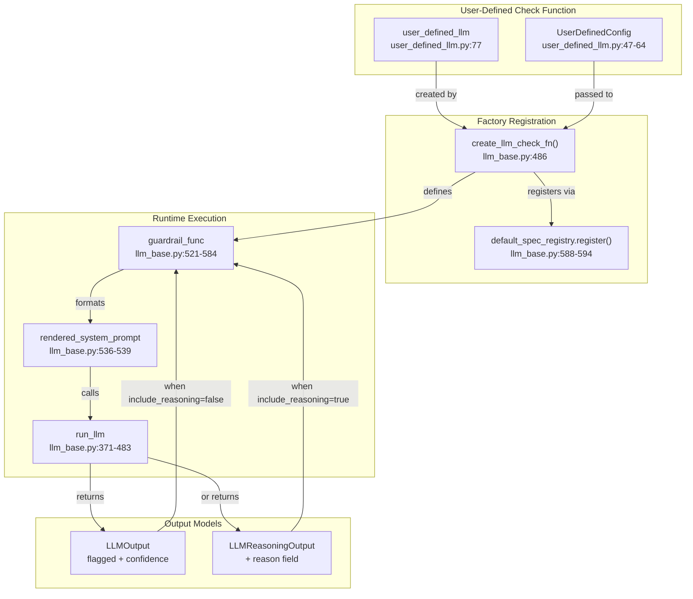
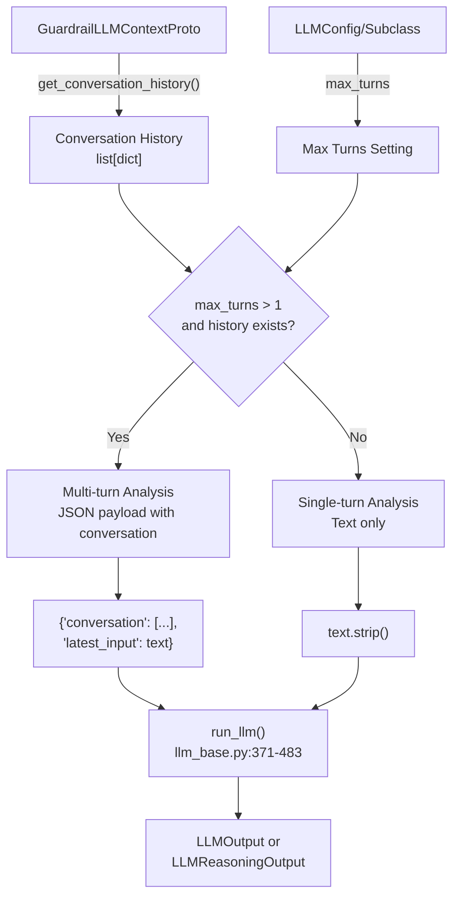

<!-- source: DeepWiki mcp.deepwiki.com · repo openai/openai-guardrails-python · page 6.7 Off-Topic Prompts and Custom Checks · fetched 2026-10-26 -->

# Off-Topic Prompts and Custom Checks

<details>
<summary>Relevant source files</summary>

The following files were used as context for generating this wiki page:

- [docs/ref/checks/hallucination_detection.md](docs/ref/checks/hallucination_detection.md)
- [src/guardrails/checks/text/hallucination_detection.py](src/guardrails/checks/text/hallucination_detection.py)
- [src/guardrails/checks/text/llm_base.py](src/guardrails/checks/text/llm_base.py)
- [src/guardrails/checks/text/off_topic_prompts.py](src/guardrails/checks/text/off_topic_prompts.py)
- [src/guardrails/checks/text/user_defined_llm.py](src/guardrails/checks/text/user_defined_llm.py)
- [src/guardrails/evals/core/benchmark_reporter.py](src/guardrails/evals/core/benchmark_reporter.py)

</details>


This page documents two flexible, prompt-based guardrails that allow domain-specific content validation: **Off Topic Prompts** for ensuring conversations stay within a defined business scope, and **User-defined LLM** for implementing custom moderation rules. Both guardrails leverage the `create_llm_check_fn` factory pattern to build LLM-based content checks with configurable system prompts.

For the underlying framework that powers these guardrails, see [LLM-Based Guardrail Framework](#6.8). For other LLM-based guardrails with pre-defined prompts, see [Jailbreak Detection](#6.2), [NSFW Text Detection](#6.3), [Prompt Injection Detection](#6.4), and [Hallucination Detection](#6.5).

## Overview

Both guardrails in this page share a common architecture but serve different purposes:

| Guardrail | Purpose | Prompt Source | Use Case |
|-----------|---------|---------------|----------|
| **Off Topic Prompts** | Enforce topical alignment | Predefined template with user-supplied business scope | Keep chatbots within allowed topics |
| **User-defined LLM** | Custom moderation rules | Fully user-supplied prompt | Domain-specific content policies |



**Diagram: Flexible Prompt-Based Guardrails Architecture**

Sources: [src/guardrails/checks/text/off_topic_prompts.py](), [src/guardrails/checks/text/user_defined_llm.py](), [src/guardrails/checks/text/llm_base.py:486-596]()

## Off Topic Prompts Guardrail

### Purpose

The **Off Topic Prompts** guardrail ensures that user inputs stay within a defined business scope or topic domain. It analyzes text to detect content that strays from allowed topics, making it useful for customer service chatbots, domain-specific assistants, or any application where maintaining topical focus is critical.

### Implementation

The guardrail is registered as `"Off Topic Prompts"` and uses the `topical_alignment` check function defined in [src/guardrails/checks/text/off_topic_prompts.py:83-89]().



**Diagram: Off Topic Prompts Execution Flow**

Sources: [src/guardrails/checks/text/off_topic_prompts.py:83-89](), [src/guardrails/checks/text/llm_base.py:486-596]()

### Configuration Schema

The `TopicalAlignmentConfig` class extends `LLMConfig` with a required `system_prompt_details` field:

[src/guardrails/checks/text/off_topic_prompts.py:51-68]()

| Parameter | Type | Required | Default | Description |
|-----------|------|----------|---------|-------------|
| `model` | `str` | Yes | - | LLM model identifier (e.g., "gpt-4.1-mini") |
| `confidence_threshold` | `float` | No | 0.7 | Minimum confidence (0.0-1.0) to trigger tripwire |
| `max_turns` | `int` | No | 10 | Maximum conversation turns to include in analysis |
| `include_reasoning` | `bool` | No | `false` | Include reasoning explanation in output |
| `system_prompt_details` | `str` | Yes | - | Description of allowed business scope or topics |

### System Prompt Template

The guardrail uses a parameterized system prompt defined at [src/guardrails/checks/text/off_topic_prompts.py:71-80]():

```
You are a content analysis system that determines if text stays on topic.

BUSINESS SCOPE: {system_prompt_details}

Determine if the text stays within the defined business scope. Flag any content
that strays from the allowed topics.
```

The `{system_prompt_details}` placeholder is replaced at runtime with the value from the configuration [src/guardrails/checks/text/llm_base.py:536-539]().

### Configuration Example

```json
{
  "name": "Off Topic Prompts",
  "config": {
    "model": "gpt-4.1-mini",
    "confidence_threshold": 0.8,
    "system_prompt_details": "Customer support for cloud infrastructure services including VM management, storage, networking, and billing. Do not discuss competitors, political topics, or unrelated services."
  }
}
```

### Usage Example

```python
from guardrails import GuardrailsOpenAI

config = {
    "version": 1,
    "input": {
        "version": 1,
        "guardrails": [
            {
                "name": "Off Topic Prompts",
                "config": {
                    "model": "gpt-4.1-mini",
                    "confidence_threshold": 0.8,
                    "system_prompt_details": "Technical support for cloud services"
                }
            }
        ]
    }
}

client = GuardrailsOpenAI(config=config)

# This should pass (on-topic)
response = client.chat.completions.create(
    model="gpt-4",
    messages=[{"role": "user", "content": "How do I configure my VM firewall?"}]
)

# This should trigger (off-topic)
try:
    response = client.chat.completions.create(
        model="gpt-4",
        messages=[{"role": "user", "content": "What's your favorite movie?"}]
    )
except Exception as e:
    print(f"Guardrail triggered: {e}")
```

Sources: [src/guardrails/checks/text/off_topic_prompts.py]()

## User-defined LLM Guardrail

### Purpose

The **User-defined LLM** guardrail (registered as `"Custom Prompt Check"`) provides a flexible framework for implementing custom content moderation rules using entirely user-supplied prompts. This allows organizations to enforce domain-specific policies that aren't covered by built-in guardrails.

### Implementation

The guardrail is defined in [src/guardrails/checks/text/user_defined_llm.py:77-85]() and follows the same factory pattern as Off Topic Prompts.



**Diagram: User-defined LLM Implementation Structure**

Sources: [src/guardrails/checks/text/user_defined_llm.py:77-85](), [src/guardrails/checks/text/llm_base.py:486-596]()

### Configuration Schema

The `UserDefinedConfig` class extends `LLMConfig` with a required `system_prompt_details` field:

[src/guardrails/checks/text/user_defined_llm.py:47-64]()

| Parameter | Type | Required | Default | Description |
|-----------|------|----------|---------|-------------|
| `model` | `str` | Yes | - | LLM model identifier |
| `confidence_threshold` | `float` | No | 0.7 | Minimum confidence to trigger tripwire |
| `max_turns` | `int` | No | 10 | Maximum conversation turns for analysis |
| `include_reasoning` | `bool` | No | `false` | Include reasoning explanation in output |
| `system_prompt_details` | `str` | Yes | - | Custom instructions for content detection |

### System Prompt Template

The guardrail uses a minimal template at [src/guardrails/checks/text/user_defined_llm.py:67-75]():

```
# Instructions

{system_prompt_details}

Flag any content that matches the criteria defined above.
```

This gives users complete control over the detection criteria through `system_prompt_details`.

### Configuration Examples

**Example 1: Political Advocacy Detection**

```json
{
  "name": "Custom Prompt Check",
  "config": {
    "model": "gpt-4.1-mini",
    "confidence_threshold": 0.7,
    "system_prompt_details": "Detect any content that advocates for political candidates, parties, or ideologies. Do not flag neutral discussion of political topics or news reporting."
  }
}
```

**Example 2: Financial Advice Detection**

```json
{
  "name": "Custom Prompt Check",
  "config": {
    "model": "gpt-4.1-mini",
    "confidence_threshold": 0.8,
    "system_prompt_details": "Detect content that provides specific investment advice or recommendations about individual stocks, bonds, or securities. Flag statements like 'you should buy X stock' but allow general financial education."
  }
}
```

**Example 3: Internal Policy Enforcement**

```json
{
  "name": "Custom Prompt Check",
  "config": {
    "model": "gpt-4.1-mini",
    "confidence_threshold": 0.75,
    "system_prompt_details": "Detect content that discusses unreleased products or features. Our policy is to never mention Project Phoenix, the Q3 roadmap items, or any beta features marked as confidential."
  }
}
```

Sources: [src/guardrails/checks/text/user_defined_llm.py]()

## Shared Implementation Pattern

Both guardrails use the `create_llm_check_fn` factory function to construct their check functions. This section describes the common implementation details.

### Factory Function Signature

[src/guardrails/checks/text/llm_base.py:486-596]()

```python
def create_llm_check_fn(
    name: str,
    description: str,
    system_prompt: str,
    output_model: type[LLMOutput] | None = None,
    config_model: type[TLLMCfg] = LLMConfig,
) -> CheckFn[GuardrailLLMContextProto, str, TLLMCfg]
```

### Registration Metadata

Both guardrails are registered with identical metadata:

[src/guardrails/checks/text/llm_base.py:588-594]()

```python
default_spec_registry.register(
    name=name,
    check_fn=guardrail_func,
    description=description,
    media_type="text/plain",
    metadata=GuardrailSpecMetadata(
        engine="LLM",
        uses_conversation_history=True
    ),
)
```

The `uses_conversation_history=True` flag indicates both guardrails support multi-turn conversation analysis.

### Conversation History Support

Both guardrails automatically support conversation-aware analysis through the factory function:

[src/guardrails/checks/text/llm_base.py:542-564]()

1. Extract conversation history from context: `ctx.get_conversation_history()`
2. Get `max_turns` from config (default 10)
3. Pass conversation history to `run_llm` function
4. The LLM receives either:
   - **Single-turn** (`max_turns=1`): Just the current text
   - **Multi-turn** (`max_turns>1`): JSON payload with `{"conversation": [...], "latest_input": "..."}`



**Diagram: Conversation History Processing Flow**

Sources: [src/guardrails/checks/text/llm_base.py:542-564](), [src/guardrails/checks/text/llm_base.py:416-427]()

### Output Model Selection

Both guardrails support optional reasoning output controlled by `include_reasoning`:

[src/guardrails/checks/text/llm_base.py:547-554]()

| `include_reasoning` | Output Model | Fields Returned |
|---------------------|--------------|-----------------|
| `false` (default) | `LLMOutput` | `flagged`, `confidence` |
| `true` | `LLMReasoningOutput` | `flagged`, `confidence`, `reason` |

Disabling reasoning reduces token usage and latency while maintaining detection performance.

### Tripwire Logic

The tripwire is triggered when both conditions are met:

[src/guardrails/checks/text/llm_base.py:575-576]()

```python
is_trigger = analysis.flagged and analysis.confidence >= config.confidence_threshold
```

The result includes detailed information:

[src/guardrails/checks/text/llm_base.py:576-584]()

```python
return GuardrailResult(
    tripwire_triggered=is_trigger,
    info={
        "guardrail_name": name,
        **analysis.model_dump(),  # flagged, confidence, reason (if enabled)
        "threshold": config.confidence_threshold,
        "token_usage": token_usage_to_dict(token_usage),
    },
)
```

Sources: [src/guardrails/checks/text/llm_base.py:521-596]()

## Configuration Reference

### Complete Configuration Structure

Both guardrails follow this configuration structure in `guardrails_config.json`:

```json
{
  "version": 1,
  "input": {
    "version": 1,
    "guardrails": [
      {
        "name": "Off Topic Prompts",
        "config": {
          "model": "gpt-4.1-mini",
          "confidence_threshold": 0.7,
          "max_turns": 10,
          "include_reasoning": false,
          "system_prompt_details": "Your business scope description"
        }
      }
    ]
  },
  "output": {
    "version": 1,
    "guardrails": [
      {
        "name": "Custom Prompt Check",
        "config": {
          "model": "gpt-4.1-mini",
          "confidence_threshold": 0.7,
          "max_turns": 10,
          "include_reasoning": false,
          "system_prompt_details": "Your custom detection criteria"
        }
      }
    ]
  }
}
```

### Parameter Tuning Guidelines

| Parameter | Recommendation |
|-----------|----------------|
| `model` | Use `gpt-4.1-mini` for balanced cost/performance. Use `gpt-4.1` or `gpt-5` for more nuanced analysis. |
| `confidence_threshold` | Start at 0.7. Increase (0.8-0.9) to reduce false positives. Decrease (0.5-0.6) to catch edge cases. |
| `max_turns` | Use 10 for conversation-aware analysis. Set to 1 for single-turn, stateless checking. |
| `include_reasoning` | Disable in production for token efficiency. Enable for debugging and development. |
| `system_prompt_details` | Be specific and concise. Include examples of what should/shouldn't be flagged. |

### Writing Effective System Prompt Details

**Best Practices:**

1. **Be Specific**: Define clear boundaries for what content is allowed or prohibited
2. **Provide Examples**: Include examples of content that should and shouldn't trigger
3. **Consider Edge Cases**: Address ambiguous scenarios explicitly
4. **Keep it Concise**: Longer prompts increase latency and cost without necessarily improving accuracy

**Example: Good vs. Poor Prompt Details**

❌ **Poor** (too vague):
```
Don't allow bad content
```

✅ **Good** (specific with examples):
```
Customer support for banking services including account management, 
transactions, and loan information. Allow: questions about balances, 
transfers, credit cards. Do not allow: investment advice, cryptocurrency 
discussion, competitor comparisons, or political opinions.
```

Sources: [src/guardrails/checks/text/off_topic_prompts.py](), [src/guardrails/checks/text/user_defined_llm.py]()

## Result Structure

### GuardrailResult Info Dictionary

Both guardrails return a `GuardrailResult` with the following `info` dictionary structure:

**With `include_reasoning=false` (default):**

```json
{
  "guardrail_name": "Off Topic Prompts",
  "flagged": true,
  "confidence": 0.85,
  "threshold": 0.7,
  "token_usage": {
    "prompt_tokens": 150,
    "completion_tokens": 25,
    "total_tokens": 175
  }
}
```

**With `include_reasoning=true`:**

```json
{
  "guardrail_name": "Custom Prompt Check",
  "flagged": true,
  "confidence": 0.92,
  "reason": "Content contains specific investment recommendations which violate the policy",
  "threshold": 0.7,
  "token_usage": {
    "prompt_tokens": 150,
    "completion_tokens": 45,
    "total_tokens": 195
  }
}
```

### Field Descriptions

| Field | Type | Always Present | Description |
|-------|------|----------------|-------------|
| `guardrail_name` | `str` | Yes | Name of the triggered guardrail |
| `flagged` | `bool` | Yes | Whether LLM flagged the content |
| `confidence` | `float` | Yes | LLM confidence score (0.0-1.0) |
| `threshold` | `float` | Yes | Configured confidence threshold |
| `reason` | `str` | Only if `include_reasoning=true` | Explanation of the decision |
| `token_usage` | `dict` | Yes | Token consumption breakdown |

Sources: [src/guardrails/checks/text/llm_base.py:576-584]()

## Error Handling

Both guardrails use the shared `create_error_result` function for error handling:

[src/guardrails/checks/text/llm_base.py:567-572]()

### Error Result Structure

When an LLM error occurs, the guardrail returns:

```json
{
  "tripwire_triggered": false,
  "execution_failed": true,
  "info": {
    "guardrail_name": "Off Topic Prompts",
    "error": "LLM execution failed",
    "flagged": false,
    "confidence": 0.0,
    "error_message": "Detailed error message",
    "token_usage": {
      "prompt_tokens": null,
      "completion_tokens": null,
      "total_tokens": null,
      "unavailable_reason": "LLM call failed before usage could be recorded"
    }
  }
}
```

### Content Filter Errors

When Azure OpenAI content filters are triggered:

[src/guardrails/checks/text/llm_base.py:460-472]()

```json
{
  "tripwire_triggered": false,
  "execution_failed": true,
  "info": {
    "flagged": true,
    "confidence": 1.0,
    "third_party_filter": true,
    "error_message": "ResponsibleAIPolicyViolation: content_filter"
  }
}
```

Sources: [src/guardrails/checks/text/llm_base.py:172-211](), [src/guardrails/checks/text/llm_base.py:456-483]()

## Usage with Different Integration Patterns

### Standard Client Integration

```python
from guardrails import GuardrailsOpenAI

client = GuardrailsOpenAI(config=config)

response = client.chat.completions.create(
    model="gpt-4",
    messages=[{"role": "user", "content": "User input"}]
)

# Check if guardrails triggered
if response.guardrails_results.has_tripwires:
    print("Guardrail triggered:")
    for result in response.guardrails_results.all_results:
        if result.tripwire_triggered:
            print(f"  {result.info['guardrail_name']}: {result.info['confidence']}")
```

### Agent Integration

```python
from guardrails import GuardrailAgent

agent_def = GuardrailAgent(
    name="Support Agent",
    instructions="You are a customer support agent",
    input_guardrails=["Off Topic Prompts"],
    output_guardrails=["Custom Prompt Check"],
    config=config
)

# Guardrails apply at both agent and tool levels
```

### Evaluation Framework

```python
from guardrails.evals import GuardrailEval

evaluator = GuardrailEval(
    guardrail_name="Off Topic Prompts",
    config=config["input"]["guardrails"][0]["config"]
)

results = evaluator.evaluate(
    dataset_path="eval_dataset.jsonl",
    output_dir="./results"
)

print(f"Precision: {results.precision:.3f}")
print(f"Recall: {results.recall:.3f}")
print(f"F1 Score: {results.f1_score:.3f}")
```

Sources: [src/guardrails/checks/text/off_topic_prompts.py](), [src/guardrails/checks/text/user_defined_llm.py]()

## Related Pages

- [LLM-Based Guardrail Framework](#6.8) - Details on `create_llm_check_fn`, `run_llm`, and base schemas
- [Guardrail Configuration Reference](#6.9) - Complete parameter reference for all guardrails
- [Jailbreak Detection](#6.2) - Another LLM-based guardrail with conversation awareness
- [NSFW Text Detection](#6.3) - LLM-based content filtering for workplace-appropriate content
- [Evaluation Framework Overview](#7.1) - Testing and benchmarking custom guardrails

---

