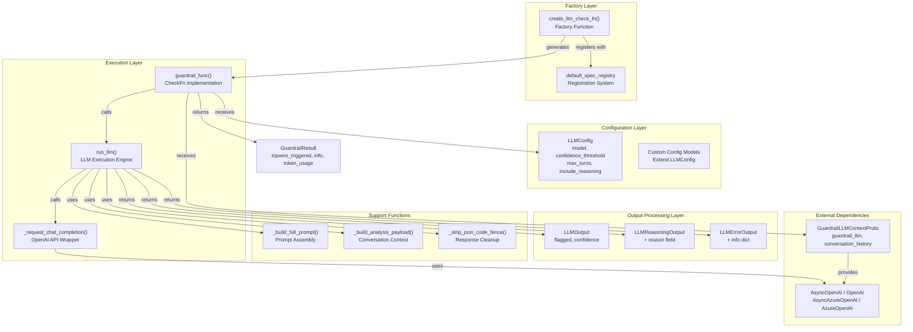
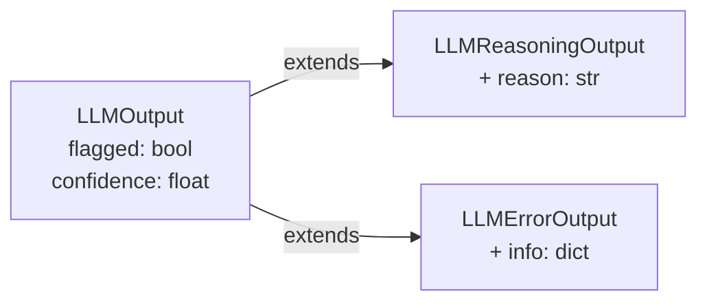
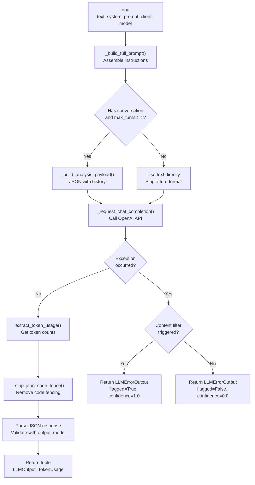
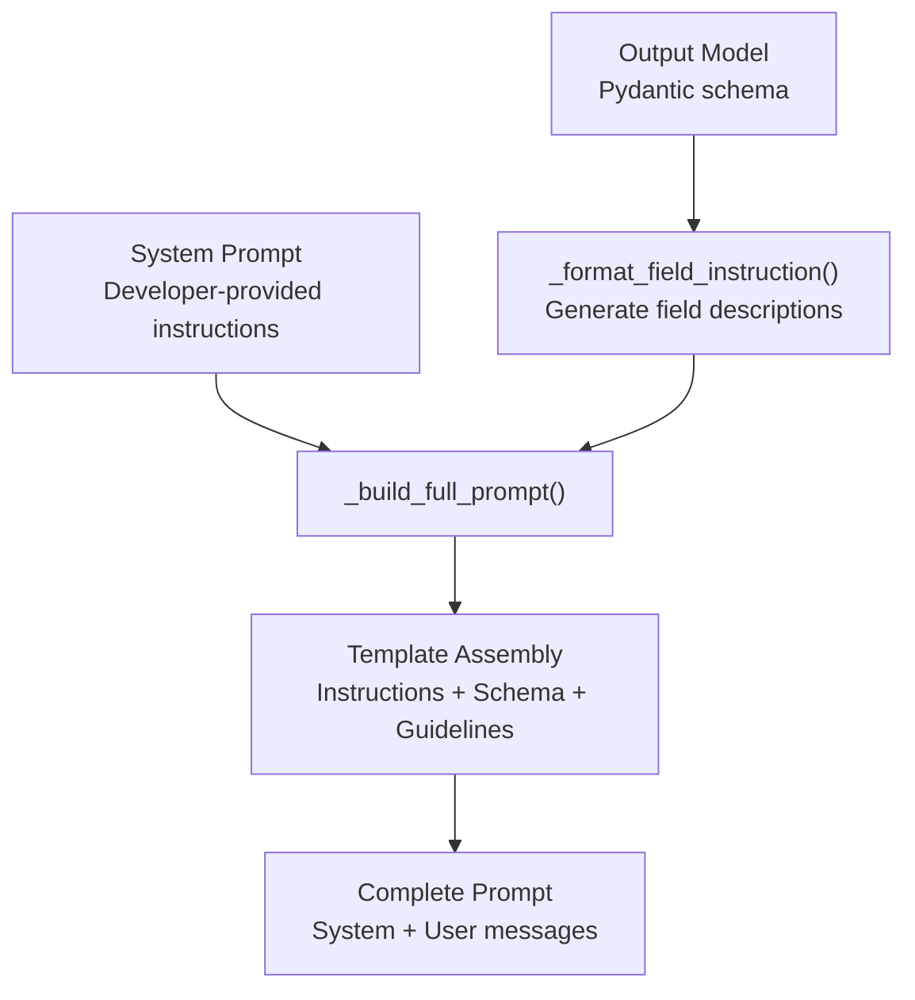
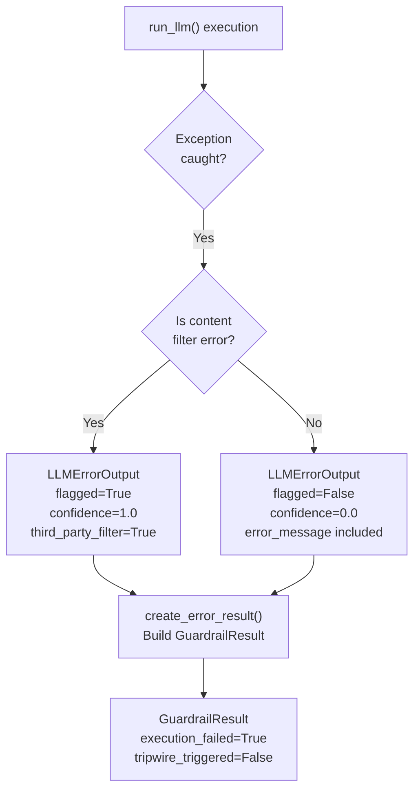
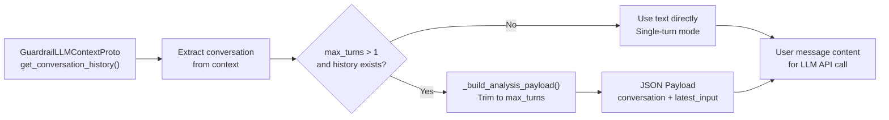
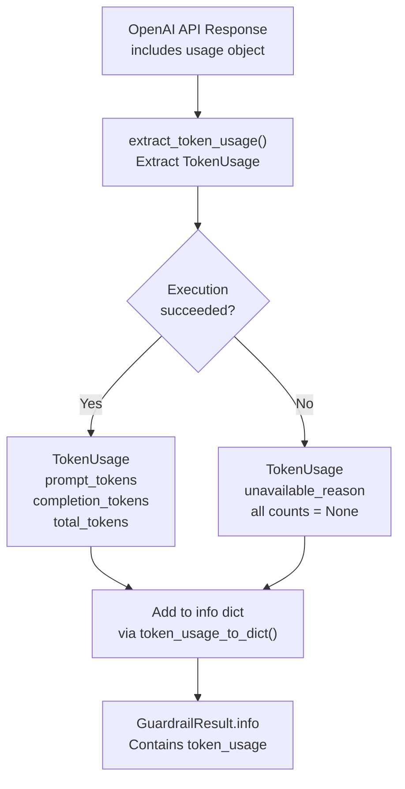
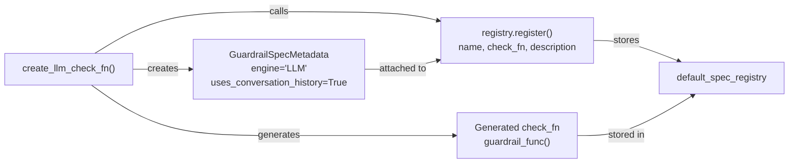
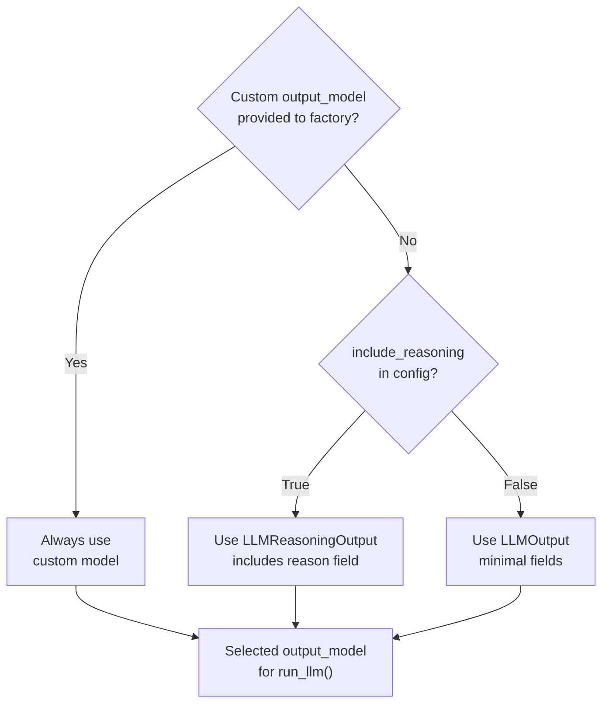

<!-- source: DeepWiki mcp.deepwiki.com · repo openai/openai-guardrails-python · page 6.8 LLM-Based Guardrail Framework · fetched 2026-10-26 -->

# LLM-Based Guardrail Framework

<details>
<summary>Relevant source files</summary>

The following files were used as context for generating this wiki page:

- [src/guardrails/checks/text/llm_base.py](src/guardrails/checks/text/llm_base.py)

</details>


## Purpose and Scope

This document describes the `llm_base` module, which provides the foundational infrastructure for creating LLM-based guardrails. This framework enables developers to build custom content moderation checks by providing a system prompt and configuration, with built-in support for multi-turn conversation analysis, structured output validation, and automatic registry integration.

For documentation on specific built-in guardrails that use this framework (Jailbreak Detection, NSFW Text, Prompt Injection, etc.), see pages [6.2](#6.2) through [6.7](#6.7). For information about the guardrail registry system that these checks integrate with, see [3.4](#3.4).

Sources: [src/guardrails/checks/text/llm_base.py:1-30]()

---

## Architecture Overview

The LLM-based guardrail framework consists of four major components that work together to enable standardized content checking using language models.



**Architecture**: The framework uses a factory pattern where `create_llm_check_fn` generates a guardrail check function that is automatically registered. During execution, the check function invokes `run_llm` which handles prompt construction, API calls, and response parsing. Output models provide structured validation of LLM responses, with support for reasoning explanations and error information.

Sources: [src/guardrails/checks/text/llm_base.py:1-597]()

---

## Core Components

### Configuration Schema

The `LLMConfig` class defines the standard configuration interface for all LLM-based guardrails.

| Field | Type | Default | Description |
|-------|------|---------|-------------|
| `model` | `str` | *required* | LLM model identifier (e.g., "gpt-4o-mini") |
| `confidence_threshold` | `float` | 0.7 | Minimum confidence (0.0-1.0) to trigger tripwire |
| `max_turns` | `int` | 10 | Maximum conversation turns to include in analysis |
| `include_reasoning` | `bool` | False | Whether to include reasoning explanations in output |

Custom guardrails can extend `LLMConfig` to add domain-specific configuration fields. The base configuration uses Pydantic's `extra="forbid"` to catch configuration errors early.

Sources: [src/guardrails/checks/text/llm_base.py:82-120]()

### Output Models

The framework provides three output schemas for different use cases:



**`LLMOutput`** [src/guardrails/checks/text/llm_base.py:125-142](): Base output model containing:
- `flagged`: Boolean indicating whether content was flagged
- `confidence`: Float (0.0-1.0) representing LLM's certainty

**`LLMReasoningOutput`** [src/guardrails/checks/text/llm_base.py:144-157](): Extended output with:
- `reason`: String explanation for the decision
- Used when `include_reasoning=True` in config

**`LLMErrorOutput`** [src/guardrails/checks/text/llm_base.py:159-170](): Error-augmented output with:
- `info`: Dict containing error details (e.g., content filter triggers)
- Used internally for error handling

Sources: [src/guardrails/checks/text/llm_base.py:125-170]()

### Factory Function

The `create_llm_check_fn` function generates guardrail check functions with automatic registry integration.

**Function Signature**:
```python
def create_llm_check_fn(
    name: str,
    description: str,
    system_prompt: str,
    output_model: type[LLMOutput] | None = None,
    config_model: type[TLLMCfg] = LLMConfig,
) -> CheckFn[GuardrailLLMContextProto, str, TLLMCfg]
```

**Parameters**:
- `name`: Guardrail identifier for registry and result info
- `description`: Human-readable explanation of the check
- `system_prompt`: Instructions controlling LLM analysis behavior
- `output_model`: Optional custom output schema (defaults to reasoning-aware selection)
- `config_model`: Configuration schema (defaults to `LLMConfig`)

The factory automatically:
1. Generates an async check function with proper type annotations
2. Registers the guardrail with `default_spec_registry`
3. Sets metadata indicating LLM engine and conversation awareness
4. Configures output model selection based on `include_reasoning` flag

Sources: [src/guardrails/checks/text/llm_base.py:486-597]()

### Execution Engine

The `run_llm` function executes LLM-based analysis and returns structured results.



**Multi-Turn Conversation Support**: When `conversation_history` is provided and `max_turns > 1`, the function builds a JSON payload containing recent conversation turns and the latest input:
```json
{
  "conversation": [
    {"role": "user", "content": "..."},
    {"role": "assistant", "content": "..."}
  ],
  "latest_input": "current text being analyzed"
}
```

Sources: [src/guardrails/checks/text/llm_base.py:371-484]()

---

## Creating Custom Guardrails

Custom guardrails are created by calling `create_llm_check_fn` with a system prompt. The framework handles all infrastructure concerns automatically.

**Example Pattern** [src/guardrails/checks/text/llm_base.py:20-29]():
```python
from guardrails.checks.text.llm_base import create_llm_check_fn, LLMOutput

my_guardrail = create_llm_check_fn(
    name="MyCheck",
    description="Checks for risky language.",
    system_prompt="Check for risky content.",
    output_model=LLMOutput,
)
```

**System Prompt Formatting**: System prompts can include template variables for dynamic content:
```python
system_prompt = "Check if the text violates: {system_prompt_details}"
```

The framework automatically renders the prompt using `system_prompt_details` from the config if present [src/guardrails/checks/text/llm_base.py:536-539]().

**Generated Check Function**: The factory produces an async function with this signature:
```python
async def guardrail_func(
    ctx: GuardrailLLMContextProto,
    data: str,
    config: TLLMCfg,
) -> GuardrailResult
```

Sources: [src/guardrails/checks/text/llm_base.py:486-597]()

---

## Prompt Construction

The framework automatically builds complete prompts from system instructions and output schemas.



**Prompt Template Structure** [src/guardrails/checks/text/llm_base.py:249-273]():
```
{system_prompt}

Respond with a json object containing:
- "flagged": boolean (true if detected and false otherwise)
- "confidence": float (0.0 to 1.0)
[additional fields from output_model]

Only respond with the json object, nothing else.

**IMPORTANT:**
You must output a confidence score reflecting how likely the input is violative:
- 1.0 = Certain violative
- 0.0 = Certain not violative
- Use the full range [0.0 - 1.0] to reflect your level of certainty

Analyze the following text according to the instructions above.
```

**Field Instruction Generation**: Each field in the output model is automatically described using natural language [src/guardrails/checks/text/llm_base.py:213-234]():
- `flagged` → "boolean (true if detected and false otherwise)"
- `confidence` → "float (0.0 to 1.0)"
- `reason` → "string explaining the rationale for the decision"
- Custom fields are formatted based on their type annotations

Sources: [src/guardrails/checks/text/llm_base.py:213-273]()

---

## Response Processing and Error Handling

### Response Parsing

The framework provides defensive parsing to handle various LLM response formats.

**JSON Code Fence Stripping** [src/guardrails/checks/text/llm_base.py:276-302](): The `_strip_json_code_fence` function removes markdown code fencing if present:
```python
# Input:
# ```json
# {"flagged": true, "confidence": 0.8}
# ```

# Output:
# {"flagged": true, "confidence": 0.8}
```

The function only strips fencing if the inner content is valid JSON, preventing errors from malformed responses.

### Error Handling



**Content Filter Detection** [src/guardrails/checks/text/llm_base.py:459-472](): When Azure OpenAI's content filters trigger, the framework returns:
- `flagged=True` and `confidence=1.0` (treating filter trigger as certain violation)
- `info` dict with `third_party_filter=True` flag
- Error message from the provider

**Generic Error Handling** [src/guardrails/checks/text/llm_base.py:473-483](): For other failures:
- `flagged=False` and `confidence=0.0` (assuming no violation when analysis fails)
- Error message captured in `info` dict
- `TokenUsage` with `unavailable_reason` explaining missing metrics

**Result Creation** [src/guardrails/checks/text/llm_base.py:172-211](): The `create_error_result` function standardizes error results:
- Sets `execution_failed=True` on the `GuardrailResult`
- Includes original exception for debugging
- Preserves token usage when available
- Aggregates all error information in the `info` dict

Sources: [src/guardrails/checks/text/llm_base.py:172-211](), [src/guardrails/checks/text/llm_base.py:276-302](), [src/guardrails/checks/text/llm_base.py:456-483]()

---

## Multi-Turn Conversation Analysis

All guardrails created with this framework automatically support conversation-aware analysis through context propagation.

### Conversation Context Flow



**Context Extraction** [src/guardrails/checks/text/llm_base.py:542](): The generated check function extracts conversation history from the context:
```python
conversation_history = getattr(ctx, "get_conversation_history", lambda: None)() or []
```

**Conversation Trimming** [src/guardrails/checks/text/llm_base.py:347-368](): The `_build_analysis_payload` function:
1. Takes the most recent `max_turns` entries from the conversation
2. Bundles them with the latest input text
3. Returns JSON-formatted payload for the LLM

**Single-Turn Behavior**: When `max_turns=1` or no conversation history exists, the framework uses the input text directly without conversation context [src/guardrails/checks/text/llm_base.py:416-426]().

Sources: [src/guardrails/checks/text/llm_base.py:347-368](), [src/guardrails/checks/text/llm_base.py:416-426](), [src/guardrails/checks/text/llm_base.py:542]()

---

## OpenAI Client Integration

The framework supports all OpenAI client variants with unified handling for sync and async operations.

### Supported Clients

| Client Type | Module | Use Case |
|-------------|--------|----------|
| `AsyncOpenAI` | `openai` | Async operations with OpenAI API |
| `OpenAI` | `openai` | Sync operations with OpenAI API |
| `AsyncAzureOpenAI` | `openai` | Async operations with Azure OpenAI |
| `AzureOpenAI` | `openai` | Sync operations with Azure OpenAI |

**Unified Invocation** [src/guardrails/checks/text/llm_base.py:305-323](): The `_invoke_openai_callable` function handles both sync and async clients:
- Detects if the method is async using `inspect.iscoroutinefunction`
- For sync methods, runs them in an executor to maintain async interface
- Handles awaitable results that may be returned from sync methods

**API Request** [src/guardrails/checks/text/llm_base.py:325-344](): The `_request_chat_completion` function:
- Builds standardized message format for chat completions
- Includes `response_format` for structured output parsing
- Adds `safety_identifier` only for official OpenAI API (not Azure or local models)
- Uses the `supports_safety_identifier` helper to detect supported clients [src/guardrails/checks/text/llm_base.py:341]()

**Safety Identifier**: The framework automatically includes `SAFETY_IDENTIFIER` in API calls to official OpenAI endpoints for compliance tracking. This is omitted for Azure and third-party providers that don't support the parameter [src/guardrails/checks/text/llm_base.py:58]().

Sources: [src/guardrails/checks/text/llm_base.py:305-344](), [src/guardrails/checks/text/llm_base.py:58]()

---

## Token Usage Tracking

The framework tracks token consumption for all LLM calls and includes it in guardrail results.

### Token Usage in Results



**Token Extraction** [src/guardrails/checks/text/llm_base.py:440](): After successful API calls, the framework extracts token usage:
```python
token_usage = extract_token_usage(response)
```

**Error Cases** [src/guardrails/checks/text/llm_base.py:407-413](): When LLM calls fail, the framework creates a `TokenUsage` object with:
- All token counts set to `None`
- `unavailable_reason` explaining why metrics weren't captured

**Result Inclusion** [src/guardrails/checks/text/llm_base.py:582](): Token usage is always included in the `GuardrailResult.info` dict:
```python
info = {
    "guardrail_name": name,
    "flagged": analysis.flagged,
    "confidence": analysis.confidence,
    "threshold": config.confidence_threshold,
    "token_usage": token_usage_to_dict(token_usage),
}
```

This enables downstream tracking of LLM costs and monitoring of token consumption patterns across guardrail executions.

Sources: [src/guardrails/checks/text/llm_base.py:407-413](), [src/guardrails/checks/text/llm_base.py:440](), [src/guardrails/checks/text/llm_base.py:576-584]()

---

## Registry Integration

Guardrails created with `create_llm_check_fn` are automatically registered with appropriate metadata.

### Registration Process



**Automatic Registration** [src/guardrails/checks/text/llm_base.py:588-594](): The factory function calls:
```python
default_spec_registry.register(
    name=name,
    check_fn=guardrail_func,
    description=description,
    media_type="text/plain",
    metadata=GuardrailSpecMetadata(
        engine="LLM",
        uses_conversation_history=True
    ),
)
```

**Metadata Significance**:
- `engine="LLM"`: Indicates this guardrail requires LLM client access
- `uses_conversation_history=True`: Enables conversation context propagation
- `media_type="text/plain"`: Specifies input data type

The registry uses this metadata during pipeline execution to determine which context information to provide to the guardrail and how to configure the execution environment.

Sources: [src/guardrails/checks/text/llm_base.py:588-594]()

---

## Output Model Selection

The framework intelligently selects output models based on configuration and customization needs.

### Selection Logic



**Selection Implementation** [src/guardrails/checks/text/llm_base.py:547-554]():
```python
if custom_output_model is not None:
    # Always use the custom model if provided
    selected_output_model = custom_output_model
else:
    # No custom model: use include_reasoning to decide
    include_reasoning = getattr(config, "include_reasoning", False)
    selected_output_model = LLMReasoningOutput if include_reasoning else LLMOutput
```

**Use Cases**:
- **Custom Model**: Guardrails with domain-specific output fields (e.g., Hallucination Detection with evidence citations)
- **Reasoning Enabled**: Development/debugging scenarios where explanations are valuable
- **Base Model**: Production deployments optimizing for token efficiency

**Empty Response Handling** [src/guardrails/checks/text/llm_base.py:443-452](): When the LLM returns an empty response, the framework always uses base `LLMOutput` to avoid validation errors with extended models that have required fields.

Sources: [src/guardrails/checks/text/llm_base.py:443-454](), [src/guardrails/checks/text/llm_base.py:547-564]()

---

