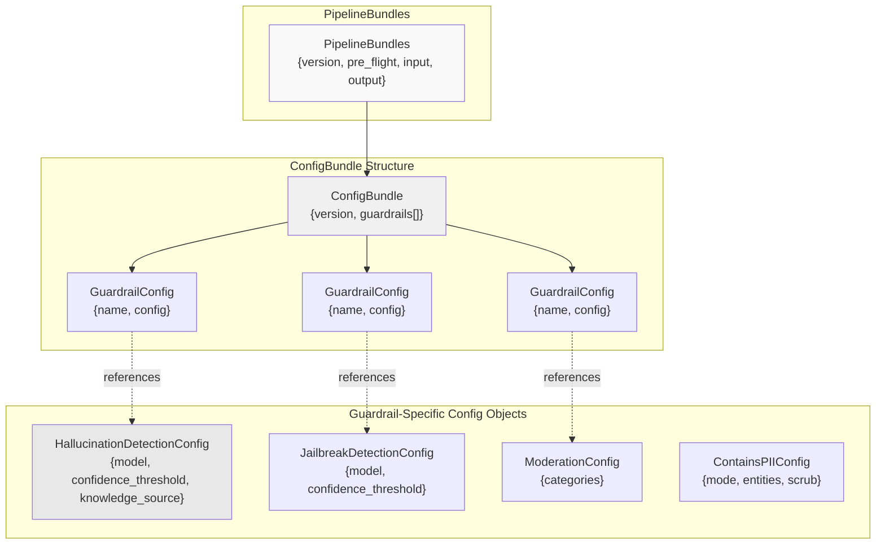
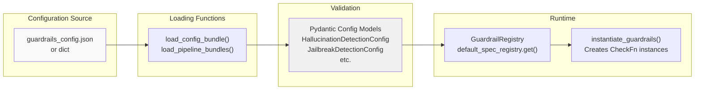
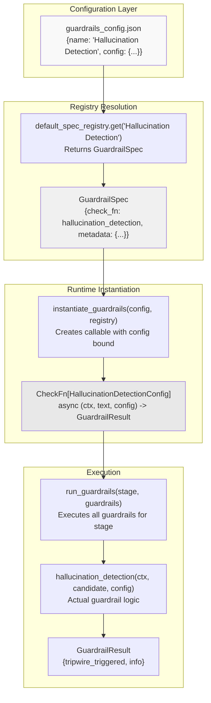
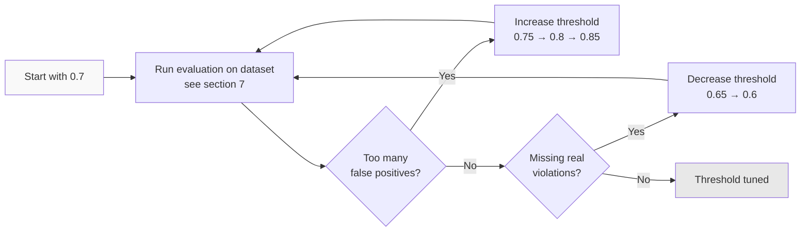

<!-- source: DeepWiki mcp.deepwiki.com · repo openai/openai-guardrails-python · page 6.9 Guardrail Configuration Reference · fetched 2026-10-26 -->

# Guardrail Configuration Reference

<details>
<summary>Relevant source files</summary>

The following files were used as context for generating this wiki page:

- [docs/ref/checks/hallucination_detection.md](docs/ref/checks/hallucination_detection.md)
- [src/guardrails/checks/text/hallucination_detection.py](src/guardrails/checks/text/hallucination_detection.py)
- [src/guardrails/checks/text/llm_base.py](src/guardrails/checks/text/llm_base.py)
- [src/guardrails/checks/text/moderation.py](src/guardrails/checks/text/moderation.py)
- [src/guardrails/checks/text/off_topic_prompts.py](src/guardrails/checks/text/off_topic_prompts.py)
- [src/guardrails/checks/text/user_defined_llm.py](src/guardrails/checks/text/user_defined_llm.py)
- [src/guardrails/evals/core/benchmark_reporter.py](src/guardrails/evals/core/benchmark_reporter.py)
- [tests/conftest.py](tests/conftest.py)
- [tests/unit/checks/test_moderation.py](tests/unit/checks/test_moderation.py)
- [tests/unit/checks/test_secret_keys.py](tests/unit/checks/test_secret_keys.py)

</details>


This page provides a comprehensive reference for all configuration parameters available for built-in guardrails. Each guardrail accepts a configuration object that controls its behavior, sensitivity, and operational parameters.

For information about how to structure and load complete pipeline configurations, see [Configuration Files](#2.2). For details on the implementation and behavior of specific guardrails, see pages [6.1](#6.1) through [6.5](#6.5).

---

## Configuration Schema Overview

All guardrail configurations follow a consistent schema structure defined in the configuration system. Each guardrail is configured through a `GuardrailConfig` object within a `ConfigBundle`.

### Configuration Structure Diagram



**Sources:** [src/guardrails/checks/text/hallucination_detection.py:65-80](), [README.md:118-128]()

---

## Common Configuration Parameters

Most LLM-based guardrails share a common set of configuration parameters inherited from the base `LLMConfig` class.

### model

**Type:** `str`  
**Required:** Yes (for LLM-based guardrails)  
**Description:** The OpenAI model to use for guardrail analysis.

**Valid values:**
- `gpt-5` - Flagship model, highest accuracy
- `gpt-5-mini` - Balanced performance and latency
- `gpt-5-nano` - Fastest, lower accuracy
- `gpt-4.1` - Previous generation flagship
- `gpt-4.1-mini` - **Default for most guardrails**
- `gpt-4.1-nano` - Previous generation nano

**Example:**
```json
{
  "model": "gpt-4.1-mini"
}
```

### confidence_threshold

**Type:** `float`  
**Required:** Yes (for LLM-based guardrails)  
**Range:** `0.0` to `1.0`  
**Description:** Minimum confidence score required to trigger the guardrail tripwire. The guardrail will only trigger if both `flagged=true` AND `confidence >= confidence_threshold`.

**Tuning guidance:**
- **0.7** - Balanced starting point (recommended default)
- **0.8-0.9** - Reduce false positives, catch only high-confidence violations
- **0.5-0.6** - Increase sensitivity, catch more potential violations
- Lower thresholds for smaller/faster models due to less calibrated confidence scores

**Example:**
```json
{
  "confidence_threshold": 0.7
}
```

**Sources:** [src/guardrails/checks/text/hallucination_detection.py:26-29](), [docs/ref/checks/jailbreak.md:39-48](), [docs/ref/checks/nsfw.md:28-36]()

---

## Guardrail Configuration Reference Table

The following table summarizes all configuration parameters for each built-in guardrail:

| Guardrail Name | Config Parameters | Required | Type | Default | Notes |
|---------------|-------------------|----------|------|---------|-------|
| **Moderation** | `categories` | No | `list[str]` | All categories | OpenAI moderation categories to check |
| **URL Filter** | `mode` | Yes | `"allowlist"` \| `"blocklist"` | - | Filter mode |
| | `domains` | Yes | `list[str]` | - | List of domains to allow/block |
| **Contains PII** | `mode` | No | `"detect"` \| `"scrub"` | `"detect"` | Whether to detect or scrub PII |
| | `entities` | No | `list[str]` | All entities | PII entity types to check |
| | `scrub` | No | `bool` | `false` | Whether to scrub detected PII |
| **Hallucination Detection** | `model` | Yes | `str` | - | LLM model for validation |
| | `confidence_threshold` | Yes | `float` | - | Minimum confidence (0.0-1.0) |
| | `knowledge_source` | Yes | `str` | - | Vector store ID (starts with `vs_`) |
| **Jailbreak** | `model` | Yes | `str` | - | LLM model for detection |
| | `confidence_threshold` | Yes | `float` | - | Minimum confidence (0.0-1.0) |
| **NSFW Text** | `model` | Yes | `str` | - | LLM model for detection |
| | `confidence_threshold` | Yes | `float` | - | Minimum confidence (0.0-1.0) |
| **Off Topic Prompts** | `model` | Yes | `str` | - | LLM model for detection |
| | `confidence_threshold` | Yes | `float` | - | Minimum confidence (0.0-1.0) |
| | `scope_description` | Yes | `str` | - | Description of allowed scope |
| **Custom Prompt Check** | `model` | Yes | `str` | - | LLM model for validation |
| | `confidence_threshold` | Yes | `float` | - | Minimum confidence (0.0-1.0) |
| | `validation_prompt` | Yes | `str` | - | Custom prompt for validation |

**Sources:** [README.md:181-193](), [src/guardrails/checks/text/hallucination_detection.py:65-80](), [docs/ref/checks/hallucination_detection.md:11-26]()

---

## Parameter Resolution and Validation

### Configuration Loading Flow



All configuration objects are validated using Pydantic models with `extra="forbid"`, meaning any unrecognized parameters will raise a validation error.

**Sources:** [src/guardrails/checks/text/hallucination_detection.py:65-80]()

---

## Guardrail-Specific Parameters

### Hallucination Detection

**Configuration Class:** `HallucinationDetectionConfig`

#### knowledge_source

**Type:** `str`  
**Required:** Yes  
**Format:** Must start with `vs_`  
**Description:** OpenAI vector store ID containing reference documents for validation.

**How to obtain:**
1. Create vector store via [OpenAI Dashboard](https://platform.openai.com/storage/vector_stores/)
2. Use Guardrails Wizard at [guardrails.openai.com](https://guardrails.openai.com/)
3. Use the utility script: `python src/guardrails/utils/create_vector_store.py <files>`

**Example:**
```json
{
  "name": "Hallucination Detection",
  "config": {
    "model": "gpt-4.1-mini",
    "confidence_threshold": 0.7,
    "knowledge_source": "vs_abc123def456"
  }
}
```

**Validation:** The `knowledge_source` parameter is validated at runtime to ensure it starts with `vs_`. Invalid vector store IDs will raise a `ValueError`.

**Sources:** [src/guardrails/checks/text/hallucination_detection.py:74-77](), [src/guardrails/checks/text/hallucination_detection.py:205-206](), [docs/ref/checks/hallucination_detection.md:11-26]()

---

### URL Filter

**Configuration Parameters:**

#### mode

**Type:** `"allowlist"` | `"blocklist"`  
**Required:** Yes  
**Description:** Determines whether the `domains` list is treated as allowed domains (allowlist) or blocked domains (blocklist).

#### domains

**Type:** `list[str]`  
**Required:** Yes  
**Description:** List of domain names to allow or block based on the `mode` setting.

**Example:**
```json
{
  "name": "URL Filter",
  "config": {
    "mode": "allowlist",
    "domains": ["example.com", "trusted-site.org"]
  }
}
```

**Sources:** [README.md:186]()

---

### Contains PII (Personally Identifiable Information)

**Configuration Parameters:**

#### mode

**Type:** `"detect"` | `"scrub"`  
**Required:** No  
**Default:** `"detect"`  
**Description:** 
- `"detect"` - Only detect PII and report it
- `"scrub"` - Detect and redact PII from the text

#### entities

**Type:** `list[str]`  
**Required:** No  
**Default:** All supported entity types  
**Description:** List of PII entity types to detect. Uses Presidio framework entity types.

**Common entity types:**
- `PERSON` - Person names
- `EMAIL_ADDRESS` - Email addresses
- `PHONE_NUMBER` - Phone numbers
- `CREDIT_CARD` - Credit card numbers
- `US_SSN` - US Social Security Numbers
- `IP_ADDRESS` - IP addresses
- `LOCATION` - Physical locations
- `DATE_TIME` - Dates and times

#### scrub

**Type:** `bool`  
**Required:** No  
**Default:** `false`  
**Description:** Alias for `mode="scrub"`. When `true`, detected PII will be redacted.

**Example:**
```json
{
  "name": "Contains PII",
  "config": {
    "mode": "scrub",
    "entities": ["EMAIL_ADDRESS", "PHONE_NUMBER", "US_SSN"]
  }
}
```

**Sources:** [README.md:187](), [README.md:202]()

---

### Moderation

**Configuration Parameters:**

#### categories

**Type:** `list[str]`  
**Required:** No  
**Default:** All categories  
**Description:** OpenAI moderation API categories to check. If not specified, all categories are checked.

**Available categories:**
- `hate`
- `hate/threatening`
- `harassment`
- `harassment/threatening`
- `self-harm`
- `self-harm/intent`
- `self-harm/instructions`
- `sexual`
- `sexual/minors`
- `violence`
- `violence/graphic`

**Example:**
```json
{
  "name": "Moderation",
  "config": {
    "categories": ["hate", "harassment", "violence"]
  }
}
```

**Sources:** [README.md:185]()

---

### Off Topic Prompts

**Configuration Parameters:**

#### scope_description

**Type:** `str`  
**Required:** Yes  
**Description:** Natural language description of the allowed scope for prompts. The guardrail uses this to determine if user prompts fall outside the intended business scope.

**Example:**
```json
{
  "name": "Off Topic Prompts",
  "config": {
    "model": "gpt-4.1-mini",
    "confidence_threshold": 0.7,
    "scope_description": "Customer support for a SaaS product, including billing, technical issues, and account management"
  }
}
```

**Sources:** [README.md:191]()

---

### Custom Prompt Check

**Configuration Parameters:**

#### validation_prompt

**Type:** `str`  
**Required:** Yes  
**Description:** Custom validation prompt that defines the criteria for flagging content. The LLM will analyze input against this prompt.

**Example:**
```json
{
  "name": "Custom Prompt Check",
  "config": {
    "model": "gpt-4.1-mini",
    "confidence_threshold": 0.8,
    "validation_prompt": "Analyze if the text contains requests for medical advice. Medical professionals should handle such queries."
  }
}
```

**Sources:** [README.md:192]()

---

## Complete Configuration Example

### Multi-Stage Pipeline Configuration

```json
{
  "version": 1,
  "pre_flight": {
    "version": 1,
    "guardrails": [
      {
        "name": "Contains PII",
        "config": {
          "mode": "scrub",
          "entities": ["EMAIL_ADDRESS", "PHONE_NUMBER", "CREDIT_CARD"]
        }
      }
    ]
  },
  "input": {
    "version": 1,
    "guardrails": [
      {
        "name": "Moderation",
        "config": {
          "categories": ["hate", "harassment", "violence"]
        }
      },
      {
        "name": "Jailbreak",
        "config": {
          "model": "gpt-4.1-mini",
          "confidence_threshold": 0.75
        }
      },
      {
        "name": "Off Topic Prompts",
        "config": {
          "model": "gpt-4.1-mini",
          "confidence_threshold": 0.7,
          "scope_description": "Technical support for cloud infrastructure products"
        }
      }
    ]
  },
  "output": {
    "version": 1,
    "guardrails": [
      {
        "name": "Hallucination Detection",
        "config": {
          "model": "gpt-4.1-mini",
          "confidence_threshold": 0.7,
          "knowledge_source": "vs_abc123def456"
        }
      },
      {
        "name": "NSFW Text",
        "config": {
          "model": "gpt-4.1-mini",
          "confidence_threshold": 0.8
        }
      }
    ]
  }
}
```

**Sources:** [README.md:118-128]()

---

## Configuration to Code Mapping

### How Configuration Maps to Guardrail Execution



**Key code entities involved:**

- **`GuardrailRegistry`** - Stores mapping from guardrail name to `GuardrailSpec`
- **`GuardrailSpec`** - Contains `check_fn`, `description`, `media_type`, `metadata`
- **`instantiate_guardrails()`** - Factory function that creates bound `CheckFn` instances
- **`run_guardrails()`** - Executes guardrails and aggregates results
- **`CheckFn`** - Type alias: `Callable[[Context, Input, Config], GuardrailResult]`

**Sources:** [src/guardrails/checks/text/hallucination_detection.py:181-204](), [src/guardrails/checks/text/hallucination_detection.py:278-288]()

---

## Validation and Error Handling

### Configuration Validation Rules

All configuration objects use Pydantic models with strict validation:

1. **Extra parameters forbidden**: Any unrecognized parameter will raise `ValidationError`
2. **Required parameters**: Missing required parameters will raise `ValidationError`
3. **Type checking**: Type mismatches will raise `ValidationError`
4. **Range validation**: Values outside allowed ranges (e.g., `confidence_threshold` not in 0.0-1.0) will raise `ValidationError`
5. **Format validation**: Special formats (e.g., `knowledge_source` must start with `vs_`) are validated at runtime

### Runtime Validation Example

From [src/guardrails/checks/text/hallucination_detection.py:205-206]():

```python
if not config.knowledge_source or not config.knowledge_source.startswith("vs_"):
    raise ValueError("knowledge_source must be a valid vector store ID starting with 'vs_'")
```

### Error Recovery

When guardrails encounter validation or execution errors, they follow a fail-safe pattern:

```python
return GuardrailResult(
    tripwire_triggered=False,
    info={
        "guardrail_name": "Guardrail Name",
        "flagged": False,
        "confidence": 0.0,
        "reasoning": f"Analysis failed: {str(e)}",
        "error": str(e),
        "checked_text": candidate,
    },
)
```

This ensures that configuration errors don't crash the application, but are logged and reported in the `GuardrailResult.info` dictionary.

**Sources:** [src/guardrails/checks/text/hallucination_detection.py:239-274]()

---

## Configuration Best Practices

### 1. Model Selection Strategy

| Use Case | Recommended Model | Rationale |
|----------|-------------------|-----------|
| Production (accuracy critical) | `gpt-5-mini` | Best ROC AUC across most guardrails |
| Production (latency critical) | `gpt-4.1-nano` | 5-10x faster than gpt-5 series |
| Development/Testing | `gpt-4.1-mini` | Balanced, widely tested default |
| Cost optimization | `gpt-4.1-nano` | Lowest cost, acceptable for some use cases |

### 2. Threshold Tuning Workflow



### 3. Multi-Stage Placement

- **Pre-flight stage**: Use `Contains PII` with `mode="scrub"` to sanitize before LLM processing
- **Input stage**: Use `Moderation`, `Jailbreak`, `URL Filter` to validate user input
- **Output stage**: Use `Hallucination Detection`, `NSFW Text`, `Off Topic Prompts` to validate LLM output

### 4. Fail-Safe vs Fail-Secure Mode

Configure error handling mode based on your use case:

- **Fail-safe** (default): Errors don't trigger tripwires, requests proceed
- **Fail-secure**: Errors trigger tripwires, requests blocked

See [Error Handling Modes](#2.3) for details on configuring this behavior.

**Sources:** [README.md:42-62](), [docs/ref/checks/hallucination_detection.md:29-31]()

---

## Performance Considerations

### Configuration Impact on Latency

| Configuration Choice | Latency Impact | Notes |
|---------------------|----------------|-------|
| `gpt-5` vs `gpt-4.1-mini` | 5-10x slower | See [6.7](#6.7) for benchmarks |
| Higher `confidence_threshold` | None | Threshold evaluated after LLM call |
| Multiple guardrails in stage | Parallel execution | Input guardrails run concurrently with LLM |
| Hallucination Detection | +7-34 seconds (P50) | FileSearch API overhead |
| PII Detection | +50-200ms | Presidio processing |

### Optimization Tips

1. **Place fast guardrails in input stage**: They run parallel to LLM call
2. **Use nano models for non-critical guardrails**: Significantly faster
3. **Minimize output stage guardrails**: They add latency after LLM response
4. **Cache vector stores**: Reuse same `knowledge_source` across requests

**Sources:** [docs/ref/checks/hallucination_detection.md:189-202](), [docs/ref/checks/jailbreak.md:104-113]()

---

