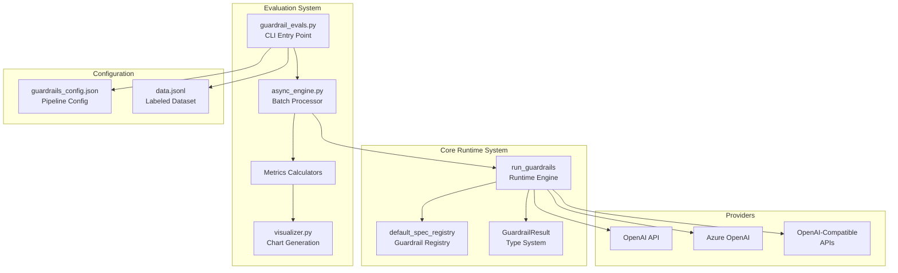
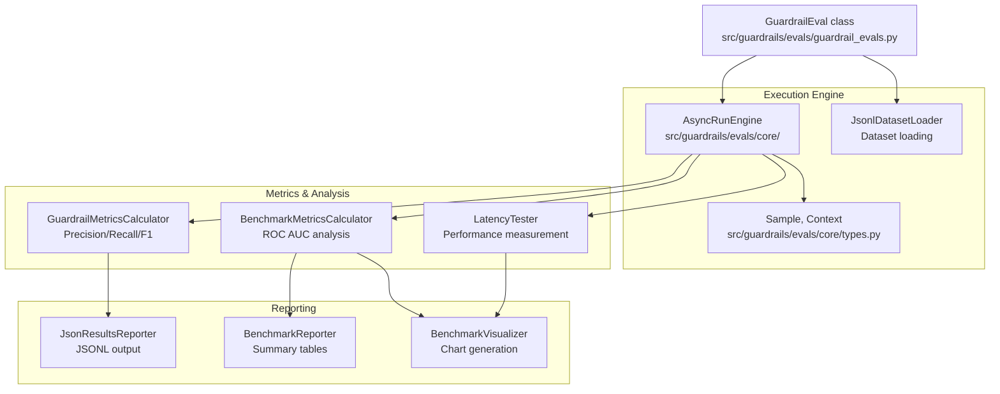
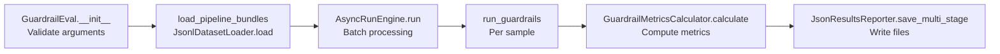
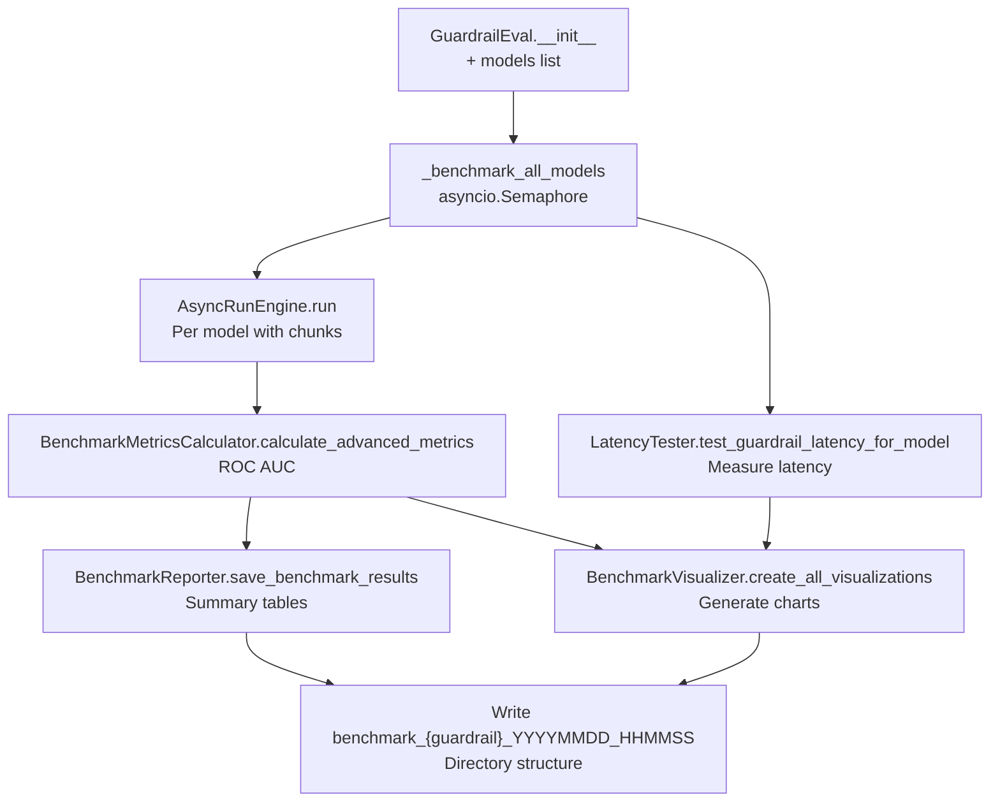
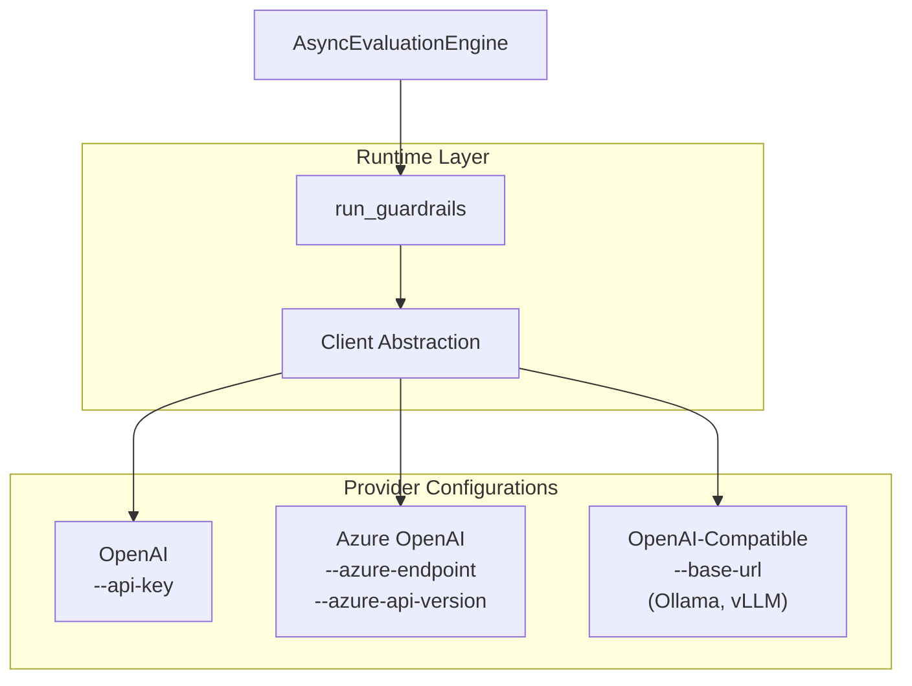

<!-- source: DeepWiki mcp.deepwiki.com · repo openai/openai-guardrails-python · page 7.1 Evaluation Framework Overview · fetched 2026-10-26 -->

# Evaluation Framework Overview

<details>
<summary>Relevant source files</summary>

The following files were used as context for generating this wiki page:

- [README.md](README.md)
- [docs/assets/images/guardrails-python-config-screenshot-100pct-q70.webp](docs/assets/images/guardrails-python-config-screenshot-100pct-q70.webp)
- [docs/evals.md](docs/evals.md)
- [src/guardrails/evals/guardrail_evals.py](src/guardrails/evals/guardrail_evals.py)
- [tests/unit/evals/test_guardrail_evals.py](tests/unit/evals/test_guardrail_evals.py)

</details>


## Purpose and Scope

The Evaluation Framework is a comprehensive testing and benchmarking system for guardrails, providing data-driven performance analysis through automated evaluation pipelines. This framework enables developers to measure guardrail accuracy (precision, recall, F1), compare model performance (ROC AUC), and test latency characteristics against labeled datasets.

This page provides an architectural overview of the evaluation system. For specific topics:
- Dataset format and structure: see [Dataset Format](#7.2)
- Running evaluations with CLI arguments: see [Running Evaluations](#7.3)
- Benchmark mode features and model comparison: see [Benchmark Mode](#7.4)
- Metrics calculation and visualization: see [Metrics and Visualization](#7.5)
- Third-party provider configuration: see [Third-Party Provider Support](#7.6)

**Sources:** [docs/evals.md:1-5](), [src/guardrails/evals/README.md:1-5]()

---

## System Integration

The evaluation framework integrates with the core guardrails runtime system, using the same `run_guardrails` execution engine and pipeline stages as production client code. This architecture ensures that evaluation results accurately reflect real-world guardrail behavior.



**Sources:** [docs/evals.md:189-197](), Diagram 5 from high-level architecture

---

## Two-Mode Architecture

The evaluation framework operates in two distinct modes, each designed for different use cases:

| Mode | Purpose | Key Features | Output |
|------|---------|--------------|--------|
| **Evaluate** | Validate single configuration | Precision, recall, F1 metrics | JSONL results, metrics JSON, summary |
| **Benchmark** | Compare multiple models | ROC AUC, precision@recall, latency | ROC curves, performance charts, comparison tables |

### Mode Selection

```bash
# Evaluation mode (default)
guardrails-evals --config-path config.json --dataset-path data.jsonl

# Benchmark mode (with model comparison)
guardrails-evals --config-path config.json --dataset-path data.jsonl \
  --mode benchmark --models gpt-5 gpt-5-mini gpt-4.1 gpt-4.1-mini
```

**Default benchmark models:** `gpt-5`, `gpt-5-mini`, `gpt-4.1`, `gpt-4.1-mini` ([src/guardrails/evals/guardrail_evals.py:44-49]())

**Sources:** [docs/evals.md:8-31](), [README.md:97-115](), [src/guardrails/evals/guardrail_evals.py:44-49]()

---

## Core Component Architecture

### Component Diagram



### Component Responsibilities

**`GuardrailEval` class** - Main evaluation orchestrator ([src/guardrails/evals/guardrail_evals.py:55-653]())
- Argument parsing and validation
- Mode routing (evaluate vs benchmark)
- Configuration and dataset loading
- Provider setup (OpenAI, Azure, OpenAI-compatible)
- Output directory management
- Parallel model benchmarking coordination

**`AsyncRunEngine`** - Batch evaluation engine ([src/guardrails/evals/guardrail_evals.py:28]())
- Asynchronous batch processing with configurable batch size
- Multi-stage pipeline evaluation (pre_flight, input, output)
- Multi-turn conversation support via `multi_turn` flag
- Progress tracking with `desc` parameter
- Result aggregation across batches

**`JsonlDatasetLoader`** - Dataset loading ([src/guardrails/evals/guardrail_evals.py:28]())
- Parses JSONL dataset format
- Loads samples with `id`, `data`, `expected_triggers` fields
- Handles conversation data (JSON strings or plain text)

**`GuardrailMetricsCalculator`** - Basic metrics ([src/guardrails/evals/guardrail_evals.py:28]())
- Precision, recall, F1 score computation
- Per-guardrail metrics with confusion matrix
- True/false positive/negative counts

**`BenchmarkMetricsCalculator`** - Advanced metrics ([src/guardrails/evals/guardrail_evals.py:28]())
- ROC AUC calculation via `calculate_advanced_metrics()`
- Precision at recall thresholds
- Model performance comparison

**`LatencyTester`** - Performance testing ([src/guardrails/evals/guardrail_evals.py:28]())
- End-to-end latency measurement via `test_guardrail_latency_for_model()`
- Configurable iteration count (default: 25)
- P50, P95 percentile calculation

**`BenchmarkVisualizer`** - Visualization ([src/guardrails/evals/guardrail_evals.py:28]())
- ROC curve plotting via `create_all_visualizations()`
- Performance comparison charts
- Latency distribution graphs
- PNG output to `graphs/` subdirectory

**`BenchmarkReporter`** - Summary generation ([src/guardrails/evals/guardrail_evals.py:28]())
- Formatted summary tables via `save_benchmark_results()`
- Performance comparison reports
- Text output for human readability

**`JsonResultsReporter`** - Evaluation output ([src/guardrails/evals/guardrail_evals.py:28]())
- JSONL results with per-sample predictions
- JSON metrics files
- Multi-stage result aggregation via `save_multi_stage()`

**Sources:** [src/guardrails/evals/guardrail_evals.py:28-38](), [src/guardrails/evals/guardrail_evals.py:55-653]()

---

## Execution Flow

### Evaluation Mode Flow



1. Parse and validate CLI arguments via `GuardrailEval.__init__()` ([src/guardrails/evals/guardrail_evals.py:58-124]())
2. Load guardrails configuration via `load_pipeline_bundles()` ([src/guardrails/evals/guardrail_evals.py:219]())
3. Load labeled dataset via `JsonlDatasetLoader.load()` ([src/guardrails/evals/guardrail_evals.py:228]())
4. Initialize `AsyncRunEngine` with `multi_turn` flag ([src/guardrails/evals/guardrail_evals.py:474]())
5. Process samples in batches via `engine.run()` with configurable batch size ([src/guardrails/evals/guardrail_evals.py:476]())
6. Aggregate results via `GuardrailMetricsCalculator.calculate()` ([src/guardrails/evals/guardrail_evals.py:478]())
7. Write output files via `JsonResultsReporter.save_multi_stage()` to timestamped directory ([src/guardrails/evals/guardrail_evals.py:257]())

### Benchmark Mode Flow



1. Parse CLI with `--mode benchmark` and `--models` ([src/guardrails/evals/guardrail_evals.py:704-709]())
2. Run models in parallel with `asyncio.Semaphore` (configurable via `--max-parallel-models`) ([src/guardrails/evals/guardrail_evals.py:515-598]())
3. For each model, optionally process dataset in chunks via `--benchmark-chunk-size` ([src/guardrails/evals/guardrail_evals.py:616-623]())
4. Run full evaluation per model using `AsyncRunEngine.run()` ([src/guardrails/evals/guardrail_evals.py:614-622]())
5. Compute ROC AUC via `BenchmarkMetricsCalculator.calculate_advanced_metrics()` ([src/guardrails/evals/guardrail_evals.py:627]())
6. Measure latency via `LatencyTester.test_guardrail_latency_for_model()` with configurable iterations (default: 25) ([src/guardrails/evals/guardrail_evals.py:339-346]())
7. Generate ROC curves via `BenchmarkVisualizer.create_all_visualizations()` ([src/guardrails/evals/guardrail_evals.py:308-310]())
8. Create comparison tables via `BenchmarkReporter.save_benchmark_results()` ([src/guardrails/evals/guardrail_evals.py:301-303]())
9. Output organized directory structure with `results/`, `graphs/` subdirectories ([src/guardrails/evals/guardrail_evals.py:301-313]())

**Sources:** [docs/evals.md:140-165](), [src/guardrails/evals/guardrail_evals.py:260-313](), [src/guardrails/evals/guardrail_evals.py:503-652]()

---

## Output Structure

### Evaluation Mode Output

```
results/
└── eval_run_YYYYMMDD_HHMMSS/
    ├── eval_results_{stage}.jsonl      # Per-sample results with predictions
    ├── eval_metrics.json                # Aggregate metrics (precision, recall, F1)
    └── run_summary.txt                  # Human-readable summary
```

**File Contents:**
- `eval_results_{stage}.jsonl`: One JSON object per dataset sample with `id`, `expected`, `actual`, `correct` fields
- `eval_metrics.json`: Structured metrics including per-guardrail and aggregate statistics
- `run_summary.txt`: Formatted text report with metrics tables

### Benchmark Mode Output

```
results/
└── benchmark_{guardrail}_YYYYMMDD_HHMMSS/
    ├── results/
    │   ├── eval_results_{guardrail}_{model}.jsonl   # Per-model evaluation results
    │   ├── performance_metrics.json                  # ROC AUC, precision@recall
    │   ├── latency_results.json                      # P50, P95 latency data
    │   └── benchmark_summary_tables.txt              # Formatted comparison tables
    ├── graphs/
    │   ├── {guardrail}_roc_curves.png               # ROC curve comparison
    │   ├── {guardrail}_basic_metrics.png            # Precision/recall/F1 bars
    │   ├── {guardrail}_advanced_metrics.png         # ROC AUC comparison
    │   └── latency_comparison.png                    # Latency distribution
    └── benchmark_summary.txt                         # Overall summary report
```

**Sources:** [docs/evals.md:123-149](), [src/guardrails/evals/README.md:79-105]()

---

## Multi-Stage Evaluation Support

The evaluation framework supports the three-stage guardrail pipeline architecture:

| Stage | Purpose | Example Guardrails |
|-------|---------|-------------------|
| **pre_flight** | Input modification | PII masking |
| **input** | Request validation | Jailbreak detection, URL filter |
| **output** | Response validation | Hallucination detection, NSFW |

### Stage-Specific Evaluation

```bash
# Evaluate specific stages only
guardrails-evals \
  --config-path config.json \
  --dataset-path data.jsonl \
  --stages pre_flight input
```

The engine automatically detects which stages are configured via `_get_valid_stages()` ([src/guardrails/evals/guardrail_evals.py:436-464]()) and evaluates only those stages. Invalid stages are skipped with warnings logged via `logger.warning()`.

**Valid stages:** `pre_flight`, `input`, `output` ([src/guardrails/evals/guardrail_evals.py:52]())

**Auto-detection logic:** If `--stages` is not specified, all stages with configured guardrails are automatically detected ([src/guardrails/evals/guardrail_evals.py:439-446]()). If specific stages are requested, they are validated against `VALID_STAGES` and checked for guardrail configuration ([src/guardrails/evals/guardrail_evals.py:448-464]()).

**Sources:** [docs/evals.md:712-716](), [src/guardrails/evals/guardrail_evals.py:52](), [src/guardrails/evals/guardrail_evals.py:436-464]()

---

## Provider Abstraction

The evaluation framework supports multiple LLM providers through a unified interface:



### Provider Selection

```bash
# OpenAI (default)
guardrails-evals --config-path config.json --dataset-path data.jsonl

# Azure OpenAI
guardrails-evals --config-path config.json --dataset-path data.jsonl \
  --azure-endpoint https://your-resource.openai.azure.com \
  --api-key your-azure-key

# Ollama (local models)
guardrails-evals --config-path config.json --dataset-path data.jsonl \
  --base-url http://localhost:11434/v1 \
  --api-key fake-key
```

**Provider Configuration Implementation:**

The `_create_context()` method ([src/guardrails/evals/guardrail_evals.py:349-383]()) creates a `Context` object with the appropriate client:

- **Azure OpenAI**: Uses `AsyncAzureOpenAI` with `azure_endpoint` and `api_version` parameters ([src/guardrails/evals/guardrail_evals.py:359-371]())
- **OpenAI / OpenAI-compatible**: Uses `AsyncOpenAI` with optional `api_key` and `base_url` parameters ([src/guardrails/evals/guardrail_evals.py:372-381]())

The `Context` object wraps the `guardrail_llm` client ([src/guardrails/evals/guardrail_evals.py:383]()) which is passed to `AsyncRunEngine.run()` for evaluation execution.

**Sources:** [docs/evals.md:169-203](), [src/guardrails/evals/guardrail_evals.py:349-383]()

---

## Benchmark Dependencies

The benchmark mode requires additional scientific computing packages for advanced metrics and visualization. These are optional for basic evaluation mode:

| Package | Version | Purpose |
|---------|---------|---------|
| `numpy` | ≥1.24.0 | Numerical computations |
| `scikit-learn` | ≥1.3.0 | ROC AUC, precision@recall |
| `matplotlib` | ≥3.7.0 | Chart generation |
| `seaborn` | ≥0.12.0 | Statistical plots |
| `pandas` | ≥2.0.0 | Data processing |

Install with:
```bash
pip install "guardrails[benchmark]"
```

**Sources:** [docs/evals.md:26-41](), [src/guardrails/evals/README.md:200-214]()

---

## CLI Entry Point

The evaluation framework is accessible via the `guardrails-evals` CLI command, implemented in:

```
src/guardrails/evals/guardrail_evals.py
```

The main entry point is the `GuardrailEval` class ([src/guardrails/evals/guardrail_evals.py:55]()) which orchestrates evaluation execution. The CLI invokes `main()` ([src/guardrails/evals/guardrail_evals.py:655-896]()) which instantiates this class and calls `asyncio.run(eval.run())`.

### Key CLI Arguments

| Argument | Required | Description | Default |
|----------|----------|-------------|---------|
| `--config-path` | ✅ | Path to `guardrails_config.json` | - |
| `--dataset-path` | ✅ | Path to labeled JSONL dataset | - |
| `--mode` | ❌ | `evaluate` or `benchmark` | `evaluate` |
| `--models` | ❌ | Space-separated model names for benchmark | `gpt-5 gpt-5-mini gpt-4.1 gpt-4.1-mini` |
| `--batch-size` | ❌ | Parallel processing batch size | 32 |
| `--stages` | ❌ | Specific stages to evaluate (pre_flight, input, output) | All configured |
| `--output-dir` | ❌ | Results directory | `results/` |
| `--latency-iterations` | ❌ | Latency test sample count | 25 |
| `--multi-turn` | ❌ | Process conversation-aware guardrails turn-by-turn | False |
| `--max-parallel-models` | ❌ | Max concurrent model benchmarks | `max(1, min(model_count, cpu_count))` |
| `--benchmark-chunk-size` | ❌ | Optional samples per chunk when benchmarking | None (process all) |
| `--api-key` | ❌ | API key for OpenAI/Azure/compatible API | From environment |
| `--base-url` | ❌ | Base URL for OpenAI-compatible API (Ollama, vLLM) | OpenAI default |
| `--azure-endpoint` | ❌ | Azure OpenAI endpoint URL | - |
| `--azure-api-version` | ❌ | Azure OpenAI API version | `2025-01-01-preview` |

**Sources:** [docs/evals.md:54-72](), [src/guardrails/evals/guardrail_evals.py:50-52](), [src/guardrails/evals/guardrail_evals.py:689-780]()

---

## Asynchronous Batch Processing

The evaluation engine uses asynchronous execution with configurable batch sizes to optimize throughput:

- Samples are grouped into batches (default: 32)
- Each batch is processed concurrently using `asyncio`
- Progress is tracked and displayed during execution
- Failed samples are logged but don't halt evaluation
- Results are aggregated across all batches

This architecture allows the evaluation framework to efficiently process large datasets while maintaining the same guardrail behavior as production code.

**Sources:** [src/guardrails/evals/README.md:39-50](), [docs/evals.md:51]()

---

