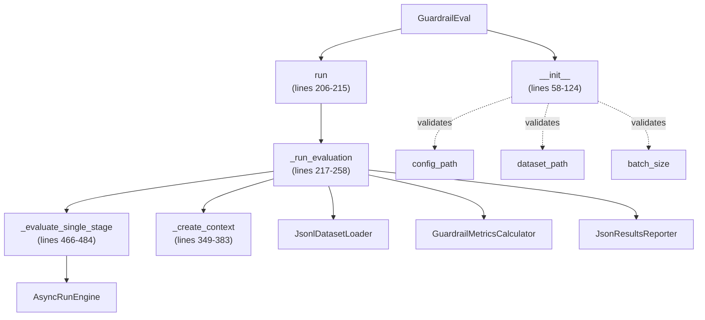
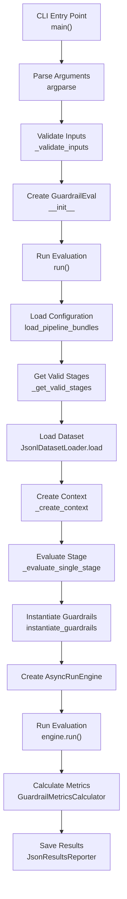
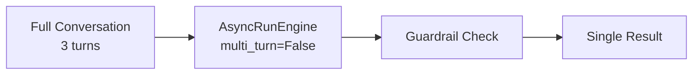
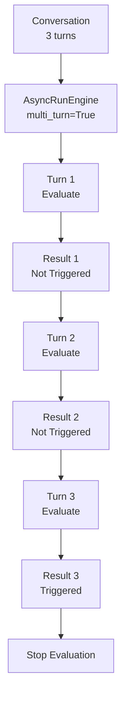
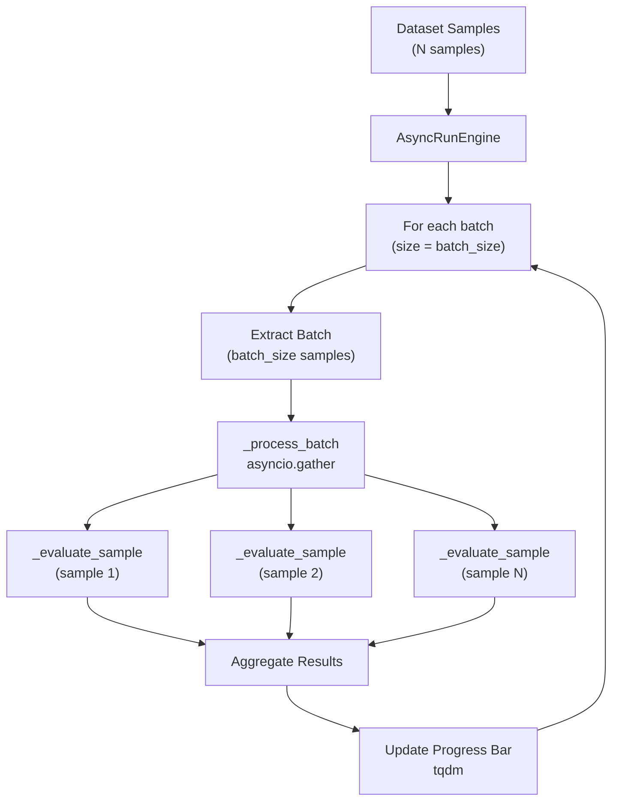
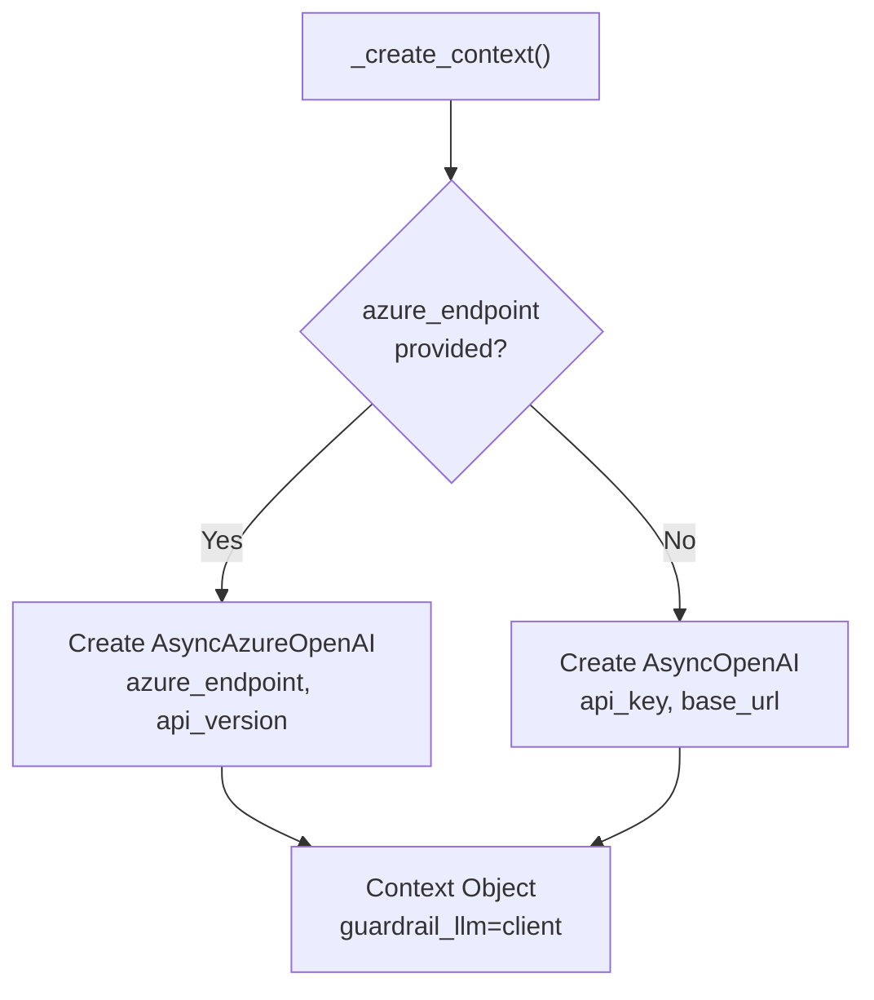

<!-- source: DeepWiki mcp.deepwiki.com · repo openai/openai-guardrails-python · page 7.3 Running Evaluations · fetched 2026-10-26 -->

# Running Evaluations

<details>
<summary>Relevant source files</summary>

The following files were used as context for generating this wiki page:

- [docs/evals.md](docs/evals.md)
- [src/guardrails/evals/core/async_engine.py](src/guardrails/evals/core/async_engine.py)
- [src/guardrails/evals/guardrail_evals.py](src/guardrails/evals/guardrail_evals.py)
- [tests/unit/evals/test_async_engine.py](tests/unit/evals/test_async_engine.py)
- [tests/unit/evals/test_guardrail_evals.py](tests/unit/evals/test_guardrail_evals.py)

</details>


This document describes how to execute guardrail evaluations using the `guardrails-evals` CLI tool and the `GuardrailEval` class. It covers CLI invocation, parameter configuration, batch processing, and output structure for standard evaluation mode.

For dataset format and structure, see [Dataset Format and Structure](#7.2). For benchmark mode (multi-model comparison), see [Benchmark Mode](#7.4). For metrics calculation and visualization, see [Metrics and Visualization](#7.5). For evaluation engine internals, see [AsyncRunEngine Internals](#7.7).

---

## CLI Invocation

The evaluation system provides two entry points for running guardrail evaluations:

### Entry Points

**Installed Package Entry Point**
```bash
guardrails-evals --help
```

**Module Execution (Development)**
```bash
python -m guardrails.evals.guardrail_evals --help
```

Both entry points invoke the same `main()` function in [src/guardrails/evals/guardrail_evals.py:655-900]().

### Basic Evaluation Command

```bash
guardrails-evals \
  --config-path guardrails_config.json \
  --dataset-path data.jsonl
```

This command evaluates all stages found in the configuration file against the provided dataset using default settings.

**Sources:** [src/guardrails/evals/guardrail_evals.py:655-900](), [docs/evals.md:1-220]()

---

## Command Line Parameters

The CLI accepts the following parameters for evaluation mode:

| Parameter | Type | Required | Default | Description |
|-----------|------|----------|---------|-------------|
| `--config-path` | Path | ✅ | - | Path to `guardrails_config.json` file |
| `--dataset-path` | Path | ✅ | - | Path to evaluation dataset (JSONL format) |
| `--mode` | String | ❌ | `evaluate` | Evaluation mode (`evaluate` or `benchmark`) |
| `--stages` | List[String] | ❌ | All stages | Specific stages to evaluate (`pre_flight`, `input`, `output`) |
| `--batch-size` | Integer | ❌ | 32 | Number of samples to process in parallel |
| `--output-dir` | Path | ❌ | `results/` | Directory to save evaluation results |
| `--multi-turn` | Boolean | ❌ | False | Enable incremental turn-by-turn evaluation |
| `--api-key` | String | ❌ | From env | API key for OpenAI or compatible API |
| `--base-url` | String | ❌ | - | Base URL for OpenAI-compatible API |

**Sources:** [src/guardrails/evals/guardrail_evals.py:689-734](), [docs/evals.md:53-72]()

### Stage Selection

The `--stages` parameter controls which pipeline stages are evaluated:

```bash
# Evaluate all stages (default)
guardrails-evals --config-path config.json --dataset-path data.jsonl

# Evaluate specific stages only
guardrails-evals \
  --config-path config.json \
  --dataset-path data.jsonl \
  --stages pre_flight input
```

If no `--stages` argument is provided, the system auto-detects all valid stages from the configuration and evaluates them [src/guardrails/evals/guardrail_evals.py:436-464]().

**Sources:** [src/guardrails/evals/guardrail_evals.py:436-464](), [src/guardrails/evals/guardrail_evals.py:712-717]()

---

## Programmatic Usage

The `GuardrailEval` class provides programmatic access to the evaluation system:

```python
from pathlib import Path
from guardrails.evals.guardrail_evals import GuardrailEval
import asyncio

# Initialize evaluator
evaluator = GuardrailEval(
    config_path=Path("guardrails_config.json"),
    dataset_path=Path("data.jsonl"),
    stages=["input", "output"],
    batch_size=16,
    output_dir=Path("results"),
    multi_turn=False
)

# Run evaluation
asyncio.run(evaluator.run())
```

### GuardrailEval Class Structure



**Sources:** [src/guardrails/evals/guardrail_evals.py:55-653]()

### Constructor Parameters

The `GuardrailEval` constructor accepts the following parameters [src/guardrails/evals/guardrail_evals.py:58-124]():

- `config_path`: Path to pipeline configuration file
- `dataset_path`: Path to evaluation dataset (JSONL)
- `stages`: Optional list of stages to evaluate
- `batch_size`: Number of samples to process in parallel (default: 32)
- `output_dir`: Directory to save results (default: `results/`)
- `api_key`: Optional API key for OpenAI or compatible API
- `base_url`: Optional base URL for OpenAI-compatible API
- `azure_endpoint`: Optional Azure OpenAI endpoint
- `azure_api_version`: Azure API version (default: `2025-01-01-preview`)
- `mode`: Evaluation mode (`evaluate` or `benchmark`)
- `models`: List of models for benchmark mode
- `latency_iterations`: Number of latency test iterations (default: 25)
- `multi_turn`: Enable incremental turn-by-turn evaluation (default: False)
- `max_parallel_models`: Maximum concurrent models in benchmark mode
- `benchmark_chunk_size`: Optional chunk size for benchmark mode

**Sources:** [src/guardrails/evals/guardrail_evals.py:58-124]()

---

## Evaluation Execution Flow

The evaluation process follows a structured pipeline:



**Sources:** [src/guardrails/evals/guardrail_evals.py:206-258](), [src/guardrails/evals/guardrail_evals.py:466-484]()

### Stage Evaluation Process

For each stage in the configuration, the evaluator:

1. **Loads Pipeline Configuration** [src/guardrails/evals/guardrail_evals.py:219]()
   - Reads `guardrails_config.json` using `load_pipeline_bundles`
   - Extracts stage-specific guardrail configurations

2. **Validates Stage Availability** [src/guardrails/evals/guardrail_evals.py:220]()
   - Checks if stage exists in configuration using `_get_valid_stages`
   - Verifies stage has at least one guardrail configured

3. **Instantiates Guardrails** [src/guardrails/evals/guardrail_evals.py:472]()
   - Converts configuration into executable guardrail instances
   - Uses `instantiate_guardrails` from core runtime

4. **Creates Evaluation Engine** [src/guardrails/evals/guardrail_evals.py:474]()
   - Instantiates `AsyncRunEngine` with guardrails
   - Configures multi-turn mode if enabled

5. **Runs Evaluation** [src/guardrails/evals/guardrail_evals.py:476]()
   - Processes samples in batches using `engine.run()`
   - Returns list of `SampleResult` objects

6. **Calculates Metrics** [src/guardrails/evals/guardrail_evals.py:478]()
   - Computes precision, recall, F1 using `GuardrailMetricsCalculator`

**Sources:** [src/guardrails/evals/guardrail_evals.py:466-484]()

---

## Multi-Turn Evaluation

The `--multi-turn` flag enables incremental turn-by-turn evaluation for conversation-aware guardrails:

### Standard Single-Pass Evaluation (Default)



Without `--multi-turn`, the entire conversation history is analyzed in a single pass [src/guardrails/evals/core/async_engine.py:376-382]().

### Incremental Turn-by-Turn Evaluation



With `--multi-turn`, the conversation is evaluated incrementally, stopping at the first turn that triggers a guardrail [src/guardrails/evals/core/async_engine.py:164-203]().

**Example Usage:**

```bash
guardrails-evals \
  --config-path config.json \
  --dataset-path multi_turn_data.jsonl \
  --multi-turn
```

The incremental mode is implemented in `_run_incremental_guardrails()` [src/guardrails/evals/core/async_engine.py:164-203](), which:

1. Iterates through conversation turns sequentially
2. Evaluates guardrails at each turn with history up to that point
3. Annotates results with turn metadata (turn_index, trigger_role)
4. Stops on first tripwire trigger
5. Returns results from triggering turn (or final turn if no trigger)

**Sources:** [src/guardrails/evals/core/async_engine.py:164-203](), [src/guardrails/evals/core/async_engine.py:371-382](), [docs/evals.md:106-138]()

---

## Batch Processing

The evaluation system processes samples in configurable batches to optimize performance:

### Batch Size Configuration

```bash
# Default batch size (32 samples)
guardrails-evals --config-path config.json --dataset-path data.jsonl

# Custom batch size (16 samples)
guardrails-evals \
  --config-path config.json \
  --dataset-path data.jsonl \
  --batch-size 16
```

### Batch Processing Flow



The `AsyncRunEngine.run()` method divides samples into batches and processes them using `asyncio.gather()` for concurrent execution [src/guardrails/evals/core/async_engine.py:225-269]().

**Sources:** [src/guardrails/evals/core/async_engine.py:225-269](), [src/guardrails/evals/core/async_engine.py:290-310]()

### Batch Processing Implementation

The batching logic in `AsyncRunEngine._run_with_progress()` [src/guardrails/evals/core/async_engine.py:271-279]():

1. Divides samples into batches of `batch_size`
2. For each batch, calls `_process_batch()` [src/guardrails/evals/core/async_engine.py:290-310]()
3. `_process_batch()` uses `asyncio.gather()` to evaluate all samples concurrently
4. Aggregates results and updates progress bar
5. Continues to next batch

**Error Handling:** Individual sample failures are caught and returned as error results [src/guardrails/evals/core/async_engine.py:297-309](). This ensures one failing sample doesn't stop the entire evaluation.

**Sources:** [src/guardrails/evals/core/async_engine.py:271-310]()

---

## Output Structure

Evaluation mode produces a timestamped directory containing results for each evaluated stage:

### Directory Structure

```
results/
└── eval_run_20240115_143022/
    ├── eval_results_pre_flight.jsonl
    ├── eval_results_input.jsonl
    ├── eval_results_output.jsonl
    ├── eval_metrics.json
    └── run_summary.txt
```

### Result Files

**Stage Results (JSONL)**

Each `eval_results_{stage}.jsonl` file contains one JSON object per line with evaluation results for that stage:

```json
{
  "id": "sample-001",
  "expected_triggers": {
    "Jailbreak": true,
    "Moderation": false
  },
  "triggered": {
    "Jailbreak": true,
    "Moderation": false
  },
  "details": {
    "Jailbreak": {
      "guardrail_name": "Jailbreak",
      "tripwire_triggered": true,
      "flagged": true
    }
  }
}
```

**Metrics Summary (JSON)**

The `eval_metrics.json` file contains aggregate metrics for each guardrail:

```json
{
  "Jailbreak": {
    "precision": 0.95,
    "recall": 0.92,
    "f1_score": 0.935,
    "true_positives": 46,
    "false_positives": 2,
    "false_negatives": 4,
    "true_negatives": 48,
    "total_samples": 100
  }
}
```

**Run Summary (Text)**

The `run_summary.txt` file provides human-readable evaluation summary.

**Sources:** [docs/evals.md:139-148](), [src/guardrails/evals/guardrail_evals.py:257]()

---

## Context Creation

The evaluation system creates an execution context containing the LLM client for guardrail checks:



The `_create_context()` method [src/guardrails/evals/guardrail_evals.py:349-383]() supports:

- **OpenAI** (default): Standard OpenAI API
- **Azure OpenAI**: Using `--azure-endpoint` and `--azure-api-version`
- **OpenAI-compatible APIs**: Using `--base-url` (e.g., Ollama, vLLM)

**Sources:** [src/guardrails/evals/guardrail_evals.py:349-383]()

---

## Common Evaluation Workflows

### Single Stage Evaluation

Evaluate only the input stage:

```bash
guardrails-evals \
  --config-path config.json \
  --dataset-path data.jsonl \
  --stages input
```

### Multi-Stage Evaluation

Evaluate multiple stages with custom batch size:

```bash
guardrails-evals \
  --config-path config.json \
  --dataset-path data.jsonl \
  --stages pre_flight input output \
  --batch-size 16
```

### Conversation-Aware Evaluation

Evaluate conversation-aware guardrails incrementally:

```bash
guardrails-evals \
  --config-path config.json \
  --dataset-path conversations.jsonl \
  --multi-turn
```

### Custom Output Location

Specify custom output directory:

```bash
guardrails-evals \
  --config-path config.json \
  --dataset-path data.jsonl \
  --output-dir ./my_results
```

### API Provider Selection

**Azure OpenAI:**
```bash
guardrails-evals \
  --config-path config.json \
  --dataset-path data.jsonl \
  --azure-endpoint https://your-resource.openai.azure.com \
  --api-key your-key
```

**Ollama (Local):**
```bash
guardrails-evals \
  --config-path config.json \
  --dataset-path data.jsonl \
  --base-url http://localhost:11434/v1 \
  --api-key fake-key
```

**Sources:** [docs/evals.md:169-203](), [src/guardrails/evals/guardrail_evals.py:655-896]()

---

