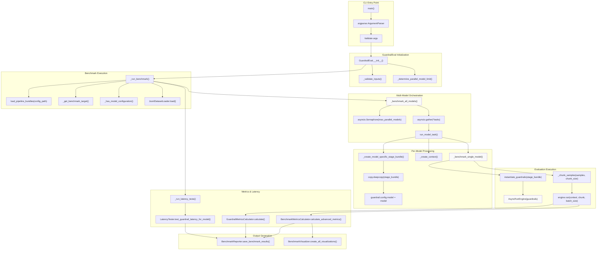
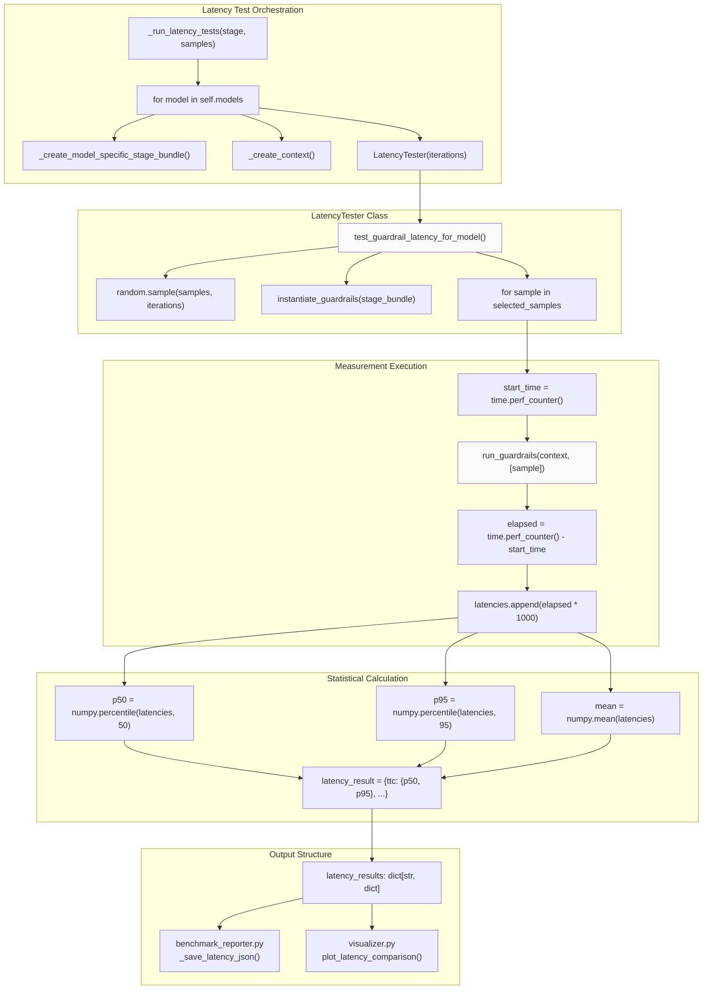
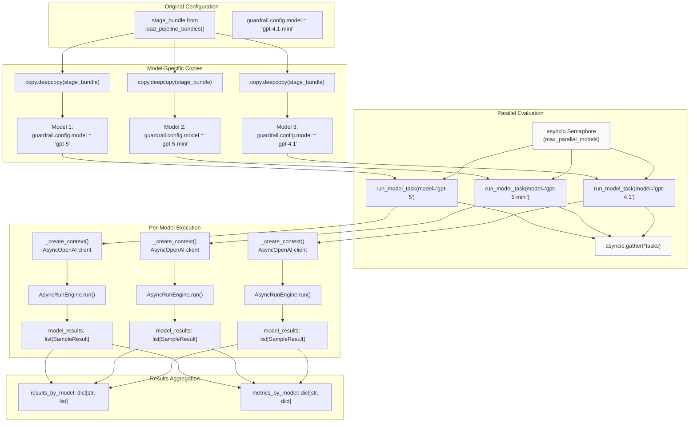
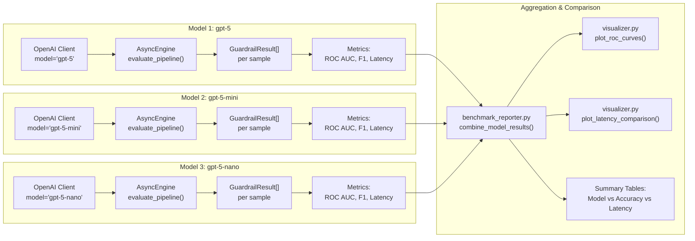
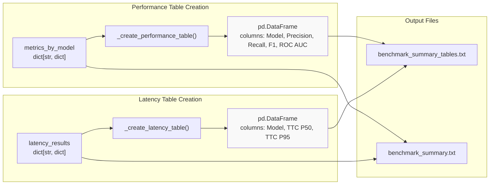
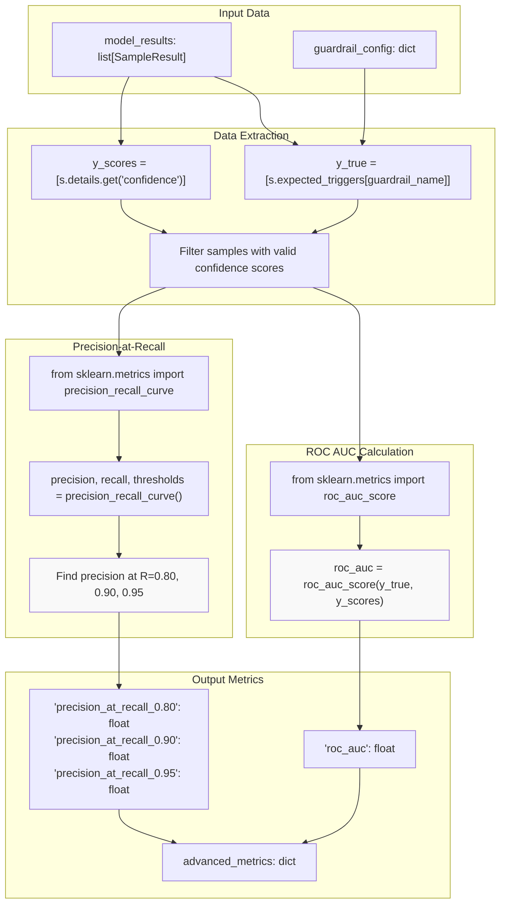

<!-- source: DeepWiki mcp.deepwiki.com · repo openai/openai-guardrails-python · page 7.4 Benchmark Mode · fetched 2026-10-26 -->

# Benchmark Mode

<details>
<summary>Relevant source files</summary>

The following files were used as context for generating this wiki page:

- [docs/evals.md](docs/evals.md)
- [docs/ref/checks/hallucination_detection.md](docs/ref/checks/hallucination_detection.md)
- [src/guardrails/checks/text/hallucination_detection.py](src/guardrails/checks/text/hallucination_detection.py)
- [src/guardrails/checks/text/off_topic_prompts.py](src/guardrails/checks/text/off_topic_prompts.py)
- [src/guardrails/checks/text/user_defined_llm.py](src/guardrails/checks/text/user_defined_llm.py)
- [src/guardrails/evals/core/benchmark_reporter.py](src/guardrails/evals/core/benchmark_reporter.py)
- [src/guardrails/evals/guardrail_evals.py](src/guardrails/evals/guardrail_evals.py)
- [tests/unit/evals/test_guardrail_evals.py](tests/unit/evals/test_guardrail_evals.py)

</details>


## Overview

Benchmark Mode enables multi-model performance comparison for LLM-based guardrails. Invoked via `--mode benchmark` in the `guardrails-evals` CLI, it executes the same guardrail configuration against multiple models and generates comparative analysis including ROC curves, precision-at-recall thresholds, and latency distributions.

The implementation is structured around the `GuardrailEval` class ([src/guardrails/evals/guardrail_evals.py:55-653]()), which coordinates:
- **Per-model evaluation:** `_benchmark_all_models()` ([line 503-598]()) runs evaluation tasks concurrently with semaphore-based concurrency control
- **Latency measurement:** `_run_latency_tests()` ([line 331-347]()) uses `LatencyTester` to measure P50/P95 percentiles
- **Results aggregation:** `BenchmarkReporter` ([src/guardrails/evals/core/benchmark_reporter.py:22-231]()) generates structured output with visualizations

Unlike basic evaluation mode (see page 7.3), benchmark mode requires LLM-based guardrails with configurable `model` parameters and installs visualization dependencies via `pip install "openai-guardrails[benchmark]"`.

**Sources:** [src/guardrails/evals/guardrail_evals.py:55-653](), [docs/evals.md:24-31]()

---

## Purpose and Use Cases

Benchmark Mode is specifically designed for the following scenarios:

| Use Case | Description |
|----------|-------------|
| **Model Selection** | Compare different models (e.g., `gpt-5`, `gpt-5-mini`, `gpt-5-nano`) to identify the optimal balance between accuracy and cost |
| **Performance Optimization** | Analyze latency characteristics across models to meet SLA requirements |
| **Quality Assurance** | Generate ROC curves and advanced metrics to validate guardrail effectiveness before production deployment |
| **Trade-off Analysis** | Visualize precision-recall trade-offs across different confidence thresholds |
| **Multi-Provider Evaluation** | Compare models from different providers (OpenAI, Azure OpenAI, Ollama) on identical test datasets |

Benchmark Mode is **not** designed for quick validation or continuous integration testing. For those scenarios, use basic evaluation mode which provides faster feedback with essential metrics.

**Sources:** [docs/evals.md:14-21](), [src/guardrails/evals/README.md:59-65]()

---

## Dependencies

Benchmark mode requires scientific computing packages for metrics calculation and visualization:

```bash
pip install "openai-guardrails[benchmark]"
```

| Package | Version | Used By |
|---------|---------|---------|
| `numpy` | ≥1.24.0 | `BenchmarkMetricsCalculator` for percentile calculations |
| `scikit-learn` | ≥1.3.0 | `roc_auc_score()` in `BenchmarkMetricsCalculator.calculate_advanced_metrics()` |
| `matplotlib` | ≥3.7.0 | `BenchmarkVisualizer.create_all_visualizations()` for plot generation |
| `seaborn` | ≥0.12.0 | `BenchmarkVisualizer` styling and statistical plots |
| `pandas` | ≥2.0.0 | `BenchmarkReporter._create_performance_table()` for tabular formatting |

These dependencies are isolated from the base installation. Basic evaluation mode (see page 7.3) functions without them, allowing lightweight deployments in CI/CD environments.

**Sources:** [docs/evals.md:37-51](), [src/guardrails/evals/core/benchmark_reporter.py:93-132]()

---

## CLI Arguments

Benchmark mode is activated via the `main()` function ([src/guardrails/evals/guardrail_evals.py:655-846]()) which parses arguments using `argparse`:

### Benchmark-Specific Arguments

| Argument | Default | Type | Implementation Reference |
|----------|---------|------|--------------------------|
| `--mode` | `"evaluate"` | `str` | [guardrail_evals.py:704-709]() - choices: `["evaluate", "benchmark"]` |
| `--models` | `DEFAULT_BENCHMARK_MODELS` | `list[str]` | [guardrail_evals.py:760-764]() - defaults: `["gpt-5", "gpt-5-mini", "gpt-4.1", "gpt-4.1-mini"]` |
| `--latency-iterations` | `25` | `int` | [guardrail_evals.py:765-770]() - used by `LatencyTester` |
| `--max-parallel-models` | `min(cpu_count, model_count)` | `int` | [guardrail_evals.py:771-775]() - controls `asyncio.Semaphore` limit |
| `--benchmark-chunk-size` | `None` | `int` | [guardrail_evals.py:776-780]() - splits dataset via `_chunk_samples()` |

### Shared Arguments

| Argument | Default | Implementation Reference |
|----------|---------|--------------------------|
| `--config-path` | Required | [guardrail_evals.py:689-695]() - passed to `load_pipeline_bundles()` |
| `--dataset-path` | Required | [guardrail_evals.py:696-701]() - loaded via `JsonlDatasetLoader` |
| `--stages` | Auto-detect | [guardrail_evals.py:712-717]() - validated against `VALID_STAGES` |
| `--batch-size` | `32` | [guardrail_evals.py:718-723]() - used by `AsyncRunEngine.run()` |
| `--output-dir` | `Path("results")` | [guardrail_evals.py:724-729]() - passed to `BenchmarkReporter` |
| `--multi-turn` | `False` | [guardrail_evals.py:730-734]() - enables conversation-aware processing |

**Sources:** [src/guardrails/evals/guardrail_evals.py:655-846](), [docs/evals.md:54-72]()

---

## Execution Flow

### Benchmark Orchestration Architecture



The execution flow follows these key methods:

1. **Entry:** `main()` ([line 655]()) parses CLI arguments and initializes `GuardrailEval`
2. **Orchestration:** `_run_benchmark()` ([line 260]()) coordinates model evaluation
3. **Concurrency:** `_benchmark_all_models()` ([line 503]()) uses `asyncio.Semaphore` to limit parallel model evaluations
4. **Per-model:** `_benchmark_single_model()` ([line 600]()) executes evaluation for a single model configuration
5. **Chunking:** `_chunk_samples()` ([line 183]()) optionally splits dataset for progress tracking
6. **Reporting:** `BenchmarkReporter.save_benchmark_results()` ([benchmark_reporter.py:33-91]()) writes structured output

**Sources:** [src/guardrails/evals/guardrail_evals.py:55-653](), [src/guardrails/evals/core/benchmark_reporter.py:22-231]()
</str>

<old_str>
## Latency Testing

### LatencyTester Implementation

The `_run_latency_tests()` method ([guardrail_evals.py:331-347]()) orchestrates latency measurement using the `LatencyTester` class:



**Measurement Methodology:**

| Aspect | Implementation |
|--------|---------------|
| **Sample Selection** | `random.sample(samples, iterations)` - default 25 samples ([guardrail_evals.py:51]()) |
| **Timing** | `time.perf_counter()` provides high-resolution wall-clock time |
| **Scope** | Measures complete `run_guardrails()` execution including all pipeline stages |
| **Metrics** | P50 (median), P95 (95th percentile), mean latency in milliseconds |
| **Output** | `latency_results.json` with structure: `{model: {ttc: {p50, p95}}}` |

The latency measurement captures end-to-end guardrail execution time, including:
- Guardrail instantiation overhead
- LLM API call latency
- Network round-trip time
- Result processing and aggregation

This provides realistic deployment performance estimates.

**Sources:** [src/guardrails/evals/guardrail_evals.py:331-347](), [docs/evals.md:69]()
</old_str>
<new_str>
## Model Configuration Strategy

### Per-Model Bundle Creation

Benchmark mode creates independent stage bundles for each model via `_create_model_specific_stage_bundle()` ([guardrail_evals.py:401-434]()):



**Key Implementation Details:**

| Component | Implementation | Line Reference |
|-----------|---------------|----------------|
| **Deep Copy** | `copy.deepcopy(stage_bundle)` ensures independent modifications | [guardrail_evals.py:403-407]() |
| **Model Update** | Modifies `guardrail.config["model"]` or `guardrail.config.model` | [guardrail_evals.py:412-424]() |
| **Concurrency** | `asyncio.Semaphore(max_parallel_models)` limits concurrent evaluations | [guardrail_evals.py:515]() |
| **Task Function** | `run_model_task()` wraps each model evaluation with logging | [guardrail_evals.py:518-574]() |
| **Aggregation** | `asyncio.gather()` collects results from all model tasks | [guardrail_evals.py:576]() |

**Sources:** [src/guardrails/evals/guardrail_evals.py:401-434, 503-598]()

---

## Model Comparison Workflow

Benchmark Mode evaluates each model independently, then aggregates results for comparison:

### Per-Model Evaluation Process



Each model runs the **same guardrail configuration** on the **same dataset**, ensuring fair comparison. The models are evaluated sequentially (not in parallel) to avoid API rate limits and resource contention.

**Sources:** [src/guardrails/evals/core/async_engine.py](), [src/guardrails/evals/core/benchmark_reporter.py]()

---

## Output Structure

### BenchmarkReporter Output Directory

The `BenchmarkReporter.save_benchmark_results()` method ([benchmark_reporter.py:33-91]()) generates a timestamped directory structure:

```
results/
└── benchmark_{guardrail_name}_{YYYYMMDD_HHMMSS}/
    ├── results/
    │   ├── eval_results_{guardrail}_{model}.jsonl
    │   ├── performance_metrics.json
    │   ├── latency_results.json
    │   └── benchmark_summary_tables.txt
    ├── graphs/
    │   ├── {guardrail}_roc_curves.png
    │   ├── {guardrail}_basic_metrics.png
    │   ├── {guardrail}_advanced_metrics.png
    │   └── latency_comparison.png
    └── benchmark_summary.txt
```

### File Generation Mapping

| File | Generated By | Content Structure |
|------|--------------|-------------------|
| `eval_results_{guardrail}_{model}.jsonl` | `_save_results_jsonl()` ([line 169-179]()) | `{id, expected_triggers, triggered, details}` per line |
| `performance_metrics.json` | `_save_metrics_json()` ([line 181-184]()) | `{model: {precision, recall, f1_score, roc_auc, ...}}` |
| `latency_results.json` | `_save_latency_json()` ([line 186-189]()) | `{model: {ttc: {p50, p95}, ttft: {...}}}` |
| `benchmark_summary_tables.txt` | `_save_summary_tables()` ([line 134-167]()) | pandas DataFrame formatted as text tables |
| `benchmark_summary.txt` | `_save_benchmark_summary()` ([line 191-231]()) | Human-readable metrics summary |

### Table Generation

The reporter uses pandas DataFrames for structured comparison:



**Sources:** [src/guardrails/evals/core/benchmark_reporter.py:22-231](), [docs/evals.md:150-165]()

---

## CLI Invocation Examples

### Standard OpenAI Benchmark

```bash
guardrails-evals \
  --config-path guardrails_config.json \
  --dataset-path data.jsonl \
  --mode benchmark \
  --models gpt-5 gpt-5-mini gpt-4.1 gpt-4.1-mini
```

### Chunked Processing for Large Datasets

```bash
guardrails-evals \
  --config-path guardrails_config.json \
  --dataset-path data.jsonl \
  --mode benchmark \
  --models gpt-5 gpt-5-mini \
  --benchmark-chunk-size 100 \
  --latency-iterations 50
```

The `--benchmark-chunk-size` argument ([guardrail_evals.py:776-780]()) splits evaluation into smaller batches, improving progress tracking for long-running benchmarks.

### Parallel Model Evaluation Control

```bash
guardrails-evals \
  --config-path guardrails_config.json \
  --dataset-path data.jsonl \
  --mode benchmark \
  --models gpt-5 gpt-5-mini gpt-4.1 gpt-4.1-mini \
  --max-parallel-models 2
```

The `--max-parallel-models` argument ([guardrail_evals.py:771-775]()) limits concurrency via `asyncio.Semaphore`, useful for rate-limited API keys.

### Azure OpenAI Deployments

```bash
guardrails-evals \
  --config-path guardrails_config.json \
  --dataset-path data.jsonl \
  --mode benchmark \
  --models gpt-4o gpt-4o-mini \
  --azure-endpoint https://your-resource.openai.azure.com \
  --api-key your-azure-key \
  --azure-api-version 2025-01-01-preview
```

Creates `AsyncAzureOpenAI` client via `_create_context()` ([guardrail_evals.py:349-383]()).

**Sources:** [src/guardrails/evals/guardrail_evals.py:655-846](), [docs/evals.md:24-31, 179-202]()

---

## Metrics Calculation

### BenchmarkMetricsCalculator

The `BenchmarkMetricsCalculator.calculate_advanced_metrics()` method computes ROC AUC and precision-at-recall thresholds:



**Metric Definitions:**

| Metric | Calculation | Interpretation |
|--------|-------------|----------------|
| **ROC AUC** | `sklearn.metrics.roc_auc_score(y_true, y_scores)` | Area under ROC curve; 1.0 = perfect, 0.5 = random |
| **Prec@R=0.80** | Precision when recall reaches 80% | Precision achievable while catching 80% of violations |
| **Prec@R=0.90** | Precision when recall reaches 90% | Precision achievable while catching 90% of violations |
| **Prec@R=0.95** | Precision when recall reaches 95% | Precision achievable while catching 95% of violations |

### Combined Metrics Output

The `_benchmark_single_model()` method ([guardrail_evals.py:600-652]()) combines basic and advanced metrics:

```python
# Basic metrics from GuardrailMetricsCalculator
basic_metrics_dict = {
    "precision": float,
    "recall": float,
    "f1_score": float,
    "true_positives": int,
    "false_positives": int,
    "false_negatives": int,
    "true_negatives": int,
}

# Advanced metrics from BenchmarkMetricsCalculator
advanced_metrics = {
    "roc_auc": float,
    "precision_at_recall_0.80": float,
    "precision_at_recall_0.90": float,
    "precision_at_recall_0.95": float,
}

combined_metrics = {**basic_metrics_dict, **advanced_metrics}
```

**Sources:** [src/guardrails/evals/guardrail_evals.py:600-652](), [src/guardrails/evals/core/benchmark_reporter.py:93-132]()

---

## Advanced Metrics

Benchmark Mode computes metrics beyond basic precision/recall/F1:

### ROC AUC (Receiver Operating Characteristic - Area Under Curve)

**Purpose:** Measures the guardrail's ability to distinguish between positive and negative cases across all confidence thresholds.

**Calculation:** Uses `sklearn.metrics.roc_auc_score()` on the confidence scores returned in `GuardrailResult.info['confidence']`.

**Interpretation:**
- **1.0:** Perfect classification
- **0.9-1.0:** Excellent discrimination
- **0.8-0.9:** Good discrimination
- **0.7-0.8:** Acceptable discrimination
- **0.5:** No discrimination (random guessing)

### Precision at Recall Thresholds

**Purpose:** Shows precision achievable at specific recall targets (e.g., 90%, 95%, 99%).

**Calculation:** For each recall threshold, finds the confidence threshold that achieves that recall level, then calculates precision at that threshold.

**Use Case:** Helps determine if a model can meet specific recall requirements (e.g., "detect 95% of PII instances") while maintaining acceptable precision.

### Metrics Comparison Table

Benchmark Mode generates a comparison table showing all models side-by-side:

| Model | Precision | Recall | F1 | ROC AUC | P@R=0.90 | P@R=0.95 | Latency P50 | Latency P95 |
|-------|-----------|--------|----|---------|---------|---------|-----------|---------| 
| gpt-5 | 0.94 | 0.92 | 0.93 | 0.97 | 0.91 | 0.88 | 245ms | 312ms |
| gpt-5-mini | 0.89 | 0.88 | 0.89 | 0.94 | 0.85 | 0.81 | 156ms | 198ms |
| gpt-5-nano | 0.82 | 0.85 | 0.84 | 0.89 | 0.78 | 0.73 | 89ms | 117ms |

This enables data-driven model selection based on accuracy-latency-cost trade-offs.

**Sources:** [src/guardrails/evals/core/benchmark_calculator.py](), [src/guardrails/evals/core/benchmark_reporter.py]()

---

## Best Practices

### Dataset Requirements

- **Minimum samples:** 100+ for reliable ROC curve analysis
- **Class balance:** Include both positive and negative examples (aim for 30-70% positive rate)
- **Coverage:** Ensure dataset covers edge cases and boundary conditions

### Model Selection Strategy

1. **Baseline:** Start with `gpt-5` as accuracy reference
2. **Efficiency tiers:** Compare `gpt-5-mini` and `gpt-5-nano` for cost reduction
3. **Latency-sensitive:** Use `gpt-5-nano` if P95 latency must be <100ms
4. **High-accuracy:** Use `gpt-5` if F1 must exceed 0.95

### Latency Testing Configuration

- **Development:** `--latency-iterations 20` for quick feedback
- **Production validation:** `--latency-iterations 100` for confidence intervals
- **SLA verification:** Run multiple benchmarks and compare P95 consistency

### Output Analysis Workflow

1. Review `benchmark_summary.txt` for executive summary
2. Examine `{guardrail}_roc_curves.png` for model discrimination comparison
3. Check `latency_comparison.png` for performance-cost trade-offs
4. Validate `performance_metrics.json` against accuracy requirements
5. Inspect `eval_results_{model}.jsonl` for failure case analysis

**Sources:** [docs/evals.md:188-197](), [src/guardrails/evals/README.md:51-65]()

---

