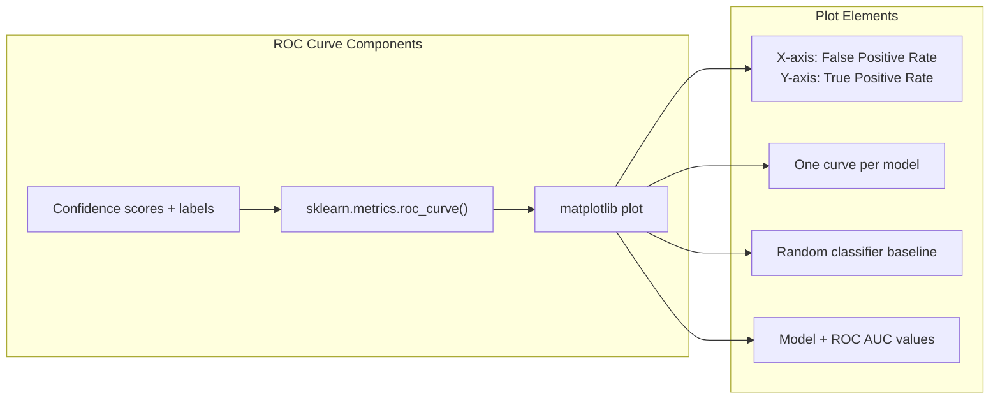
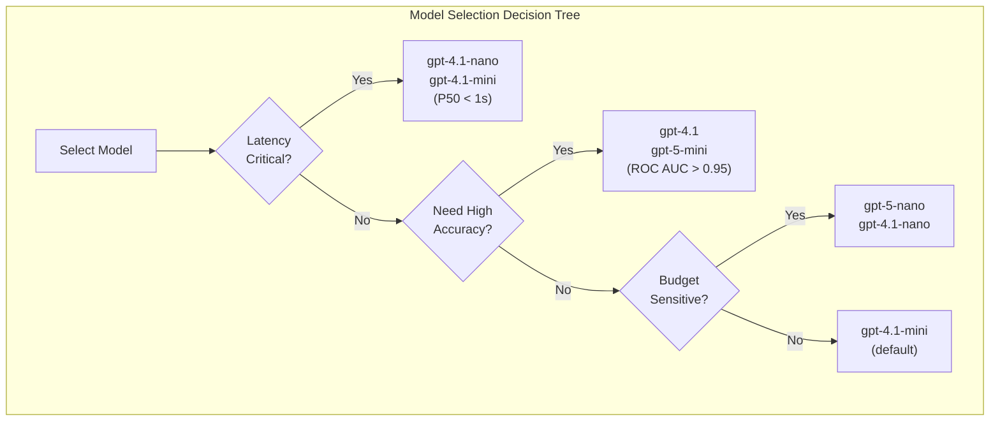
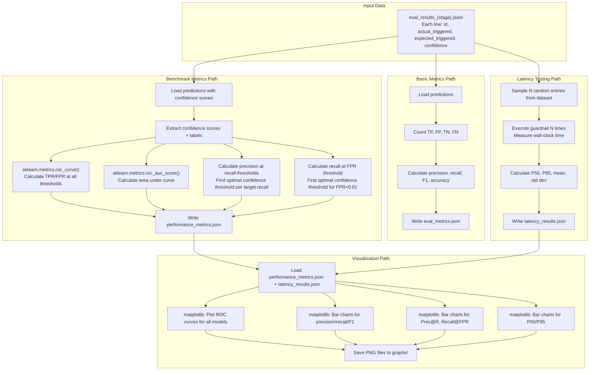

<!-- source: DeepWiki mcp.deepwiki.com · repo openai/openai-guardrails-python · page 7.5 Metrics and Visualization · fetched 2026-10-26 -->

# Metrics and Visualization

<details>
<summary>Relevant source files</summary>

The following files were used as context for generating this wiki page:

- [docs/evals.md](docs/evals.md)
- [docs/ref/checks/hallucination_detection.md](docs/ref/checks/hallucination_detection.md)
- [src/guardrails/checks/text/hallucination_detection.py](src/guardrails/checks/text/hallucination_detection.py)
- [src/guardrails/checks/text/off_topic_prompts.py](src/guardrails/checks/text/off_topic_prompts.py)
- [src/guardrails/checks/text/user_defined_llm.py](src/guardrails/checks/text/user_defined_llm.py)
- [src/guardrails/evals/core/benchmark_reporter.py](src/guardrails/evals/core/benchmark_reporter.py)
- [src/guardrails/evals/guardrail_evals.py](src/guardrails/evals/guardrail_evals.py)
- [tests/unit/evals/test_guardrail_evals.py](tests/unit/evals/test_guardrail_evals.py)

</details>


This page documents the metrics calculation and visualization system used in the guardrails evaluation framework. It covers the statistical metrics (precision, recall, F1, ROC AUC), latency measurements, and automated visualization generation.

For information about running evaluations, see [Running Evaluations](#7.3). For information about benchmark mode and model comparison, see [Benchmark Mode](#7.4).

## Overview

The evaluation framework provides two levels of metrics:

1. **Basic metrics** (evaluation mode): Precision, recall, F1 score, and accuracy for simple performance assessment
2. **Advanced metrics** (benchmark mode): ROC AUC, precision at recall thresholds, recall at FPR thresholds, and latency measurements for comprehensive model comparison

The metrics system operates on evaluation results comparing predicted guardrail triggers against expected labels, producing both machine-readable (JSON) and human-readable (tables, charts) outputs.

Sources: [docs/evals.md:1-201](), [src/guardrails/evals/README.md:1-222]()

## Metrics Architecture

```mermaid
graph TB
    subgraph "Evaluation Results"
        EvalResults["eval_results_{stage}.jsonl<br/>actual_triggered + expected_triggered"]
    end
    
    subgraph "Basic Metrics Pipeline"
        Calculator["calculator.py<br/>calculate_metrics()"]
        BasicOutput["eval_metrics.json<br/>precision, recall, F1, accuracy"]
    end
    
    subgraph "Benchmark Metrics Pipeline"
        BenchCalc["benchmark_calculator.py<br/>calculate_benchmark_metrics()"]
        LatencyTest["latency_tester.py<br/>LatencyTester.run_latency_tests()"]
        
        ROCCalc["ROC curve calculation<br/>sklearn.metrics.roc_curve()"]
        AUCCalc["ROC AUC calculation<br/>sklearn.metrics.roc_auc_score()"]
        PrecAtRecall["Precision at recall thresholds<br/>0.80, 0.90, 0.95"]
        RecallAtFPR["Recall at FPR thresholds<br/>0.01"]
        
        BenchCalc --> ROCCalc
        BenchCalc --> AUCCalc
        BenchCalc --> PrecAtRecall
        BenchCalc --> RecallAtFPR
    end
    
    subgraph "Visualization System"
        Visualizer["visualizer.py<br/>Visualizer class"]
        
        ROCPlot["plot_roc_curves()<br/>{guardrail}_roc_curves.png"]
        BasicPlot["plot_basic_metrics()<br/>{guardrail}_basic_metrics.png"]
        AdvPlot["plot_advanced_metrics()<br/>{guardrail}_advanced_metrics.png"]
        LatencyPlot["plot_latency_comparison()<br/>latency_comparison.png"]
        
        Visualizer --> ROCPlot
        Visualizer --> BasicPlot
        Visualizer --> AdvPlot
        Visualizer --> LatencyPlot
    end
    
    subgraph "Reporting"
        Reporter["benchmark_reporter.py<br/>BenchmarkReporter"]
        SummaryTables["benchmark_summary_tables.txt<br/>Performance + Latency tables"]
    end
    
    EvalResults --> Calculator
    EvalResults --> BenchCalc
    
    Calculator --> BasicOutput
    
    BenchCalc --> Visualizer
    LatencyTest --> Visualizer
    
    BenchCalc --> Reporter
    LatencyTest --> Reporter
    Reporter --> SummaryTables
    
    Visualizer --> ROCPlot
    Visualizer --> BasicPlot
    Visualizer --> AdvPlot
    Visualizer --> LatencyPlot
```



**Diagram: Metrics and Visualization Pipeline Architecture**

This diagram shows how evaluation results flow through the metrics calculation and visualization system. Basic metrics use a simple calculator, while benchmark metrics employ scikit-learn for advanced statistical analysis and matplotlib/seaborn for visualization.

Sources: [docs/evals.md:123-149](), [src/guardrails/evals/README.md:39-50]()

## Basic Metrics

The `calculator.py` module provides fundamental classification metrics for guardrail evaluation. These metrics are calculated for each guardrail in the configuration.

### Metric Definitions

| Metric | Formula | Interpretation |
|--------|---------|----------------|
| **Precision** | TP / (TP + FP) | Of all samples flagged by the guardrail, what fraction were actually violations? |
| **Recall** | TP / (TP + FN) | Of all actual violations, what fraction did the guardrail detect? |
| **F1 Score** | 2 × (Precision × Recall) / (Precision + Recall) | Harmonic mean balancing precision and recall |
| **Accuracy** | (TP + TN) / (TP + TN + FP + FN) | Overall fraction of correct predictions |

Where:
- **TP** (True Positive): Correctly flagged as violation
- **FP** (False Positive): Incorrectly flagged as violation
- **TN** (True Negative): Correctly identified as non-violation
- **FN** (False Negative): Missed violation

### Output Format

Basic metrics are written to `eval_metrics.json`:

```json
{
  "Contains PII": {
    "precision": 0.95,
    "recall": 0.88,
    "f1_score": 0.91,
    "accuracy": 0.92,
    "total_samples": 100,
    "true_positives": 44,
    "false_positives": 2,
    "true_negatives": 48,
    "false_negatives": 6
  },
  "Moderation": {
    "precision": 0.89,
    "recall": 0.92,
    "f1_score": 0.91,
    "accuracy": 0.90,
    "total_samples": 100,
    "true_positives": 46,
    "false_positives": 6,
    "true_negatives": 44,
    "false_negatives": 4
  }
}
```

Sources: [src/guardrails/evals/core/calculator.py](), [docs/evals.md:1-15]()

## Advanced Metrics

The `benchmark_calculator.py` module provides advanced metrics for comparing multiple models. These metrics require the `[benchmark]` extra dependencies (numpy, scikit-learn, pandas).

### ROC Analysis

**ROC (Receiver Operating Characteristic) Curve** plots the True Positive Rate (recall) against the False Positive Rate at various confidence thresholds. The area under this curve (ROC AUC) provides a threshold-independent measure of model performance.

- **ROC AUC = 1.0**: Perfect classifier
- **ROC AUC = 0.5**: Random classifier
- **ROC AUC > 0.9**: Excellent performance
- **ROC AUC 0.8-0.9**: Good performance
- **ROC AUC 0.7-0.8**: Fair performance

### Precision at Recall Thresholds

**Prec@R** measures precision when the model is calibrated to achieve a specific recall level. This metric is crucial for understanding the trade-off between catching violations (recall) and avoiding false alarms (precision).

Common thresholds evaluated:
- **Prec@R=0.80**: Precision when catching 80% of violations
- **Prec@R=0.90**: Precision when catching 90% of violations
- **Prec@R=0.95**: Precision when catching 95% of violations

High Prec@R values indicate the model maintains accuracy even at high recall levels.

### Recall at False Positive Rate

**Recall@FPR** measures recall when the false positive rate is constrained. The framework evaluates:

- **Recall@FPR=0.01**: Recall when only 1% of negatives are incorrectly flagged

This metric is important for applications where false positives are costly.

### Example Benchmark Output

```json
{
  "gpt-4.1-mini": {
    "roc_auc": 0.982,
    "precision_at_recall": {
      "0.80": 0.992,
      "0.90": 0.992,
      "0.95": 0.954
    },
    "recall_at_fpr": {
      "0.01": 0.444
    },
    "basic_metrics": {
      "precision": 0.95,
      "recall": 0.92,
      "f1_score": 0.93,
      "accuracy": 0.94
    }
  },
  "gpt-5-mini": {
    "roc_auc": 0.954,
    "precision_at_recall": {
      "0.80": 0.990,
      "0.90": 0.900,
      "0.95": 0.900
    },
    "recall_at_fpr": {
      "0.01": 0.768
    },
    "basic_metrics": {
      "precision": 0.93,
      "recall": 0.89,
      "f1_score": 0.91,
      "accuracy": 0.91
    }
  }
}
```

Sources: [docs/ref/checks/jailbreak.md:74-121](), [docs/ref/checks/nsfw.md:63-95]()

## Latency Metrics

The `latency_tester.py` module measures end-to-end guardrail execution performance. Latency testing runs a specified number of iterations (default: 50) using random samples from the evaluation dataset.

### Metrics Collected

| Metric | Description |
|--------|-------------|
| **TTC P50** (Time to Complete, 50th percentile) | Median latency - 50% of requests complete within this time |
| **TTC P95** (Time to Complete, 95th percentile) | 95% of requests complete within this time |
| **Mean** | Average latency across all iterations |
| **Std Dev** | Standard deviation of latency measurements |

### Latency Output Format

```json
{
  "gpt-4.1-mini": {
    "p50": 749,
    "p95": 1291,
    "mean": 812,
    "std_dev": 245,
    "unit": "milliseconds",
    "iterations": 50
  },
  "gpt-5-mini": {
    "p50": 5019,
    "p95": 9212,
    "mean": 5543,
    "std_dev": 1876,
    "unit": "milliseconds",
    "iterations": 50
  }
}
```

### Latency Considerations

Measured latency includes:
- Guardrail check execution time
- LLM API calls (for LLM-based guardrails)
- Network latency to external services
- File search processing (for hallucination detection)

The P95 metric is particularly important for understanding worst-case performance and planning capacity.

Sources: [docs/ref/checks/jailbreak.md:104-113](), [docs/ref/checks/hallucination_detection.md:187-203](), [src/guardrails/evals/core/latency_tester.py]()

## Visualization Outputs

The `visualizer.py` module uses matplotlib and seaborn to generate publication-quality charts. All visualizations are automatically saved to the `graphs/` subdirectory in benchmark mode.

### ROC Curves

**File**: `{guardrail}_roc_curves.png`



**Diagram: ROC Curve Generation Pipeline**

ROC curves compare multiple models on the same axes, with each model's curve labeled with its ROC AUC score. A diagonal line represents random guessing (AUC = 0.5).

### Basic Metrics Charts

**File**: `{guardrail}_basic_metrics.png`

Bar charts showing precision, recall, F1 score, and accuracy for each model. This provides a quick visual comparison of fundamental performance metrics.

### Advanced Metrics Charts

**File**: `{guardrail}_advanced_metrics.png`

Grouped bar charts displaying:
- Precision at recall thresholds (0.80, 0.90, 0.95)
- Recall at FPR threshold (0.01)

This visualization helps identify which models maintain high precision at different recall levels.

### Latency Comparison Charts

**File**: `latency_comparison.png`

Bar charts showing P50 and P95 latency for each model. Useful for understanding the performance-latency trade-off when selecting models.

Sources: [src/guardrails/evals/core/visualizer.py](), [docs/evals.md:134-149]()

## Benchmark Summary Tables

The `benchmark_reporter.py` module generates formatted text tables for inclusion in reports and documentation.

### Performance Summary Table

```
Model Performance Comparison
============================

| Model         | ROC AUC | Prec@R=0.80 | Prec@R=0.90 | Prec@R=0.95 | Recall@FPR=0.01 |
|--------------|---------|-------------|-------------|-------------|-----------------|
| gpt-4.1       | 0.990   | 1.000       | 1.000       | 0.984       | 0.946           |
| gpt-4.1-mini  | 0.982   | 0.992       | 0.992       | 0.954       | 0.444           |
| gpt-5         | 0.979   | 0.973       | 0.970       | 0.970       | 0.733           |
| gpt-5-mini    | 0.954   | 0.990       | 0.900       | 0.900       | 0.768           |
| gpt-4.1-nano  | 0.934   | 0.924       | 0.924       | 0.848       | 0.000           |
| gpt-5-nano    | 0.962   | 0.973       | 0.967       | 0.965       | 0.048           |
```

### Latency Summary Table

```
Latency Comparison
==================

| Model         | TTC P50 (ms) | TTC P95 (ms) |
|--------------|--------------|--------------|
| gpt-4.1-nano  | 683          | 890          |
| gpt-4.1-mini  | 749          | 1,291        |
| gpt-4.1       | 841          | 1,861        |
| gpt-5-nano    | 4,702        | 6,739        |
| gpt-5         | 4,569        | 7,256        |
| gpt-5-mini    | 5,019        | 9,212        |
```

Tables are sorted by primary metric (ROC AUC for performance, P50 for latency) to facilitate quick comparison.

Sources: [src/guardrails/evals/core/benchmark_reporter.py](), [docs/ref/checks/jailbreak.md:92-121]()

## Output Directory Structure

```
results/
└── benchmark_{guardrail}_YYYYMMDD_HHMMSS/
    ├── results/
    │   ├── eval_results_{guardrail}_{model}.jsonl    # Raw predictions
    │   ├── performance_metrics.json                   # Advanced metrics
    │   ├── latency_results.json                       # Latency measurements
    │   └── benchmark_summary_tables.txt               # Formatted tables
    ├── graphs/
    │   ├── {guardrail}_roc_curves.png                # ROC curve comparison
    │   ├── {guardrail}_basic_metrics.png             # Precision/Recall/F1
    │   ├── {guardrail}_advanced_metrics.png          # Prec@R charts
    │   └── latency_comparison.png                    # Latency bar chart
    └── benchmark_summary.txt                          # Human-readable summary
```

The directory structure separates machine-readable data (`results/`) from human-readable visualizations (`graphs/`) and provides timestamped directories to preserve historical runs.

Sources: [docs/evals.md:134-149](), [src/guardrails/evals/README.md:90-105]()

## Interpreting Results

### Performance Metrics Selection

Different metrics serve different use cases:

| Use Case | Recommended Metrics | Reasoning |
|----------|---------------------|-----------|
| **Cost-sensitive application** | High precision, Prec@R=0.80 | Minimize false positives to avoid unnecessary escalation |
| **Safety-critical application** | High recall, Recall@FPR=0.01 | Catch as many violations as possible with acceptable false positives |
| **Balanced application** | High F1, ROC AUC > 0.9 | Balance precision and recall |
| **Real-time application** | TTC P95 < threshold, ROC AUC > 0.8 | Ensure latency meets requirements without sacrificing accuracy |

### Model Selection Trade-offs



**Diagram: Model Selection Based on Requirements**

### Threshold Tuning

When tuning `confidence_threshold` parameters for guardrails:

1. **Examine ROC curve**: Identify operating point that balances TPR/FPR
2. **Check Prec@R values**: Ensure acceptable precision at desired recall level
3. **Validate with P95 latency**: Confirm performance meets requirements
4. **Test with representative data**: Validate with data similar to production

Example threshold adjustment process:

| Current State | Issue | Action |
|--------------|-------|--------|
| Prec@R=0.80 is low (< 0.8) | Too many false positives at 80% recall | Increase `confidence_threshold` (e.g., 0.7 → 0.8) |
| Recall low (< 0.7) | Missing too many violations | Decrease `confidence_threshold` (e.g., 0.7 → 0.6) |
| P95 latency too high | Performance bottleneck | Switch to faster model (e.g., gpt-4.1-mini → gpt-4.1-nano) |
| Both precision and recall low | Model not suitable | Try different model or add training data |

Sources: [docs/ref/checks/hallucination_detection.md:22-31](), [docs/ref/checks/jailbreak.md:44-48]()

## Dependencies

The visualization and advanced metrics system requires optional dependencies:

```bash
pip install "guardrails[benchmark]"
```

This installs:
- `numpy>=1.24.0` - Array operations and statistical calculations
- `scikit-learn>=1.3.0` - ROC curve, AUC, and classification metrics
- `matplotlib>=3.7.0` - Chart generation
- `seaborn>=0.12.0` - Statistical visualization styling
- `pandas>=2.0.0` - Data processing for summary tables

Basic evaluation mode (precision, recall, F1) does not require these dependencies.

Sources: [docs/evals.md:26-41](), [src/guardrails/evals/README.md:193-214]()

## Metric Calculation Flow



**Diagram: Complete Metrics Calculation and Visualization Flow**

This diagram shows how evaluation results are processed through three parallel paths (basic metrics, benchmark metrics, latency testing) and then combined for visualization.

Sources: [src/guardrails/evals/core/calculator.py](), [src/guardrails/evals/core/benchmark_calculator.py](), [src/guardrails/evals/core/latency_tester.py](), [src/guardrails/evals/core/visualizer.py]()

## Best Practices

### Evaluation Dataset Size

- **Minimum**: 100 samples per guardrail for meaningful statistics
- **Recommended**: 500-1000 samples for stable ROC AUC estimates
- **Large-scale**: 2000+ samples for fine-grained threshold optimization

### Statistical Significance

When comparing models, consider:

1. **ROC AUC differences < 0.02**: Likely not meaningful
2. **Confidence intervals**: Run multiple evaluation runs to estimate variance
3. **Dataset balance**: Ensure positive/negative class balance approximates production

### Benchmark Reporting

When documenting guardrail performance:

1. **Report dataset composition**: Size, class balance, data sources
2. **Include uncertainty**: P50/P95 rather than just mean latency
3. **Document thresholds**: Report which `confidence_threshold` was used
4. **Show trade-offs**: Include both performance and latency metrics

Sources: [docs/ref/checks/hallucination_detection.md:134-273](), [docs/ref/checks/jailbreak.md:74-121]()

---

