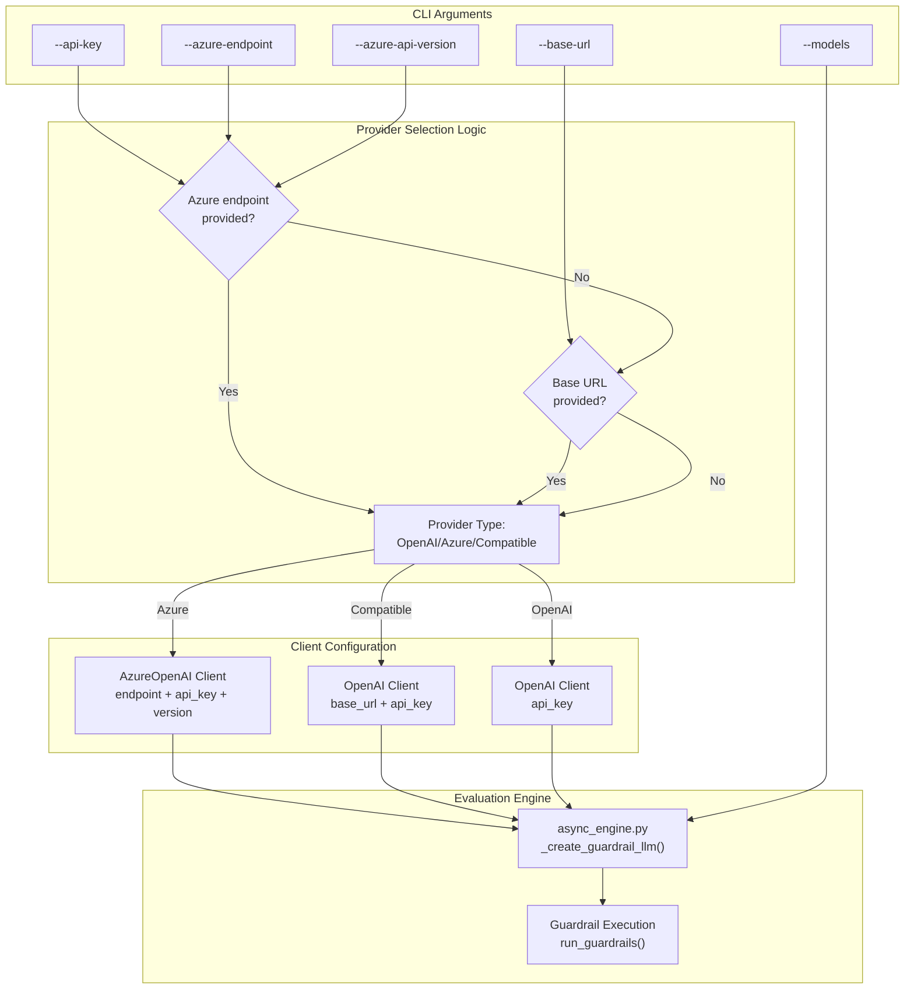
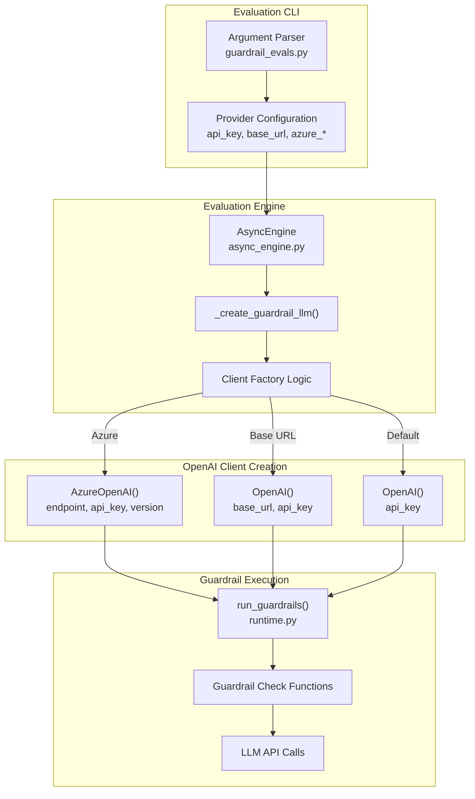
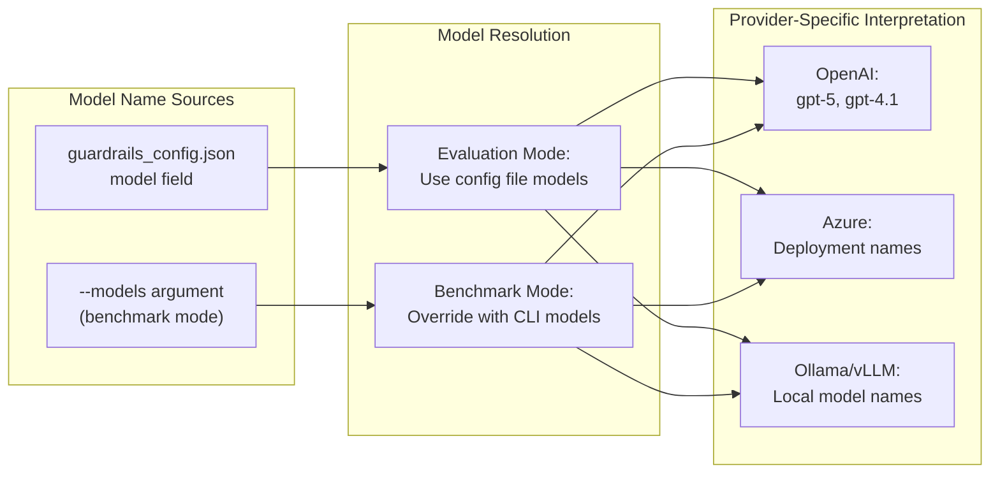

<!-- source: DeepWiki mcp.deepwiki.com · repo openai/openai-guardrails-python · page 7.6 Third-Party Provider Support · fetched 2026-10-26 -->

# Third-Party Provider Support

<details>
<summary>Relevant source files</summary>

The following files were used as context for generating this wiki page:

- [docs/evals.md](docs/evals.md)
- [src/guardrails/evals/guardrail_evals.py](src/guardrails/evals/guardrail_evals.py)
- [tests/unit/evals/test_guardrail_evals.py](tests/unit/evals/test_guardrail_evals.py)

</details>


This page documents how to configure and use different LLM providers with the guardrail evaluation framework. The evaluation tool (`guardrail_evals.py`) supports OpenAI, Azure OpenAI, and any OpenAI-compatible API endpoint, enabling you to benchmark guardrails across different models and deployment options.

For information about using third-party providers with the main guardrails clients (outside of evaluation), see [GuardrailsOpenAI Client](#4.1) and [Azure OpenAI Integration](#4.2).

---

## Overview

The evaluation framework supports three categories of providers:

| Provider Category | Configuration Method | Use Cases |
|------------------|---------------------|-----------|
| **OpenAI** | API key only | Standard OpenAI models (gpt-5, gpt-4.1, etc.) |
| **Azure OpenAI** | Endpoint + API key + version | Enterprise Azure deployments |
| **OpenAI-Compatible** | Base URL + API key | Ollama, vLLM, local models, custom endpoints |

All providers use the same evaluation workflow and produce identical output formats. The provider configuration is transparent to the evaluation engine—it simply configures the underlying OpenAI client used for guardrail checks.

**Sources:** [docs/evals.md:151-186]()

---

## Provider Configuration Flow



**Sources:** [docs/evals.md:51-58](), [docs/evals.md:151-186]()

---

## Command-Line Arguments

The evaluation tool provides specific arguments for configuring different providers:

| Argument | Required | Description | Default |
|----------|----------|-------------|---------|
| `--api-key` | ❌ | API key for OpenAI, Azure, or compatible API | `OPENAI_API_KEY` env var |
| `--base-url` | ❌ | Base URL for OpenAI-compatible APIs | None (uses OpenAI default) |
| `--azure-endpoint` | ❌ | Azure OpenAI endpoint URL | None |
| `--azure-api-version` | ❌ | Azure OpenAI API version | `2025-01-01-preview` |
| `--models` | ❌ | Model names for benchmark mode | Config file models |

**Argument Priority:**

1. If `--azure-endpoint` is provided → Azure OpenAI provider
2. Else if `--base-url` is provided → OpenAI-compatible provider
3. Else → Standard OpenAI provider

**Sources:** [docs/evals.md:51-58]()

---

## OpenAI Provider (Default)

The standard OpenAI provider is used when no special endpoint configuration is provided. It uses the OpenAI API with standard model names.

### Basic Usage

```bash
python guardrail_evals.py \
  --config-path guardrails_config.json \
  --dataset-path data.jsonl \
  --api-key sk-...
```

### With Benchmark Mode

```bash
python guardrail_evals.py \
  --config-path guardrails_config.json \
  --dataset-path data.jsonl \
  --mode benchmark \
  --models gpt-5 gpt-5-mini gpt-5-nano \
  --api-key sk-...
```

### Environment Variable

If `--api-key` is not provided, the tool uses the `OPENAI_API_KEY` environment variable:

```bash
export OPENAI_API_KEY=sk-...
python guardrail_evals.py \
  --config-path guardrails_config.json \
  --dataset-path data.jsonl
```

**Model Names:** Use standard OpenAI model identifiers (`gpt-5`, `gpt-4.1`, `gpt-5-mini`, etc.).

**Sources:** [docs/evals.md:155-161]()

---

## Azure OpenAI Provider

Azure OpenAI deployments require three additional parameters: endpoint URL, API key, and API version.

### Configuration

```bash
python guardrail_evals.py \
  --config-path guardrails_config.json \
  --dataset-path data.jsonl \
  --azure-endpoint https://your-resource.openai.azure.com \
  --api-key your-azure-key \
  --azure-api-version 2025-01-01-preview
```

### Benchmark Mode with Azure

```bash
python guardrail_evals.py \
  --config-path guardrails_config.json \
  --dataset-path data.jsonl \
  --azure-endpoint https://your-resource.openai.azure.com \
  --api-key your-azure-key \
  --azure-api-version 2025-01-01-preview \
  --mode benchmark \
  --models gpt-4o gpt-4o-mini
```

### Azure-Specific Considerations

| Aspect | Details |
|--------|---------|
| **Model Names** | Use your Azure deployment names, not OpenAI model names |
| **Endpoint Format** | Must include full URL with resource name: `https://{resource}.openai.azure.com` |
| **API Version** | Defaults to `2025-01-01-preview` if not specified |
| **Authentication** | Uses Azure API key authentication (Azure AD auth not currently supported) |

**Sources:** [docs/evals.md:163-173]()

---

## OpenAI-Compatible APIs

Any service implementing the OpenAI API specification can be used by providing a custom `--base-url`. This includes Ollama, vLLM, text-generation-inference, and other compatible servers.

### Ollama Example

Ollama provides local model hosting with an OpenAI-compatible API:

```bash
# Start Ollama server (if not already running)
ollama serve

# Run evaluation with Ollama models
python guardrail_evals.py \
  --config-path guardrails_config.json \
  --dataset-path data.jsonl \
  --base-url http://localhost:11434/v1 \
  --api-key fake-key \
  --mode benchmark \
  --models llama3 mistral
```

### vLLM Example

vLLM provides high-throughput inference with OpenAI compatibility:

```bash
# Assuming vLLM server running on port 8000
python guardrail_evals.py \
  --config-path guardrails_config.json \
  --dataset-path data.jsonl \
  --base-url http://localhost:8000/v1 \
  --api-key token-placeholder \
  --models meta-llama/Llama-3-8B
```

### Compatible API Requirements

For an API to work with the evaluation framework, it must support:

| Requirement | Description |
|-------------|-------------|
| **Chat Completions Endpoint** | `POST /v1/chat/completions` with messages array |
| **Request Format** | OpenAI-compatible request schema with `model`, `messages`, etc. |
| **Response Format** | OpenAI-compatible response with `choices[0].message.content` |
| **Streaming** | Optional but recommended for output guardrails |

**Sources:** [docs/evals.md:175-186](), [docs/quickstart.md:158-172]()

---

## Provider Integration Architecture



The evaluation framework's provider support is implemented through a client factory pattern. The `_create_guardrail_llm()` method in the async engine determines which OpenAI client class to instantiate based on the provided arguments.

**Key Implementation Details:**

1. **Argument Parsing:** [docs/evals.md:51-58]() - CLI arguments define provider configuration
2. **Client Factory:** The evaluation engine selects the appropriate client class
3. **Transparent Execution:** The runtime (`run_guardrails()`) operates identically regardless of provider
4. **Model Resolution:** Model names are passed through to the provider without modification

**Sources:** [docs/evals.md:151-197]()

---

## Model Name Handling

Model names are handled differently depending on the provider:



### Model Name Resolution Rules

| Mode | Model Source | Provider | Example |
|------|--------------|----------|---------|
| **Evaluation** | Config file `model` field | OpenAI | `gpt-5` |
| **Evaluation** | Config file `model` field | Azure | `my-gpt4-deployment` |
| **Evaluation** | Config file `model` field | Ollama | `llama3` |
| **Benchmark** | `--models` CLI argument | OpenAI | `gpt-5 gpt-5-mini` |
| **Benchmark** | `--models` CLI argument | Azure | `gpt-4o gpt-4o-mini` |
| **Benchmark** | `--models` CLI argument | Ollama | `llama3 mistral` |

### Azure Model Name Mapping

Azure OpenAI uses deployment names instead of model names. When configuring guardrails for Azure:

```json
{
  "version": 1,
  "input": {
    "version": 1,
    "guardrails": [
      {
        "name": "Jailbreak Detection",
        "config": {
          "model": "my-gpt4-deployment"
        }
      }
    ]
  }
}
```

Then run with Azure endpoint:

```bash
python guardrail_evals.py \
  --config-path config.json \
  --dataset-path data.jsonl \
  --azure-endpoint https://my-resource.openai.azure.com \
  --api-key ... \
  --mode benchmark \
  --models my-gpt4-deployment my-gpt35-deployment
```

**Sources:** [docs/evals.md:163-173]()

---

## Considerations and Limitations

### Provider-Specific Guardrails

Some guardrails have provider-specific requirements:

| Guardrail | OpenAI | Azure | Compatible APIs |
|-----------|--------|-------|-----------------|
| **Moderation** | ✅ Native API | ✅ Native API | ❌ Requires OpenAI endpoint |
| **Custom Prompt Check** | ✅ Any model | ✅ Any model | ✅ Any model |
| **Hallucination Detection** | ✅ With vector store | ✅ With vector store | ⚠️ Requires embeddings API |
| **Jailbreak Detection** | ✅ Any model | ✅ Any model | ✅ Any model |
| **PII Detection** | ✅ Local processing | ✅ Local processing | ✅ Local processing |

### Performance Considerations

| Provider | Latency | Throughput | Cost |
|----------|---------|------------|------|
| **OpenAI** | Low (global CDN) | High | Per-token pricing |
| **Azure** | Low (regional) | High | Reserved capacity available |
| **Ollama (Local)** | Very Low | Medium | Free (hardware cost) |
| **vLLM (Local)** | Very Low | Very High | Free (hardware cost) |

### API Compatibility Notes

**Streaming Support:** Output guardrails require streaming responses. Ensure your OpenAI-compatible API implements:
- Server-sent events (SSE) format
- `stream=True` parameter support
- Proper `data: [DONE]` termination

**Embeddings:** Hallucination detection requires embeddings API support at `/v1/embeddings` if using vector stores.

**Moderation:** The OpenAI Moderation API (`/v1/moderations`) is only available through OpenAI and Azure OpenAI. Other providers must use alternative content safety guardrails.

**Sources:** [docs/evals.md:151-197](), [docs/quickstart.md:158-172]()

---

## Multi-Provider Benchmark Example

Compare the same guardrail configuration across multiple providers:

```bash
# Test jailbreak detection across OpenAI, Azure, and Ollama
python guardrail_evals.py \
  --config-path jailbreak_config.json \
  --dataset-path jailbreak_dataset.jsonl \
  --mode benchmark \
  --models gpt-5 gpt-5-mini  # OpenAI models
  
python guardrail_evals.py \
  --config-path jailbreak_config.json \
  --dataset-path jailbreak_dataset.jsonl \
  --azure-endpoint https://my-resource.openai.azure.com \
  --api-key ... \
  --mode benchmark \
  --models gpt-4o-deployment gpt-4o-mini-deployment  # Azure deployments
  
python guardrail_evals.py \
  --config-path jailbreak_config.json \
  --dataset-path jailbreak_dataset.jsonl \
  --base-url http://localhost:11434/v1 \
  --api-key fake \
  --mode benchmark \
  --models llama3 mistral  # Ollama models
```

This generates separate benchmark reports for each provider, enabling direct comparison of:
- ROC AUC scores across models
- Latency characteristics (P50, P95)
- Precision at different recall thresholds

**Sources:** [docs/evals.md:151-197]()

---

