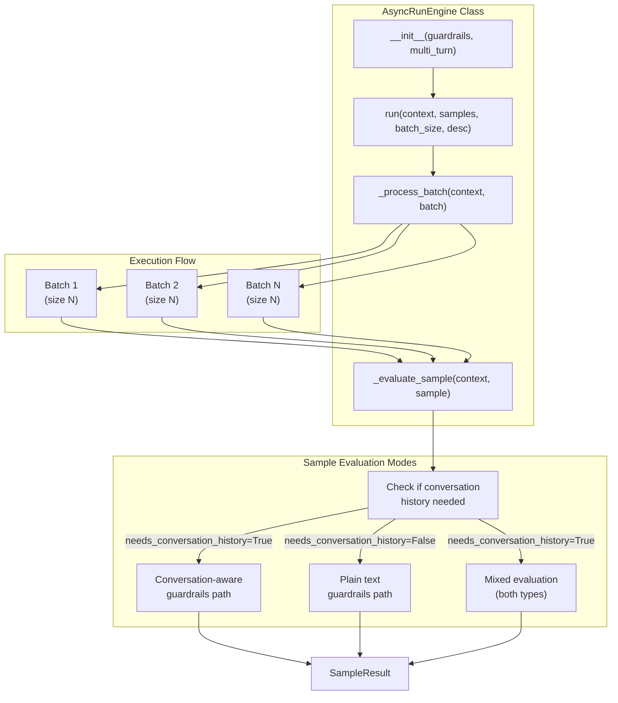
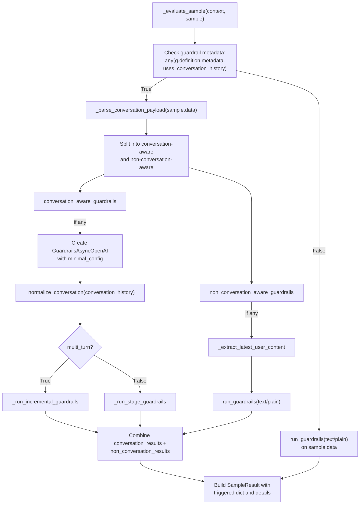
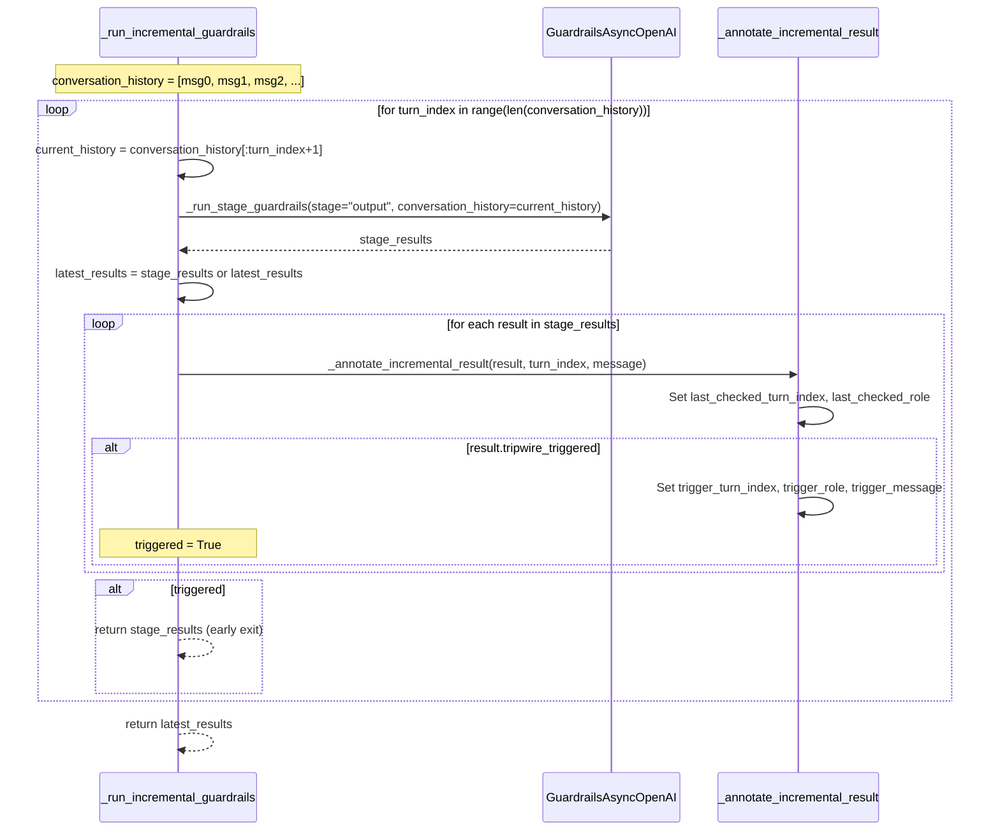
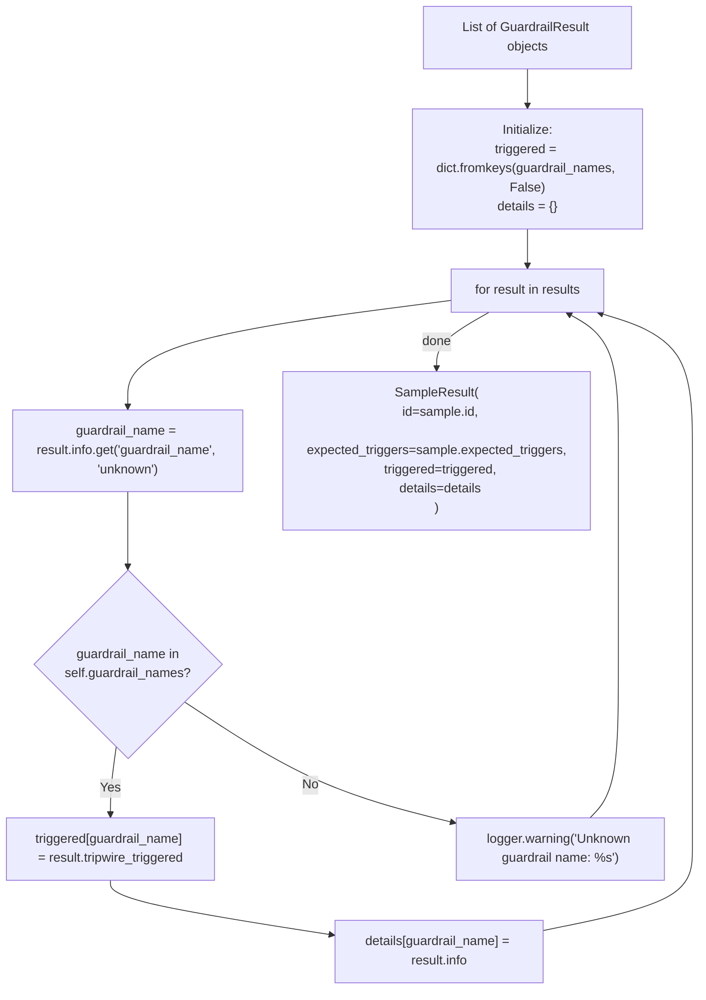
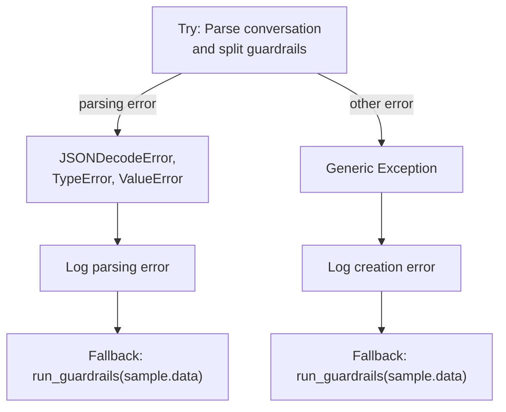

<!-- source: DeepWiki mcp.deepwiki.com · repo openai/openai-guardrails-python · page 7.7 AsyncRunEngine Internals · fetched 2026-10-26 -->

# AsyncRunEngine Internals

<details>
<summary>Relevant source files</summary>

The following files were used as context for generating this wiki page:

- [src/guardrails/evals/core/async_engine.py](src/guardrails/evals/core/async_engine.py)
- [tests/unit/evals/test_async_engine.py](tests/unit/evals/test_async_engine.py)

</details>


This page provides a deep dive into the internal architecture and implementation of the `AsyncRunEngine` class, which powers the asynchronous evaluation of guardrails against test datasets. The engine handles batch processing, conversation-aware guardrails, multi-turn incremental evaluation, and robust error handling.

For information about using the evaluation framework from a user perspective, see [Evaluation Framework Overview](#7.1). For dataset formats and CLI usage, see [Dataset Format and Structure](#7.2) and [Running Evaluations](#7.3).

**Sources:** [src/guardrails/evals/core/async_engine.py:1-463]()

## Engine Architecture

The `AsyncRunEngine` class implements the `RunEngine` protocol and serves as the core execution engine for evaluating guardrails against datasets. It processes samples in configurable batches, handling both simple text samples and complex conversation histories.



**Sources:** [src/guardrails/evals/core/async_engine.py:206-224](), [src/guardrails/evals/core/async_engine.py:225-269]()

### Class Initialization

The `AsyncRunEngine` is initialized with a list of configured guardrails and a `multi_turn` flag:

| Parameter | Type | Purpose |
|-----------|------|---------|
| `guardrails` | `list[Any]` | List of guardrail instances with `definition` and `config` attributes |
| `multi_turn` | `bool` | Enable incremental turn-by-turn evaluation for conversation-aware guardrails |

The engine extracts guardrail names from `g.definition.name` and stores them for result aggregation.

**Sources:** [src/guardrails/evals/core/async_engine.py:209-223]()

## Sample Evaluation Pipeline

The `_evaluate_sample` method orchestrates the evaluation of a single sample against all configured guardrails. The execution path varies based on guardrail metadata requirements.



**Sources:** [src/guardrails/evals/core/async_engine.py:312-462]()

### Conversation History Detection

The engine determines whether a sample requires conversation history by checking guardrail metadata:

```python
needs_conversation_history = any(
    guardrail.definition.metadata and 
    guardrail.definition.metadata.uses_conversation_history 
    for guardrail in self.guardrails
)
```

This check evaluates **all** configured guardrails, not just those in `sample.expected_triggers`, ensuring that guardrails requiring conversation context receive it even when not explicitly expected to trigger.

**Sources:** [src/guardrails/evals/core/async_engine.py:325-327]()

### Mixed Guardrail Evaluation

When a sample contains both conversation-aware and non-conversation-aware guardrails, the engine:

1. **Splits guardrails** into two groups based on `uses_conversation_history` metadata
2. **Evaluates conversation-aware guardrails** with full conversation history via temporary `GuardrailsAsyncOpenAI` client
3. **Evaluates non-conversation-aware guardrails** with extracted plain text from the latest user message
4. **Combines results** from both evaluation paths

**Sources:** [src/guardrails/evals/core/async_engine.py:336-398]()

## Conversation Payload Parsing

The engine includes several utility functions for parsing and normalizing conversation data from samples.

### Parsing Function Flow

```mermaid
graph TB
    Input["sample.data (string)"]
    
    ParseFunc["_parse_conversation_payload(data)"]
    TryJSON["json.loads(data)"]
    
    NormalizeFunc["_normalize_conversation_payload(payload)"]
    
    IsList{isinstance(payload, list)?}
    IsDict{isinstance(payload, dict)?}
    
    CheckKeys["Check keys: messages,<br/>conversation,<br/>conversation_history"]
    
    ReturnList["Return list"]
    WrapUser["Wrap as user message:<br/>[{'role': 'user', 'content': data}]"]
    
    Input --> ParseFunc
    ParseFunc --> TryJSON
    
    TryJSON -->|success| NormalizeFunc
    TryJSON -->|JSONDecodeError| WrapUser
    
    NormalizeFunc --> IsList
    IsList -->|True| ReturnList
    IsList -->|False| IsDict
    
    IsDict -->|True| CheckKeys
    IsDict -->|False| WrapUser
    
    CheckKeys -->|found| ReturnList
    CheckKeys -->|not found| WrapUser
```

**Sources:** [src/guardrails/evals/core/async_engine.py:79-109]()

### Content Extraction

The `_extract_text_from_content` function handles multi-modal message content structures:

| Content Type | Handling |
|--------------|----------|
| `str` | Return as-is |
| `list` of parts | Extract text from parts with `type: "text"` or fields `text`, `input_text`, `output_text` |
| Other types | Stringify with `str()` |

The `_extract_latest_user_content` function traverses conversation history in reverse to find the most recent user message and extract its plain text content.

**Sources:** [src/guardrails/evals/core/async_engine.py:38-77](), [src/guardrails/evals/core/async_engine.py:112-128]()

## Incremental Multi-Turn Evaluation

When `multi_turn=True`, the `_run_incremental_guardrails` function evaluates conversation-aware guardrails incrementally, turn-by-turn through the conversation history.

### Incremental Evaluation Algorithm



**Sources:** [src/guardrails/evals/core/async_engine.py:164-203]()

### Result Annotation

The `_annotate_incremental_result` function enriches guardrail results with turn-specific metadata:

| Info Field | Meaning | When Set |
|------------|---------|----------|
| `last_checked_turn_index` | Index of the most recently evaluated turn | Always |
| `last_checked_role` | Role of the message in the last checked turn | If available |
| `last_checked_type` | Type of the message in the last checked turn | If available |
| `trigger_turn_index` | Turn index where the tripwire triggered | If triggered |
| `trigger_role` | Role of the message that triggered | If triggered |
| `trigger_type` | Type of the message that triggered | If triggered |
| `trigger_message` | Full message object that triggered | If triggered |

This metadata enables precise identification of which turn in a conversation caused a guardrail to trigger.

**Sources:** [src/guardrails/evals/core/async_engine.py:131-161]()

### Early Termination

The incremental evaluation halts immediately upon detecting a triggered guardrail, returning results from that turn. This behavior mirrors production usage where a conversation would be blocked upon violation, preventing further turns from executing.

**Sources:** [src/guardrails/evals/core/async_engine.py:194-201]()

## Batch Processing and Concurrency

The `AsyncRunEngine` processes samples in configurable batches to balance throughput and resource usage.

### Batch Execution Flow

```mermaid
graph LR
    subgraph "run() Entry Point"
        ValidateBS["Validate batch_size >= 1"]
        CheckProgress{desc provided<br/>and len(samples) > 1?}
    end
    
    subgraph "With Progress Bar"
        CreateProgress["tqdm progress bar"]
        RunWithProgress["_run_with_progress"]
    end
    
    subgraph "Without Progress Bar"
        RunWithoutProgress["_run_without_progress"]
    end
    
    subgraph "Batch Loop"
        ForLoop["for i in range(0, len(samples), batch_size)"]
        SliceBatch["batch = samples[i:i+batch_size]"]
        ProcessBatch["_process_batch(context, batch)"]
    end
    
    subgraph "Concurrent Processing"
        Gather["asyncio.gather(*tasks, return_exceptions=True)"]
        Task1["_evaluate_sample(sample1)"]
        Task2["_evaluate_sample(sample2)"]
        TaskN["_evaluate_sample(sampleN)"]
    end
    
    ValidateBS --> CheckProgress
    CheckProgress -->|True| CreateProgress
    CheckProgress -->|False| RunWithoutProgress
    
    CreateProgress --> RunWithProgress
    
    RunWithProgress --> ForLoop
    RunWithoutProgress --> ForLoop
    
    ForLoop --> SliceBatch
    SliceBatch --> ProcessBatch
    
    ProcessBatch --> Gather
    Gather --> Task1
    Gather --> Task2
    Gather --> TaskN
```

**Sources:** [src/guardrails/evals/core/async_engine.py:225-288]()

### Error Handling in Batches

The `_process_batch` method uses `asyncio.gather(..., return_exceptions=True)` to ensure one failing sample doesn't crash the entire batch. Exception handling:

1. **Exceptions captured**: Each task's exception is returned as a result value
2. **Error conversion**: Exceptions are converted to `SampleResult` objects with error details
3. **Logging**: Errors are logged with sample ID for debugging
4. **Default triggered values**: Failed samples return `False` for all guardrails

```python
if isinstance(result, Exception):
    logger.error("Sample %s failed: %s", sample.id, str(result))
    result = SampleResult(
        id=sample.id,
        expected_triggers=sample.expected_triggers,
        triggered=dict.fromkeys(self.guardrail_names, False),
        details={"error": str(result)},
    )
```

**Sources:** [src/guardrails/evals/core/async_engine.py:290-310]()

## Result Aggregation

After running guardrails, the engine aggregates results into a `SampleResult` object.

### Result Building Process



**Sources:** [src/guardrails/evals/core/async_engine.py:437-453]()

### Triggered Dictionary Structure

The `triggered` dictionary maps each guardrail name to a boolean indicating whether it triggered:

```python
triggered: dict[str, bool] = {
    "Jailbreak": True,
    "Moderation": False,
    "NSFW Text": False,
}
```

The `details` dictionary provides full `info` dictionaries from each guardrail's result, enabling detailed analysis of why guardrails triggered or what evidence they found.

**Sources:** [src/guardrails/evals/core/async_engine.py:437-444]()

## Fallback and Error Recovery

The engine includes multiple fallback mechanisms for robustness:

### Conversation Parsing Fallback



When conversation parsing or context creation fails, the engine falls back to treating the sample as plain text and evaluates all guardrails in standard mode with `media_type="text/plain"`.

**Sources:** [src/guardrails/evals/core/async_engine.py:399-426]()

### Top-Level Exception Handling

The `_evaluate_sample` method wraps all evaluation logic in a try-except block that catches any unhandled exceptions:

```python
except Exception as e:
    logger.error("Error evaluating sample %s: %s", sample.id, str(e))
    return SampleResult(
        id=sample.id,
        expected_triggers=sample.expected_triggers,
        triggered=dict.fromkeys(self.guardrail_names, False),
        details={"error": str(e)},
    )
```

This ensures that individual sample failures are isolated and don't prevent other samples from being evaluated.

**Sources:** [src/guardrails/evals/core/async_engine.py:455-462]()

## Helper Functions Reference

### Text and Conversation Processing

| Function | Signature | Purpose |
|----------|-----------|---------|
| `_safe_getattr` | `(obj, key, default=None) -> Any` | Defensively get attribute from dict or object |
| `_extract_text_from_content` | `(content: Any) -> str` | Extract plain text from multi-part content structures |
| `_normalize_conversation_payload` | `(payload: Any) -> list[Any] \| None` | Extract conversation list from various payload formats |
| `_parse_conversation_payload` | `(data: str) -> list[Any]` | Parse JSON or plain string into conversation format |
| `_extract_latest_user_content` | `(conversation_history: list[Any]) -> str` | Get plain text from most recent user message |

**Sources:** [src/guardrails/evals/core/async_engine.py:22-128]()

### Incremental Evaluation

| Function | Signature | Purpose |
|----------|-----------|---------|
| `_annotate_incremental_result` | `(result, turn_index, message) -> None` | Add turn metadata to guardrail results |
| `_run_incremental_guardrails` | `(client, conversation_history) -> list[Any]` | Evaluate guardrails turn-by-turn, stop on first trigger |

**Sources:** [src/guardrails/evals/core/async_engine.py:131-203]()

## Testing and Verification

The test suite in `tests/unit/evals/test_async_engine.py` validates key behaviors:

- **Incremental evaluation termination** on trigger (test with 2-turn conversation)
- **Last result return** when no triggers occur (test with 3-turn safe conversation)
- **Conversation payload parsing** for various formats (JSON objects, plain strings)
- **Mixed guardrail evaluation** with both conversation-aware and non-conversation-aware guardrails

The tests use a `_FakeClient` stub to verify that conversation histories are sliced correctly for each turn and that annotations are applied properly.

**Sources:** [tests/unit/evals/test_async_engine.py:1-225]()

---

