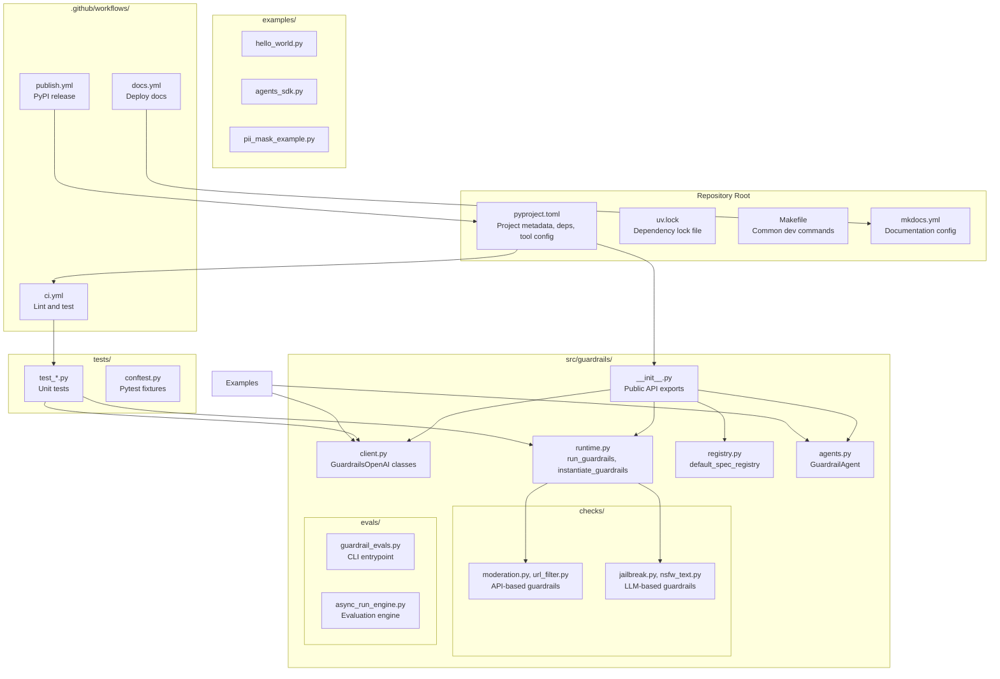
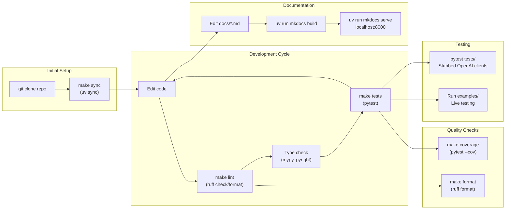
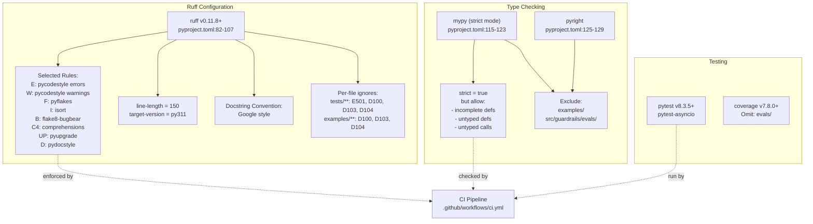
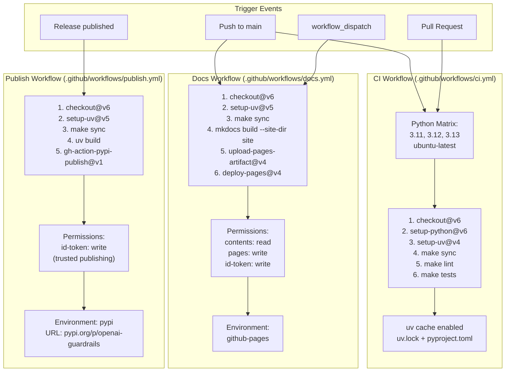
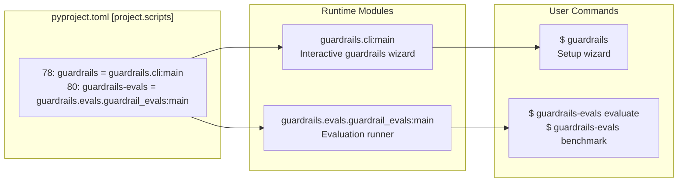
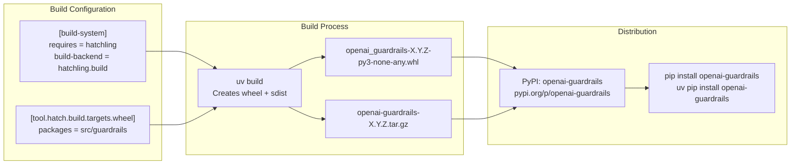

<!-- source: DeepWiki mcp.deepwiki.com · repo openai/openai-guardrails-python · page 8 Development Guide · fetched 2026-10-26 -->

# Development Guide

<details>
<summary>Relevant source files</summary>

The following files were used as context for generating this wiki page:

- [.github/workflows/ci.yml](.github/workflows/ci.yml)
- [.github/workflows/docs.yml](.github/workflows/docs.yml)
- [.github/workflows/publish.yml](.github/workflows/publish.yml)
- [pyproject.toml](pyproject.toml)
- [src/guardrails/__init__.py](src/guardrails/__init__.py)

</details>


This guide provides an overview of the development practices, tooling, and workflows for contributors to the openai-guardrails-python codebase. It covers local development setup, code quality standards, testing procedures, CI/CD pipelines, documentation generation, and release processes.

For detailed information on specific aspects of development:
- Project file organization: see [Project Structure](#8.1)
- Day-to-day development workflow: see [Development Workflow](#8.2)
- Linting and type checking tools: see [Code Quality Tools](#8.3)
- CI/CD implementation details: see [CI/CD Pipeline](#8.4)
- Documentation authoring: see [Documentation](#8.5)
- Release procedures: see [Release Process](#8.6)

---

## Development Environment Requirements

The project requires Python 3.11 or higher and uses modern Python tooling for dependency management, code quality, and build processes.

### Core Dependencies

| Category | Package | Purpose |
|----------|---------|---------|
| **Runtime** | `openai>=1.75.0` | OpenAI API client integration |
| | `pydantic>=2.11.3` | Data validation and configuration |
| | `openai-agents>=0.3.3` | Agents SDK integration |
| | `presidio-analyzer>=2.2.360` | PII detection framework |
| **Development** | `uv` | Fast Python package installer and resolver |
| | `ruff>=0.11.8` | Linting and formatting |
| | `mypy>=1.15.0` | Static type checking |
| | `pyright>=1.1.400` | Additional type checking |
| | `pytest>=8.3.5` | Testing framework |
| **Documentation** | `mkdocs>=1.6.1` | Documentation site generation |
| | `mkdocs-material>=9.6.14` | Material theme for mkdocs |

**Sources:** [pyproject.toml:1-63]()

### Python Version Support

The project actively supports Python 3.11, 3.12, and 3.13. All CI tests run against this matrix to ensure compatibility.

**Sources:** [pyproject.toml:6](), [.github/workflows/ci.yml:13]()

---

## Project Structure Overview

The codebase follows a standard Python package layout with source code under `src/guardrails/` and supporting files in the repository root.



**Key Code Entry Points**

The public API surface is explicitly defined in `__all__` within [src/guardrails/__init__.py:45-68](), which exports:

- **Client wrappers:** `GuardrailsOpenAI`, `GuardrailsAsyncOpenAI`, `GuardrailsAzureOpenAI`, `GuardrailsAsyncAzureOpenAI`
- **Agent integration:** `GuardrailAgent`
- **Runtime utilities:** `run_guardrails`, `instantiate_guardrails`, `load_config_bundle`, `load_pipeline_bundles`
- **Type definitions:** `GuardrailResult`, `GuardrailResults`, `GuardrailsResponse`
- **Exception types:** `GuardrailTripwireTriggered`
- **Registry:** `default_spec_registry`

**Sources:** [src/guardrails/__init__.py:1-77](), [pyproject.toml:76]()

---

## Development Workflow

The project uses `uv` as the primary dependency management and development tool, with a `Makefile` providing convenient shortcuts for common tasks.



### Common Make Commands

The `Makefile` provides standardized commands that wrap `uv` operations:

| Command | Purpose | Underlying Tool |
|---------|---------|-----------------|
| `make sync` | Install dependencies (including dev) | `uv sync` |
| `make lint` | Run ruff linter | `uv run ruff check .` |
| `make format` | Auto-format with ruff | `uv run ruff format .` |
| `make tests` | Run pytest suite | `uv run pytest` |
| `make coverage` | Run tests with coverage | `uv run pytest --cov` |

**Editable Installation**

For local development with live code changes reflected immediately, use:

```bash
uv sync
```

This installs the package in editable mode with all dev dependencies from [pyproject.toml:48-63]().

**Sources:** [pyproject.toml:48-63](), [.github/workflows/ci.yml:32]()

---

## Code Quality Standards

The project enforces strict code quality standards through automated linting, formatting, and type checking.



### Ruff Configuration Details

**Linting Rules:** [pyproject.toml:86-96]()

The project uses ruff for both linting and formatting. Key configuration:

- **Line length:** 150 characters
- **Target version:** Python 3.11+
- **Docstring convention:** Google-style docstrings (enforced by pydocstyle rules)
- **Import sorting:** Combined as-imports with `guardrails` as first-party

**Format Configuration:** [pyproject.toml:106-107]()

- Docstring code formatting enabled for proper syntax in examples

### Type Checking Configuration

**MyPy:** [pyproject.toml:115-123]()

Runs in `strict` mode but with pragmatic relaxations:
- `disallow_incomplete_defs = false`
- `disallow_untyped_defs = false`
- `disallow_untyped_calls = false`

This allows incremental type annotation adoption while maintaining overall type safety.

**Pyright:** [pyproject.toml:125-129]()

Provides additional type checking as a secondary validator, using the same exclusions as mypy.

### Test Configuration

**Coverage:** [pyproject.toml:109-113]()

Code coverage tracking excludes the `evals/` directory, which is a separate evaluation framework with different testing needs.

**Sources:** [pyproject.toml:82-130]()

---

## CI/CD Pipeline Architecture

The project uses GitHub Actions for continuous integration, documentation deployment, and package publishing. All workflows leverage `uv` for fast, reproducible builds.



### CI Workflow Details

**File:** [.github/workflows/ci.yml:1-39]()

**Matrix Strategy:**
- **Python versions:** 3.11, 3.12, 3.13
- **OS:** ubuntu-latest only
- **Parallelization:** Each Python version runs concurrently

**Caching Strategy:**
The workflow uses `enable-cache: true` with `cache-dependency-glob` matching both `uv.lock` and `pyproject.toml`, ensuring that dependency installations are cached and only re-run when these files change.

**Quality Gates:**
1. `make lint` - Must pass ruff linting
2. `make tests` - Must pass pytest suite

**Sources:** [.github/workflows/ci.yml:1-39]()

### Documentation Deployment

**File:** [.github/workflows/docs.yml:1-42]()

**Deployment Target:** GitHub Pages at https://openai.github.io/openai-guardrails-python/

**Concurrency Control:**
The workflow uses `group: "pages"` with `cancel-in-progress: false` to prevent race conditions during deployment.

**Build Process:**
1. Install dependencies via `make sync`
2. Build static site with `mkdocs build --site-dir site`
3. Upload artifact using `upload-pages-artifact@v4`
4. Deploy via `deploy-pages@v4`

**Sources:** [.github/workflows/docs.yml:1-42]()

### PyPI Publishing

**File:** [.github/workflows/publish.yml:1-33]()

**Trusted Publishing:**
The workflow uses OpenID Connect (OIDC) authentication via `id-token: write` permission, enabling trusted publishing to PyPI without manual API tokens.

**Build Process:**
1. `uv build` - Creates wheel and source distribution
2. `pypa/gh-action-pypi-publish@v1` - Uploads to PyPI using OIDC

**Package Metadata:**
- **Name:** `openai-guardrails`
- **Build backend:** hatchling ([pyproject.toml:72-73]())
- **Package location:** `src/guardrails/` ([pyproject.toml:76]())

**Sources:** [.github/workflows/publish.yml:1-33](), [pyproject.toml:72-76]()

---

## CLI Entrypoints

The package exposes two command-line interfaces via setuptools entrypoints.



### guardrails CLI

**Entrypoint:** [pyproject.toml:79]()

Provides an interactive wizard for configuring guardrails. This tool helps developers set up `guardrails_config.json` files without manually editing JSON.

### guardrails-evals CLI

**Entrypoint:** [pyproject.toml:80]()

Provides evaluation and benchmarking capabilities for guardrails. Supports two modes:
- `evaluate` - Run guardrails against labeled datasets
- `benchmark` - Compare multiple models with performance metrics

For detailed evaluation framework documentation, see [Evaluation Framework Overview](#7.1).

**Sources:** [pyproject.toml:78-80]()

---

## Documentation System

Documentation is built with MkDocs using the Material theme and deployed to GitHub Pages.

### MkDocs Configuration

The project uses several MkDocs plugins and extensions:

| Component | Purpose |
|-----------|---------|
| `mkdocs-material` | Material Design theme |
| `mkdocstrings[python]` | API reference from docstrings |
| `mkdocs-static-i18n` | Internationalization support |
| `pymdown-extensions` | Enhanced Markdown features |

**Dependencies:** [pyproject.toml:55-59]()

### Building Documentation Locally

```bash
# Install documentation dependencies
uv sync

# Build static site
uv run mkdocs build

# Serve with live reload
uv run mkdocs serve
```

The `mkdocs serve` command starts a development server at `http://localhost:8000` with automatic reloading when markdown files change.

### Automatic Deployment

Documentation is automatically deployed to GitHub Pages on every push to `main` via [.github/workflows/docs.yml]().

**Homepage:** [pyproject.toml:31]() specifies the documentation URL as https://openai.github.io/openai-guardrails-python/

**Sources:** [pyproject.toml:31](), [pyproject.toml:55-59](), [.github/workflows/docs.yml:1-42]()

---

## Testing Strategy

The test suite uses pytest with stubbed OpenAI clients to avoid network dependencies and API costs during development.

### Test Organization

Tests are located in the `tests/` directory with the following organization:

- **Unit tests:** Test individual functions and classes in isolation
- **Integration tests:** Test complete workflows with stubbed API responses
- **Fixtures:** Shared test setup in `conftest.py`

### Test Execution

```bash
# Run all tests
make tests

# Run with coverage report
make coverage

# Run specific test file
uv run pytest tests/test_specific.py

# Run with verbose output
uv run pytest -v
```

### Async Testing

The project uses `pytest-asyncio>=0.26.0` ([pyproject.toml:52]()) to support testing async functions, particularly important for:
- `GuardrailsAsyncOpenAI` client methods
- `GuardrailsAsyncAzureOpenAI` client methods
- Async evaluation engine in `evals/async_run_engine.py`

### Coverage Configuration

**Coverage Settings:** [pyproject.toml:109-113]()

- **Source:** `guardrails` package
- **Omit:** `src/guardrails/evals/*` (evaluation framework has separate testing needs)

The coverage report is generated with `pytest --cov` and can be exported in various formats (terminal, HTML, XML).

**Sources:** [pyproject.toml:52](), [pyproject.toml:109-113]()

---

## Package Build System

The project uses Hatchling as the build backend, configured via PEP 517/518 standards.



### Build Configuration

**Build Backend:** [pyproject.toml:72-73]()

The project uses Hatchling, a modern Python build tool that implements PEP 517/518 standards.

**Package Location:** [pyproject.toml:76]()

The build configuration specifies `packages = ["src/guardrails"]`, instructing Hatchling to include the `src/guardrails/` directory in the wheel.

### Version Management

**Current Version:** [pyproject.toml:3]()

Version is defined as `0.2.1` in `pyproject.toml`. The version is also exposed programmatically via:

```python
from guardrails import __version__
```

The `__version__` attribute is populated from package metadata at import time ([src/guardrails/__init__.py:70]()).

### Build and Distribution Commands

```bash
# Build wheel and source distribution
uv build

# Output:
# - dist/openai_guardrails-0.2.1-py3-none-any.whl
# - dist/openai-guardrails-0.2.1.tar.gz

# Install locally for testing
uv pip install dist/openai_guardrails-0.2.1-py3-none-any.whl
```

**Sources:** [pyproject.toml:3](), [pyproject.toml:72-76](), [src/guardrails/__init__.py:70]()

---

## Dependency Management

The project uses `uv` for fast, reproducible dependency management with lock file support.

### Dependency Categories

**Runtime Dependencies:** [pyproject.toml:9-16]()

Core libraries required for production use:
- `openai>=1.75.0` - OpenAI API client
- `pydantic>=2.11.3` - Data validation
- `openai-agents>=0.3.3` - Agents SDK integration
- `presidio-analyzer>=2.2.360` - PII detection

**Optional Dependencies:** [pyproject.toml:34-45]()

- `examples` - Required for running example scripts (pillow, rich)
- `benchmark` - Required for evaluation benchmarks (numpy, scikit-learn, matplotlib, seaborn, pandas)

**Development Dependencies:** [pyproject.toml:48-63]()

Defined under `[dependency-groups]` for `uv` support:
- Linting: ruff
- Type checking: mypy, pyright
- Testing: pytest, pytest-asyncio, pytest-cov, coverage, hypothesis
- Documentation: mkdocs, mkdocs-material, mkdocstrings

### Workspace Configuration

**Workspace:** [pyproject.toml:65-69]()

The project uses `uv` workspace features with `mcp_server` as a workspace member, allowing shared dependency resolution.

### Dependency Installation

```bash
# Install all dependencies including dev
uv sync

# Install with optional dependencies
uv sync --extra examples
uv sync --extra benchmark

# Install production dependencies only
uv sync --no-dev
```

**Sources:** [pyproject.toml:9-69]()

---

## Summary

This development guide provides the foundation for contributing to the openai-guardrails-python project. The codebase follows modern Python best practices with:

- **Dependency Management:** `uv` for fast, reproducible builds
- **Code Quality:** Ruff for linting/formatting, mypy/pyright for type checking
- **Testing:** pytest with async support and coverage tracking
- **CI/CD:** GitHub Actions for automated testing, documentation, and releases
- **Documentation:** MkDocs with Material theme deployed to GitHub Pages
- **Distribution:** Hatchling build backend with trusted publishing to PyPI

For detailed implementation information on each topic, refer to the child pages listed at the beginning of this document.

**Sources:** [pyproject.toml:1-130](), [.github/workflows/ci.yml:1-39](), [.github/workflows/docs.yml:1-42](), [.github/workflows/publish.yml:1-33](), [src/guardrails/__init__.py:1-77]()

---

