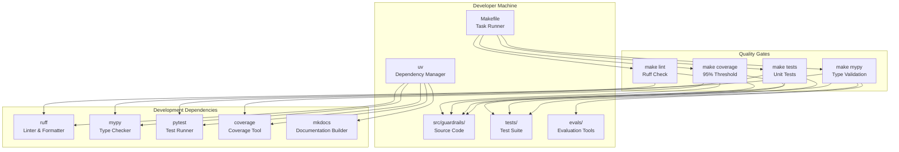
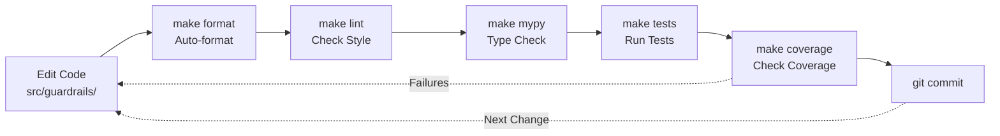
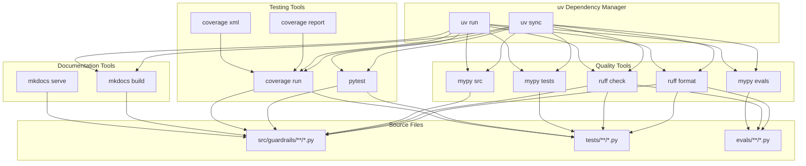

<!-- source: DeepWiki mcp.deepwiki.com · repo openai/openai-guardrails-python · page 8.2 Development Workflow · fetched 2026-10-26 -->

# Development Workflow

<details>
<summary>Relevant source files</summary>

The following files were used as context for generating this wiki page:

- [README.md](README.md)
- [docs/assets/images/guardrails-python-config-screenshot-100pct-q70.webp](docs/assets/images/guardrails-python-config-screenshot-100pct-q70.webp)
- [src/guardrails/checks/text/moderation.py](src/guardrails/checks/text/moderation.py)
- [tests/conftest.py](tests/conftest.py)
- [tests/unit/checks/test_moderation.py](tests/unit/checks/test_moderation.py)
- [tests/unit/checks/test_secret_keys.py](tests/unit/checks/test_secret_keys.py)

</details>


This page documents the local development workflow for contributors to the openai-guardrails-python repository. It covers setting up a development environment, running tests and quality checks, and iterating on code changes. For project structure details, see [Project Structure](#8.1). For CI/CD pipeline information, see [CI/CD Pipeline](#8.4). For documentation-specific workflows, see [Documentation](#8.5).

## Overview

The openai-guardrails project uses `uv` as its dependency manager and provides a `Makefile` with standardized targets for common development tasks. The workflow emphasizes fast iteration with comprehensive quality gates: linting with `ruff`, type checking with `mypy`, and testing with `pytest` at 95% coverage threshold.

**Sources:** [Makefile:1-54](), [pyproject.toml:1-111]()

## Prerequisites and Setup

### Required Tools

The development environment requires:

| Tool | Purpose | Version |
|------|---------|---------|
| Python | Runtime | ≥3.11 (3.11, 3.12, 3.13 supported) |
| `uv` | Dependency manager | Latest stable |
| Git | Version control | Any recent version |

### Initial Setup

```bash
# Clone the repository
git clone https://github.com/openai/openai-guardrails-python.git
cd openai-guardrails-python

# Install uv (if not already installed)
curl -LsSf https://astral.sh/uv/install.sh | sh

# Install all dependencies
make sync
```

The `make sync` command executes `uv sync --all-extras --all-packages --group dev`, which installs:
- Core dependencies from [pyproject.toml:9-15]()
- Optional extras (`examples`, `benchmark`) from [pyproject.toml:33-44]()
- Development tools from [dependency-groups.dev:47-61]()

**Sources:** [Makefile:1-3](), [pyproject.toml:6-15](), [pyproject.toml:46-61]()

## Development Environment Architecture



This diagram shows the local development environment structure. The `Makefile` provides task targets that invoke tools installed by `uv`. Each quality gate validates different aspects of the codebase: `ruff` for style and common errors, `mypy` for type safety, and `pytest` with `coverage` for functional correctness.

**Sources:** [Makefile:1-54](), [pyproject.toml:46-61]()

## Makefile Targets Reference

The `Makefile` provides standardized commands for all common development tasks:

### Dependency Management

```makefile
make sync
```

Synchronizes all dependencies including extras and development tools. Executes: `uv sync --all-extras --all-packages --group dev`

**Sources:** [Makefile:1-3]()

### Code Quality

```makefile
make format
```

Automatically formats code with `ruff format` and applies auto-fixes with `ruff check --fix`. Run before committing changes.

**Sources:** [Makefile:5-8]()

```makefile
make lint
```

Checks code style with `ruff check` without modifying files. This is what CI runs.

**Sources:** [Makefile:10-12]()

```makefile
make mypy
```

Runs type checking across three directories: `src`, `tests`, and `evals`. Uses configuration from [pyproject.toml:106-111]().

**Sources:** [Makefile:14-18]()

### Testing

```makefile
make tests
```

Runs the full test suite with `pytest`. Does not generate coverage reports.

**Sources:** [Makefile:20-22]()

```makefile
make coverage
```

Runs tests with coverage tracking, generates XML report, and enforces 95% coverage threshold. Fails if coverage drops below this level.

**Sources:** [Makefile:24-29]()

### Snapshot Testing

```makefile
make snapshots-fix
```

Updates existing inline snapshots. Used when intentional output changes occur.

**Sources:** [Makefile:31-33]()

```makefile
make snapshots-create
```

Creates new inline snapshots for new tests.

**Sources:** [Makefile:35-37]()

### Documentation

```makefile
make build-docs
```

Builds documentation locally with `mkdocs build`. Output goes to `site/` directory.

**Sources:** [Makefile:39-41]()

```makefile
make serve-docs
```

Starts local documentation server with live reload at `http://127.0.0.1:8000/`.

**Sources:** [Makefile:48-50]()

```makefile
make deploy-docs
```

Manually deploys documentation to GitHub Pages. Typically handled by CI.

**Sources:** [Makefile:51-53]()

## Core Development Loop



This diagram illustrates the typical development iteration cycle. The workflow proceeds linearly through quality gates, with failures at any stage requiring returning to code edits. The `coverage` step enforces the 95% threshold before allowing commits.

**Sources:** [Makefile:5-29]()

### Typical Development Session

1. **Make code changes** in `src/guardrails/`
2. **Run formatter**: `make format` to auto-fix style issues
3. **Check linting**: `make lint` to verify no remaining issues
4. **Type check**: `make mypy` to validate type safety
5. **Run tests**: `make tests` for quick validation
6. **Check coverage**: `make coverage` before committing (enforces 95%)
7. **Commit changes**: `git commit -m "description"`

## Tool Configuration

### Ruff Configuration

Ruff is configured in [pyproject.toml:79-104]() with these key settings:

| Setting | Value | Purpose |
|---------|-------|---------|
| `line-length` | 150 | Maximum line length |
| `target-version` | py311 | Python 3.11+ syntax |
| Selected rules | E, W, F, I, B, C4, UP, D | Error, style, imports, docstrings |
| `pydocstyle.convention` | google | Google-style docstrings |

Test files and examples have relaxed rules: line length (E501), missing docstrings (D100, D103, D104).

**Sources:** [pyproject.toml:79-104]()

### Mypy Configuration

Type checking configuration in [pyproject.toml:106-111]():

```toml
[tool.mypy]
strict = true
disallow_incomplete_defs = false
disallow_untyped_defs = false
disallow_untyped_calls = false
```

`strict = true` enables most strict checks, with selective relaxation for incomplete/untyped definitions to balance safety with pragmatism.

**Sources:** [pyproject.toml:106-111]()

### Pytest Configuration

Pytest uses default configuration with `pytest-asyncio>=0.26.0` for async test support. The `coverage` tool tracks only `src/guardrails/*` files:

```bash
uv run coverage run --include="src/guardrails/*" -m pytest
uv run coverage report --include="src/guardrails/*" -m --fail-under=95
```

**Sources:** [Makefile:27-29](), [pyproject.toml:51]()

## Coverage Requirements

The project enforces a **95% code coverage threshold** via [Makefile:29](). Coverage is calculated only for source files in `src/guardrails/*`, excluding tests and examples.

```bash
# Generate coverage report
make coverage

# Output includes:
# - Terminal report showing coverage per file
# - coverage.xml for CI integration
# - Fails build if coverage < 95%
```

When adding new features:
1. Write tests in `tests/` that exercise new code paths
2. Run `make coverage` to verify threshold met
3. If coverage drops, add missing tests before committing

**Sources:** [Makefile:24-29]()

## Development Tool Chain



This diagram maps the complete tool chain from dependency management through quality checks. The `uv` tool manages installation and execution of all development tools. Each tool operates on specific source directories with distinct purposes: `ruff` for formatting/linting, `mypy` for type checking, `pytest`/`coverage` for testing, and `mkdocs` for documentation.

**Sources:** [Makefile:1-54](), [pyproject.toml:46-61]()

## Dependency Groups

The project uses `uv`'s dependency groups feature defined in [pyproject.toml:46-61]():

### Production Dependencies

Listed in [project.dependencies:9-15]():
- `openai>=1.75.0` - Core OpenAI SDK
- `pydantic>=2.11.3` - Data validation
- `openai-agents>=0.3.3` - Agents SDK integration
- `pip>=25.0.1` - Package installer
- `presidio-analyzer>=2.2.358` - PII detection

### Optional Extras

Installed with `--all-extras` flag:

**examples** group [pyproject.toml:34-37]():
- `pillow>=11.2.1` - Image processing for examples
- `rich>=14.0.0` - Terminal formatting

**benchmark** group [pyproject.toml:38-44]():
- `numpy>=1.24.0` - Numerical computing
- `scikit-learn>=1.3.0` - ML metrics (ROC AUC)
- `matplotlib>=3.7.0` - Plotting
- `seaborn>=0.12.0` - Statistical visualization
- `pandas>=2.0.0` - Data manipulation

### Development Group

Installed with `--group dev` flag [pyproject.toml:47-61]():
- Linting: `ruff`, `pyright`
- Type checking: `mypy`, type stubs
- Testing: `pytest`, `pytest-asyncio`, `hypothesis`
- Coverage: `coverage`
- Documentation: `mkdocs`, `mkdocs-material`, `mkdocstrings`, plugins

**Sources:** [pyproject.toml:9-61]()

## Python Version Support

The project supports Python 3.11, 3.12, and 3.13 [pyproject.toml:6](), [pyproject.toml:19-22]().

To test against multiple Python versions locally:

```bash
# Using uv to manage Python versions
uv python install 3.11 3.12 3.13

# Run tests with specific version
uv run --python 3.12 pytest

# Or use tox/nox (if configured)
```

The CI pipeline validates all three versions via matrix builds [.github/workflows/ci.yml:11-13]().

**Sources:** [pyproject.toml:6](), [pyproject.toml:19-22](), [.github/workflows/ci.yml:11-13]()

## Local vs CI Workflow Comparison

| Aspect | Local Development | CI Pipeline |
|--------|-------------------|-------------|
| Dependency installation | `make sync` (all extras + dev) | `make sync` in GitHub Actions |
| Linting | `make lint` | `make lint` in ci.yml |
| Type checking | `make mypy` (manual) | Not currently in CI |
| Testing | `make tests` | `make tests` in ci.yml |
| Coverage | `make coverage` (95% threshold) | Not currently enforced in CI |
| Python versions | Local version only | Matrix: 3.11, 3.12, 3.13 |
| Documentation | `make build-docs` (manual) | Auto-deploy on main push |

The local workflow provides more comprehensive checks (type checking, coverage) than CI currently enforces. Developers should run all quality gates locally before pushing.

**Sources:** [Makefile:1-54](), [.github/workflows/ci.yml:1-39](), [.github/workflows/docs.yml:1-42]()

## Common Development Workflows

### Adding a New Guardrail

1. Create check implementation in `src/guardrails/checks/`
2. Register in `src/guardrails/checks/__init__.py`
3. Add tests in `tests/checks/`
4. Update `default_spec_registry` if built-in
5. Run `make coverage` to verify 95% threshold
6. Add documentation and examples

### Fixing a Bug

1. Add failing test case in `tests/`
2. Implement fix in `src/guardrails/`
3. Run `make format` to auto-format
4. Run `make lint` to verify style
5. Run `make mypy` for type safety
6. Run `make coverage` to ensure coverage
7. Commit with descriptive message

### Updating Documentation

1. Edit files in `docs/`
2. Run `make serve-docs` to preview locally
3. Verify rendering at `http://127.0.0.1:8000/`
4. Push changes (auto-deploys to GitHub Pages on main)

See [Documentation](#8.5) for detailed documentation workflows.

**Sources:** [Makefile:48-50](), [.github/workflows/docs.yml:1-42]()

## Troubleshooting

### Common Issues

**Issue**: `make sync` fails with dependency conflicts
```bash
# Solution: Clear uv cache and retry
uv cache clean
make sync
```

**Issue**: `make coverage` fails at 95% threshold
```bash
# Solution: Identify uncovered lines
uv run coverage report -m
# Add tests for uncovered code paths
```

**Issue**: `make mypy` reports type errors
```bash
# Solution: Add type annotations or use type: ignore
# Prefer fixing over ignoring
```

**Issue**: `make lint` reports formatting errors
```bash
# Solution: Auto-fix with formatter
make format
make lint  # Verify fixes applied
```

### Debug Mode

Run tools directly without Makefile for verbose output:

```bash
# Verbose pytest
uv run pytest -vv

# Mypy with error codes
uv run mypy --show-error-codes src

# Ruff with explanations
uv run ruff check --show-source
```

**Sources:** [Makefile:1-54]()

## Summary

The development workflow uses `uv` for dependency management and `Makefile` for task orchestration. The core quality gates are:

1. **Formatting**: `make format` (auto-fix)
2. **Linting**: `make lint` (style check)
3. **Type checking**: `make mypy` (type safety)
4. **Testing**: `make tests` (unit tests)
5. **Coverage**: `make coverage` (95% threshold)

All tools are configured via [pyproject.toml]() with sensible defaults. The workflow emphasizes fast local iteration with comprehensive quality checks before pushing to CI.

**Sources:** [Makefile:1-54](), [pyproject.toml:1-111]()

---

