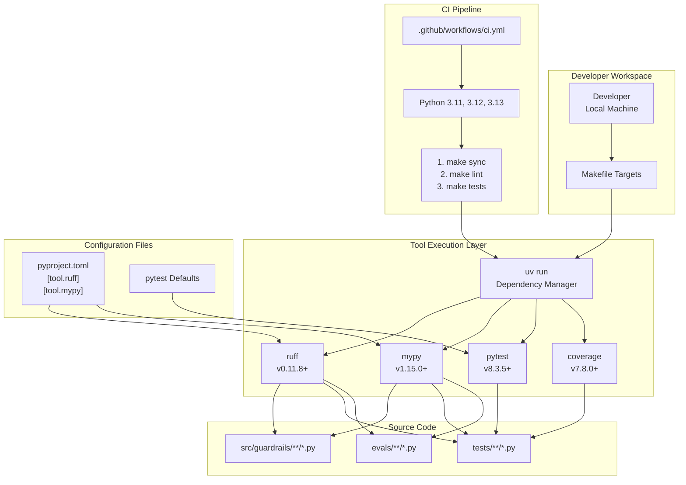
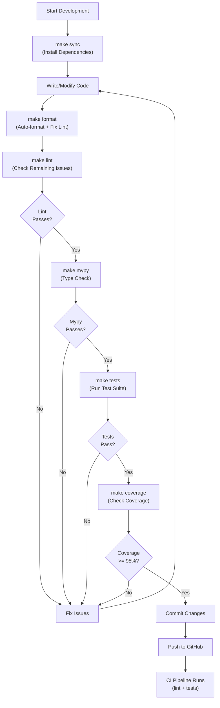
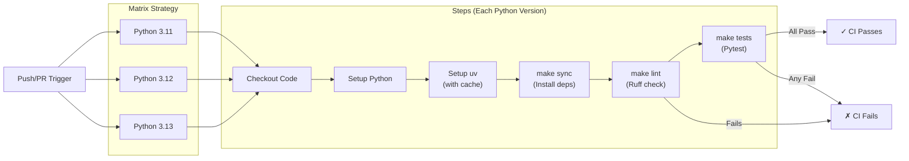

<!-- source: DeepWiki mcp.deepwiki.com · repo openai/openai-guardrails-python · page 8.3 Code Quality Tools · fetched 2026-10-26 -->

# Code Quality Tools

<details>
<summary>Relevant source files</summary>

The following files were used as context for generating this wiki page:

- [.github/workflows/ci.yml](.github/workflows/ci.yml)
- [.github/workflows/docs.yml](.github/workflows/docs.yml)
- [.github/workflows/publish.yml](.github/workflows/publish.yml)
- [pyproject.toml](pyproject.toml)
- [src/guardrails/__init__.py](src/guardrails/__init__.py)

</details>


This page documents the code quality tools used in the OpenAI Guardrails project, including linting, type checking, testing, and coverage requirements. It explains how these tools are configured, how to use them during local development, and how they are enforced in CI. For information about the overall development workflow and setup, see [Development Workflow](#8.2). For CI/CD pipeline details, see [CI/CD Pipeline](#8.4).

---

## Overview

The OpenAI Guardrails project enforces code quality through four primary tools:

| Tool | Purpose | Configuration File | Enforcement Level |
|------|---------|-------------------|-------------------|
| **ruff** | Linting and formatting | [pyproject.toml:79-105]() | CI + Local |
| **mypy** | Static type checking | [pyproject.toml:106-111]() | Local (recommended) |
| **pytest** | Unit and integration testing | Inline via `pytest.ini` behavior | CI + Local |
| **coverage** | Code coverage measurement | Command-line flags | Local (95% threshold) |

All tools are managed via the `uv` dependency manager and invoked through `Makefile` targets for consistency across development environments.

**Sources:** [pyproject.toml:1-111](), [Makefile:1-54]()

---

## Code Quality Tool Architecture



**Diagram: Code Quality Tool Execution Flow**

This diagram shows how developers interact with quality tools through `Makefile` targets, which invoke `uv run` to execute tool commands. Configuration flows from `pyproject.toml` to individual tools, which analyze source code in `src/`, `tests/`, and `evals/` directories. The CI pipeline mirrors this local workflow.

**Sources:** [Makefile:1-54](), [pyproject.toml:46-61](), [.github/workflows/ci.yml:1-39]()

---

## Ruff: Linting and Formatting

Ruff is an extremely fast Python linter and formatter written in Rust. It replaces multiple tools (flake8, isort, black) with a single unified tool.

### Configuration

Ruff is configured in [pyproject.toml:79-105]():

```toml
[tool.ruff]
line-length = 150
target-version = "py311"

[tool.ruff.lint]
select = [
  "E",  # pycodestyle errors
  "W",  # pycodestyle warnings
  "F",  # pyflakes
  "I",  # isort
  "B",  # flake8-bugbear
  "C4", # flake8-comprehensions
  "UP", # pyupgrade
  "D",  # pydocstyle
]
```

**Key Configuration Points:**

| Setting | Value | Purpose |
|---------|-------|---------|
| `line-length` | 150 | Maximum line length (more permissive than default 88) |
| `target-version` | `py311` | Minimum Python version (3.11+) |
| `pydocstyle.convention` | `google` | Use Google-style docstrings |
| `format.docstring-code-format` | `true` | Format code blocks inside docstrings |

### Lint Rules Enabled

The `select` configuration enables the following rule families:

- **E, W**: Pycodestyle errors and warnings (PEP 8 violations)
- **F**: Pyflakes (undefined names, unused imports)
- **I**: Isort (import sorting)
- **B**: Flake8-bugbear (likely bugs and design problems)
- **C4**: Flake8-comprehensions (better list/dict/set comprehensions)
- **UP**: Pyupgrade (modernize Python syntax)
- **D**: Pydocstyle (docstring conventions)

### Per-File Ignores

Test and example files have relaxed rules [pyproject.toml:99-101]():

```toml
[tool.ruff.lint.extend-per-file-ignores]
"tests/**" = ["E501", "D100", "D103", "D104"]
"examples/**" = ["D100", "D103", "D104"]
```

This allows longer lines in tests (`E501`) and skips docstring requirements for test modules and functions.

### Usage

#### Check for Issues
```bash
make lint
# Equivalent to: uv run ruff check
```

This command runs ruff in check-only mode, reporting violations without modifying files.

#### Auto-Fix Issues
```bash
make format
# Equivalent to:
#   uv run ruff format
#   uv run ruff check --fix
```

The `format` target:
1. Formats code using ruff's formatter
2. Applies automatic fixes for lint violations where possible

**Sources:** [pyproject.toml:79-105](), [Makefile:5-12]()

---

## Mypy: Static Type Checking

Mypy is a static type checker for Python that validates type annotations and catches type-related errors before runtime.

### Configuration

Mypy configuration is defined in [pyproject.toml:106-111]():

```toml
[tool.mypy]
strict = true
disallow_incomplete_defs = false
disallow_untyped_defs = false
disallow_untyped_calls = false
```

**Configuration Analysis:**

| Setting | Value | Rationale |
|---------|-------|-----------|
| `strict` | `true` | Enable all optional checks by default |
| `disallow_incomplete_defs` | `false` | Allow partially typed functions (relaxed from strict) |
| `disallow_untyped_defs` | `false` | Allow functions without type annotations (relaxed) |
| `disallow_untyped_calls` | `false` | Allow calling untyped functions (relaxed) |

This configuration starts from `strict = true` (maximum type safety) but selectively relaxes three specific rules to allow gradual typing adoption. This is a pragmatic approach for a project with extensive integration with third-party libraries.

### Usage

```bash
make mypy
# Equivalent to:
#   uv run mypy src
#   uv run mypy tests
#   uv run mypy evals
```

The `mypy` target type-checks three directories:
- `src/`: Main package code
- `tests/`: Test suite
- `evals/`: Evaluation framework

Mypy is **not** run in CI but is recommended for local development to catch type errors early.

### Type Checking in Code

The project uses modern Python typing features:

- **Protocol classes** for structural subtyping: `GuardrailLLMContextProto`
- **Type aliases** for complex signatures: `CheckFn`
- **Pydantic models** for runtime validation: `ConfigBundle`, `GuardrailConfig`
- **Generic types** for flexible APIs: `TypeVar("TContext")`, `TypeVar("TIn")`

For detailed type system documentation, see [Type System and Protocols](#3.2).

**Sources:** [pyproject.toml:106-111](), [Makefile:14-18]()

---

## Pytest: Testing Framework

Pytest is the testing framework used for unit tests, integration tests, and functional tests across the codebase.

### Dependencies and Configuration

Pytest dependencies are declared in [pyproject.toml:50-52]():

```toml
[dependency-groups]
dev = [
  "pytest>=8.3.5",
  "pytest-asyncio>=0.26.0",  # Support for async test functions
  "hypothesis>=6.131.20",    # Property-based testing
]
```

Additional testing support:
- **pytest-asyncio**: Enables `async def test_*()` functions and fixtures
- **hypothesis**: Property-based testing for generating test cases

### Usage

```bash
make tests
# Equivalent to: uv run pytest
```

This command runs all tests in the `tests/` directory with pytest's default discovery rules:
- Test files matching `test_*.py` or `*_test.py`
- Test functions matching `test_*`
- Test classes matching `Test*`

### Test Organization

Tests are organized to mirror the source structure:

```
tests/
├── test_client.py          # GuardrailsOpenAI client tests
├── test_runtime.py         # Runtime execution tests
├── test_registry.py        # Registry system tests
├── checks/                 # Built-in guardrail tests
│   ├── test_moderation.py
│   ├── test_pii.py
│   └── ...
└── integration/            # End-to-end integration tests
```

### Snapshot Testing

The project uses inline snapshots for regression testing [Makefile:31-37]():

```bash
# Update existing snapshots
make snapshots-fix

# Create new snapshots
make snapshots-create
```

These commands use the `inline-snapshot` plugin to capture and validate complex outputs.

**Sources:** [pyproject.toml:50-52](), [Makefile:20-37]()

---

## Coverage: Code Coverage Requirements

Code coverage is measured using the `coverage.py` tool to ensure comprehensive test coverage.

### Coverage Threshold

The project enforces a **95% code coverage threshold** [Makefile:24-29]():

```makefile
coverage:
	uv run coverage run --include="src/guardrails/*" -m pytest
	uv run coverage xml --include="src/guardrails/*" -o coverage.xml
	uv run coverage report --include="src/guardrails/*" -m --fail-under=95
```

**Coverage Workflow:**

1. `coverage run --include="src/guardrails/*"`: Execute pytest with coverage tracking, limited to the `src/guardrails/` package
2. `coverage xml -o coverage.xml`: Generate XML report for tooling integration
3. `coverage report --fail-under=95`: Display report and **fail if coverage < 95%**

### Scope Limitations

Coverage measurement is explicitly scoped to `src/guardrails/*`:
- **Included**: All production code in the main package
- **Excluded**: Tests themselves, examples, evaluation scripts, CLI tools

This ensures that coverage metrics reflect actual library code quality, not test infrastructure.

### Usage

```bash
make coverage
```

This command will:
- Run the full test suite with coverage tracking
- Generate both XML (for CI/tooling) and terminal reports
- Exit with non-zero status if coverage drops below 95%

Coverage is **not** enforced in the CI pipeline but is used during local development and release preparation.

**Sources:** [Makefile:24-29](), [pyproject.toml:59]()

---

## Local Development Workflow



**Diagram: Recommended Local Development Quality Workflow**

This workflow ensures code quality before pushing to remote:

1. **Sync dependencies**: `make sync` installs all tools and dependencies
2. **Format code**: `make format` auto-fixes style issues
3. **Check lint**: `make lint` verifies no unfixable issues remain
4. **Type check**: `make mypy` validates type annotations
5. **Run tests**: `make tests` ensures functionality
6. **Verify coverage**: `make coverage` checks 95% threshold
7. **Commit and push**: Changes trigger CI validation

**Sources:** [Makefile:1-54]()

---

## CI Pipeline Integration

The CI pipeline enforces a subset of quality checks on every push and pull request.

### CI Workflow Configuration

The CI workflow is defined in [.github/workflows/ci.yml:1-39]():

```yaml
name: CI

on:
  push:
    branches: [main]
  pull_request:

jobs:
  lint-and-test:
    runs-on: ubuntu-latest
    strategy:
      matrix:
        python-version: ["3.11", "3.12", "3.13"]
    steps:
      - name: Checkout repository
      - name: Set up Python
      - name: Set up uv
      - name: Install dependencies (make sync)
      - name: Lint with ruff (make lint)
      - name: Run tests (make tests)
```

### CI Checks Matrix

| Check | Python 3.11 | Python 3.12 | Python 3.13 |
|-------|-------------|-------------|-------------|
| Ruff Lint | ✓ | ✓ | ✓ |
| Pytest Tests | ✓ | ✓ | ✓ |
| Mypy | ✗ | ✗ | ✗ |
| Coverage | ✗ | ✗ | ✗ |

**Not Enforced in CI:**
- **Mypy**: Optional type checking (recommended locally)
- **Coverage**: 95% threshold (checked locally before releases)

### CI Execution Flow



**Diagram: CI Pipeline Execution Per Python Version**

Each Python version (3.11, 3.12, 3.13) runs independently. All must pass for CI to succeed. The `uv` cache is enabled to speed up dependency installation across runs.

**Sources:** [.github/workflows/ci.yml:1-39]()

---

## Tool Versions and Dependency Management

All quality tools are managed through `uv` with pinned minimum versions:

```toml
[dependency-groups]
dev = [
  "mypy>=1.15.0",
  "ruff>=0.11.8",
  "pytest>=8.3.5",
  "pytest-asyncio>=0.26.0",
  "pyright>=1.1.400",     # Alternative type checker
  "coverage>=7.8.0",
]
```

### Version Compatibility

| Tool | Minimum Version | Python Support | Notes |
|------|----------------|----------------|-------|
| ruff | 0.11.8 | 3.11+ | Fast Rust-based linter/formatter |
| mypy | 1.15.0 | 3.11+ | Strict mode with relaxations |
| pytest | 8.3.5 | 3.11+ | Modern pytest features |
| pytest-asyncio | 0.26.0 | 3.11+ | Async test support |
| coverage | 7.8.0 | 3.11+ | Coverage measurement |
| pyright | 1.1.400 | 3.11+ | Optional (Microsoft's type checker) |

### Installing Tools

```bash
# Install all dependencies including dev tools
make sync

# Equivalent to:
uv sync --all-extras --all-packages --group dev
```

The `--group dev` flag ensures development dependencies (quality tools) are installed alongside the package dependencies.

**Sources:** [pyproject.toml:46-61](), [Makefile:1-3]()

---

## Makefile Target Reference

Complete reference of quality-related `Makefile` targets:

| Target | Command | Purpose | CI |
|--------|---------|---------|-----|
| `make sync` | `uv sync --all-extras --all-packages --group dev` | Install all dependencies | ✓ |
| `make format` | `uv run ruff format && uv run ruff check --fix` | Auto-format and fix issues | ✗ |
| `make lint` | `uv run ruff check` | Check for lint violations | ✓ |
| `make mypy` | `uv run mypy src tests evals` | Static type checking | ✗ |
| `make tests` | `uv run pytest` | Run test suite | ✓ |
| `make coverage` | `uv run coverage run -m pytest` | Measure code coverage (≥95%) | ✗ |
| `make snapshots-fix` | `uv run pytest --inline-snapshot=fix` | Update existing snapshots | ✗ |
| `make snapshots-create` | `uv run pytest --inline-snapshot=create` | Create new snapshots | ✗ |

### Pre-Commit Checklist

Before committing code, run:

```bash
make format    # Auto-fix style issues
make lint      # Verify no issues remain
make mypy      # Check types (optional but recommended)
make tests     # Ensure tests pass
make coverage  # Verify 95% coverage
```

The CI pipeline will automatically run `make lint` and `make tests` on all supported Python versions.

**Sources:** [Makefile:1-54](), [.github/workflows/ci.yml:1-39]()

---

