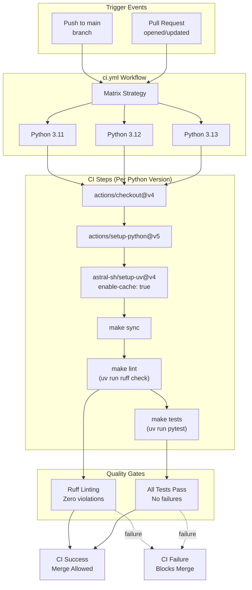
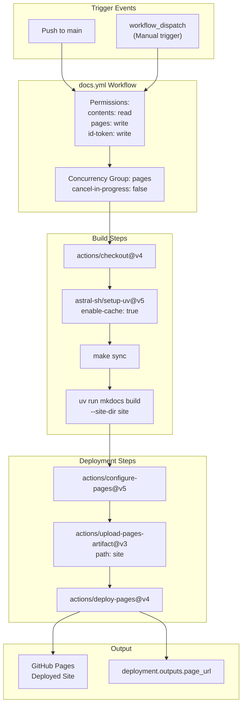
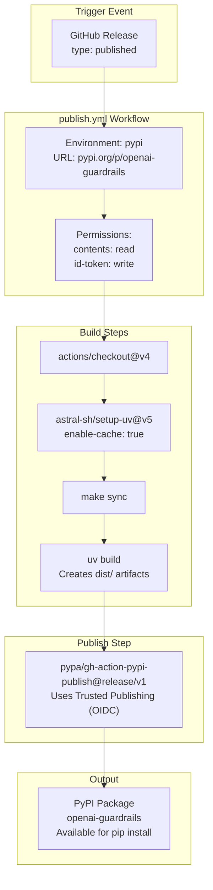
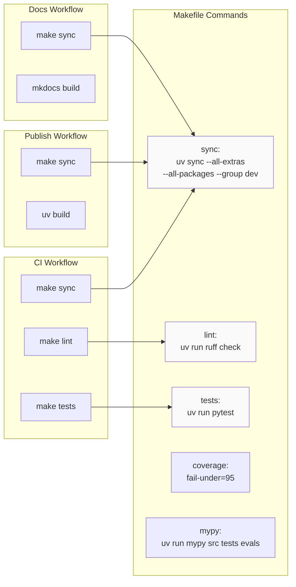
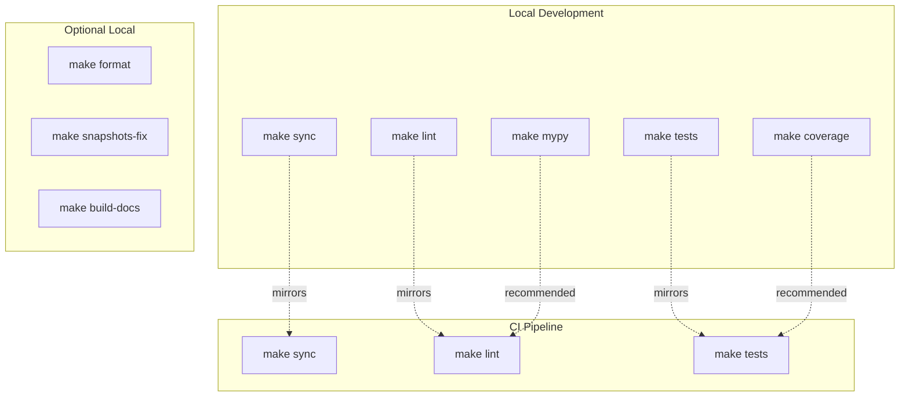

<!-- source: DeepWiki mcp.deepwiki.com · repo openai/openai-guardrails-python · page 8.4 CI/CD Pipeline · fetched 2026-10-26 -->

# CI/CD Pipeline

<details>
<summary>Relevant source files</summary>

The following files were used as context for generating this wiki page:

- [.github/workflows/ci.yml](.github/workflows/ci.yml)
- [.github/workflows/docs.yml](.github/workflows/docs.yml)
- [.github/workflows/publish.yml](.github/workflows/publish.yml)

</details>


## Purpose and Scope

This document describes the continuous integration and continuous delivery (CI/CD) infrastructure for the OpenAI Guardrails Python package. It covers the three GitHub Actions workflows that automate code quality checks, documentation deployment, and PyPI package publishing. For information about local development workflow and Makefile targets, see [Development Workflow](#8.2). For the release process and versioning strategy, see [Release Process](#8.6).

## Overview

The CI/CD pipeline consists of three GitHub Actions workflows located in `.github/workflows/`:

| Workflow | Trigger | Purpose | Output |
|----------|---------|---------|--------|
| `ci.yml` | Push to `main`, Pull Requests | Run linting and tests across Python 3.11, 3.12, 3.13 | Quality gate for all code changes |
| `docs.yml` | Push to `main`, Manual dispatch | Build and deploy documentation | GitHub Pages site at project URL |
| `publish.yml` | GitHub Release published | Build and publish package to PyPI | Published package at `openai-guardrails` |

All workflows use `uv` as the dependency manager and leverage the `Makefile` targets for consistency with local development.

**Sources:** [.github/workflows/ci.yml](), [.github/workflows/docs.yml](), [.github/workflows/publish.yml](), [Makefile]()

## CI Workflow Architecture



### CI Workflow (ci.yml)

The CI workflow runs on every push to `main` and on all pull requests to ensure code quality before merging.

**Trigger Configuration:** [.github/workflows/ci.yml:3-6]()

**Matrix Strategy:**
The workflow uses a matrix strategy to test across three Python versions simultaneously, ensuring compatibility:
- Python 3.11
- Python 3.12
- Python 3.13

[.github/workflows/ci.yml:11-13]()

**Job Steps:**

1. **Checkout:** Uses `actions/checkout@v4` to clone the repository [.github/workflows/ci.yml:15-16]()

2. **Python Setup:** Uses `actions/setup-python@v5` with the matrix Python version [.github/workflows/ci.yml:18-21]()

3. **UV Setup:** Configures `uv` with caching enabled for `uv.lock` and `pyproject.toml` [.github/workflows/ci.yml:23-29]()

4. **Dependency Installation:** Runs `make sync` which executes `uv sync --all-extras --all-packages --group dev` [.github/workflows/ci.yml:31-32](), [Makefile:2-3]()

5. **Linting:** Runs `make lint` which executes `uv run ruff check` [.github/workflows/ci.yml:34-35](), [Makefile:11-12]()

6. **Testing:** Runs `make tests` which executes `uv run pytest` [.github/workflows/ci.yml:37-38](), [Makefile:21-22]()

**Caching Strategy:**
The workflow enables UV caching with dependency glob patterns to speed up subsequent runs. Cache invalidation occurs when `uv.lock` or `pyproject.toml` changes [.github/workflows/ci.yml:26-29]().

**Sources:** [.github/workflows/ci.yml](), [Makefile:2-3](), [Makefile:11-12](), [Makefile:21-22]()

## Documentation Deployment Workflow



### Documentation Workflow (docs.yml)

The documentation workflow automatically builds and deploys the MkDocs documentation site to GitHub Pages whenever changes are pushed to the `main` branch.

**Trigger Configuration:** [.github/workflows/docs.yml:3-6]()

**Permissions:**
The workflow requires specific permissions for GitHub Pages deployment:
- `contents: read` - Read repository contents
- `pages: write` - Write to GitHub Pages
- `id-token: write` - Required for OIDC authentication

[.github/workflows/docs.yml:8-11]()

**Concurrency Control:**
Uses a concurrency group named `"pages"` with `cancel-in-progress: false` to prevent simultaneous deployments that could conflict [.github/workflows/docs.yml:13-15]().

**Environment:**
The job runs in the `github-pages` environment and outputs the deployed page URL [.github/workflows/docs.yml:20-22]().

**Job Steps:**

1. **Checkout:** Clone the repository [.github/workflows/docs.yml:24-25]()

2. **UV Setup:** Configure `uv` with caching [.github/workflows/docs.yml:26-29]()

3. **Install Dependencies:** Run `make sync` [.github/workflows/docs.yml:30-31]()

4. **Build Documentation:** Execute `uv run mkdocs build --site-dir site` to generate static site in `site/` directory [.github/workflows/docs.yml:32-33]()

5. **Configure Pages:** Set up GitHub Pages configuration [.github/workflows/docs.yml:34-35]()

6. **Upload Artifact:** Upload the `site/` directory as a Pages artifact [.github/workflows/docs.yml:36-39]()

7. **Deploy:** Deploy the artifact to GitHub Pages [.github/workflows/docs.yml:40-42]()

**Note:** The workflow uses `mkdocs build` directly rather than `make build-docs` to specify the `--site-dir site` output directory explicitly [.github/workflows/docs.yml:33]().

**Sources:** [.github/workflows/docs.yml](), [Makefile:39-41]()

## PyPI Publishing Workflow



### Publishing Workflow (publish.yml)

The publishing workflow is triggered when a GitHub Release is published, automatically building and uploading the package to PyPI.

**Trigger Configuration:** [.github/workflows/publish.yml:3-6]()

**Environment Configuration:**
- Environment name: `pypi`
- URL: `https://pypi.org/p/openai-guardrails`

[.github/workflows/publish.yml:13-15]()

**Permissions:**
The workflow uses **Trusted Publishing** (OIDC) which requires:
- `contents: read` - Read repository contents
- `id-token: write` - Generate OIDC tokens for authentication with PyPI

[.github/workflows/publish.yml:8-9](), [.github/workflows/publish.yml:16-17]()

**Job Steps:**

1. **Checkout:** Clone the repository [.github/workflows/publish.yml:21-22]()

2. **UV Setup:** Configure `uv` with caching [.github/workflows/publish.yml:23-26]()

3. **Install Dependencies:** Run `make sync` [.github/workflows/publish.yml:27-28]()

4. **Build Package:** Execute `uv build` to create distribution artifacts (`.tar.gz` and `.whl` files) in the `dist/` directory [.github/workflows/publish.yml:29-30]()

5. **Publish to PyPI:** Use `pypa/gh-action-pypi-publish@release/v1` to upload the package using Trusted Publishing [.github/workflows/publish.yml:31-32]()

**Trusted Publishing:**
This workflow uses PyPI's Trusted Publishing feature, which leverages OIDC tokens instead of requiring API tokens. This is a more secure approach as no long-lived credentials are stored in the repository. The `id-token: write` permission allows GitHub to generate short-lived OIDC tokens that PyPI validates [.github/workflows/publish.yml:17]().

**Sources:** [.github/workflows/publish.yml]()

## Makefile Integration



All three workflows leverage the `Makefile` to ensure consistency between CI and local development environments. Key targets used:

| Target | Command | Used In |
|--------|---------|---------|
| `make sync` | `uv sync --all-extras --all-packages --group dev` | All three workflows |
| `make lint` | `uv run ruff check` | CI workflow |
| `make tests` | `uv run pytest` | CI workflow |

The `Makefile` also includes additional targets that are not currently used in CI but are available for local development:

| Target | Command | Coverage Requirement |
|--------|---------|---------------------|
| `make coverage` | `uv run coverage run/report` | 95% threshold |
| `make mypy` | `uv run mypy src tests evals` | Type checking |

[Makefile:24-29]() shows the coverage target requires 95% code coverage via `--fail-under=95`.

**Sources:** [Makefile](), [.github/workflows/ci.yml:31-32](), [.github/workflows/ci.yml:34-35](), [.github/workflows/ci.yml:37-38](), [.github/workflows/docs.yml:30-31](), [.github/workflows/publish.yml:27-28]()

## Dependency Caching Strategy

All workflows use `astral-sh/setup-uv` with caching enabled to speed up dependency installation:

```yaml
- name: Setup uv
  uses: astral-sh/setup-uv@v4
  with:
    enable-cache: true
```

The CI workflow additionally specifies cache invalidation patterns:

```yaml
cache-dependency-glob: |
  uv.lock
  pyproject.toml
```

This ensures the cache is invalidated whenever dependencies change, while reusing cached dependencies for unchanged lock files.

**Sources:** [.github/workflows/ci.yml:23-29](), [.github/workflows/docs.yml:26-29](), [.github/workflows/publish.yml:23-26]()

## Workflow Comparison

| Aspect | ci.yml | docs.yml | publish.yml |
|--------|--------|----------|-------------|
| **Trigger** | Push to `main`, PRs | Push to `main`, Manual | GitHub Release published |
| **Python Matrix** | 3.11, 3.12, 3.13 | Default (3.x) | Default (3.x) |
| **UV Version** | v4 | v5 | v5 |
| **Build Step** | pytest tests | mkdocs build | uv build |
| **Output** | CI status checks | GitHub Pages site | PyPI package |
| **Permissions** | Default | pages: write, id-token: write | id-token: write |
| **Environment** | None | github-pages | pypi |
| **Concurrency** | Not configured | Group: pages | Not configured |

**Sources:** [.github/workflows/ci.yml](), [.github/workflows/docs.yml](), [.github/workflows/publish.yml]()

## Quality Gates

The CI workflow enforces the following quality gates that must pass before code can be merged:

1. **Linting:** Code must pass `ruff check` with zero violations [.github/workflows/ci.yml:34-35]()
2. **Testing:** All pytest tests must pass across Python 3.11, 3.12, and 3.13 [.github/workflows/ci.yml:37-38]()
3. **Multi-version Compatibility:** Code must work on all three supported Python versions

While not enforced in CI, local development includes additional quality checks:
- **Type Checking:** `make mypy` runs mypy on `src/`, `tests/`, and `evals/` [Makefile:14-18]()
- **Coverage:** `make coverage` enforces 95% code coverage threshold [Makefile:24-29]()

**Sources:** [.github/workflows/ci.yml](), [Makefile:14-29]()

## Integration with Development Workflow

The CI/CD pipeline is designed to mirror local development commands:



Developers can run the same commands locally that CI will execute, ensuring no surprises:

1. Before committing: `make lint` and `make tests`
2. Before pushing: `make mypy` and `make coverage`
3. For formatting: `make format` (auto-fixes issues)

This consistency reduces CI failures and improves development velocity.

**Sources:** [Makefile](), [.github/workflows/ci.yml]()

## Concurrency and Resource Management

### Documentation Workflow
The docs workflow uses explicit concurrency control:
- **Group:** `"pages"`
- **Cancel in Progress:** `false`

This prevents race conditions when multiple documentation builds are triggered in quick succession, ensuring only one deployment occurs at a time while queuing subsequent builds [.github/workflows/docs.yml:13-15]().

### CI Workflow
The CI workflow does not configure explicit concurrency, allowing multiple builds to run in parallel for different PRs or branches. The matrix strategy creates three parallel jobs per trigger event.

### Publish Workflow
The publish workflow runs only on release events and does not configure concurrency, as releases are typically infrequent and sequential.

**Sources:** [.github/workflows/docs.yml:13-15]()

## Error Handling and Debugging

When workflows fail, investigate in this order:

1. **Dependency Issues:** Check if `uv.lock` or `pyproject.toml` changes caused conflicts
2. **Cache Problems:** Review cache invalidation in UV setup steps
3. **Linting Failures:** Run `make lint` locally to reproduce
4. **Test Failures:** Run `make tests` locally with verbose output: `uv run pytest -vv`
5. **Build Issues:** For docs, run `make build-docs`; for publish, run `uv build` locally

All workflows use the same `make` targets as local development, making issues reproducible locally.

**Sources:** [.github/workflows/ci.yml](), [.github/workflows/docs.yml](), [.github/workflows/publish.yml](), [Makefile]()

---

