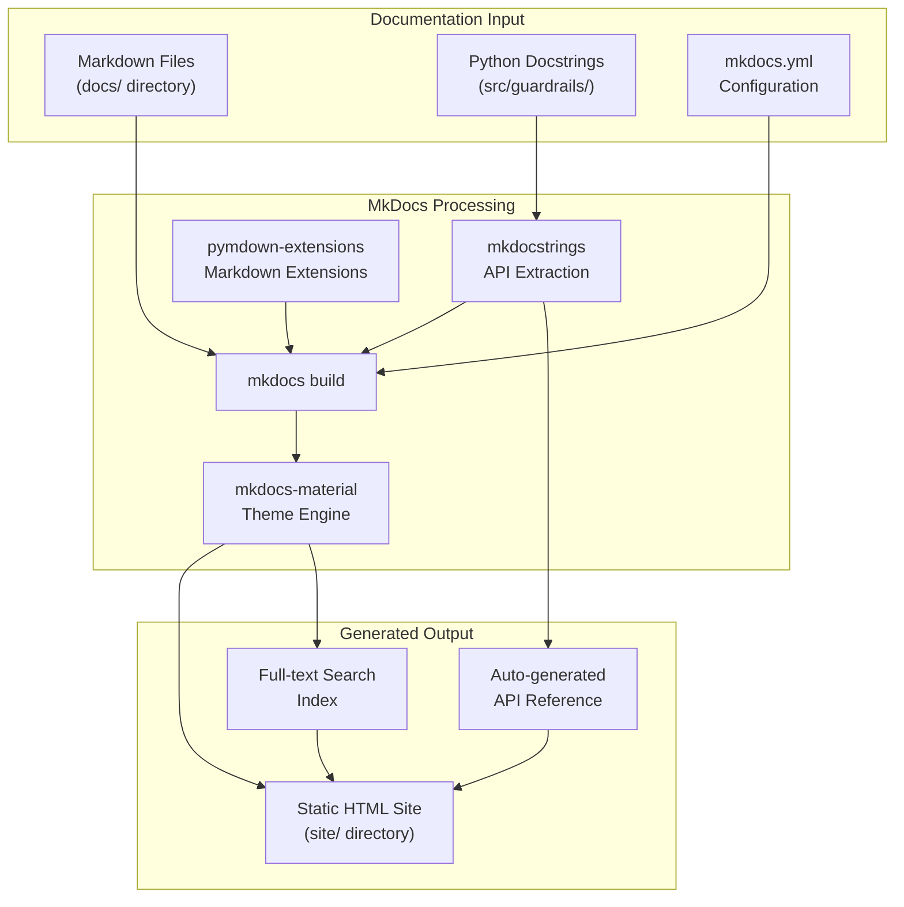
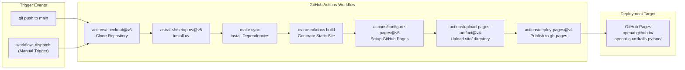
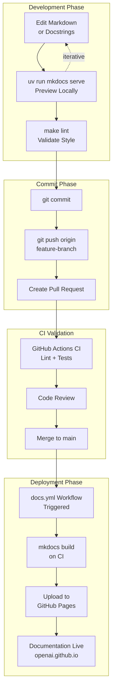

<!-- source: DeepWiki mcp.deepwiki.com · repo openai/openai-guardrails-python · page 8.5 Documentation · fetched 2026-10-26 -->

# Documentation

<details>
<summary>Relevant source files</summary>

The following files were used as context for generating this wiki page:

- [.github/workflows/ci.yml](.github/workflows/ci.yml)
- [.github/workflows/docs.yml](.github/workflows/docs.yml)
- [.github/workflows/publish.yml](.github/workflows/publish.yml)
- [pyproject.toml](pyproject.toml)
- [src/guardrails/__init__.py](src/guardrails/__init__.py)

</details>


This page describes the documentation system for the OpenAI Guardrails Python package, including the technology stack, local development workflow, and automated deployment pipeline. For information about the CI/CD pipeline that runs tests and linting, see [CI/CD Pipeline](#8.4). For the overall project structure, see [Project Structure](#8.1).

## Purpose and Scope

The documentation system generates and deploys the project's public documentation site hosted at [https://openai.github.io/openai-guardrails-python/](https://openai.github.io/openai-guardrails-python/). This page covers:

- The MkDocs-based documentation stack and its extensions
- Local documentation building and preview workflow
- Automated deployment via GitHub Actions
- Documentation structure and organization
- Contributing guidelines for documentation updates

---

## Documentation Technology Stack

The project uses **MkDocs** with the **Material** theme to generate static documentation from Markdown source files. The documentation stack includes several specialized extensions for enhanced functionality.

### Core Dependencies

The documentation tooling is defined in the `dev` dependency group:

| Package | Version | Purpose |
|---------|---------|---------|
| `mkdocs` | >=1.6.1 | Core static site generator |
| `mkdocs-material` | >=9.6.14 | Material Design theme with navigation and search |
| `mkdocstrings[python]` | >=0.29.1 | Automatic API reference generation from docstrings |
| `mkdocs-static-i18n` | >=1.3.0 | Internationalization support for multi-language docs |
| `pymdown-extensions` | >=10.0.0 | Extended Markdown syntax (admonitions, code blocks, etc.) |

**Sources:** [pyproject.toml:55-59]()

### Key Features



**Material Theme** provides:
- Responsive navigation with collapsible sections
- Built-in search functionality
- Code syntax highlighting with theme support
- Mobile-friendly responsive design
- Dark/light mode toggle

**mkdocstrings** enables:
- Automatic extraction of API documentation from Python docstrings
- Type annotation rendering
- Cross-referencing between documentation and code
- Google-style docstring parsing (configured via `ruff.lint.pydocstyle`)

**pymdown-extensions** adds:
- Admonitions (note, warning, tip boxes)
- Enhanced code block syntax with line numbers
- Tabbed content sections
- Task lists and definition lists
- Inline code highlighting

**Sources:** [pyproject.toml:47-63]()

---

## Building Documentation Locally

### Prerequisites

Ensure the development environment is set up with all dependencies:

```bash
# Install project with dev dependencies
make sync

# Or manually with uv
uv sync --group dev
```

This installs all packages defined in the `dev` dependency group, including the MkDocs stack.

**Sources:** [pyproject.toml:47-63]()

### Build Commands

#### Serve with Live Reload

For active documentation development, use MkDocs' built-in development server with hot reload:

```bash
uv run mkdocs serve
```

This command:
1. Builds the documentation
2. Starts a local web server (typically at `http://127.0.0.1:8000`)
3. Watches for file changes and automatically rebuilds
4. Refreshes the browser when changes are detected

The development server is ideal for iterative documentation writing, allowing you to see changes immediately.

#### Build Static Site

To generate the static HTML output without serving:

```bash
uv run mkdocs build --site-dir site
```

This produces the complete static site in the `site/` directory, which mirrors the production deployment structure.

**Command Options:**
- `--site-dir site`: Specifies output directory (matches CI/CD configuration)
- `--strict`: Treats warnings as errors (useful for CI validation)
- `--clean`: Removes previous build artifacts before building

**Sources:** [.github/workflows/docs.yml:33]()

### Documentation Structure

The MkDocs configuration defines the documentation hierarchy, source locations, and theme settings. While the `mkdocs.yml` file is not included in the provided files, the typical structure follows:

```
project-root/
├── docs/                    # Markdown source files
│   ├── index.md            # Homepage
│   ├── getting-started/    # Tutorial content
│   ├── guides/             # How-to guides
│   ├── reference/          # API reference (auto-generated)
│   └── examples/           # Usage examples
├── mkdocs.yml              # MkDocs configuration
├── site/                   # Generated static site (gitignored)
└── src/guardrails/         # Source code with docstrings
```

The `mkdocstrings` plugin automatically generates API reference pages from the Python source code in `src/guardrails/`, extracting:
- Module docstrings
- Class definitions and docstrings
- Function signatures and docstrings
- Type annotations

This ensures the API reference stays synchronized with the codebase without manual updates.

**Sources:** [pyproject.toml:76](), [src/guardrails/__init__.py:1-9]()

---

## Automated Deployment Pipeline

Documentation is automatically built and deployed to GitHub Pages on every push to the `main` branch.

### Deployment Workflow



**Workflow Configuration:**

The deployment workflow is defined in `.github/workflows/docs.yml`:

| Configuration | Value | Purpose |
|--------------|-------|---------|
| **Trigger** | `push: branches: [main]` | Auto-deploy on main branch updates |
| **Manual Trigger** | `workflow_dispatch` | Allow manual deployment |
| **Permissions** | `contents: read, pages: write, id-token: write` | Required for GitHub Pages deployment |
| **Concurrency** | `group: "pages"` | Prevents concurrent deployments |
| **Environment** | `github-pages` | Deployment environment with URL |

**Sources:** [.github/workflows/docs.yml:1-42]()

### Deployment Steps

1. **Repository Checkout**: Clones the repository at the current commit
   ```yaml
   - uses: actions/checkout@v6
   ```

2. **Setup uv**: Installs the `uv` package manager with caching enabled
   ```yaml
   - uses: astral-sh/setup-uv@v5
     with:
       enable-cache: true
   ```

3. **Install Dependencies**: Synchronizes project dependencies
   ```bash
   make sync
   ```

4. **Build Documentation**: Generates static site in `site/` directory
   ```bash
   uv run mkdocs build --site-dir site
   ```

5. **Upload Artifact**: Packages the `site/` directory for Pages deployment
   ```yaml
   - uses: actions/upload-pages-artifact@v4
     with:
       path: site
   ```

6. **Deploy to Pages**: Publishes the artifact to GitHub Pages
   ```yaml
   - uses: actions/deploy-pages@v4
   ```

The deployed site becomes available at the URL specified in `pyproject.toml`:
```toml
[project.urls]
Homepage = "https://openai.github.io/openai-guardrails-python/"
```

**Sources:** [.github/workflows/docs.yml:24-42](), [pyproject.toml:30-32]()

### Concurrency Control

The workflow uses concurrency control to prevent deployment conflicts:

```yaml
concurrency:
  group: "pages"
  cancel-in-progress: false
```

This ensures:
- Only one deployment runs at a time
- Queued deployments wait for completion rather than canceling
- No race conditions between rapid successive commits

**Sources:** [.github/workflows/docs.yml:13-15]()

---

## Documentation Style and Conventions

### Docstring Format

The project uses **Google-style docstrings** as configured in `pyproject.toml`:

```toml
[tool.ruff.lint.pydocstyle]
convention = "google"
```

Example structure from the public API surface:

```python
"""Guardrails public API surface.

This package exposes utilities to define and run guardrails which validate
arbitrary data. The submodules provide runtime helpers, exception
types and a registry of built-in checks.

Modules within :mod:`guardrails` are imported lazily to keep the import surface
small when only a few utilities are needed.
"""
```

**Google-style sections:**
- Summary line (one-liner)
- Extended description (optional)
- `Args:` - Function parameters
- `Returns:` - Return value description
- `Raises:` - Exception types thrown
- `Example:` - Usage examples

**Sources:** [pyproject.toml:99-100](), [src/guardrails/__init__.py:1-9]()

### Code Quality Integration

Documentation quality is enforced through the linting pipeline:

```bash
make lint  # Runs ruff with pydocstyle checks
```

The `ruff` linter includes docstring linting via the `D` rule set:

```toml
[tool.ruff.lint]
select = [
  "E",  # pycodestyle errors
  "W",  # pycodestyle warnings
  "F",  # pyflakes
  "I",  # isort
  "B",  # flake8-bugbear
  "C4", # flake8-comprehensions
  "UP", # pyupgrade
  "D",  # pydocstyle
]
```

Certain files are exempt from docstring requirements:
```toml
[tool.ruff.lint.extend-per-file-ignores]
"tests/**" = ["E501", "D100", "D103", "D104"]
"examples/**" = ["D100", "D103", "D104"]
```

**Sources:** [pyproject.toml:86-104]()

---

## Contributing to Documentation

### Adding New Pages

1. Create Markdown files in the appropriate `docs/` subdirectory
2. Update `mkdocs.yml` navigation structure (if adding top-level sections)
3. Use relative links for cross-references between pages
4. Preview changes with `uv run mkdocs serve`

### Updating API Documentation

API reference pages are auto-generated from docstrings. To update them:

1. Modify docstrings in source code files
2. Ensure Google-style format compliance
3. Run `make lint` to validate docstring format
4. Preview with `mkdocs serve` to verify rendering

### Testing Documentation Changes

Before pushing documentation changes:

```bash
# 1. Lint code including docstrings
make lint

# 2. Build docs to catch any errors
uv run mkdocs build --site-dir site --strict

# 3. Serve locally and verify rendering
uv run mkdocs serve
```

The `--strict` flag treats warnings as errors, catching issues like:
- Broken internal links
- Missing referenced sections
- Invalid Markdown syntax
- Broken docstring references

### Deployment Timeline

Once changes are merged to `main`:
1. GitHub Actions triggers the docs workflow automatically
2. Build completes in approximately 1-2 minutes
3. GitHub Pages deployment takes an additional 1-2 minutes
4. Total time from merge to live: ~3-5 minutes

Monitor deployment status at: `https://github.com/openai/openai-guardrails-python/actions/workflows/docs.yml`

**Sources:** [.github/workflows/docs.yml:1-42]()

---

## Documentation Workflow Summary



**Key Points:**
- Documentation changes follow the same PR workflow as code changes
- CI validates both code quality and documentation building
- Deployment is fully automated on merge to `main`
- No manual deployment steps required
- Documentation stays synchronized with code via auto-generated API reference

**Sources:** [.github/workflows/docs.yml:1-42](), [.github/workflows/ci.yml:1-39]()

---

